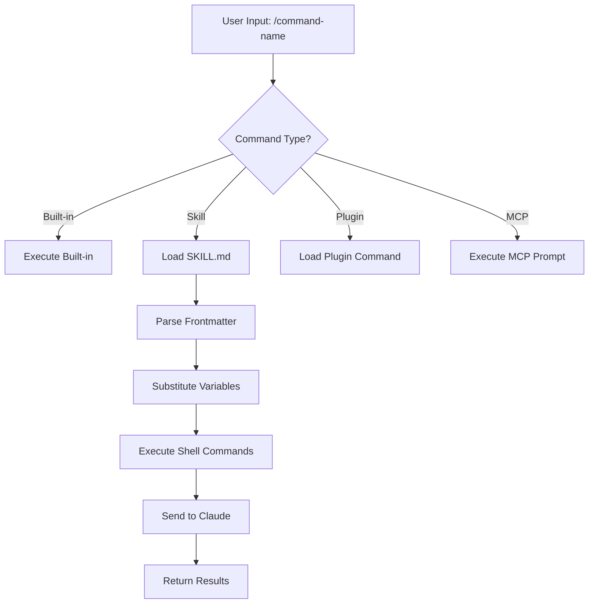
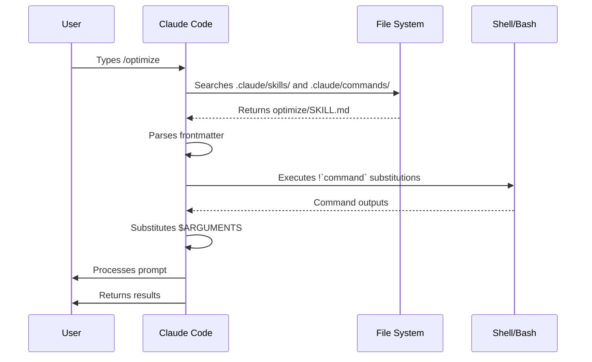

<!-- i18n-source: 01-slash-commands/README.md -->
<!-- i18n-source-sha: ba721a3 -->
<!-- i18n-date: 2026-10-29 -->

<picture>
  <source media="(prefers-color-scheme: dark)" srcset="../../resources/logos/claude-howto-logo-dark.svg">
  
</picture>

# 슬래시 명령

## 개요

슬래시 명령은 대화형 세션에서 Claude의 동작을 제어하는 단축 명령입니다. 여러 종류가 있습니다.

- **내장 명령**: Claude Code가 제공하는 명령 (`/help`, `/clear`, `/model`)
- **스킬**: 사용자가 `SKILL.md` 파일로 직접 만든 명령 (`/optimize`, `/pr`)
- **플러그인 명령**: 설치한 플러그인이 제공하는 명령 (`/frontend-design:frontend-design`)
- **MCP 프롬프트**: MCP 서버가 제공하는 명령 (`/mcp__github__list_prs`)

> **참고**: 맞춤 슬래시 명령은 스킬로 통합되었습니다. `.claude/commands/`의 파일도 여전히 작동하지만, 이제는 스킬(`.claude/skills/`)이 권장 방식입니다. 둘 다 `/command-name` 형태의 단축 명령을 만듭니다. 전체 레퍼런스는 [스킬 가이드](../03-skills/)를 참고하세요.

## 내장 명령 레퍼런스

내장 명령은 자주 하는 작업을 위한 단축 명령입니다. **60개 이상의 내장 명령**과 **약 20개의 번들 스킬**(일부는 기능 플래그로 제한됨)을 쓸 수 있습니다. Claude Code에서 `/`를 입력하면 전체 목록이 나오고, `/` 뒤에 글자를 이어 입력하면 목록이 걸러집니다.

> **참고**: v2.1.236부터 슬래시 명령을 잘못 입력했거나 현재 세션에서 쓸 수 없는 명령에서 Enter를 누르면, 유사한 명령어를 임의로 실행하지 않고 오류를 표시합니다. 모호하지 않은 접두사와 정의된 별칭은 예전처럼 실행됩니다.

| 명령 | 용도 |
|------|------|
| `/add-dir <path>` | 작업 디렉터리 추가 |
| `/advisor [model\|off]` | 어드바이저 설정. 대화 상자로 열립니다. 데스크톱 앱, Remote Control, 헤드리스(`-p` / Agent SDK) 세션에서는 대신 텍스트 형식을 받습니다. `/advisor`, `/advisor <model>`, `/advisor off` (v2.1.260+) |
| `/agents` | 더 이상 작동하지 않는 명령입니다. 대화형 마법사는 v2.1.198에서 제거되었고, v2.1.281부터는 `/` 메뉴와 `/help`에도 나타나지 않습니다. 입력하면 마법사가 어디로 옮겨졌는지만 설명합니다. 서브에이전트를 만들거나 관리하려면 Claude에게 요청하거나 `.claude/agents/` 파일을 직접 편집하세요 |
| `/artifacts` | 내가 소유했거나 나에게 공유된 아티팩트를 나열하고, 하나를 골라 세션에 첨부하거나 브라우저에서 열거나 링크를 복사합니다 (v2.1.208+). `d`로 삭제하면 확인을 묻습니다: 1 또는 Enter는 유지, 2는 삭제, Esc는 취소 (v2.1.305) |
| `/auto-mode-setup` | 프로젝트와 최근 세션을 바탕으로 `autoMode.environment` 항목 초안을 만들고, 검토한 뒤 사용자 설정에 저장합니다. Pro/Max/Team: v2.1.228+ (네이티브 Windows는 v2.1.233+); Enterprise 또는 Console API 키: v2.1.283+. v2.1.304부터 Bedrock, Vertex, Foundry, Claude 앱 게이트웨이, 텔레메트리를 끈 세션에서도 쓸 수 있습니다 |
| `/branch [name]` | 이 시점의 대화 복사본으로 전환하고 원래 대화는 보존합니다 (`/resume`으로 돌아갈 수 있음) |
| `/fork [prompt]` | 현재 대화를 새 **백그라운드 세션**으로 복사하고 여기서는 계속 작업합니다. 그 시점부터 두 세션은 서로 독립적이며, 복사본은 `claude agents`에 따로 한 줄로 표시됩니다 (v2.1.212+). 복사본이 제자리에서 편집하는 경우가 아니라면, Claude Code는 코드를 바꾸기 전에 자체 워크트리를 만들도록 지시합니다 (격리 지시는 v2.1.221+ 필요) |
| `/subtask <task>` | 전체 대화를 물려받는 **포크된 서브에이전트**를 띄워, 내가 계속 작업하는 동안 그 작업을 처리하게 합니다. 끝나면 결과가 이 대화로 돌아옵니다 (v2.1.212+) |
| `/btw [question]` | Claude가 주 작업을 하는 동안 일회성 곁가지 질문을 합니다. 주 대화의 컨텍스트를 어지럽히지 않습니다. 인수 없는 `/btw`는 마지막 곁가지 질문을 다시 엽니다 (v2.1.212+) |
| `/cd <path>` | 프롬프트 캐시를 깨뜨리지 않고 세션을 새 작업 디렉터리로 옮깁니다 (v2.1.169에서 추가) |
| `/chrome` | Chrome 브라우저 연동 설정 |
| `/clear` | 대화 지우기 (별칭: `/reset`, `/new`) |
| `/color [color\|default]` | 프롬프트 바 색 설정. 인수 없는 `/color`는 무작위 세션 색을 고릅니다 (v2.1.128+). 색 이름이나 16진수 값을 넘기면 그 색으로 설정합니다. |
| `/compact [instructions]` | 대화를 압축합니다. 무엇에 집중할지 지시를 덧붙일 수 있습니다. 압축에 실패하면 이제 아무 일 없이 넘어가지 않고 UI에 오류로 표시됩니다 (v2.1.216) |
| `/config` | 설정 열기 (별칭: `/settings`) |
| `/context` | 컨텍스트 사용량을 색깔 격자로 보여 줍니다. 사용량이 컨텍스트 윈도 한도를 넘으면 명확한 경고를 표시합니다 (v2.1.216) |
| `/copy [N]` | 어시스턴트 응답을 클립보드에 복사합니다. `w`를 누르면 파일로 씁니다 |
| `/cost` | `/usage`의 입력용 단축 별칭으로, 비용 탭을 엽니다 (v2.1.118+) |
| `/desktop` | 데스크톱 앱에서 이어서 하기 (별칭: `/app`) |
| `/diff` | 커밋하지 않은 변경 사항을 보는 대화형 diff 뷰어. 전체 화면 렌더링에서는 대신 대화 옆에 diff 패널을 열어 계속 작업하는 동안 띄워 둡니다. 패널은 바뀐 파일과 추가/삭제된 줄 수를 보여 주고, Claude가 파일을 편집하거나 셸 명령을 실행할 때마다 새로 고칩니다. `/diff`를 다시 실행하거나 `✕`를 누르면 닫힙니다 (v2.1.260+). 기존 렌더러에서는 프롬프트 자리에 뷰어가 열립니다 |
| `/doctor` | 설치 상태 진단. Claude가 응답하는 중에도 열 수 있습니다. 번들 스킬이라서 Claude가 설정을 점검하고 수정안을 제안한 뒤, 확인하면 적용합니다 (`claude doctor`는 읽기 전용 진단만 실행). Pro, Max, Team, Enterprise 요금제에서는 `/usage`가 권장하는 변경도 함께 제안합니다 (v2.1.305; Remote Control이 연결된 동안에는 건너뜀). `/doctor prompt-audit` (또는 `/checkup prompt-audit`)는 CLAUDE.md 파일, 스킬, 에이전트, 명령에 예전 모델용으로 쓰인 프롬프트 패턴이 있는지 감사합니다 (v2.1.283) |
| `/effort [low\|medium\|high\|xhigh\|max\|auto\|ultracode [on\|off]]` | 화살표 키 슬라이더로 노력 수준을 설정합니다. 수준: `low` → `medium` → `high` → `xhigh` (v2.1.111에서 추가) → `max`. 기본값은 Opus 5.5 (v2.1.280부터 기본 모델), Sonnet 5.5, Haiku 5.5에서 `medium`, Opus 5, Sonnet 5, Opus 4.8에서 `high`, Opus 4.7에서 `xhigh`입니다. `xhigh`는 Fable 5.1, Fable 5, Opus 5.5, Sonnet 5.5, Haiku 5.5, Opus 5, Sonnet 5, Opus 4.8, Opus 4.7에서만 쓸 수 있고, `max`는 Fable 5.1, Fable 5, Opus 5.5, Sonnet 5.5, Haiku 5.5, Opus 5, Sonnet 5, Opus 4.8/4.7/4.6, Sonnet 4.6에서 작동합니다. `/effort`가 모델별 설정이 되기 전에 저장한 수준은 Opus 5.5 같은 새로 나온 모델에는 적용되지 않습니다 (v2.1.280). 슬라이더에는 **Ultracode** 토글도 있습니다 (Tab, 또는 `/effort ultracode [on\|off]`). 이것은 모델 노력 수준이 아니라, 세션의 노력 수준이 무엇이든 Claude가 동적 워크플로를 조율하게 하는 기능입니다. v2.1.284부터는 `xhigh`를 강제하지 않으며 수준을 바꿔도 켜진 채로 유지됩니다. `/effort ultracode`는 세션 동안 유지되고, `ultracode` 설정을 쓰면 계속 유지됩니다 |
| `/exit` | REPL 종료 (별칭: `/quit`) |
| `/export [filename]` | 현재 대화를 파일이나 클립보드로 내보내기 |
| `/usage-credits` | 사용 한도를 넘었을 때 쓸 추가 사용량 설정 (v2.1.144에서 `/extra-usage`에서 이름이 바뀜; `/extra-usage`도 별칭으로 계속 작동) |
| `/fast [on\|off]` | 빠른 모드 켜고 끄기. Opus 5.5 (v2.1.280부터 빠른 모드 기본값), Opus 5, Opus 4.8에 적용됩니다 |
| `/feedback` | 피드백 보내기. v2.1.141부터 최근 세션(지난 24시간 또는 7일)을 첨부할 수 있어, 여러 세션에 걸친 문제를 신고할 때 맥락을 함께 보낼 수 있습니다. v2.1.178부터 `/bug`는 설명을 적어야 제출할 수 있습니다. |
| `/focus` | 포커스 보기 켜고 끄기 (v2.1.110에서 추가; 포커스 전환용 `Ctrl+O`를 대체) |
| `/goal <statement>` | 세션 단위 완료 조건을 등록합니다. 목표를 달성할 때까지 Claude가 계속 작업합니다. `/goal clear`로 지웁니다. 활성 목표는 상태 줄에 표시되고, 경과 시간, 턴 수, 토큰 사용량을 실시간으로 보여 주는 오버레이 패널이 뜹니다 (v2.1.139에서 추가). |
| `/help` | 도움말 표시 |
| `/hooks` | 훅 설정 보기 |
| `/ide` | IDE 연동 관리 |
| `/init` | `CLAUDE.md` 초기화. 대화형 흐름을 쓰려면 `CLAUDE_CODE_NEW_INIT=1`을 설정합니다 |
| `/insights` | 세션 분석 보고서 생성 |
| `/install-github-app` | GitHub Actions 앱 설정 |
| `/install-slack-app` | Slack 앱 설치 |
| `/keybindings` | 키 바인딩 설정 열기 |
| `/fewer-permission-prompts` | 최근 Bash/MCP 도구 호출을 분석해 우선순위를 매긴 허용 목록을 `.claude/settings.json`에 추가하고, 권한 확인 창을 줄입니다 (v2.1.111에서 추가) |
| `/login` | Anthropic 계정 전환 |
| `/logout` | Anthropic 계정에서 로그아웃 |
| `/mcp` | MCP 서버와 OAuth 관리 |
| `/memory` | `CLAUDE.md` 편집, 자동 메모리 켜고 끄기 |
| `/mobile` | 모바일 앱용 QR 코드 (별칭: `/ios`, `/android`) |
| `/model [model]` | 모델을 고르고, 왼쪽/오른쪽 화살표로 노력 수준을 정합니다. v2.1.153부터 선택이 새 세션의 **기본값으로 저장**됩니다 (IDE와 동일). 현재 세션에만 적용하려면 고른 뒤 `s`를 누릅니다. (키 바인딩 `modelPicker:setAsDefault`는 `modelPicker:thisSessionOnly`로 이름이 바뀌었고, 예전 `d` 동작은 이제 `s`입니다.) v2.1.219부터 선택기는 통합된 Opus 줄을 "Opus (1M context)"로 표시했는데, v2.1.283에서는 Opus가 이미 1M 윈도를 가진 Opus 줄과 Default 줄에서 이 표시를 뺐습니다 (윈도 크기는 그대로) |
| `/output-style [name]` | 출력 스타일을 나열하고 전환합니다 (v2.1.91에서 제거되었다가 v2.1.269에서 다시 추가됨). 인수가 없으면 스타일 목록을 보여 주고 현재 스타일을 표시합니다. 헤드리스와 Remote Control 세션에서도 작동하며, 선택은 `.claude/settings.local.json`에 저장됩니다 |
| `/passes` | Claude Code 무료 1주 이용권 공유 |
| `/permissions` | 권한 보기/수정 (별칭: `/allowed-tools`) |
| `/plan [description]` | 계획 모드로 들어가기 |
| `/plugin` | 플러그인 관리 |
| `/proactive` | `/loop`의 별칭 (v2.1.105에서 추가) |
| `/powerup` | 애니메이션 데모가 담긴 대화형 레슨으로 기능 알아보기 |
| `/privacy-settings` | 개인정보 설정 (Pro/Max 전용) |
| `/release-notes` | 변경 이력 보기 |
| `/recap` | 세션으로 돌아왔을 때 세션 요약 보기 (v2.1.108에서 추가) |
| `/reload-plugins` | 활성 플러그인 다시 불러오기. v2.1.221부터는 대부분의 설치가 바로 활성화되므로, 설치 요약에 `Run /reload-plugins to activate.`라고 나올 때만 필요합니다. v2.1.260부터 헤드리스 세션에서도 쓸 수 있어 Claude Code Desktop과 SDK 명령 목록에도 나타납니다 |
| `/reload-skills` | 세션을 다시 시작하지 않고 스킬 디렉터리를 다시 검색합니다 (v2.1.152에서 추가). v2.1.304부터는 새로 생겼거나 바뀐 스킬만 Claude에게 보냅니다. 이제 압축할 때 스킬 목록을 알아서 다시 보내므로, 압축한 뒤에 `/reload-skills`를 실행할 필요가 없습니다 |
| `/remote-control` | claude.ai에서 원격 제어 (별칭: `/rc`) |
| `/remote-env` | 기본 원격 환경 설정 |
| `/rename [name]` | 세션 이름 바꾸기 |
| `/resume [session]` | 대화 재개 (별칭: `/continue`) |
| `/review [low\|medium\|high\|xhigh\|max\|ultra] [--fix] [--comment] [pr#\|branch\|path]` | `/code-review`의 별칭 (v2.1.223). 현재 diff를 리뷰하거나, 넘겨준 PR 번호, 브랜치, 경로를 리뷰합니다. 예: `/review 1234`. 같은 노력 수준과 플래그를 받습니다. 수준을 지정하지 않으면 마지막으로 입력한 `low`–`max` 수준을 다시 씁니다 |
| `/rewind` | 대화나 코드, 또는 둘 다 되감기 (별칭: `/checkpoint`, `/undo`) |
| `/sandbox` | 샌드박스 모드 켜고 끄기 |
| `/schedule [description]` | 클라우드 예약 작업(예전 이름: routines)을 만들고, 수정하고, 나열하고, 실행합니다. 별칭: `/routines` |
| `/scroll-speed` | 전체 화면 모드의 마우스 휠 스크롤 속도를 조정하는 대화 상자를 엽니다: ←/→로 조정, `r`로 초기화, Enter로 저장. `~/.claude/settings.json`에 저장됩니다 (v2.1.139에서 추가). |
| `/security-review` | 브랜치의 보안 취약점 분석 |
| `/skill-doctor` | 불러온 스킬 가운데 쓰이지 않는 것과 각 스킬이 컨텍스트를 얼마나 차지하는지 보여 주어, 무엇을 끌지 정할 수 있게 합니다. 보고서는 `/plugin` 관리자의 **Stats** 탭에서 열리고, 비대화형 `-p` 모드에서는 텍스트로 출력됩니다. Remote Control에서는 `Skill usage reports are not available on this connection.`이라고 답하므로, 세션을 실행 중인 컴퓨터의 터미널에서 실행하세요 (v2.1.252+ 필요) |
| `/skills` | 사용할 수 있는 스킬 나열 |
| `/stats` | `/usage`의 입력용 단축 별칭으로, 통계 탭(일별 사용량, 세션, 연속 사용일)을 엽니다 (v2.1.118+) |
| `/stickers` | Claude Code 스티커 주문 |
| `/status` | 버전, 모델, 계정, 그리고 `background job · attached`, `background job · unattended`, `interactive` 중 하나로 표시되는 `Session kind` 줄을 보여 줍니다 (이 줄은 v2.1.221에서 추가). Claude가 응답하는 중에도 열 수 있습니다 |
| `/statusline` | 상태 줄 설정 |
| `/tasks` | 백그라운드 작업 나열/관리 |
| `/team-onboarding` | 지난 30일간의 Claude Code 세션, 명령, MCP 사용 기록으로 팀원용 적응 가이드를 만듭니다. Team과 Enterprise 요금제에서는 공유 링크도 돌려줍니다 (v2.1.101에서 추가) |
| `/teleport` | 웹의 Claude Code 세션을 이 터미널에서 이어서 합니다. 웹 세션 선택기를 엽니다 (별칭: `/tp`). claude.ai 구독이 필요합니다 |
| `/terminal-setup` | 터미널 키 바인딩 설정 |
| `/theme` | 테마 선택기 열기 / 맞춤 테마 관리 (v2.1.118). 맞춤 테마는 `~/.claude/themes/<name>.json`에 JSON으로 정의합니다 |
| `/tui [default\|fullscreen]` | 터미널 UI 렌더러를 설정하고 (`fullscreen`은 깜박임 없는 렌더링) 그 렌더러로 다시 시작합니다. 인수 없는 `/tui`는 현재 렌더러를 출력합니다 (v2.1.110에서 추가) |
| `/ultrareview` | 클라우드 기반 멀티 에이전트 종합 코드 리뷰 (v2.1.111에서 추가). 이제는 `/code-review ultra`가 권장 호출 방식이고 `/ultrareview`는 별칭으로 남아 있습니다. Pro와 Max에서 무료 3회가 포함되며, 그 뒤에는 사용 크레딧이 필요합니다 |
| `/upgrade` | 상위 요금제 업그레이드 페이지 열기 |
| `/usage` | 대표 사용량 대시보드 (v2.1.118). 요금제 사용 한도, 속도 제한, 비용, 일별 세션 통계를 한곳에 모읍니다. `/cost`와 `/stats`는 특정 탭을 여는 입력용 단축 별칭입니다. max 노력 수준, 워크플로, 항상 켜져 있는 컨텍스트, 큰 도구 결과에 대해 경고합니다 (v2.1.299). v2.1.305부터 각 경고는 한 줄짜리 수정안으로 표시되며, `f`를 누르면 Claude Code가 적용할 수 있는 수정을 적용합니다 |
| `/voice` | 눌러서 말하기 음성 받아쓰기 켜고 끄기 |
| `/workflows` | 실행 중이거나 완료된 동적 워크플로 실행 보기 (v2.1.154에서 추가). [동적 워크플로](../../09-advanced-features/README.md#dynamic-workflows) 참고 |

> **`/cd`가 중요한 이유:** 예전에는 디렉터리를 바꾸면 캐시가 식어 다음 턴이 느려지고 비용도 늘었습니다. `/cd`는 디렉터리를 바꿔도 프롬프트 캐시를 유지합니다.

### 번들 스킬

이 스킬들은 Claude Code에 함께 들어 있으며, 슬래시 명령처럼 호출합니다.

| 스킬 | 용도 |
|------|------|
| `/batch <instruction>` | 워크트리를 써서 대규모 병렬 변경을 조율합니다 |
| `/claude-api` | 프로젝트 언어에 맞는 Claude API 레퍼런스를 불러옵니다. 하위 명령으로 `api-version` (코드를 더 새로운 API 버전으로 옮김, v2.1.307+)과 `managed-agents-secure` (Managed Agent의 설정 감사, v2.1.304+)가 있습니다 |
| `/dataviz` | 실행할 수 있는 색상 팔레트 검증기가 포함된 차트·대시보드 디자인 가이드 (v2.1.198) |
| `/debug [description]` | 디버그 로그 켜기 |
| `/design [description]` | **디자인 캔버스**를 만듭니다. 여러 아트보드로 된 시각 디자인(UI 목업, 화면 흐름, 랜딩 페이지, 포스터)을 아티팩트로 게시하고, 코드가 아니라 화면을 보며 다듬습니다. 레이아웃 자체를 여러 번 고쳐 가고 싶을 때 HTML을 손으로 쓰는 대신 사용하세요. v2.1.265+, 아티팩트를 쓸 수 있는 세션, Design 템플릿이 있는 계정이 필요하며 Bedrock, Vertex, Foundry, Claude Platform on AWS에서는 쓸 수 없습니다. 독립형 Claude Design (claude.ai/design)은 2026년 12월 14일에 종료됩니다. `/design consent`와 `/design revoke`는 Claude가 Claude Design에 접근하는 것을 허용하거나 철회합니다. Claude가 `/design consent`를 실행해 달라고 하면 프롬프트에 직접 입력하세요. |
| `/loop [interval] [prompt]` | 정해진 간격으로 프롬프트를 반복 실행합니다 |
| `/code-review [low\|medium\|high\|xhigh\|max\|ultra] [--fix] [--comment] [--max-findings n\|all\|default] [pr#\|branch\|path]` | 현재 diff를, 또는 넘겨준 PR 번호, 브랜치, 경로를 리뷰해 정확성 버그를 찾습니다. `--fix`를 넘기면 결과를 적용하고, `--comment`를 넘기면 GitHub PR에 인라인 댓글로 올리고, `ultra`를 넘기면 클라우드에서 심층 리뷰를 실행합니다. `github.com` PR 대상에 `ultra`를 쓰면 `--post`로 결과를 PR에 올리도록 미리 선택할 수 있습니다. 노력 수준을 지정하지 않으면 마지막으로 입력한 수준을 다시 씁니다 (v2.1.223). v2.1.147에서 `/simplify`를 흡수했지만, v2.1.154에서 `/simplify`가 별도 명령으로 돌아왔습니다. `--max-findings <n>\|all`을 넘기면 평소 한도보다 많거나 적게 보고하며, `--max-findings default`를 넘길 때까지 그 선택이 유지됩니다 (v2.1.288) |
| `/simplify` | 정리 전용 리뷰(재사용 / 단순화 / 효율 / 추상화 수준)를 실행하고 수정 사항을 적용합니다. 버그는 찾지 **않으니** 버그를 찾으려면 `/code-review`를 쓰세요. 잠시 `/code-review --fix`의 별칭이었다가 (v2.1.152), v2.1.154에서 정리 전용이 되었습니다 |

### 폐지된 명령

| 명령 | 상태 |
|------|------|
| `/pr-comments` | v2.1.91에서 제거됨. PR 댓글을 보려면 Claude에게 직접 요청하세요 |
| `/vim` | v2.1.92에서 제거됨. /config → Editor mode를 사용하세요 |

### 최근 변경 사항

- **v2.1.212**에서 `/fork`와 `/subtask`의 역할이 서로 바뀌었습니다. 이제 `/fork`는 대화를 새로운 독립 백그라운드 세션으로 복사하고, 예전에 하던 포크된 서브에이전트 동작은 새 `/subtask` 명령으로 옮겨 갔습니다. 이력: `/fork`는 v2.1.77부터 v2.1.161까지 `/branch`의 별칭이었고, v2.1.161부터 v2.1.211까지는 포크된 서브에이전트를 시작했습니다 (지금 `/subtask`가 하는 일). 에이전트 보기가 꺼져 있으면 `/subtask`는 쓸 수 없고, `/fork`가 포크된 서브에이전트 동작을 유지합니다
- 인수 없는 `/resume`은 지난 세션 선택기를 엽니다. 보이는 목록에서 제거된 세션도 포함되며, 고른 세션을 백그라운드 세션으로 재개합니다 (v2.1.212)
- 백그라운드에서 실행 중인 세션에 `/resume`이나 `claude --resume`을 쓰면 거부하지 않고 그 세션을 열며, `claude --resume <id> "prompt"`는 프롬프트를 그 세션의 다음 턴으로 보냅니다 (v2.1.285)
- `/output-style`은 폐지되었다가 (v2.1.73) 제거되었고 (v2.1.91), **v2.1.269에서 다시 추가되었습니다**. v2.1.278에서 다시 정식 명령이 되었으며, 헤드리스와 Remote Control 세션에서도 작동합니다. 출력 스타일은 `/config` → Output style이나 `outputStyle` 설정으로도 계속 쓸 수 있습니다. 내장 스타일은 Default, Proactive, Explanatory, Learning, Concise (v2.1.237에서 추가)입니다
- `/review`가 `/code-review`의 완전한 별칭이 되었습니다. 대상, 노력 수준, 플래그가 모두 같습니다 (v2.1.223). 이력: v2.1.186에서 처음 `/code-review medium` 엔진으로 옮겨 갔지만 그때는 PR 전용이었습니다
- `/effort` 명령 추가. `max` 수준은 Opus 4.6+에서 쓸 수 있습니다 (처음에는 Opus 4.6 전용)
- 눌러서 말하기 음성 받아쓰기용 `/voice` 명령 추가
- 예약 작업을 만들고 관리하는 `/schedule` 명령 추가
- 프롬프트 바를 꾸미는 `/color` 명령 추가
- /pr-comments가 v2.1.91에서 제거됨. PR 댓글을 보려면 Claude에게 직접 요청하세요
- /vim이 v2.1.92에서 제거됨. 대신 /config → Editor mode를 사용하세요
- `/ultraplan`이 v2.1.222에서 제거됨. 대신 계획 모드를 사용하세요
- 대화형 기능 레슨용 /powerup 추가
- 샌드박스 모드를 켜고 끄는 /sandbox 추가
- `/model` 선택기가 원시 모델 ID 대신 읽기 쉬운 이름(예: "Sonnet 4.6")을 표시
- `/resume`이 `/continue` 별칭을 지원
- MCP 프롬프트를 `/mcp__<server>__<prompt>` 명령으로 쓸 수 있음 ([명령으로 쓰는 MCP 프롬프트](#명령으로-쓰는-mcp-프롬프트) 참고)
- 팀원 적응 가이드를 자동으로 만드는 `/team-onboarding` 추가 (v2.1.101)
- 깜박임 없는 전체 화면 TUI 렌더링용 `/tui` 명령 추가 (v2.1.110)
- 포커스 보기를 켜고 끄는 `/focus` 명령 추가. 이제 `Ctrl+O`는 상세 대화 기록만 켜고 끕니다 (v2.1.110)
- 세션 컨텍스트 요약을 직접 불러오는 `/recap` 명령 추가 (v2.1.108)
- `/rewind`의 별칭으로 `/undo` 추가 (v2.1.108). `/checkpoint`와 함께 지금도 `/rewind`의 별칭입니다
- `/loop`의 별칭으로 `/proactive` 추가 (v2.1.105)
- `/effort`에 화살표 키 슬라이더와 `high`와 `max` 사이의 새 수준 `xhigh`가 생겼고, Opus 4.7 요금제의 기본 노력 수준이 `xhigh`로 올라갔습니다 (v2.1.111). Opus 4.8의 기본값은 `high`이고 (v2.1.154), Opus 5의 기본값도 `high`입니다 (v2.1.219)
- 클라우드 기반 멀티 에이전트 종합 코드 리뷰용 `/ultrareview` 추가 (v2.1.111)
- Bash/MCP 도구 호출을 분석하고 `.claude/settings.json`의 허용 목록으로 권한 확인 창을 줄이는 `/fewer-permission-prompts` 추가 (v2.1.111)
- Opus 4.7을 쓰는 Max 구독자는 더 이상 자동 모드에 `--enable-auto-mode` 플래그가 필요 없음 (v2.1.112)
- `/goal` 추가: Claude가 여러 턴에 걸쳐 달성하려고 하는 세션 단위 완료 조건. 오버레이로 경과 시간, 턴 수, 토큰 사용량을 실시간 표시 (v2.1.139)
- `/scroll-speed` 추가: TUI 실시간 미리 보기 창의 마우스 휠 스크롤 속도 조정. 컴퓨터별로 저장됨 (v2.1.139)
- `/reload-skills` 추가: 세션을 다시 시작하지 않고 스킬 디렉터리 다시 검색 (v2.1.152)
- `/model`이 고른 모델을 새 세션의 기본값으로 저장. 현재 세션에만 적용하려면 `s` (키 바인딩 `modelPicker:setAsDefault` → `modelPicker:thisSessionOnly`) (v2.1.153)
- `/workflows` 추가: 실행 중이거나 완료된 동적 워크플로 실행 보기 (v2.1.154)
- `/simplify`가 `/code-review`의 버그 찾기와 분리된 정리 전용 리뷰 명령(재사용 / 단순화 / 효율 / 추상화 수준)으로 돌아옴 (v2.1.154)
- `/status`에 연결된 백그라운드 작업, 무인 백그라운드 작업, 대화형 세션을 구분하는 `Session kind` 줄 추가 (v2.1.221)
- 안전할 때는 플러그인 설치가 바로 활성화됨. `/reload-plugins`는 설치 요약에서 요청할 때만 필요 (v2.1.221)
- `/ultraplan` 제거. 계획 모드를 사용하세요 (v2.1.222)
- `/code-review`와 `/review`에서 노력 수준을 생략하면 마지막으로 입력한 수준을 기억해 씀 (v2.1.223)
- 클라우드 멀티 에이전트 리뷰의 권장 진입점이 `/code-review ultra`가 됨. `/ultrareview`는 별칭으로 유지 (v2.1.223)
- `high`, `xhigh`, `max` 노력 수준의 `/code-review`도 다른 수준처럼 백그라운드 에이전트에서 실행됨 (v2.1.232)
- 맞춤 서브에이전트를 만들라고 권하던 시작 팁과 `/powerup` 둘러보기의 같은 안내가 제거됨 (v2.1.232)
- 이제 Claude가 작업하는 중에도 `/permissions`를 열 수 있음. 규칙 변경은 현재 턴의 남은 부분에 적용됨 (v2.1.234)
- 이제 Claude가 작업하는 중에도 `/add-dir <path>`를 쓸 수 있음. **전체 화면 TUI에서는** `/add-dir`, `/autocompact`, `/theme`, `/help`, `/config`, `/advisor` 대화 상자가 Claude의 응답이 끝날 때까지 기다리지 않고 턴 도중에 열림 (`/bug`는 v2.1.232부터 이미 바로 열렸음) (v2.1.234)

### `/goal`: 세션 단위 완료 조건

> **v2.1.139에서 새로 추가**

`/goal`로 현재 세션의 완료 조건을 등록합니다. Claude는 여러 턴에 걸쳐 그 조건을 향해 작업하고, 오버레이 패널에 경과 시간, 턴 수, 사용한 토큰이 표시됩니다. `/goal clear`로 지웁니다. 대화형 모드, `claude -p`, Remote Control에서 작동합니다.

```text
User: /goal Migrate the payments service from REST to gRPC and get the integration tests passing.
Claude: Goal registered. I'll work toward this until you clear it.
[Goal panel: ⏱ 0s · turns 0 · tokens 0]

User: start by listing the REST endpoints
Claude: [does the work, panel updates]
```

**멈춘 백그라운드 작업 확인 (v2.1.234):** 목표가 활성화된 동안 백그라운드 작업이 30분 넘게 진척이 없으면, Claude는 조용히 계속하는 대신 상황을 알려 줍니다. 기준 시간(분)은 `CLAUDE_CODE_GOAL_CHECKIN_MINUTES` 환경 변수로 조정하고, `0`으로 설정하면 확인을 완전히 끕니다.

### `/team-onboarding`: 팀원 적응 가이드

> **v2.1.101에서 새로 추가**

`/team-onboarding`은 프로젝트의 로컬 Claude Code 사용 기록으로 팀원 적응 가이드를 만듭니다. Claude가 지난 30일간의 세션, 명령, MCP 서버 사용을 분석해 새 개발자가 빠르게 생산성을 낼 수 있도록 돕는 온보딩 가이드를 만듭니다. Team과 Enterprise 요금제의 claude.ai 구독자에게는 팀원이 Claude Code에서 바로 열 수 있는 공유 링크도 돌려줍니다.

내장 명령이라 따로 설치할 것이 없습니다.

**사용법:**

```bash
claude /team-onboarding
```

생성되는 가이드는 다음을 바탕으로 합니다.

- 최근 세션에서 반복되는 워크플로
- 가장 자주 실행하는 명령
- 사용하는 [MCP 서버](../05-mcp/README.md)

**제공 시기:** Claude Code v2.1.101 (2026년 4월 11일)에 포함되었습니다.

## 맞춤 명령 (이제는 스킬)

맞춤 슬래시 명령은 **스킬로 통합되었습니다**. 두 방식 모두 `/command-name`으로 호출하는 명령을 만듭니다.

| 방식 | 위치 | 상태 |
|------|------|------|
| **스킬 (권장)** | `.claude/skills/<name>/SKILL.md` | 현재 표준 |
| **기존 명령** | `.claude/commands/<name>.md` | 계속 작동 |

스킬과 명령의 이름이 같으면 **스킬이 우선**합니다. 예를 들어 `.claude/commands/review.md`와 `.claude/skills/review/SKILL.md`가 둘 다 있으면 스킬 쪽이 사용됩니다.

### 옮기는 방법

기존 `.claude/commands/` 파일은 바꾸지 않아도 계속 작동합니다. 스킬로 옮기려면 다음과 같이 합니다.

**이전 (명령):**
```text
.claude/commands/optimize.md
```

**이후 (스킬):**
```text
.claude/skills/optimize/SKILL.md
```

### 왜 스킬인가요?

스킬은 기존 명령보다 다음 기능이 더 있습니다.

- **디렉터리 구조**: 스크립트, 템플릿, 참고 파일을 함께 묶을 수 있습니다
- **자동 호출**: 관련 있을 때 Claude가 스킬을 자동으로 실행할 수 있습니다
- **호출 제어**: 사용자, Claude, 또는 둘 다 중 누가 호출할 수 있는지 정합니다
- **서브에이전트 실행**: `context: fork`로 격리된 컨텍스트에서 스킬을 실행합니다
- **점진적 공개**: 필요할 때만 추가 파일을 불러옵니다

### 스킬로 맞춤 명령 만들기

`SKILL.md` 파일이 든 디렉터리를 만듭니다.

```bash
mkdir -p .claude/skills/my-command
```

**파일:** `.claude/skills/my-command/SKILL.md`

```yaml
---
name: my-command
description: 이 명령이 하는 일과 언제 쓰는지
---

# My Command

이 명령이 호출되면 Claude가 따를 지침입니다.

1. 첫 번째 단계
2. 두 번째 단계
3. 세 번째 단계
```

### 프런트매터 레퍼런스

| 필드 | 용도 | 기본값 |
|------|------|--------|
| `name` | 명령 이름 (`/name`이 됨) | 디렉터리 이름 |
| `description` | 짧은 설명 (Claude가 언제 쓸지 판단하는 데 도움) | 비어 있지 않은 첫 줄 |
| `argument-hint` | 자동 완성에 표시할 예상 인수 | 없음 |
| `allowed-tools` | 권한 확인 없이 명령이 쓸 수 있는 도구 | 상속 |
| `model` | 사용할 특정 모델 | 상속 |
| `disable-model-invocation` | `true`면 사용자만 호출할 수 있음 (Claude는 불가) | `false` |
| `user-invocable` | `false`면 `/` 메뉴에서 숨김 | `true` |
| `context` | `fork`로 설정하면 격리된 서브에이전트에서 실행 | 없음 |
| `agent` | `context: fork`를 쓸 때의 에이전트 유형 | `general-purpose` |
| `hooks` | 스킬이 실행될 때 등록되는 훅 (모든 훅 이벤트 가능; 세션이 끝날 때까지 활성 상태 유지) | 없음 |

### 인수

명령은 인수를 받을 수 있습니다.

**`$ARGUMENTS`로 모든 인수 받기:**

```yaml
---
name: fix-issue
description: 번호로 GitHub 이슈 수정하기
---

Fix issue #$ARGUMENTS following our coding standards
```

사용법: `/fix-issue 123` → `$ARGUMENTS`가 "123"이 됩니다

**`$0`, `$1` 등으로 개별 인수 받기:**

```yaml
---
name: review-pr
description: 우선순위를 정해 PR 리뷰하기
---

Review PR #$0 with priority $1
```

사용법: `/review-pr 456 high` → `$0`="456", `$1`="high"

`${CLAUDE_PROJECT_DIR}`는 프로젝트 루트의 절대 경로로 바뀝니다 (v2.1.196).

### 셸 명령으로 동적 컨텍스트 넣기

`` !`command` ``를 쓰면 프롬프트보다 먼저 bash 명령을 실행합니다.

> **참고 (v2.1.299)**: `UserPromptSubmit` 훅은 명령이 펼쳐지기 전에 실행되므로, 훅이 프롬프트를 막으면 이 `!` 명령들도 실행되지 않습니다.

```yaml
---
name: commit
description: 맥락을 반영해 git 커밋 만들기
allowed-tools: Bash(git *)
---

## 맥락

- 현재 git 상태: !`git status`
- 현재 git diff: !`git diff HEAD`
- 현재 브랜치: !`git branch --show-current`
- 최근 커밋: !`git log --oneline -5`

## 할 일

위 변경 사항을 바탕으로 git 커밋 하나를 만듭니다.
```

### 파일 참조

`@`로 파일 내용을 포함합니다.

```markdown
Review the implementation in @src/utils/helpers.js
Compare @src/old-version.js with @src/new-version.js
```

## 플러그인 명령

플러그인은 맞춤 명령을 제공할 수 있습니다.

```text
/plugin-name:command-name
```

이름이 겹치지 않으면 간단히 `/command-name`으로도 씁니다.

**예시:**
```bash
/frontend-design:frontend-design
/commit-commands:commit
```

## 명령으로 쓰는 MCP 프롬프트

MCP 서버는 프롬프트를 슬래시 명령으로 노출할 수 있습니다.

```text
/mcp__<server-name>__<prompt-name> [arguments]
```

**예시:**
```bash
/mcp__github__list_prs
/mcp__github__pr_review 456
/mcp__jira__create_issue "Bug title" high
```

### MCP 권한 문법

권한 설정에서 MCP 서버 접근을 제어합니다.

- `mcp__github` - GitHub MCP 서버 전체에 접근
- `mcp__github__*` - 와일드카드로 모든 도구에 접근
- `mcp__github__get_issue` - 특정 도구에만 접근

> **v2.1.299+:** 규칙은 이름을 지정한 서버에만 적용됩니다. `mcp__github`는 더 이상 `github__x`나 `github_`라는 서버와 일치하지 않습니다. 정규화된 이름에 `__`가 들어 있는 서버는 `mcp__<정규화된 전체 이름>__*`으로 씁니다 (서브에이전트의 `tools:` 목록도 마찬가지).

## 명령 아키텍처



## 명령 수명 주기



## 이 폴더에 있는 명령

이 예제 명령들은 스킬로도, 기존 방식의 명령으로도 설치할 수 있습니다.

### 1. `/optimize` - 코드 최적화

코드의 성능 문제, 메모리 누수, 최적화 기회를 분석합니다.

**사용법:**
```text
/optimize
[코드 붙여 넣기]
```

### 2. `/pr` - 풀 리퀘스트 준비

린트, 테스트, 커밋 형식을 포함한 PR 준비 체크리스트를 안내합니다.

**사용법:**
```text
/pr
```

**스크린숏:**


### 3. `/generate-api-docs` - API 문서 생성기

소스 코드로부터 종합적인 API 문서를 만듭니다.

**사용법:**
```text
/generate-api-docs
```

### 4. `/commit` - 맥락을 반영한 git 커밋

저장소의 동적 컨텍스트를 반영해 git 커밋을 만듭니다.

**사용법:**
```text
/commit [선택: 메시지]
```

### 5. `/push-all` - 스테이징, 커밋, 푸시

모든 변경 사항을 스테이징하고 커밋을 만든 뒤, 안전 검사를 거쳐 원격으로 푸시합니다.

**사용법:**
```text
/push-all
```

**안전 검사:**
- 비밀 정보: `.env*`, `*.key`, `*.pem`, `credentials.json`
- API 키: 실제 키와 자리표시자를 구분해 찾아냅니다
- 큰 파일: Git LFS 없이 `>10MB`
- 빌드 산출물: `node_modules/`, `dist/`, `__pycache__/`

### 6. `/doc-refactor` - 문서 구조 재정비

명확하고 찾기 쉽도록 프로젝트 문서 구조를 재정비합니다.

**사용법:**
```text
/doc-refactor
```

### 7. `/setup-ci-cd` - CI/CD 파이프라인 구축

품질 보증을 위한 pre-commit 훅과 GitHub Actions를 구축합니다.

**사용법:**
```text
/setup-ci-cd
```

### 8. `/unit-test-expand` - 테스트 커버리지 확장

테스트되지 않은 분기와 경계 사례를 겨냥해 테스트 커버리지를 높입니다.

**사용법:**
```text
/unit-test-expand
```

## 설치

> **한국어판 템플릿:** 아래 명령은 원문(영어) 템플릿을 복사합니다. 한국어로 번역된 템플릿을 쓰려면 경로의 `01-slash-commands/`를 `ko/01-slash-commands/`로 바꾸세요.

### 스킬로 설치 (권장)

스킬 디렉터리로 복사합니다.

```bash
# 스킬 디렉터리 만들기
mkdir -p .claude/skills

# 명령 파일마다 스킬 디렉터리 만들기
for cmd in optimize pr commit; do
  mkdir -p .claude/skills/$cmd
  cp 01-slash-commands/$cmd.md .claude/skills/$cmd/SKILL.md
done
```

### 기존 방식의 명령으로 설치

명령 디렉터리로 복사합니다.

```bash
# 프로젝트 전체 (팀)
mkdir -p .claude/commands
cp 01-slash-commands/*.md .claude/commands/ && rm .claude/commands/README.md

# 개인용
mkdir -p ~/.claude/commands
cp 01-slash-commands/*.md ~/.claude/commands/ && rm ~/.claude/commands/README.md
```

## 나만의 명령 만들기

### 스킬 템플릿 (권장)

`.claude/skills/my-command/SKILL.md`를 만듭니다.

```yaml
---
name: my-command
description: 이 명령이 하는 일. [실행 조건]일 때 사용합니다.
argument-hint: [optional-args]
allowed-tools: Bash(npm *), Read, Grep
---

# 명령 제목

## 맥락

- 현재 브랜치: !`git branch --show-current`
- 관련 파일: @package.json

## 지침

1. 첫 번째 단계
2. 인수를 쓰는 두 번째 단계: $ARGUMENTS
3. 세 번째 단계

## 출력 형식

- 응답을 어떤 형식으로 쓸지
- 무엇을 포함할지
```

### 사용자 전용 명령 (자동 호출 없음)

Claude가 자동으로 실행하면 안 되는, 부수 효과가 있는 명령에 씁니다.

```yaml
---
name: deploy
description: 운영 환경에 배포하기
disable-model-invocation: true
allowed-tools: Bash(npm *), Bash(git *)
---

애플리케이션을 운영 환경에 배포합니다.

1. 테스트 실행
2. 애플리케이션 빌드
3. 배포 대상으로 푸시
4. 배포 확인
```

## 모범 사례

| 해야 할 것 | 하지 말아야 할 것 |
|------------|-------------------|
| 명확하고 동작 중심적인 이름 쓰기 | 한 번만 할 작업에 명령 만들기 |
| `description`에 실행 조건 포함하기 | 명령 안에 복잡한 로직 넣기 |
| 명령은 한 가지 작업에 집중하기 | 민감한 정보 하드코딩하기 |
| 부수 효과가 있으면 `disable-model-invocation` 쓰기 | description 필드 빼먹기 |
| 동적 컨텍스트에는 `!` 접두사 쓰기 | Claude가 현재 상태를 안다고 가정하기 |
| 관련 파일은 스킬 디렉터리에 정리하기 | 모든 걸 한 파일에 넣기 |

## 문제 해결

### 명령을 찾을 수 없을 때

**해결 방법:**
- 파일이 `.claude/skills/<name>/SKILL.md`나 `.claude/commands/<name>.md`에 있는지 확인합니다
- 프런트매터의 `name` 필드가 기대한 명령 이름과 같은지 확인합니다
- Claude Code 세션을 다시 시작합니다
- `/help`를 실행해 쓸 수 있는 명령을 확인합니다

### 명령이 기대한 대로 실행되지 않을 때

**해결 방법:**
- 더 구체적인 지침을 추가합니다
- 스킬 파일에 예시를 넣습니다
- bash 명령을 쓴다면 `allowed-tools`를 확인합니다
- 먼저 간단한 입력으로 테스트합니다

### 스킬과 명령이 충돌할 때

같은 이름이 둘 다 있으면 **스킬이 우선**합니다. 하나를 지우거나 이름을 바꾸세요.

## 관련 가이드

- **[스킬](../03-skills/)** - 스킬(자동 호출되는 기능) 전체 레퍼런스
- **[메모리](../02-memory/)** - CLAUDE.md로 유지되는 컨텍스트
- **[서브에이전트](../04-subagents/)** - 작업을 맡기는 AI 에이전트
- **[플러그인](../../07-plugins/)** - 명령 모음 묶음
- **[훅](../06-hooks/)** - 이벤트 기반 자동화

## 추가 자료

- [공식 대화형 모드 문서](https://code.claude.com/docs/en/interactive-mode) - 내장 명령 레퍼런스
- [공식 스킬 문서](https://code.claude.com/docs/en/skills) - 스킬 전체 레퍼런스
- [CLI 레퍼런스](https://code.claude.com/docs/en/cli-reference) - 명령줄 옵션

---

**마지막 업데이트**: 2026년 10월 26일
**Claude Code 버전**: 2.1.310
**출처**:
- https://code.claude.com/docs/en/output-styles
- https://code.claude.com/docs/en/skills
- https://code.claude.com/docs/en/slash-commands
- https://code.claude.com/docs/en/interactive-mode
- https://code.claude.com/docs/en/interactive-mode#review-changes-with-diff
- https://code.claude.com/docs/en/changelog
- https://code.claude.com/docs/en/commands
- https://code.claude.com/docs/en/whats-new/2026-w34
- https://code.claude.com/docs/en/model-config
- https://github.com/anthropics/claude-code/blob/main/CHANGELOG.md
- https://github.com/anthropics/claude-code/releases/tag/v2.1.139
- https://github.com/anthropics/claude-code/releases/tag/v2.1.144
- https://github.com/anthropics/claude-code/releases/tag/v2.1.152
- https://github.com/anthropics/claude-code/releases/tag/v2.1.153
- https://github.com/anthropics/claude-code/releases/tag/v2.1.154
- https://github.com/anthropics/claude-code/releases/tag/v2.1.281
- https://code.claude.com/docs/en/fast-mode
- https://github.com/anthropics/claude-code/releases/tag/v2.1.283
- https://code.claude.com/docs/en/workflows#let-claude-decide-with-ultracode
- https://github.com/anthropics/claude-code/releases/tag/v2.1.285
- https://code.claude.com/docs/en/hooks#hooks-in-skills-and-agents
- https://code.claude.com/docs/en/permissions#mcp
- https://code.claude.com/docs/en/changelog#2-1-299
- https://code.claude.com/docs/en/hooks#hook-lifecycle
- https://code.claude.com/docs/en/fullscreen
- https://support.claude.com/en/articles/17440474-migrate-from-standalone-claude-design-to-claude
- https://code.claude.com/docs/en/changelog#2-1-304
- https://code.claude.com/docs/en/commands#all-commands
- https://code.claude.com/docs/en/context-window#what-survives-compaction
- https://code.claude.com/docs/en/changelog#2-1-305
- https://code.claude.com/docs/en/changelog#2-1-307
- https://code.claude.com/docs/en/skills#work-on-claude-api-projects
- https://code.claude.com/docs/en/costs#apply-recommendations-with-the-fix-shortcut
- https://code.claude.com/docs/en/skills#check-your-setup-with-/doctor
- https://code.claude.com/docs/en/routines#where-the-name-routines-still-appears
- https://code.claude.com/docs/en/artifacts#find-an-artifact-again
- https://code.claude.com/docs/en/auto-mode-config#generate-environment-entries-with-auto-mode-setup
**호환 모델**: Claude Fable 5, Claude Opus 5, Claude Sonnet 5, Claude Sonnet 4.6, Claude Opus 4.8, Claude Haiku 4.5

*[Claude How To](../README.md) 가이드 시리즈의 일부입니다*
