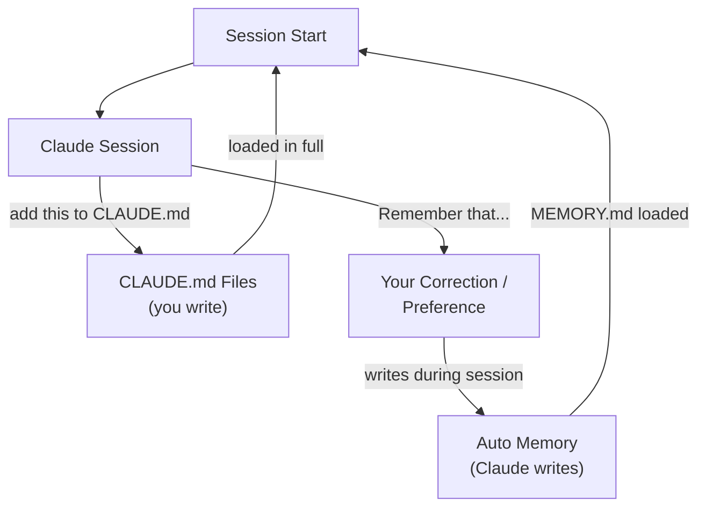
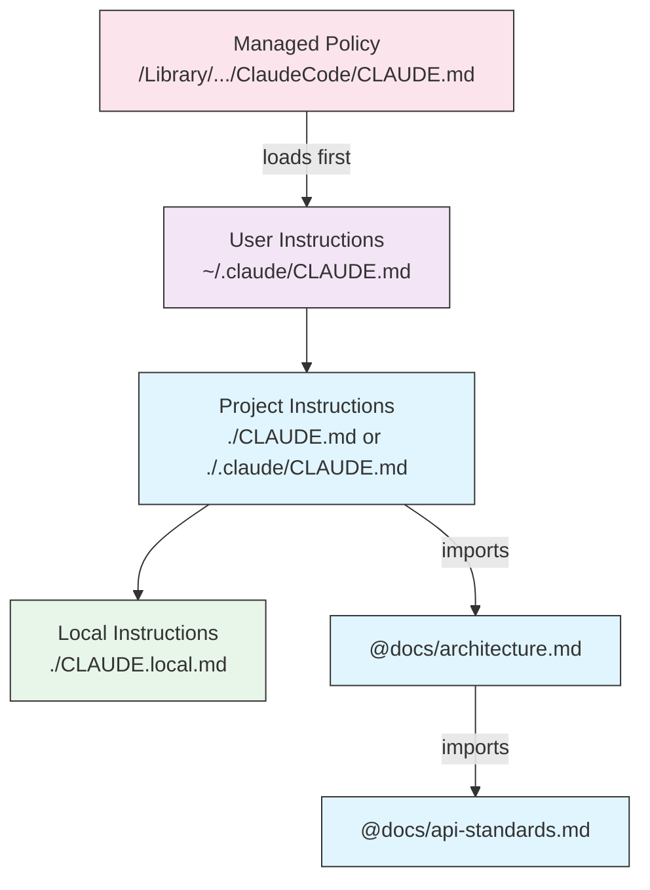
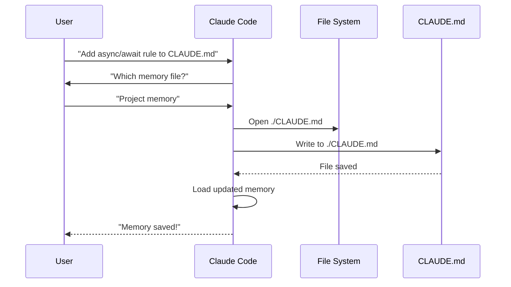
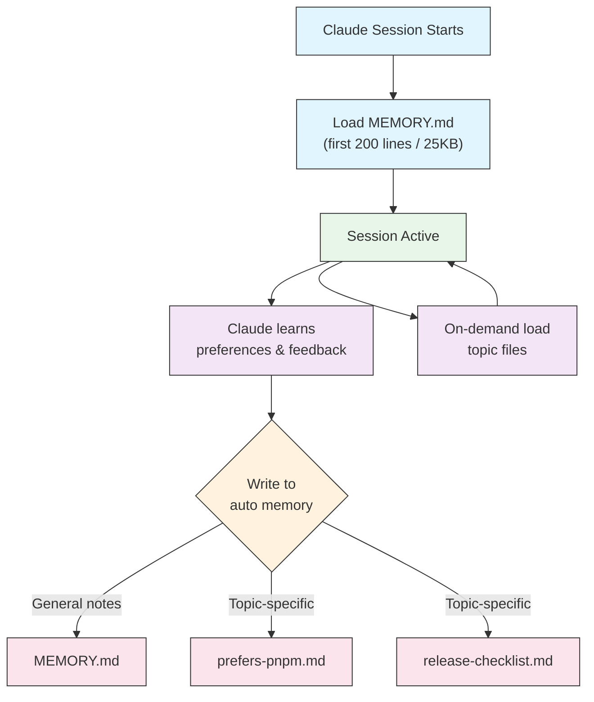

<!-- i18n-source: 02-memory/README.md -->
<!-- i18n-source-sha: ba721a3 -->
<!-- i18n-date: 2026-10-29 -->

<picture>
  <source media="(prefers-color-scheme: dark)" srcset="../../resources/logos/claude-howto-logo-dark.svg">
  
</picture>

# 메모리 가이드

메모리는 Claude가 세션과 대화가 바뀌어도 컨텍스트를 기억하게 해 줍니다. 메모리에는 두 가지 형태가 있습니다. claude.ai에서 자동으로 종합되는 메모리와, Claude Code에서 파일 시스템에 저장하는 CLAUDE.md입니다.

## 개요

Claude Code의 메모리는 여러 세션과 대화에 걸쳐 이어지는 지속적인 컨텍스트를 제공합니다. 임시로 쓰이는 컨텍스트 윈도와 달리, 메모리 파일로는 다음을 할 수 있습니다.

- 프로젝트 기준을 팀과 공유하기
- 개인 개발 선호 설정 저장하기
- 디렉터리별 규칙과 설정 유지하기
- 외부 문서 가져오기
- 메모리를 프로젝트의 일부로 버전 관리하기

메모리 시스템은 전역 개인 설정부터 특정 하위 디렉터리까지 여러 단계에서 작동합니다. 그래서 Claude가 무엇을 기억하고 그 지식을 어떻게 적용할지 세밀하게 제어할 수 있습니다.

## 메모리 명령 빠른 참고

| 명령 | 용도 | 사용법 | 언제 쓰나요 |
|------|------|--------|-------------|
| `/init` | 프로젝트 메모리 초기화 | `/init` | 새 프로젝트를 시작할 때, CLAUDE.md를 처음 설정할 때 |
| `/memory` | 편집기에서 메모리 파일 편집 | `/memory` | 대규모 업데이트, 재구성, 내용 검토 |
| `#` 접두사 | ~~한 줄 메모리 빠르게 추가~~ **지원 종료** | — | 대신 `/memory`를 쓰거나 대화로 요청하세요 |
| `@path/to/file` | 외부 내용 가져오기 | `@README.md` 또는 `@docs/api.md` | CLAUDE.md에서 기존 문서를 참조할 때 |

## 빠른 시작: 메모리 초기화하기

### `/init` 명령

`/init` 명령은 Claude Code에서 프로젝트 메모리를 설정하는 가장 빠른 방법입니다. 프로젝트의 기본 문서가 담긴 CLAUDE.md 파일을 만듭니다.

**사용법:**

```bash
/init
```

**하는 일:**

- 프로젝트에 새 CLAUDE.md 파일을 만듭니다 (보통 `./CLAUDE.md` 또는 `./.claude/CLAUDE.md`)
- 프로젝트 규칙과 가이드라인을 정합니다
- 세션 간에 컨텍스트를 유지하는 기반을 마련합니다
- 프로젝트 기준을 문서화할 템플릿 구조를 제공합니다

**향상된 대화형 모드:** `CLAUDE_CODE_NEW_INIT=1`을 설정하면 프로젝트 설정을 단계별로 안내하는 여러 단계의 대화형 흐름이 켜집니다.

```bash
CLAUDE_CODE_NEW_INIT=1 claude
/init
```

**`/init`을 쓰는 경우:**

- Claude Code로 새 프로젝트를 시작할 때
- 팀 코딩 기준과 규칙을 정할 때
- 코드베이스 구조에 대한 문서를 만들 때
- 협업 개발을 위한 메모리 계층을 설정할 때

**워크플로 예시:**

```markdown
# 프로젝트 디렉터리에서
/init

# Claude가 다음과 같은 구조로 CLAUDE.md를 만듭니다:
# Project Configuration
## Project Overview
- Name: Your Project
- Tech Stack: [Your technologies]
- Team Size: [Number of developers]

## Development Standards
- Code style preferences
- Testing requirements
- Git workflow conventions
```

### 메모리 빠르게 업데이트하기

> **참고**: 인라인 메모리용 `#` 단축키는 지원이 종료되었습니다. `/memory`로 메모리 파일을 직접 편집하거나, Claude에게 대화로 기억해 달라고 요청하세요 (예: "이 프로젝트에서는 항상 TypeScript strict 모드를 쓴다는 걸 기억해 줘").

메모리에 정보를 추가하는 권장 방법은 다음과 같습니다.

**방법 1: `/memory` 명령 사용**

```bash
/memory
```

시스템 편집기에서 메모리 파일을 열어 직접 편집합니다.

**방법 2: 대화로 요청**

```text
Remember that we always use TypeScript strict mode in this project.
Please add to memory: prefer async/await over promise chains.
```

Claude에게 무언가를 기억해 달라고 하면 자동 메모리에 저장됩니다. 대신 CLAUDE.md를 바꾸고 싶다면 "이걸 CLAUDE.md에 추가해 줘"라고 하거나, `/memory`로 파일을 직접 편집하세요.

**예전 방식 참고** (더 이상 작동하지 않음):

예전에는 `#` 접두사 단축키로 규칙을 바로 추가할 수 있었습니다.

```markdown
# Always use TypeScript strict mode in this project  ← 더 이상 작동하지 않음
```

이 방식을 써 왔다면 `/memory` 명령이나 대화 요청으로 바꾸세요.

### `/memory` 명령

`/memory` 명령을 쓰면 Claude Code 세션 안에서 CLAUDE.md 메모리 파일을 바로 편집할 수 있습니다. 시스템 편집기에서 메모리 파일을 열어 자유롭게 편집합니다. GUI 편집기에서 파일이 열리면 파일이 열려 있는 동안에도 세션이 멈추지 않아 동시에 작업을 계속할 수 있습니다 (v2.1.216). Vim 같은 터미널 편집기는 여전히 종료할 때까지 터미널을 차지합니다.

**사용법:**

```bash
/memory
```

**하는 일:**

- 시스템 기본 편집기에서 메모리 파일을 엽니다
- 대규모 추가, 수정, 재구성을 할 수 있습니다
- 계층의 모든 메모리 파일에 바로 접근할 수 있습니다
- 세션 간에 유지되는 컨텍스트를 관리할 수 있습니다

**`/memory`를 쓰는 경우:**

- 기존 메모리 내용을 검토할 때
- 프로젝트 기준을 크게 업데이트할 때
- 메모리 구조를 재구성할 때
- 자세한 문서나 가이드라인을 추가할 때
- 프로젝트가 발전함에 따라 메모리를 관리하고 업데이트할 때

**비교: `/memory`와 `/init`**

| 항목 | `/memory` | `/init` |
|------|-----------|---------|
| **용도** | 기존 메모리 파일 편집 | 새 CLAUDE.md 초기화 |
| **언제 쓰나요** | 프로젝트 컨텍스트를 업데이트/수정할 때 | 새 프로젝트를 시작할 때 |
| **동작** | 변경을 위해 편집기 열기 | 시작용 템플릿 생성 |
| **워크플로** | 지속적인 관리 | 한 번만 하는 설정 |

**워크플로 예시:**

```markdown
# 편집할 메모리 열기
/memory

# Claude가 옵션을 보여 줍니다:
# 1. Managed Policy Memory
# 2. Project Memory (./CLAUDE.md)
# 3. User Memory (~/.claude/CLAUDE.md)
# 4. Local Project Memory

# 2번(Project Memory)을 고릅니다
# 기본 편집기가 ./CLAUDE.md 내용과 함께 열립니다

# 변경하고, 저장하고, 편집기를 닫습니다
# Claude가 업데이트된 메모리를 자동으로 다시 불러옵니다
```

**메모리 가져오기 사용:**

CLAUDE.md 파일은 외부 내용을 포함하는 `@path/to/file` 문법을 지원합니다.

```markdown
# 프로젝트 문서
프로젝트 개요는 @README.md 참고
사용할 수 있는 npm 명령은 @package.json 참고
시스템 설계는 @docs/architecture.md 참고

# 절대 경로로 홈 디렉터리에서 가져오기
@~/.claude/my-project-instructions.md
```

**가져오기 기능:**

- 상대 경로와 절대 경로를 모두 지원합니다 (예: `@docs/api.md` 또는 `@~/.claude/my-project-instructions.md`)
- 재귀 가져오기를 지원하며, 최대 4단계까지 이어질 수 있습니다
- 외부 위치에서 처음 가져올 때는 보안을 위해 승인 대화 상자가 뜹니다
- markdown 코드 스팬이나 코드 블록 안의 가져오기 지시는 평가되지 않습니다 (그래서 예시로 문서화해도 안전합니다)
- 기존 문서를 참조해 중복을 피할 수 있습니다
- 참조한 내용이 Claude의 컨텍스트에 자동으로 포함됩니다

## 메모리 아키텍처

Claude Code의 메모리는 범위마다 역할이 다른 계층 구조를 따릅니다. 24시간 주기로 종합되는 Claude Web/Desktop의 메모리와 달리 (아래 [Claude Web/Desktop의 메모리](#claude-webdesktop의-메모리) 참고), Claude Code에는 두 가지 메모리 시스템이 있습니다. 둘 다 세션이 시작될 때마다 불러오며, 정해진 주기가 아니라 계속 업데이트됩니다.



## Claude Code의 메모리 계층

Claude Code에는 서로를 보완하는 두 가지 메모리 시스템이 있고, 둘 다 대화가 시작될 때마다 불러옵니다. **CLAUDE.md 파일**(내가 쓰는 지침)과 **자동 메모리**(Claude가 스스로 쓰는 메모)입니다. CLAUDE.md 파일은 **서로 덮어쓰지 않고 컨텍스트에 이어 붙습니다**. 상위 단계가 하위 단계를 대체하는 엄격한 우선순위 구조가 아닙니다. `.claude/rules/*.md` 파일은 주제나 경로별 지침을 위한 별개의 관련 기능입니다.

**CLAUDE.md 파일 위치 (불러오는 순서대로, 가장 넓은 범위부터 가장 구체적인 범위까지):**

| 범위 | 위치 | 용도 |
|------|------|------|
| 관리형 정책 | macOS: `/Library/Application Support/ClaudeCode/CLAUDE.md`<br>Linux/WSL: `/etc/claude-code/CLAUDE.md`<br>Windows: `C:\Program Files\ClaudeCode\CLAUDE.md` | IT/DevOps가 관리하는 조직 전체 지침. 관리형 CLAUDE.md는 가장 먼저 불러오며 `claudeMdExcludes`로 건너뛸 수 없습니다. 하지만 CLAUDE.md 불러오기를 끈 채 시작한 세션에서는 이 파일도 불러오지 않으므로, 반드시 지켜야 할 규칙은 관리형 `permissions.deny`로 강제하세요. |
| 사용자 지침 | `~/.claude/CLAUDE.md` | 모든 프로젝트에 적용되는 개인 선호 설정 |
| 프로젝트 지침 | `./CLAUDE.md` 또는 `./.claude/CLAUDE.md` | 팀이 공유하고 버전 관리하는 지침. v2.1.277부터는 작업 디렉터리나 그 위쪽에 `CLAUDE.md`나 `CLAUDE.local.md`가 없을 때 대신 `./AGENTS.md`를 같은 단계에서 불러옵니다. `/config`의 **Project instructions**로 제어합니다 |
| 로컬 지침 | `./CLAUDE.local.md` | 개인의 프로젝트별 선호 설정. `.gitignore`에 추가하세요 |

디렉터리 트리 안에서 Claude Code는 작업 디렉터리에서 위쪽으로 올라가며 파일을 찾습니다. `foo/bar/`에서 실행하면 `foo/CLAUDE.md`가 `foo/bar/CLAUDE.md`보다 먼저 불러와집니다. 그래서 실행한 위치에 가까운 지침일수록 *나중에* 읽힙니다. 덮어쓰기라는 의미에서 "우선순위가 가장 높은" 것이 아니라, 컨텍스트에서 가장 최근에 놓일 뿐입니다. 각 디렉터리 안에서는 `CLAUDE.local.md`가 `CLAUDE.md` 뒤에 붙습니다. 작업 디렉터리 *아래* 하위 디렉터리의 CLAUDE.md와 CLAUDE.local.md 파일은 시작할 때가 아니라 Claude가 그 하위 디렉터리의 파일을 읽을 때 필요에 따라 불러옵니다. v2.1.309부터 필요에 따라 불러오는 파일이 파일별 크기 한도를 넘으면 앞부분만 불러오고, 나머지는 Read로 읽으라는 안내를 끝에 붙입니다. 여기에는 하위 디렉터리의 `CLAUDE.md`/`CLAUDE.local.md`와 그 `@` 가져오기, 하위 디렉터리 `.claude/rules/`의 규칙, `.claude/rules/`나 `~/.claude/rules/`의 경로별 규칙이 해당됩니다. 한도는 200K 컨텍스트 윈도에서 40,000자입니다. 1M 윈도에서는 Opus 4.6과 Sonnet 4.6이 200,000자, 이후 모델이 150,000자입니다. 파일 크기는 `wc -m path/to/CLAUDE.md`로 확인합니다.

조직은 별도 파일을 배포하는 대신 `managed-settings.json` 안의 `claudeMd` 키에 관리형 CLAUDE.md 내용을 바로 넣을 수도 있습니다. 이 키는 관리형/정책 설정에서만 적용됩니다. 사용자 설정이나 프로젝트 설정에 `claudeMd`를 넣어도 효과가 없습니다.

**`.claude/rules/*.md`**: 모듈식 주제별 지침으로, `paths` 프런트매터로 파일 경로 범위를 정할 수 있습니다. `paths` 필드가 없는 규칙은 `.claude/CLAUDE.md`와 같은 우선순위로 항상 불러옵니다. 경로별 규칙은 Claude가 일치하는 파일을 읽거나, 쓰거나, 편집할 때 필요에 따라 불러옵니다. `cat`, `head`, `tail`, `sed -n`, `grep` 같은 단일 파일 Bash 읽기로 볼 때도 포함됩니다 (Write/Edit는 v2.1.288부터, Bash 읽기는 v2.1.293부터). 사용자 단위 규칙(`~/.claude/rules/`)은 프로젝트 규칙보다 먼저 불러옵니다. 각 `paths` 패턴은 규칙의 기준 디렉터리에 대한 상대 경로입니다. 프로젝트 규칙은 규칙이 든 `.claude` 폴더를 포함한 디렉터리가, 사용자 단위 규칙은 세션의 주 작업 디렉터리가 기준입니다. 옆에 있는 다른 git 워크트리의 파일에도 경로별 규칙을 적용하려면, 그 워크트리에서 Claude Code를 시작하거나 `/cd`로 세션을 그곳으로 옮기세요.

**자동 메모리** (`~/.claude/projects/<project>/memory/`)는 별개의 시스템입니다. CLAUDE.md 내용이 아니라 Claude 자신의 메모이며, 위의 이어 붙이기 순서에도 속하지 않습니다. 아래 [자동 메모리](#자동-메모리)를 참고하세요.

> **참고**: `CLAUDE.local.md`는 완전히 지원되며 [공식 문서](https://code.claude.com/docs/en/memory)에 설명되어 있습니다. 버전 관리에 커밋하지 않는 개인의 프로젝트별 선호 설정을 담습니다. `CLAUDE.local.md`를 `.gitignore`에 추가하세요.

**메모리 탐색 동작:**



그림의 모든 파일은 덮어쓰기로 하나가 골라지는 것이 아니라 하나의 컨텍스트로 이어 붙습니다. 뒤쪽 상자는 앞쪽 상자를 "대신하는" 것이 아니라 컨텍스트에서 더 뒤에 놓일 뿐입니다.

## AGENTS.md

`AGENTS.md`는 여러 도구가 함께 쓰는 프로젝트 컨텍스트 파일입니다. CLAUDE.md와 같은 *종류*의 문서로, 여러 코딩 에이전트가 하나의 프로젝트 규칙을 공유할 수 있도록 작성합니다. **v2.1.277**부터 Claude Code는 이 파일을 가져오기 없이 프로젝트 지침으로 바로 읽습니다.

**기본 동작** (`claude-md-or-agents-md`):

| 프로젝트에 있는 파일 | Claude Code가 읽는 파일 |
|----------------------|-------------------------|
| `AGENTS.md`만 있고 `CLAUDE.md`는 없음 | `AGENTS.md` |
| `AGENTS.md`와 `CLAUDE.md`가 모두 있음 | `CLAUDE.md`만 |
| `@AGENTS.md`로 `AGENTS.md`를 가져오는 `CLAUDE.md` | 가져오기가 펼쳐진 `CLAUDE.md` |

**AGENTS.md를 막는 파일.** Claude Code는 작업 디렉터리와 그 위의 모든 디렉터리에서 `CLAUDE.md`, `.claude/CLAUDE.md`, `CLAUDE.local.md`를 찾습니다. 하나라도 있으면 `AGENTS.md`는 읽지 않습니다. `~/.claude/CLAUDE.md`, 관리형 CLAUDE.md, `.claude/rules/`는 이 검사에 **포함되지 않으며**, 어떤 프로젝트 파일이 선택되든 함께 계속 불러옵니다.

> **주의**: `CLAUDE.local.md`를 추가하면 아무 알림 없이 `AGENTS.md`를 더 이상 읽지 않습니다. 로컬 설정 파일을 만든 뒤 프로젝트 지침이 사라진 것 같다면 대개 이 때문입니다.

**읽는 파일.** 작업 디렉터리와 그 위쪽의 모든 `AGENTS.md`와 `.claude/AGENTS.md`는 세션이 시작될 때 불러옵니다. 하위 디렉터리의 파일은 Claude가 그곳의 파일을 읽을 때 필요에 따라 불러옵니다. `@path` 가져오기는 CLAUDE.md와 같은 방식으로 펼쳐지고, `claudeMdExcludes`도 적용됩니다.

**절대 읽지 않는 파일**: `AGENTS.local.md`, `AGENTS.override.md`, 그리고 `.agents/` 아래의 모든 파일.

**동작 선택하기.** **Project instructions** 설정에는 네 가지 값이 있습니다.

| 값 | 효과 |
|----|------|
| `claude-md-or-agents-md` | 기본값. CLAUDE.md 파일이 없을 때만 `AGENTS.md`를 읽습니다 |
| `claude-md-and-agents-md` | 둘 다 있으면 둘 다 읽습니다 |
| `claude-md` | CLAUDE.md 파일만 읽고 `AGENTS.md`는 무시합니다 |
| `managed-only` | 관리형 정책 지침만 읽습니다 |

`/config`나 설정 파일에서 정합니다.

```jsonc
{
  "pluginConfigs": {
    "agents-md@builtin": {
      "options": {
        "instructionFiles": "claude-md-and-agents-md"
      }
    }
  }
}
```

이 키는 사용자 설정과 관리형 설정에서만 적용됩니다. 프로젝트 설정이나 로컬 설정에 넣어도 효과가 없습니다.

**바로 읽을 수 없는 경우.** v2.1.277 이전 버전(Bedrock/Vertex/Foundry, LLM 게이트웨이 뒤, 텔레메트리를 끈 경우에는 v2.1.281 이전), 업그레이드 후 첫 세션, 내장 `agents-md` 플러그인을 끈 경우에는 Claude Code가 `AGENTS.md`를 스스로 읽지 않습니다. 이럴 때는 CLAUDE.md에서 가져오세요.

```markdown
@AGENTS.md
```

## `claudeMdExcludes`로 CLAUDE.md 파일 제외하기

큰 모노레포에서는 일부 CLAUDE.md 파일이 지금 하는 작업과 관계없을 수 있습니다. `claudeMdExcludes` 설정으로 특정 CLAUDE.md 파일을 건너뛰어 컨텍스트에 불러오지 않게 할 수 있습니다.

```jsonc
// ~/.claude/settings.json 또는 .claude/settings.json에서
{
  "claudeMdExcludes": [
    "**/packages/legacy-app/CLAUDE.md",
    "**/vendors/**/CLAUDE.md"
  ]
}
```

패턴은 glob 문법으로 절대 파일 경로와 비교하므로, 저장소 기준 패턴은 `**/`로 시작하세요. 특히 다음 경우에 유용합니다.

- 하위 프로젝트가 많은데 일부만 관련 있는 모노레포
- 외부에서 들여온 코드나 서드파티 CLAUDE.md 파일이 들어 있는 저장소
- 오래되었거나 관계없는 지침을 빼서 Claude의 컨텍스트 윈도를 깔끔하게 유지하고 싶을 때

## 설정 파일 계층

Claude Code 설정(`autoMemoryDirectory`, `claudeMdExcludes` 등)은 우선순위에 따라 정해집니다. 위의 CLAUDE.md 파일과 달리 설정은 이어 붙지 않고 실제로 덮어씁니다. 같은 설정이 여러 범위에 있으면 상위 단계가 이깁니다.

| 단계 | 위치 | 범위 |
|------|------|------|
| 1 (가장 높음) | 관리형: `managed-settings.json`, plist/레지스트리, 또는 서버 관리형 | 조직 전체에 강제 적용. 덮어쓸 수 없음 |
| 2 | 명령줄 인수 | 세션 동안만 임시로 덮어쓰기 |
| 3 | `.claude/settings.local.json` | 로컬 덮어쓰기 (git에서 무시) |
| 4 | `.claude/settings.json` | 프로젝트 단위 (git에 커밋) |
| 5 (가장 낮음) | `~/.claude/settings.json` | 사용자 선호 설정 |

관리형 설정은 `managed-settings.json` 옆에 드롭인 디렉터리 `managed-settings.d/`도 지원합니다. 먼저 기본 파일을 병합하고, 그 위에 드롭인 디렉터리의 `*.json` 파일을 알파벳 순서로 병합합니다 (스칼라 값은 덮어쓰고, 배열은 이어 붙인 뒤 중복을 없애고, 객체는 깊게 병합). 그래서 여러 팀이 공유 파일을 고치지 않고도 각자 독립된 정책 조각을 배포할 수 있습니다. 이것은 CLAUDE.md가 아니라 **settings.json**의 기능이므로, 위에서 설명한 CLAUDE.md 파일 위치에는 적용되지 않습니다.

권한 규칙(`allow`/`ask`/`deny`)은 다른 설정과 다르게 동작합니다. 상위 단계가 하위 단계를 대체하지 않고, 여러 범위의 규칙이 병합됩니다.

**플랫폼별 설정 (v2.1.51+):**

설정은 다음 방법으로도 할 수 있습니다.
- **macOS**: 속성 목록(plist) 파일
- **Windows**: Windows 레지스트리

이런 플랫폼 고유 방식은 JSON 설정 파일과 함께 읽히며, 같은 우선순위 규칙을 따릅니다.

> **참고 (v2.1.119)**: 이제 `/config` 변경 사항은 `~/.claude/settings.json`에 저장됩니다. `/config`로 쓴 값은 위에서 설명한 정책/로컬/프로젝트 우선순위 구조에 그대로 참여하며, 더 이상 세션 동안만 유지되지 않습니다. 대화형으로 고칠 때는 `/config`를, 스크립트나 관리형 설정은 `settings.json` 파일을 직접 편집하세요.

### 보존 및 정리 설정

| 설정 | 타입 | 기본값 | 설명 |
|------|------|--------|------|
| `cleanupPeriodDays` | 정수 (일) | 30 | `~/.claude/` 아래 세션 대화 기록과 기타 애플리케이션 데이터의 보존 기간입니다. `file-history/` (체크포인트 스냅샷), `plans/`, `debug/`, `tasks/`, `shell-snapshots/`, `backups/`가 포함됩니다. `~/.claude/checkpoints/` 폴더는 없습니다. 기간보다 오래된 파일은 시작할 때 정리됩니다. |

```jsonc
// ~/.claude/settings.json
{
  "cleanupPeriodDays": 14
}
```

### 작성자 표시, 음성, PR URL 설정

| 설정 | 타입 | 설명 |
|------|------|------|
| `attribution.commit` | 문자열 | Claude가 만드는 커밋에 붙는 텍스트 (기본값은 `Co-Authored-By: Claude` 트레일러). `""`로 숨깁니다. 폐지된 `includeCoAuthoredBy` 플래그를 대체합니다. |
| `attribution.pr` | 문자열 | Claude가 만드는 풀 리퀘스트 설명에 붙는 텍스트. `""`로 숨깁니다. PR용으로 폐지된 `includeCoAuthoredBy` 플래그를 대체합니다. |
| `attribution.sessionUrl` | 불리언 | 웹과 Remote Control 세션에서 만든 커밋과 PR에서 claude.ai 세션 링크를 뺍니다 (v2.1.183+). |
| `voice.enabled` | 불리언 | 눌러서 말하기 음성 받아쓰기(`/voice`)를 켭니다. 폐지된 `voiceEnabled` 플래그를 대체합니다. |
| `prUrlTemplate` | 문자열 | **v2.1.119에서 새로 추가.** 하단 PR 배지에 쓰는 맞춤 URL 템플릿. GitLab, Bitbucket, 사내 코드 리뷰 플랫폼에 유용합니다. `{host}`, `{owner}`, `{repo}`, `{number}`, `{url}` 자리표시자를 지원하며, GitLab 병합 요청 링크는 바뀌지 않습니다. |

```jsonc
// ~/.claude/settings.json
{
  "attribution": {
    "commit": "",
    "pr": ""
  },
  "voice": {
    "enabled": true
  },
  "prUrlTemplate": "https://reviews.example.com/{owner}/{repo}/pull/{number}"
}
```

빈 문자열(`""`)은 해당 작성자 표시를 숨기고, `"attribution": false`는 전부 숨깁니다 (v2.1.281+).

#### 폐지된 설정 이름

다음 예전 설정 키는 아직 작동하지만 폐지되었습니다. 위의 대체 키를 쓰세요.

| 폐지된 키 | 대체 키 | 참고 |
|-----------|---------|------|
| `includeCoAuthoredBy` | `attribution.commit` / `attribution.pr` | 예전의 단일 플래그가 커밋용과 PR용 스위치로 나뉘었습니다. 예전에 설치한 사용자는 기존 키를 계속 써도 되지만, 새 프로젝트는 중첩된 형식을 쓰세요. |
| `voiceEnabled` | `voice.enabled` | 앞으로 생길 음성 관련 옵션과 함께 `voice` 네임스페이스 아래로 묶였습니다. |

## 모듈식 규칙 시스템

`.claude/rules/` 디렉터리 구조로 경로별 규칙을 체계적으로 만듭니다. 규칙은 프로젝트 단위와 사용자 단위 모두에서 정의할 수 있습니다.

```text
your-project/
├── .claude/
│   ├── CLAUDE.md
│   └── rules/
│       ├── code-style.md
│       ├── testing.md
│       ├── security.md
│       └── api/                  # 하위 디렉터리 지원
│           ├── conventions.md
│           └── validation.md

~/.claude/
├── CLAUDE.md
└── rules/                        # 사용자 단위 규칙 (모든 프로젝트)
    ├── personal-style.md
    └── preferred-patterns.md
```

규칙은 `rules/` 디렉터리 안에서 하위 디렉터리까지 재귀적으로 찾습니다. `~/.claude/rules/`의 사용자 단위 규칙은 프로젝트 단위 규칙보다 먼저 불러오므로, 프로젝트에서 덮어쓸 수 있는 개인 기본값으로 쓸 수 있습니다.

### YAML 프런트매터로 경로별 규칙 정하기

특정 파일 경로에만 적용되는 규칙을 정의합니다.

```markdown
---
paths: src/api/**/*.ts
---

# API 개발 규칙

- 모든 API 엔드포인트에는 입력 검증이 있어야 합니다
- 스키마 검증에는 Zod를 사용합니다
- 모든 매개변수와 응답 타입을 문서화합니다
- 모든 작업에 오류 처리를 넣습니다
```

**glob 패턴 예시:**

- `**/*.ts` - 모든 TypeScript 파일
- `src/**/*` - src/ 아래 모든 파일
- `src/**/*.{ts,tsx}` - 여러 확장자
- `{src,lib}/**/*.ts, tests/**/*.test.ts` - 여러 패턴

### 하위 디렉터리와 심볼릭 링크

`.claude/rules/`의 규칙은 두 가지 정리 기능을 지원합니다.

- **하위 디렉터리**: 규칙을 재귀적으로 찾으므로 주제별 폴더로 정리할 수 있습니다 (예: `rules/api/`, `rules/testing/`, `rules/security/`)
- **심볼릭 링크**: 여러 프로젝트에서 규칙을 공유할 수 있도록 심볼릭 링크를 지원합니다. 예를 들어 한곳에 둔 공유 규칙 파일을 각 프로젝트의 `.claude/rules/` 디렉터리에 심볼릭 링크로 걸 수 있습니다. v2.1.284부터 프로젝트 밖에서 심볼릭 링크로 걸어 온 규칙이나 `.claude` 디렉터리는 `@path` 가져오기와 같은 외부 가져오기 승인 창을 띄웁니다

## 메모리 위치 표

CLAUDE.md 파일과 규칙은 엄격한 덮어쓰기로 하나가 골라지는 것이 아니라 컨텍스트에 이어 붙습니다. 아래의 "불러오는 순서"는 *어느 것이 이기는지*가 아니라 *컨텍스트의 어디에 놓이는지*를 뜻합니다. 자동 메모리는 저장 위치가 따로 있는 별개의 기능입니다.

| 위치 | 유형 | 불러오는 순서 | 공유 범위 | 접근 | 적합한 용도 |
|------|------|---------------|-----------|------|-------------|
| `/Library/Application Support/ClaudeCode/CLAUDE.md` (macOS) | 관리형 정책 | 1번째 (가장 먼저) | 조직 | 시스템 | 회사 전체 정책 |
| `/etc/claude-code/CLAUDE.md` (Linux/WSL) | 관리형 정책 | 1번째 (가장 먼저) | 조직 | 시스템 | 조직 기준 |
| `C:\Program Files\ClaudeCode\CLAUDE.md` (Windows) | 관리형 정책 | 1번째 (가장 먼저) | 조직 | 시스템 | 회사 가이드라인 |
| `~/.claude/rules/*.md` | 사용자 규칙 | 2번째 | 개인 | 파일 시스템 | 개인 규칙 (모든 프로젝트) |
| `~/.claude/CLAUDE.md` | 사용자 메모리 | 3번째 | 개인 | 파일 시스템 | 개인 선호 설정 (모든 프로젝트) |
| `./.claude/rules/*.md` | 프로젝트 규칙 | 4번째 | 팀 | Git | 경로별 모듈식 규칙 |
| `./CLAUDE.md` 또는 `./.claude/CLAUDE.md` | 프로젝트 메모리 | 5번째 | 팀 | Git | 팀 기준, 공유 아키텍처 |
| `./CLAUDE.local.md` | 프로젝트 로컬 | 6번째 (가장 나중) | 개인 | Git (무시됨) | 개인의 프로젝트별 선호 설정 |
| `~/.claude/projects/<project>/memory/` | 자동 메모리 | 해당 없음 (별개 기능) | 개인 | 파일 시스템 | Claude의 자동 메모와 학습 내용 |

## 메모리 업데이트 수명 주기

Claude Code 세션에서 메모리 업데이트는 다음과 같이 흘러갑니다.



## 자동 메모리

자동 메모리는 Claude가 프로젝트에서 작업하면서 유형별 메모(`user`, `feedback`, `project`, `reference`)를 자동으로 저장하는 지속적인 디렉터리입니다. 아키텍처, 파일 경로, 디버깅 해결 방법처럼 코드베이스에서 알아낼 수 있는 내용은 저장하지 않습니다. 내가 직접 쓰고 관리하는 CLAUDE.md 파일과 달리, 자동 메모리는 세션 중에 Claude가 스스로 씁니다.

### 자동 메모리가 작동하는 방식

- **위치**: `~/.claude/projects/<project>/memory/`
- **진입점**: `MEMORY.md`가 자동 메모리 디렉터리의 주 파일입니다
- **주제 파일**: 선택적으로 추가하는 파일로, 메모 하나에 파일 하나입니다 (예: `prefers-pnpm.md`, `release-checklist.md`)
- **불러오는 방식**: 세션이 시작될 때 `MEMORY.md`의 처음 200줄(또는 처음 25KB 중 먼저 닿는 쪽)을 컨텍스트에 불러옵니다. 주제 파일은 시작할 때가 아니라 필요할 때 불러옵니다.
- **읽기/쓰기**: Claude는 세션 중에 선호 설정, 피드백, 프로젝트 맥락을 알게 되면서 메모리 파일을 읽고 씁니다
- **프런트매터**: YAML 프런트매터로 시작하는 파일에는 `modified` 필드가 붙습니다. Claude Code가 파일을 쓸 때마다 기록하는 ISO 8601 타임스탬프입니다 (v2.1.214)

### 자동 메모리 아키텍처



### 자동 메모리 디렉터리 구조

```text
~/.claude/projects/<project>/memory/
├── MEMORY.md              # 진입점 (시작할 때 처음 200줄 / 25KB 불러옴)
├── prefers-pnpm.md        # 주제 파일 (필요할 때 불러옴)
├── release-checklist.md   # 주제 파일 (필요할 때 불러옴)
└── team-contacts.md       # 주제 파일 (필요할 때 불러옴)
```

### 버전 요구 사항

자동 메모리는 **Claude Code v2.1.59 이상**이 필요합니다. 이전 버전을 쓰고 있다면 먼저 업그레이드하세요.

```bash
npm install -g @anthropic-ai/claude-code@latest
```

### 자동 메모리 켜고 끄기

자동 메모리는 **기본으로 켜져 있습니다**. `autoMemoryEnabled` 설정(기본값 `true`)으로 제어하며, `false`면 Claude는 자동 메모리 디렉터리를 읽지도 쓰지도 않습니다. 세션 중에 `/memory`로 켜고 끌 수도 있습니다.

```json
{
  "autoMemoryEnabled": false
}
```

대신 환경 변수로 끄려면 `CLAUDE_CODE_DISABLE_AUTO_MEMORY=1`을 설정합니다. `0`으로 설정하면 `--bare` 모드나 `autoMemoryEnabled: false`로 꺼질 상황에서도 자동 메모리를 강제로 **켭니다**.

### 자동 메모리 디렉터리 바꾸기

기본적으로 자동 메모리는 `~/.claude/projects/<project>/memory/`에 저장됩니다. `autoMemoryDirectory` 설정으로 위치를 바꿀 수 있습니다 (**v2.1.74**부터 사용 가능).

```jsonc
// 어떤 설정 파일이든 가능: 사용자, 프로젝트, 로컬, 관리형 정책
{
  "autoMemoryDirectory": "/path/to/custom/memory/directory"
}
```

> **참고**: `autoMemoryDirectory`는 사용자, 프로젝트, 로컬, 관리형 정책, `--settings` 등 어떤 설정 범위에서든 읽힙니다. 값은 절대 경로이거나 `~/`로 시작해야 합니다.

다음과 같은 경우에 유용합니다.

- 자동 메모리를 공유 위치나 동기화되는 위치에 저장하고 싶을 때
- 자동 메모리를 기본 Claude 설정 디렉터리와 분리하고 싶을 때
- 기본 계층 밖의 프로젝트 전용 경로를 쓰고 싶을 때

### 워크트리와 저장소 공유

같은 git 저장소 안의 모든 워크트리와 하위 디렉터리는 하나의 자동 메모리 디렉터리를 공유합니다. 그래서 워크트리를 오가거나 같은 저장소의 다른 하위 디렉터리에서 작업해도 같은 메모리 파일을 읽고 씁니다.

### 서브에이전트 메모리

Agent 도구로 띄운 서브에이전트도 자체 지속 메모리를 가질 수 있습니다. 서브에이전트 정의의 `memory` 프런트매터 필드로 메모리 디렉터리 위치를 정합니다.

```yaml
memory: user      # ~/.claude/agent-memory/<agent-name>/
memory: project   # .claude/agent-memory/<agent-name>/ (git으로 공유 가능)
memory: local     # .claude/agent-memory-local/<agent-name>/ (커밋하지 않음)
```

서브에이전트는 시작할 때 그 디렉터리 `MEMORY.md`의 처음 200줄 / 25KB를 읽고, 메모리를 관리할 수 있도록 Read/Write/Edit 도구를 받습니다. 자동 메모리가 꺼져 있으면 효과가 없습니다.

> **참고**: 서브에이전트도 자체 자동 메모리를 관리할 수 있습니다. 자세한 내용은 [서브에이전트 메모리 공식 문서](https://code.claude.com/docs/en/sub-agents#enable-persistent-memory)를 참고하세요.

### 자동 메모리 제어하기

자동 메모리는 `CLAUDE_CODE_DISABLE_AUTO_MEMORY` 환경 변수로 제어할 수 있습니다.

| 값 | 동작 |
|----|------|
| `0` | 자동 메모리를 강제로 **켬** |
| `1` | 자동 메모리를 강제로 **끔** |
| *(설정 안 함)* | 기본 동작 (자동 메모리 켜짐) |

```bash
# 세션에서 자동 메모리 끄기
CLAUDE_CODE_DISABLE_AUTO_MEMORY=1 claude

# 자동 메모리를 명시적으로 강제로 켜기
CLAUDE_CODE_DISABLE_AUTO_MEMORY=0 claude
```

## `--add-dir`로 디렉터리 추가하기

`--add-dir` 플래그를 쓰면 Claude Code가 현재 작업 디렉터리 말고도 추가 디렉터리의 CLAUDE.md 파일을 불러옵니다. 다른 디렉터리의 컨텍스트가 필요한 모노레포나 여러 프로젝트를 함께 다루는 환경에 유용합니다.

이 기능을 켜려면 환경 변수를 설정합니다.

```bash
CLAUDE_CODE_ADDITIONAL_DIRECTORIES_CLAUDE_MD=1
```

그런 다음 플래그와 함께 Claude Code를 실행합니다.

```bash
claude --add-dir /path/to/other/project
```

Claude는 현재 작업 디렉터리의 메모리 파일과 함께, 지정한 추가 디렉터리의 CLAUDE.md도 불러옵니다.

## 실전 예시

### 예시 1: 프로젝트 메모리 구조

**파일:** `./CLAUDE.md`

```markdown
# 프로젝트 설정

## 프로젝트 개요
- **이름**: E-commerce Platform
- **기술 스택**: Node.js, PostgreSQL, React 18, Docker
- **팀 규모**: 개발자 5명
- **마감**: 2025년 4분기

## 아키텍처
@docs/architecture.md
@docs/api-standards.md
@docs/database-schema.md

## 개발 기준

### 코드 스타일
- 포맷에는 Prettier를 사용합니다
- ESLint와 airbnb 설정을 사용합니다
- 한 줄 최대 길이: 100자
- 들여쓰기는 공백 2칸

### 이름 규칙
- **파일**: kebab-case (user-controller.js)
- **클래스**: PascalCase (UserService)
- **함수/변수**: camelCase (getUserById)
- **상수**: UPPER_SNAKE_CASE (API_BASE_URL)
- **데이터베이스 테이블**: snake_case (user_accounts)

### Git 워크플로
- 브랜치 이름: `feature/description` 또는 `fix/description`
- 커밋 메시지: conventional commits를 따릅니다
- 병합 전에 PR이 필요합니다
- 모든 CI/CD 검사를 통과해야 합니다
- 최소 1명의 승인이 필요합니다

### 테스트 요구 사항
- 코드 커버리지 최소 80%
- 모든 핵심 경로에는 테스트가 있어야 합니다
- 단위 테스트는 Jest를 사용합니다
- E2E 테스트는 Cypress를 사용합니다
- 테스트 파일 이름: `*.test.ts` 또는 `*.spec.ts`

### API 기준
- RESTful 엔드포인트만 사용합니다
- 요청/응답은 JSON
- HTTP 상태 코드를 올바르게 사용합니다
- API 엔드포인트에 버전을 붙입니다: `/api/v1/`
- 모든 엔드포인트를 예시와 함께 문서화합니다

### 데이터베이스
- 스키마 변경에는 마이그레이션을 사용합니다
- 자격 증명을 하드코딩하지 않습니다
- 커넥션 풀을 사용합니다
- 개발 환경에서는 쿼리 로그를 켭니다
- 정기 백업이 필요합니다

### 배포
- Docker 기반 배포
- Kubernetes 오케스트레이션
- 블루-그린 배포 전략
- 실패하면 자동 롤백
- 배포 전에 데이터베이스 마이그레이션 실행

## 자주 쓰는 명령

| 명령 | 용도 |
|------|------|
| `npm run dev` | 개발 서버 시작 |
| `npm test` | 테스트 스위트 실행 |
| `npm run lint` | 코드 스타일 검사 |
| `npm run build` | 운영용 빌드 |
| `npm run migrate` | 데이터베이스 마이그레이션 실행 |

## 팀 연락처
- 테크 리드: Sarah Chen (@sarah.chen)
- 프로덕트 매니저: Mike Johnson (@mike.j)
- DevOps: Alex Kim (@alex.k)

## 알려진 문제와 우회 방법
- 사용량이 많은 시간대에는 PostgreSQL 커넥션 풀이 20개로 제한됨
- 우회 방법: 쿼리 대기열 구현
- Safari 14에서 async generator 호환성 문제
- 우회 방법: Babel 트랜스파일러 사용

## 관련 프로젝트
- 분석 대시보드: `/projects/analytics`
- 모바일 앱: `/projects/mobile`
- 관리자 패널: `/projects/admin`
```

### 예시 2: 디렉터리별 메모리

**파일:** `./src/api/CLAUDE.md`

````markdown
# API 모듈 기준

이 파일은 /src/api/ 아래 모든 것에 대해 루트 CLAUDE.md를 보완합니다. 메모리 파일은
덮어쓰지 않고 이어 붙입니다. 루트 CLAUDE.md는 계속 적용되며, Claude Code는
이 하위 트리의 파일을 읽거나, 쓰거나, 편집할 때 필요에 따라 이 파일을 불러옵니다.

## API 전용 기준

### 요청 검증
- 스키마 검증에는 Zod를 사용합니다
- 입력은 항상 검증합니다
- 검증 오류는 400으로 반환합니다
- 필드 단위 오류 정보를 포함합니다

### 인증
- 모든 엔드포인트는 JWT 토큰이 필요합니다
- 토큰은 Authorization 헤더에 넣습니다
- 토큰은 24시간 뒤 만료됩니다
- 리프레시 토큰 방식을 구현합니다

### 응답 형식

모든 응답은 다음 구조를 따라야 합니다.

```json
{
  "success": true,
  "data": { /* 실제 데이터 */ },
  "timestamp": "2025-11-06T10:30:00Z",
  "version": "1.0"
}
```

오류 응답:
```json
{
  "success": false,
  "error": {
    "code": "VALIDATION_ERROR",
    "message": "User message",
    "details": { /* 필드 오류 */ }
  },
  "timestamp": "2025-11-06T10:30:00Z"
}
```

### 페이지네이션
- 커서 기반 페이지네이션을 사용합니다 (오프셋 방식 아님)
- `hasMore` 불리언을 포함합니다
- 최대 페이지 크기는 100으로 제한합니다
- 기본 페이지 크기: 20

### 속도 제한
- 인증된 사용자는 시간당 1000회 요청
- 공개 엔드포인트는 시간당 100회 요청
- 한도를 넘으면 429를 반환합니다
- retry-after 헤더를 포함합니다

### 캐싱
- 세션 캐싱에는 Redis를 사용합니다
- 캐시 유지 시간: 기본 5분
- 쓰기 작업이 일어나면 캐시를 무효화합니다
- 캐시 키에 리소스 유형 태그를 붙입니다
````

### 예시 3: 개인 메모리

**파일:** `~/.claude/CLAUDE.md`

```markdown
# 나의 개발 선호 설정

## 나에 대해
- **경력**: 풀스택 개발 8년
- **선호 언어**: TypeScript, Python
- **소통 방식**: 직설적으로, 예시와 함께
- **학습 방식**: 코드가 곁들여진 시각적 다이어그램

## 코드 선호

### 오류 처리
try-catch 블록과 의미 있는 오류 메시지로 명시적으로 오류를 처리하는 것을 선호합니다.
막연한 오류는 피합니다. 디버깅을 위해 오류는 항상 로그로 남깁니다.

### 주석
주석에는 '무엇'이 아니라 '왜'를 씁니다. 코드는 그 자체로 설명이 되어야 합니다.
주석은 비즈니스 로직이나 한눈에 알기 어려운 결정을 설명해야 합니다.

### 테스트
TDD(테스트 주도 개발)를 선호합니다.
테스트를 먼저 쓰고, 그다음 구현합니다.
구현 세부 사항이 아니라 동작에 집중합니다.

### 아키텍처
모듈화되고 결합도가 낮은 설계를 선호합니다.
테스트하기 쉽도록 의존성 주입을 사용합니다.
관심사를 분리합니다 (Controllers, Services, Repositories).

## 디버깅 선호
- 접두사를 붙여 console.log를 사용합니다: `[DEBUG]`
- 맥락을 포함합니다: 함수 이름, 관련 변수
- 가능하면 스택 트레이스를 사용합니다
- 로그에는 항상 타임스탬프를 넣습니다

## 소통
- 복잡한 개념은 다이어그램으로 설명합니다
- 이론보다 구체적인 예시를 먼저 보여 줍니다
- 변경 전/후 코드 조각을 포함합니다
- 마지막에 핵심 내용을 요약합니다

## 프로젝트 구성
프로젝트는 다음과 같이 구성합니다.

   project/
     ├── src/
     │   ├── api/
     │   ├── services/
     │   ├── models/
     │   └── utils/
     ├── tests/
     ├── docs/
     └── docker/


## 도구
- **IDE**: vim 키 바인딩을 쓰는 VS Code
- **터미널**: Oh-My-Zsh를 쓰는 Zsh
- **포맷**: Prettier (한 줄 100자)
- **린터**: airbnb 설정을 쓰는 ESLint
- **테스트 프레임워크**: Jest와 React Testing Library
```

_직접 해 본 테스트_

Claude에게 새 규칙을 저장해 달라고 요청했습니다.


어디에도 `Claude.md` 파일이 없어서 Claude가 규칙을 저장하지 않았습니다. 그래서 Claude에게 저장 위치를 확인해 달라고 했습니다.


### 예시 4: 세션 중에 메모리 업데이트하기

Claude Code 세션 중에 Claude에게 직접 요청해 CLAUDE.md에 새 규칙을 추가할 수 있습니다 (무언가를 *기억해* 달라고 하면 대신 자동 메모리에 저장됩니다).

```markdown
User: Add this to CLAUDE.md: I prefer using React hooks instead of class components
     for all new components.

Claude: I'm adding that to your memory. Which memory file should this go in?
        1. Project memory (./CLAUDE.md)
        2. Personal memory (~/.claude/CLAUDE.md)

User: Project memory

Claude: ✅ Memory saved!

Added to ./CLAUDE.md:
---

### Component Development
- Use functional components with React Hooks
- Prefer hooks over class components
- Custom hooks for reusable logic
- Use useCallback for event handlers
- Use useMemo for expensive computations
```

대규모 업데이트나 재구성이 필요하면 `/memory`로 메모리 파일을 직접 편집하세요.

#### 메모리를 추가할 때의 팁

- 규칙은 구체적이고 실행할 수 있게 씁니다
- 관련된 규칙은 한 단락 제목 아래 모읍니다
- 내용을 중복해서 쓰지 말고 기존 단락을 업데이트합니다
- 알맞은 메모리 범위(프로젝트 또는 개인)를 고릅니다

## 메모리 기능 비교

| 기능 | Claude Web/Desktop | Claude Code (CLAUDE.md) |
|------|--------------------|-------------------------|
| 자동 종합 | ✅ 24시간마다 | ✅ 자동 메모리 |
| 프로젝트 간 공유 | ✅ 공유됨 | ❌ 프로젝트별 |
| 팀 접근 | ✅ 공유 프로젝트 | ✅ Git으로 추적 |
| 검색 | ✅ 내장 | ✅ `/memory`로 |
| 편집 | ✅ 대화 안에서 | ✅ 파일 직접 편집 |
| 가져오기/내보내기 | ✅ 가능 | ✅ 복사/붙여 넣기 |
| 유지 기간 | ✅ 24시간 이상 | ✅ 무기한 |

### Claude Web/Desktop의 메모리

#### 메모리 종합 타임라인


**메모리 요약 예시:**

```markdown
## 사용자에 대한 Claude의 메모리

### 직업 배경
- 경력 8년의 시니어 풀스택 개발자
- TypeScript/Node.js 백엔드와 React 프런트엔드에 집중
- 오픈 소스에 활발히 기여
- AI와 머신러닝에 관심

### 프로젝트 맥락
- 현재 전자상거래 플랫폼을 만드는 중
- 기술 스택: Node.js, PostgreSQL, React 18, Docker
- 개발자 5명으로 된 팀에서 작업
- CI/CD와 블루-그린 배포 사용

### 소통 선호
- 직설적이고 간결한 설명을 선호
- 시각적 다이어그램과 예시를 좋아함
- 코드 조각을 반김
- 비즈니스 로직은 주석으로 설명

### 현재 목표
- API 성능 개선
- 테스트 커버리지를 90%로 높이기
- 캐싱 전략 구현
- 아키텍처 문서화
```

## 모범 사례

### 해야 할 것: 무엇을 넣을까

- **구체적이고 자세하게 쓰기**: 막연한 안내 대신 명확하고 자세한 지침을 씁니다
  - ✅ 좋음: "모든 JavaScript 파일은 공백 2칸으로 들여쓰기"
  - ❌ 피함: "모범 사례를 따르기"

- **정리된 상태 유지하기**: 명확한 markdown 단락과 제목으로 메모리 파일을 구성합니다

- **알맞은 계층 단계 쓰기**:
  - **관리형 정책**: 회사 전체 정책, 보안 기준, 규정 준수 요구 사항
  - **프로젝트 메모리**: 팀 기준, 아키텍처, 코딩 규칙 (git에 커밋)
  - **사용자 메모리**: 개인 선호 설정, 소통 방식, 도구 선택
  - **디렉터리 메모리**: 모듈별 규칙과 덮어쓰기

- **가져오기 활용하기**: `@path/to/file` 문법으로 기존 문서를 참조합니다
  - 재귀 가져오기는 최대 4단계까지 지원합니다
  - 메모리 파일 사이의 중복을 피합니다
  - 예: `프로젝트 개요는 @README.md 참고`

- **자주 쓰는 명령 문서화하기**: 반복해서 쓰는 명령을 넣어 시간을 아낍니다

- **프로젝트 메모리 버전 관리하기**: 팀이 함께 쓸 수 있도록 프로젝트 단위 CLAUDE.md 파일을 git에 커밋합니다

- **주기적으로 검토하기**: 프로젝트가 발전하고 요구 사항이 바뀌면 메모리도 정기적으로 업데이트합니다

- **구체적인 예시 넣기**: 코드 조각과 구체적인 시나리오를 넣습니다

### 하지 말아야 할 것: 무엇을 피할까

- **비밀 정보 저장하지 않기**: API 키, 비밀번호, 토큰, 자격 증명은 절대 넣지 않습니다

- **민감한 데이터 넣지 않기**: 개인 식별 정보, 사적인 정보, 독점 기밀은 넣지 않습니다

- **내용 중복하지 않기**: 대신 가져오기(`@path`)로 기존 문서를 참조합니다

- **막연하게 쓰지 않기**: "모범 사례를 따르기"나 "좋은 코드 쓰기" 같은 일반적인 문장은 피합니다

- **너무 길게 쓰지 않기**: CLAUDE.md 하나당 **200줄 이하**를 목표로 합니다. 시작할 때 불러오는 파일은 길어도 전부 불러오지만, 지침을 따르는 정도가 떨어집니다. 아래 [CLAUDE.md를 작게 유지하기](#claudemd를-작게-유지하기)를 참고하세요

- **지나치게 쪼개지 않기**: 계층은 전략적으로 쓰고, 하위 디렉터리 덮어쓰기를 너무 많이 만들지 않습니다

- **업데이트를 잊지 않기**: 오래된 메모리는 혼란과 낡은 관행을 낳을 수 있습니다

- **중첩 한도 넘지 않기**: 메모리 가져오기는 최대 4단계까지 지원합니다

### CLAUDE.md를 작게 유지하기

현재 Anthropic의 안내는 "모든 걸 CLAUDE.md에 넣어라"와 정반대입니다. 이 파일은 **모든** 세션에 불러오므로, 한 줄을 더할 때마다 그 줄과 상관없는 작업에서도 주의를 다투는 줄이 하나 늘어납니다.

**경험 법칙: CLAUDE.md는 200줄 이하로 유지하세요.** 시작할 때 불러오는 CLAUDE.md는 길어도 전부 불러오지만 (최대 4 MiB까지이며, 그보다 큰 파일은 Claude Code가 건너뜀), 파일이 길어질수록 지침을 따르는 정도가 떨어집니다. 필요에 따라 불러오는 하위 디렉터리 CLAUDE.md 파일과 경로별 규칙은 파일별 한도에서 잘립니다 (v2.1.309). [Claude Code의 메모리 계층](#claude-code의-메모리-계층)을 참고하세요.

파일이 커지기 시작하면 문장을 다듬기보다 내용을 다른 곳으로 옮기세요.

| 내용 | 옮길 곳 | 이유 |
|------|---------|------|
| 여러 단계로 된 절차 | [스킬](../../03-skills/) | 관련 있을 때만 필요에 따라 불러옴 |
| 디렉터리나 파일 유형별 규칙 | `paths:` 프런트매터가 있는 `.claude/rules/*.md` | glob으로 범위가 정해져, 일치하는 파일을 다룰 때만 불러옴 |
| 참고 자료와 긴 예시 | 스킬의 `references/` 디렉터리 | 스킬에 필요할 때만 읽음 |
| Claude가 *나*에 대해 기억해야 할 것 | 자동 메모리 (기본으로 켜짐) | 자동으로 쓰이고 불러와짐 |

> **참고**: `@path` 가져오기는 큰 CLAUDE.md를 정리해 줄 뿐 컨텍스트를 **아껴 주지는 않습니다**. 가져온 파일도 불러올 때 똑같이 들어옵니다. 실제로 불러오는 양을 줄이는 것은 경로별 규칙으로 나누는 것입니다.

`/doctor` (v2.1.206+)는 설정을 검사해, CLAUDE.md가 쓸모 있는 수준을 넘어 커졌을 때 줄일 부분을 제안합니다.

### 검증 알림을 쓰지 마세요

예전 안내에서는 "끝났다고 말하기 전에 항상 테스트를 실행해" 또는 "작업을 다시 확인해" 같은 줄을 권했습니다. **Claude Opus 5와 Fable 5에서는 이런 줄이 과도한 검증을 일으킵니다.** Claude가 이미 맞는 작업을 다시 확인하느라 턴과 토큰을 낭비합니다.

Anthropic은 Claude 5 세대에 맞춰 Claude Code 자체 시스템 프롬프트의 80% 이상을 지웠지만, 측정된 성능 저하는 없었습니다. CLAUDE.md에도 같은 원칙이 적용됩니다. Claude가 해야 할 검사를 하나하나 나열하기보다, 목표를 말하고 Claude가 판단하게 두세요.

Opus 5나 Fable 5를 대상으로 하는 기존 CLAUDE.md 파일에서는 검증 알림을 지우세요. 다만 한눈에 알기 어려운 프로젝트 요구 사항은 남기세요. "통합 테스트에는 Docker가 실행 중이어야 한다"는 알림이 아니라 정보입니다.

### 메모리 관리 팁

**알맞은 메모리 단계 고르기:**

| 사용 사례 | 메모리 단계 | 이유 |
|-----------|-------------|------|
| 회사 보안 정책 | 관리형 정책 | 조직 전체의 모든 프로젝트에 적용 |
| 팀 코드 스타일 가이드 | 프로젝트 | git으로 팀과 공유 |
| 내가 좋아하는 편집기 단축키 | 사용자 | 개인 선호, 공유하지 않음 |
| API 모듈 기준 | 디렉터리 | 그 모듈에만 해당 |

**빠른 업데이트 워크플로:**

1. 규칙 하나: `/memory`로 편집기를 열거나 대화로 요청합니다
2. 여러 변경: `/memory`로 편집기를 엽니다
3. 처음 설정: `/init`으로 템플릿을 만듭니다

**가져오기 모범 사례:**

```markdown
# 좋음: 기존 문서 참조하기
@README.md
@docs/architecture.md
@package.json

# 피함: 다른 곳에 있는 내용 복사하기
# README 내용을 CLAUDE.md에 복사하지 말고 그냥 가져오세요
```

## 설치 방법

### 프로젝트 메모리 설정

#### 방법 1: `/init` 명령 사용 (권장)

프로젝트 메모리를 설정하는 가장 빠른 방법입니다.

1. **프로젝트 디렉터리로 이동합니다:**
   ```bash
   cd /path/to/your/project
   ```

2. **Claude Code에서 init 명령을 실행합니다:**
   ```bash
   /init
   ```

3. **Claude가 템플릿 구조로 CLAUDE.md를 만들고 내용을 채웁니다**

4. **만들어진 파일을 프로젝트에 맞게 고칩니다**

5. **git에 커밋합니다:**
   ```bash
   git add CLAUDE.md
   git commit -m "Initialize project memory with /init"
   ```

#### 방법 2: 직접 만들기

직접 설정하고 싶다면 다음과 같이 합니다.

1. **프로젝트 루트에 CLAUDE.md를 만듭니다:**
   ```bash
   cd /path/to/your/project
   touch CLAUDE.md
   ```

2. **프로젝트 기준을 추가합니다:**
   ```bash
   cat > CLAUDE.md << 'EOF'
   # 프로젝트 설정

   ## 프로젝트 개요
   - **이름**: 프로젝트 이름
   - **기술 스택**: 사용하는 기술 목록
   - **팀 규모**: 개발자 수

   ## 개발 기준
   - 코딩 기준
   - 이름 규칙
   - 테스트 요구 사항
   EOF
   ```

3. **git에 커밋합니다:**
   ```bash
   git add CLAUDE.md
   git commit -m "Add project memory configuration"
   ```

### 개인 메모리 설정

1. **~/.claude 디렉터리를 만듭니다:**
   ```bash
   mkdir -p ~/.claude
   ```

2. **개인 CLAUDE.md를 만듭니다:**
   ```bash
   touch ~/.claude/CLAUDE.md
   ```

3. **선호 설정을 추가합니다:**
   ```bash
   cat > ~/.claude/CLAUDE.md << 'EOF'
   # 나의 개발 선호 설정

   ## 나에 대해
   - 경력: [내 수준]
   - 선호 언어: [내 언어]
   - 소통 방식: [내 방식]

   ## 코드 선호
   - [내 선호 설정]
   EOF
   ```

### 디렉터리별 메모리 설정

1. **특정 디렉터리에 메모리를 만듭니다:**
   ```bash
   mkdir -p /path/to/directory/.claude
   touch /path/to/directory/CLAUDE.md
   ```

2. **디렉터리별 규칙을 추가합니다:**
   ```bash
   cat > /path/to/directory/CLAUDE.md << 'EOF'
   # [디렉터리 이름] 기준

   이 파일은 이 디렉터리에 대해 루트 CLAUDE.md를 보완합니다. 메모리 파일은
   덮어쓰지 않고 이어 붙습니다. Claude Code는 이 디렉터리의 파일을 읽거나,
   쓰거나, 편집할 때 필요에 따라 이 파일을 불러옵니다.

   ## [구체적인 기준]
   EOF
   ```

3. **버전 관리에 커밋합니다:**
   ```bash
   git add /path/to/directory/CLAUDE.md
   git commit -m "Add [directory] memory configuration"
   ```

### 설정 확인

1. **메모리 위치를 확인합니다:**
   ```bash
   # 프로젝트 루트 메모리
   ls -la ./CLAUDE.md

   # 개인 메모리
   ls -la ~/.claude/CLAUDE.md
   ```

2. **세션을 시작하면 Claude Code가 이 파일들을 자동으로 불러옵니다**

3. **프로젝트에서 새 세션을 시작해 Claude Code로 테스트합니다**

## 공식 문서

최신 정보는 Claude Code 공식 문서를 참고하세요.

- **[메모리 문서](https://code.claude.com/docs/en/memory)** - 메모리 시스템 전체 레퍼런스
- **[슬래시 명령 레퍼런스](https://code.claude.com/docs/en/interactive-mode)** - `/init`과 `/memory`를 포함한 모든 내장 명령
- **[CLI 레퍼런스](https://code.claude.com/docs/en/cli-reference)** - 명령줄 인터페이스 문서

### 공식 문서의 핵심 기술 정보

**메모리 불러오기:**

- 작업 디렉터리와 그 위쪽의 CLAUDE.md 파일, 범위가 정해지지 않은 규칙, `MEMORY.md`의 앞부분은 Claude Code가 시작될 때 자동으로 불러옵니다
- Claude는 현재 작업 디렉터리에서 위쪽으로 올라가며 CLAUDE.md 파일을 찾습니다
- 하위 트리의 파일은 그 디렉터리에 접근할 때 맥락에 따라 찾아 불러옵니다

**가져오기 문법:**

- `@path/to/file`로 외부 내용을 포함합니다 (예: `@~/.claude/my-project-instructions.md`)
- 상대 경로와 절대 경로를 모두 지원합니다 (상대 경로는 작업 디렉터리가 아니라 가져오기가 들어 있는 파일을 기준으로 풀이됩니다)
- 재귀 가져오기를 최대 4단계까지 지원합니다
- 외부에서 처음 가져올 때는 승인 대화 상자가 뜹니다
- markdown 코드 스팬이나 코드 블록 안에서는 평가되지 않습니다
- 참조한 내용이 Claude의 컨텍스트에 자동으로 포함됩니다

**CLAUDE.md 불러오는 순서** (엄격한 덮어쓰기가 아니라 컨텍스트에 이어 붙음, 위의 [Claude Code의 메모리 계층](#claude-code의-메모리-계층) 참고):

1. 관리형 정책 (가장 먼저)
2. 사용자 단위 규칙 (`~/.claude/rules/`)
3. 사용자 메모리
4. 프로젝트 규칙 (`.claude/rules/`)
5. 프로젝트 메모리
6. 로컬 프로젝트 메모리 (가장 나중)

자동 메모리(`~/.claude/projects/<project>/memory/`)는 별개의 기능이며, 이 이어 붙이기 순서에 속하지 않습니다.

## 관련 개념 링크

### 연동 지점
- [MCP 프로토콜](../../05-mcp/) - 메모리와 함께 쓰는 실시간 데이터 접근
- [슬래시 명령](../01-slash-commands/) - 세션별 단축 명령
- [스킬](../../03-skills/) - 메모리 컨텍스트를 활용하는 자동화 워크플로

### 관련 Claude 기능
- [Claude 웹 메모리](https://claude.ai) - 자동 종합
- [공식 메모리 문서](https://code.claude.com/docs/en/memory) - Anthropic 문서

---

**마지막 업데이트**: 2026년 10월 26일
**Claude Code 버전**: 2.1.310
**출처**:
- https://code.claude.com/docs/en/memory
- https://code.claude.com/docs/en/memory#agents-md
- https://code.claude.com/docs/en/memory#when-agents-md-support-is-unavailable
- https://github.com/anthropics/claude-code/releases/tag/v2.1.284
- https://github.com/anthropics/claude-code/releases/tag/v2.1.288
- https://github.com/anthropics/claude-code/releases/tag/v2.1.293
- https://code.claude.com/docs/en/sub-agents#enable-persistent-memory
- https://code.claude.com/docs/en/settings-reference
- https://code.claude.com/docs/en/claude-directory
- https://code.claude.com/docs/en/memory#deploy-organization-wide-claude-md
- https://code.claude.com/docs/en/memory#exclude-specific-claude-md-files
- https://code.claude.com/docs/en/changelog#2-1-309
- https://code.claude.com/docs/en/memory#claude-ignores-the-end-of-my-subdirectory-claude-md
- https://code.claude.com/docs/en/memory#how-it-works
- https://code.claude.com/docs/en/memory#path-specific-rules
- https://code.claude.com/docs/en/memory#how-claude-md-files-load
**호환 모델**: Claude Fable 5, Claude Opus 5, Claude Sonnet 5, Claude Sonnet 4.6, Claude Opus 4.8, Claude Haiku 4.5
