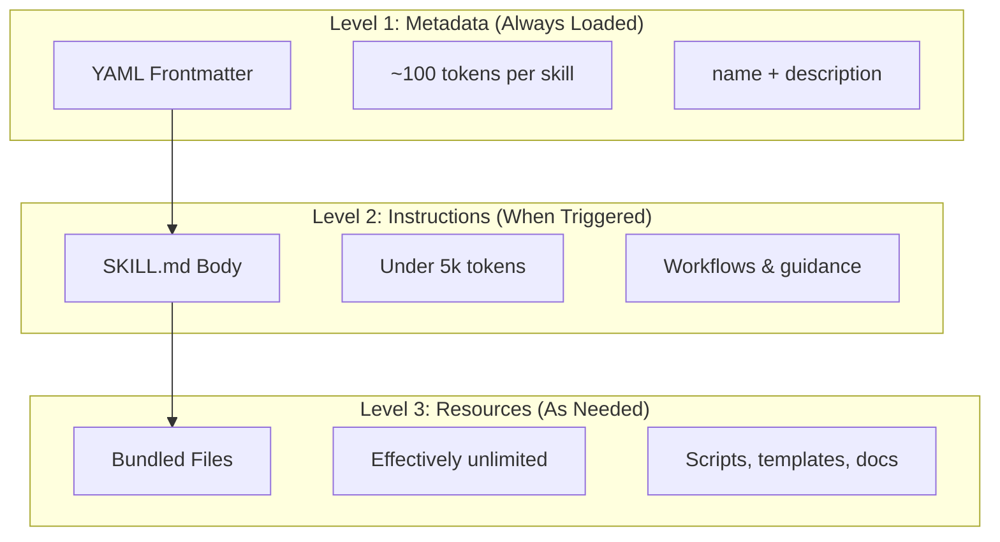
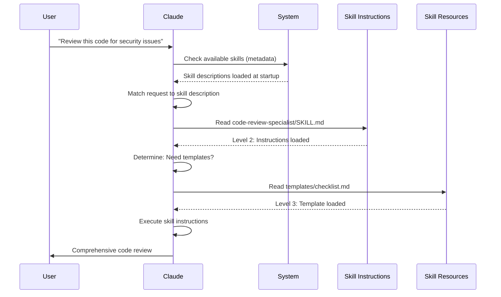

<!-- i18n-source: 03-skills/README.md -->
<!-- i18n-source-sha: ba721a3 -->
<!-- i18n-date: 2026-10-29 -->

<picture>
  <source media="(prefers-color-scheme: dark)" srcset="../../resources/logos/claude-howto-logo-dark.svg">
  
</picture>

# 에이전트 스킬 가이드

에이전트 스킬(Agent Skills)은 Claude의 기능을 넓혀 주는, 파일 시스템 기반의 재사용 가능한 기능입니다. 분야별 전문 지식, 워크플로, 모범 사례를 찾아 쓸 수 있는 구성 요소로 묶어 두면, Claude가 관련 있을 때 자동으로 사용합니다.

## 개요

**에이전트 스킬**은 범용 에이전트를 전문가로 바꿔 주는 모듈식 기능입니다. 일회성 작업을 위한 대화 단위 지침인 프롬프트와 달리, 스킬은 필요할 때 불러오므로 여러 대화에서 같은 안내를 반복해서 줄 필요가 없습니다.

### 주요 이점

- **Claude 전문화**: 분야별 작업에 맞게 기능을 맞춤 설정합니다
- **반복 줄이기**: 한 번 만들면 여러 대화에서 자동으로 쓰입니다
- **기능 조합**: 스킬을 조합해 복잡한 워크플로를 만듭니다
- **워크플로 확장**: 여러 프로젝트와 팀에서 스킬을 재사용합니다
- **품질 유지**: 모범 사례를 워크플로에 바로 담습니다

스킬은 여러 AI 도구에서 작동하는 [Agent Skills](https://agentskills.io) 개방형 표준을 따릅니다. Claude Code는 이 표준에 호출 제어, 서브에이전트 실행, 동적 컨텍스트 주입 같은 기능을 더했습니다.

> **참고**: 맞춤 슬래시 명령은 스킬로 통합되었습니다. `.claude/commands/` 파일도 계속 작동하며 같은 프런트매터 필드를 지원합니다. 새로 만드는 것은 스킬을 권장합니다. 같은 경로에 둘 다 있으면 (예: `.claude/commands/review.md`와 `.claude/skills/review/SKILL.md`) 스킬이 우선합니다.

## 스킬이 작동하는 방식: 점진적 공개

스킬은 **점진적 공개(progressive disclosure)** 구조를 씁니다. 처음부터 컨텍스트를 다 쓰지 않고, 필요할 때 단계별로 정보를 불러옵니다. 그래서 컨텍스트를 효율적으로 관리하면서도 사실상 제한 없이 확장할 수 있습니다.

### 불러오기의 세 단계



| 단계 | 불러오는 때 | 토큰 비용 | 내용 |
|------|-------------|-----------|------|
| **1단계: 메타데이터** | 항상 (시작할 때) | 스킬당 약 100토큰 | YAML 프런트매터의 `name`과 `description` |
| **2단계: 지침** | 스킬이 실행될 때 | 5천 토큰 미만 | 지침과 안내가 담긴 SKILL.md 본문 |
| **3단계 이상: 리소스** | 필요할 때 | 사실상 무제한 | 내용을 컨텍스트에 불러오지 않고 bash로 실행하는 번들 파일 |

그래서 스킬은 가볍습니다. 실제로 실행되기 전까지 Claude는 각 스킬이 있다는 것과 언제 쓰는지만 압니다. 하지만 공짜는 아닙니다. 목록에 오른 스킬마다 매 턴 그 설명이 컨텍스트에 더해집니다.

## 스킬 불러오기 과정



## 스킬 유형과 위치

| 유형 | 위치 | 범위 | 공유 | 적합한 용도 |
|------|------|------|------|-------------|
| **엔터프라이즈** | 관리형 설정 | 조직의 모든 사용자 | 예 | 조직 전체 기준 |
| **개인** | `~/.claude/skills/<skill-name>/SKILL.md` | 개인 | 아니요 | 개인 워크플로 |
| **프로젝트** | `.claude/skills/<skill-name>/SKILL.md` | 팀 | 예 (git으로) | 팀 기준 |
| **플러그인** | `<plugin>/skills/<skill-name>/SKILL.md` | 켜 둔 곳 | 경우에 따라 다름 | 플러그인과 함께 묶음 |

여러 단계에 같은 이름의 스킬이 있으면 우선순위가 높은 위치가 이깁니다: **엔터프라이즈 > 개인 > 프로젝트**. `~/.claude/skills/`와 `.claude/skills/`에 같은 이름이 있으면 개인 스킬이 실행됩니다. 우선순위가 아니라 스킬이 보이는지 여부를 바꾸려면 `skillOverrides` 설정(v2.1.129+)을 쓰세요. [스킬 덮어쓰기 동작 제어하기](#스킬-덮어쓰기-동작-제어하기-skilloverrides)를 참고하세요. 플러그인 스킬은 `plugin-name:skill-name` 네임스페이스를 쓰므로 충돌하지 않습니다.

> **서브에이전트의 스킬 탐색 (v2.1.133+)**: 이제 서브에이전트도 메인 세션과 같은 방식으로 Skill 도구를 통해 프로젝트, 사용자, 플러그인 스킬을 찾습니다. 이전 버전에서는 서브에이전트가 자체 내장 스킬만 쓸 수 있어서, 스킬과 서브에이전트를 함께 쓰는 워크플로가 알게 모르게 제대로 작동하지 않았습니다. v2.1.133부터는 양쪽 모두 같은 스킬 목록을 봅니다.

### 자동 탐색

**중첩 디렉터리**: 하위 디렉터리의 파일로 작업하면 Claude Code가 중첩된 `.claude/skills/` 디렉터리의 스킬을 자동으로 찾습니다. 예를 들어 `packages/frontend/`의 파일을 편집하면 `packages/frontend/.claude/skills/`에서도 스킬을 찾습니다. 그래서 패키지마다 자체 스킬을 둔 모노레포 구성을 지원합니다. 중첩된 스킬이 저장소 루트의 스킬과 이름이 같으면 **둘 다 불러옵니다**. 루트와 `apps/web/.claude/skills/`에 모두 `deploy` 스킬이 있으면, `/deploy`는 루트의 스킬을, `/apps/web:deploy`는 중첩된 스킬을 실행합니다.

**`--add-dir` 디렉터리**: `--add-dir`로 추가한 디렉터리의 스킬은 자동으로 불러오며, 변경 사항도 실시간으로 감지합니다. 그 디렉터리의 스킬 파일을 고치면 Claude Code를 다시 시작하지 않아도 바로 반영됩니다. 추가한 디렉터리의 스킬이 엔터프라이즈, 개인, 프로젝트 스킬이나 먼저 추가한 디렉터리의 스킬과 이름이 같으면, 접두사가 붙은 이름으로 실행됩니다. 예를 들어 `--add-dir ../cli`를 쓰고 양쪽에 `verify` 스킬이 있으면, `/verify`는 프로젝트의 스킬을, `/cli:verify`는 `../cli`의 스킬을 실행합니다 (v2.1.309+).

**스킬 다시 불러오기**: `/reload-skills` 명령(v2.1.152에서 추가)은 세션을 다시 시작하지 않고 모든 스킬 디렉터리를 다시 검색합니다. 실시간 감지로 잡히지 않는 스킬을 추가하거나 고친 뒤에 유용합니다. `SessionStart` 훅이 `reloadSkills: true`를 반환해도 같은 재검색이 일어납니다 ([훅](../06-hooks/README.md) 참고).

**설명 예산**: 스킬 설명(1단계 메타데이터)은 **컨텍스트 윈도의 1%**(대체값: **8,000자**)로 제한됩니다. 스킬을 많이 설치하면 설명이 짧게 잘릴 수 있습니다. 모든 스킬 이름은 항상 포함되지만, 설명은 한도에 맞게 줄어듭니다. 설명에는 핵심 사용 사례를 앞쪽에 쓰세요. 예산은 `SLASH_COMMAND_TOOL_CHAR_BUDGET` 환경 변수로 바꿀 수 있습니다.

## 맞춤 스킬 만들기

### 기본 디렉터리 구조

```text
my-skill/
├── SKILL.md           # 주 지침 (필수)
├── template.md        # Claude가 채울 템플릿
├── examples/
│   └── sample.md      # 기대하는 형식을 보여 주는 출력 예시
└── scripts/
    └── validate.sh    # Claude가 실행할 수 있는 스크립트
```

### SKILL.md 형식

```yaml
---
name: your-skill-name
description: 이 스킬이 하는 일과 언제 쓰는지에 대한 짧은 설명
---

# 스킬 이름

## 지침
Claude를 위한 명확한 단계별 안내를 적습니다.

## 예시
이 스킬을 쓰는 구체적인 예시를 보여 줍니다.
```

### 권장 필드

- **description** (권장): 스킬이 하는 일과 언제 쓰는지를 함께 적습니다. 생략하면 Claude Code가 markdown 내용에서 비어 있지 않은 첫 줄을 씁니다. 스킬 목록에서 `description`과 `when_to_use`를 합친 텍스트는 **1,536자**에서 잘립니다 (`skillListingMaxDescChars`로 설정 가능). Claude는 이 내용과 비교해 스킬을 언제 실행할지 정합니다.
- **name** (선택): 기본값은 스킬의 **디렉터리 이름**입니다. 지정하면 표시 이름이 됩니다. 소문자, 숫자, 하이픈만 쓰고 최대 64자로 하는 것이 권장되는 호환성 좋은 형식입니다 (claude.ai와 Skills API에서는 필수). Claude Code 자체(v2.1.299+)는 이름에 보이지 않는 문자, 방향을 바꾸는 문자, 공백처럼 보이는 문자, `<`나 `>`가 들어 있거나 256자를 넘는 스킬과 명령은 이름을 바꿀 때까지 건너뜁니다. Claude Code에서 `anthropic-skills`와 `synced`는 예약어라 플러그인 밖에서는 불러오지 않습니다. "anthropic"이나 "claude"를 금지하는 더 엄격한 규칙은 claude.ai나 Skills API에 올리는 스킬에 적용됩니다. 플러그인 스킬에서는 `name`이 명령의 마지막 부분도 정합니다.

SKILL.md의 모든 프런트매터 필드는 선택 사항이며, 권장되는 필드는 `description` 하나뿐입니다.

### 선택 프런트매터 필드

```yaml
---
name: my-skill
description: 이 스킬이 하는 일과 언제 쓰는지
argument-hint: "[filename] [format]"        # 자동 완성 힌트
disable-model-invocation: true              # 사용자만 호출 가능
user-invocable: false                       # 슬래시 메뉴에서 숨김
allowed-tools: Read, Grep, Glob             # 스킬이 실행되는 동안 이 도구들을 미리 승인 (권한 확인 창 없음)
disallowed-tools: Write, Edit               # 활성화된 동안 특정 도구 제거 (v2.1.152)
model: opus                                 # 사용할 특정 모델
effort: high                                # 노력 수준 덮어쓰기 (low, medium, high, xhigh, max)
context: fork                               # 격리된 서브에이전트에서 실행
agent: Explore                              # 에이전트 유형 (context: fork와 함께)
background: false                           # 포크 스킬은 백그라운드에서 실행 (기본값 true); false = 포그라운드
shell: bash                                 # 명령용 셸: bash (기본값) 또는 powershell
hooks:                                      # 스킬이 호출될 때 등록되는 훅
  PreToolUse:
    - matcher: "Bash"
      hooks:
        - type: command
          command: "./scripts/validate.sh"
paths: "src/api/**/*.ts"               # 스킬이 활성화되는 경우를 제한하는 glob 패턴
---
```

| 필드 | 설명 |
|------|------|
| `name` | 권장 형식(호환성 좋음): 소문자, 숫자, 하이픈만 사용 (최대 64자). Claude Code에서 `anthropic-skills`와 `synced`는 예약어입니다. |
| `description` | 스킬이 하는 일과 언제 쓰는지. 스킬 목록에서 `description`과 `when_to_use`를 합친 텍스트는 1,536자에서 잘립니다 (`skillListingMaxDescChars`로 설정 가능). 자동 호출 판단에 매우 중요합니다. |
| `when_to_use` | Claude가 언제 스킬을 호출해야 하는지에 대한 추가 맥락. 스킬 목록에서 `description` 뒤에 붙고 1,536자 한도에 포함됩니다. |
| `argument-hint` | `/` 자동 완성 메뉴에 표시되는 힌트 (예: `"[filename] [format]"`). |
| `disable-model-invocation` | `true` = 사용자만 `/name`으로 호출할 수 있습니다. Claude는 절대 자동으로 호출하지 않습니다. |
| `user-invocable` | `false` = `/` 메뉴에서 숨깁니다. Claude만 자동으로 호출할 수 있습니다. |
| `allowed-tools` | 스킬이 권한 확인 창 없이 쓸 수 있는 도구 목록 (쉼표로 구분). 관리형 설정의 `strictPluginOnlyCustomization`에 `hooks`가 들어 있으면, 프런트매터에 `hooks`를 선언한 개인 스킬이나 프로젝트 스킬은 이 사전 승인을 잃습니다 (v2.1.304). `hooks`를 빼거나 플러그인으로 옮기세요. |
| `disallowed-tools` | 스킬이 활성화된 동안 제거할 도구 목록 (쉼표로 구분, `allowed-tools`를 보완). v2.1.152에서 추가. |
| `model` | 스킬이 활성화된 동안 쓸 모델 (예: `opus`, `sonnet`). |
| `effort` | 스킬이 활성화된 동안 쓸 노력 수준: `low`, `medium`, `high`, `xhigh`, `max`. 다섯 가지 모두 Fable 5.1, Fable 5, Opus 5.5, Sonnet 5.5, Haiku 5.5, Opus 5, Sonnet 5, Opus 4.8, Opus 4.7에서 지원됩니다. 기본 노력 수준은 노력 수준을 지원하는 모든 모델에서 `high`입니다. 다만 Opus 5.5, Sonnet 5.5, Haiku 5.5는 `medium`, Opus 4.7은 `xhigh`가 기본값입니다. |
| `context` | `fork`로 설정하면 자체 컨텍스트 윈도를 가진 포크된 서브에이전트 컨텍스트에서 스킬을 실행합니다. |
| `agent` | `context: fork`일 때의 서브에이전트 유형 (예: `Explore`, `Plan`, `general-purpose`). |
| `background` | `context: fork`와 함께 쓸 때만 의미가 있습니다. `context: fork` 스킬의 기본값은 `true`라 백그라운드에서 실행됩니다. `false`로 설정하면 포그라운드에서 실행됩니다. v2.1.218에서 추가. |
| `shell` | `` !`command` `` 치환과 스크립트에 쓰는 셸: `bash` (기본값) 또는 `powershell`. |
| `hooks` | 스킬이 호출될 때 등록되는 훅 (설정의 훅과 같은 형식, 모든 이벤트 가능). 세션이 끝날 때까지 활성 상태로 남습니다. v2.1.304부터 한 출처(프로젝트, 개인 스킬 폴더, 또는 플러그인 하나)의 스킬은 세션당 최대 1,024개의 훅과 16,384자의 matcher를 등록할 수 있습니다. 이를 넘으면 스킬이 프런트매터 훅 없이 실행됩니다 (`/hooks`로 확인). |
| `paths` | 스킬이 자동으로 활성화되는 경우를 제한하는 glob 패턴. 쉼표로 구분한 문자열이나 YAML 목록. 패턴은 Claude의 현재 작업 디렉터리 기준이며, `/add-dir`로 추가한 옆 워크트리처럼 그 밖에 있는 파일은 일치하지 않습니다 (그곳에서 Claude Code를 시작하거나 `/cd`를 쓰세요). 경로별 규칙과 같은 형식입니다. |
| `arguments` | 자동 완성과 인수 치환을 위해 스킬이 받는 인수를 선언합니다. 처음 64개 이름까지, 각각 64자까지만 채워집니다 (v2.1.301). |
| `metadata` | 직접 관리용으로 쓰는 자유 형식 키/값 맵 (예: `version`, `author`). Claude Code는 그대로 전달합니다. |
| `license` | 스킬의 라이선스 식별자 (예: `MIT`). |
| `compatibility` | 최대 500자의 자유 형식 호환성 설명. Claude Code는 받아들이지만 이에 따라 동작하지는 않습니다. |

> **참고**: claude.ai에 올리거나 Skills API로 만드는 스킬에서 유효한 필드는 `name`, `description`, `license`, `compatibility`, `metadata`, `allowed-tools`뿐입니다. 표의 나머지 필드는 Claude Code 전용입니다.

v2.1.218부터 불리언 프런트매터 필드는 `true`/`false` 말고도 `yes`/`no`, `on`/`off`, `1`/`0`(대소문자 구분 없음)을 받습니다.

## 스킬 내용의 유형

스킬에는 두 가지 유형의 내용을 담을 수 있으며, 각각 쓰임새가 다릅니다.

### 참고 내용

Claude가 지금 하는 작업에 적용할 지식(규칙, 패턴, 스타일 가이드, 분야 지식)을 더합니다. 대화 컨텍스트 안에서 함께 실행됩니다.

```yaml
---
name: api-conventions
description: 이 코드베이스의 API 설계 패턴
---

API 엔드포인트를 작성할 때:
- RESTful 이름 규칙을 사용합니다
- 일관된 오류 형식을 반환합니다
- 요청 검증을 포함합니다
```

### 작업 내용

특정 작업을 위한 단계별 지침입니다. 보통 `/skill-name`으로 직접 호출합니다.

```yaml
---
name: deploy
description: 애플리케이션을 운영 환경에 배포하기
context: fork
disable-model-invocation: true
---

애플리케이션을 배포합니다:
1. 테스트 스위트 실행
2. 애플리케이션 빌드
3. 배포 대상으로 푸시
```

## 스킬 호출 제어하기

기본적으로는 나와 Claude 모두 어떤 스킬이든 호출할 수 있습니다. 두 프런트매터 필드로 세 가지 호출 방식을 제어합니다.

| 프런트매터 | 내가 호출 | Claude가 호출 |
|---|---|---|
| (기본값) | 가능 | 가능 |
| `disable-model-invocation: true` | 가능 | 불가 |
| `user-invocable: false` | 불가 | 가능 |

부수 효과가 있는 워크플로에는 **`disable-model-invocation: true`를 쓰세요**: `/commit`, `/deploy`, `/send-slack-message`. 코드가 준비된 것처럼 보인다는 이유로 Claude가 배포를 결정하면 곤란합니다.

명령으로 실행할 만한 동작이 아닌 배경 지식에는 **`user-invocable: false`를 쓰세요**. 예를 들어 오래된 시스템의 작동 방식을 설명하는 `legacy-system-context` 스킬은 Claude에게는 유용하지만, 사용자가 실행할 의미 있는 동작은 아닙니다.

## 문자열 치환

스킬은 내용이 Claude에게 전달되기 전에 풀이되는 동적 값을 지원합니다.

| 변수 | 설명 |
|------|------|
| `$ARGUMENTS` | 스킬을 호출할 때 넘긴 모든 인수 |
| `$ARGUMENTS[N]` 또는 `$N` | 인덱스(0부터 시작)로 특정 인수에 접근 |
| `${CLAUDE_SESSION_ID}` | 현재 세션 ID |
| `${CLAUDE_SKILL_DIR}` | 스킬의 SKILL.md 파일이 있는 디렉터리 |
| `${CLAUDE_PROJECT_DIR}` | 프로젝트 루트의 절대 경로. 스킬 본문과 `allowed-tools`에서 쓸 수 있습니다 (v2.1.196) |
| `${CLAUDE_EFFORT}` | 현재 노력 수준 (`low`, `medium`, `high`, `xhigh`, `max`). 스킬 동작을 나눌 때 유용합니다. 예: `[ "${CLAUDE_EFFORT}" = "max" ] && deep_analysis` (v2.1.120+) |
| `` !`command` `` | 동적 컨텍스트 주입. 셸 명령을 실행하고 그 출력을 그 자리에 넣습니다 |

**예시:**

```yaml
---
name: fix-issue
description: GitHub 이슈 수정하기
---

팀의 코딩 기준에 따라 GitHub 이슈 $ARGUMENTS를 수정합니다.
1. 이슈 설명 읽기
2. 수정 구현하기
3. 테스트 작성하기
4. 커밋 만들기
```

`/fix-issue 123`을 실행하면 `$ARGUMENTS`가 `123`으로 바뀝니다.

### 스킬 겹쳐 쓰기

터미널 프롬프트에서 `/write-tests /fix-issue 123`처럼 슬래시 스킬을 한 번에 겹쳐 호출할 수 있습니다. v2.1.199부터는 앞쪽의 스킬을 모두 불러오고 (첫 번째 스킬과 최대 5개 더), 뒤쪽 인수(`123`)를 각 스킬에 넘깁니다. 예전에는 첫 번째 스킬만 불러왔습니다. `/code-review`처럼 포크된 서브에이전트로 실행되는 스킬을 만나면 펼치기가 멈추고, Agent SDK나 `claude -p`에서는 첫 번째 스킬만 불러옵니다. 같은 스킬을 여러 번 호출하면 같은 내용을 두 번 붙이지 않고 중복을 없앱니다 (v2.1.202).

## 동적 컨텍스트 주입하기

`` !`command` `` 문법은 스킬 내용이 Claude에게 전달되기 전에 셸 명령을 실행합니다.

> **참고 (v2.1.299)**: `UserPromptSubmit` 훅은 명령이 펼쳐지기 전에 실행되므로, 훅이 프롬프트를 막으면 이 `!` 명령들도 실행되지 않습니다.

```yaml
---
name: pr-summary
description: 풀 리퀘스트의 변경 사항 요약하기
context: fork
agent: Explore
---

## 풀 리퀘스트 맥락
- PR diff: !`gh pr diff`
- PR 댓글: !`gh pr view --comments`
- 바뀐 파일: !`gh pr diff --name-only`

## 할 일
이 풀 리퀘스트를 요약합니다...
```

명령은 바로 실행되며, Claude는 최종 출력만 봅니다. 기본적으로 명령은 `bash`에서 실행됩니다. 대신 PowerShell을 쓰려면 프런트매터에 `shell: powershell`을 설정하세요.

## 서브에이전트에서 스킬 실행하기

`context: fork`를 추가하면 격리된 서브에이전트 컨텍스트에서 스킬을 실행합니다. 스킬 내용이 자체 컨텍스트 윈도를 가진 전용 서브에이전트의 작업이 되므로, 메인 대화가 어지러워지지 않습니다. v2.1.218부터 `context: fork` 스킬의 `background` 기본값은 `true`라서 백그라운드에서 실행됩니다. 포크 스킬을 포그라운드에서 실행하려면 프런트매터에 `background: false`를 설정하세요.

> **v2.1.145 수정**: 예전에는 드물게 `context: fork`를 쓰는 스킬이 무한히 다시 호출되는 일이 있었습니다. 포크 스킬을 만들거나 쓴다면 v2.1.145+로 업그레이드하세요.

`agent` 필드로 쓸 에이전트 유형을 정합니다.

| 에이전트 유형 | 적합한 용도 |
|---|---|
| `Explore` | 읽기 전용 조사, 코드베이스 분석 |
| `Plan` | 구현 계획 세우기 |
| `general-purpose` | 모든 도구가 필요한 폭넓은 작업 |
| 맞춤 에이전트 | 설정에서 정의한 전문 에이전트 |

**프런트매터 예시:**

```yaml
---
context: fork
agent: Explore
---
```

**전체 스킬 예시:**

```yaml
---
name: topic-research
description: 주제를 깊이 조사하기
context: fork
agent: Explore
---

$ARGUMENTS를 깊이 조사합니다:
1. Glob과 Grep으로 관련 파일 찾기
2. 코드를 읽고 분석하기
3. 구체적인 파일 참조와 함께 결과 요약하기
```

## 실전 예시

### 예시 1: 코드 리뷰 스킬

**디렉터리 구조:**

```text
~/.claude/skills/code-review-specialist/
├── SKILL.md
├── templates/
│   ├── review-checklist.md
│   └── finding-template.md
└── scripts/
    ├── analyze-metrics.py
    └── compare-complexity.py
```

**파일:** `~/.claude/skills/code-review-specialist/SKILL.md`

```yaml
---
name: code-review-specialist
description: 보안, 성능, 품질 분석을 포함한 종합 코드 리뷰. 사용자가 코드 리뷰, 코드 품질 분석, 풀 리퀘스트 평가를 요청하거나 코드 리뷰, 보안 분석, 성능 최적화를 언급할 때 사용합니다.
---

# 코드 리뷰 스킬

이 스킬은 다음에 집중하는 종합 코드 리뷰 기능을 제공합니다.

1. **보안 분석**
   - 인증/인가 문제
   - 데이터 노출 위험
   - 인젝션 취약점
   - 암호화 약점

2. **성능 리뷰**
   - 알고리즘 효율 (Big O 분석)
   - 메모리 최적화
   - 데이터베이스 쿼리 최적화
   - 캐싱 기회

3. **코드 품질**
   - SOLID 원칙
   - 디자인 패턴
   - 이름 규칙
   - 테스트 커버리지

4. **유지 보수성**
   - 코드 가독성
   - 함수 크기 (50줄 미만이어야 함)
   - 순환 복잡도
   - 타입 안전성

## 리뷰 템플릿

리뷰한 코드마다 다음을 제공합니다.

### 요약
- 전체 품질 평가 (1-5)
- 주요 발견 사항 수
- 우선 개선할 영역 추천

### 심각한 문제 (있는 경우)
- **문제**: 명확한 설명
- **위치**: 파일과 줄 번호
- **영향**: 왜 중요한지
- **심각도**: Critical/High/Medium
- **수정**: 코드 예시

자세한 체크리스트는 [templates/review-checklist.md](templates/review-checklist.md)를 참고하세요.
```

### 예시 2: 코드베이스 시각화 스킬

대화형 HTML 시각화를 만드는 스킬입니다.

**디렉터리 구조:**

```text
~/.claude/skills/codebase-visualizer/
├── SKILL.md
└── scripts/
    └── visualize.py
```

**파일:** `~/.claude/skills/codebase-visualizer/SKILL.md`

````yaml
---
name: codebase-visualizer
description: 코드베이스를 접고 펼 수 있는 대화형 트리로 시각화하기. 새 저장소를 살펴보거나, 프로젝트 구조를 이해하거나, 큰 파일을 찾을 때 사용합니다.
allowed-tools: Bash(python *)
---

# 코드베이스 시각화

프로젝트의 파일 구조를 보여 주는 대화형 HTML 트리 보기를 만듭니다.

## 사용법

프로젝트 루트에서 시각화 스크립트를 실행합니다.

```bash
python ~/.claude/skills/codebase-visualizer/scripts/visualize.py .
```

`codebase-map.html`이 만들어지고 기본 브라우저에서 열립니다.

## 시각화가 보여 주는 것

- **접고 펼 수 있는 디렉터리**: 폴더를 누르면 펼치거나 접힙니다
- **파일 크기**: 각 파일 옆에 표시됩니다
- **색상**: 파일 유형마다 다른 색을 씁니다
- **디렉터리 합계**: 각 폴더의 전체 크기를 보여 줍니다
````

무거운 작업은 번들 Python 스크립트가 하고, Claude는 전체 흐름을 조율합니다.

### 예시 3: 배포 스킬 (사용자만 호출)

```yaml
---
name: deploy
description: 애플리케이션을 운영 환경에 배포하기
disable-model-invocation: true
allowed-tools: Bash(npm *), Bash(git *)
---

$ARGUMENTS를 운영 환경에 배포합니다:

1. 테스트 스위트 실행: `npm test`
2. 애플리케이션 빌드: `npm run build`
3. 배포 대상으로 푸시
4. 배포가 성공했는지 확인
5. 배포 상태 보고
```

### 예시 4: 브랜드 보이스 스킬 (배경 지식)

```yaml
---
name: brand-voice
description: 모든 커뮤니케이션이 브랜드 보이스와 어조 가이드라인에 맞는지 확인하기. 마케팅 문구, 고객 커뮤니케이션, 외부에 공개되는 콘텐츠를 만들 때 사용합니다.
user-invocable: false
---

## 어조
- **친근하지만 전문적으로** - 가볍지 않으면서도 다가가기 쉽게
- **명확하고 간결하게** - 전문 용어는 피하기
- **자신 있게** - 우리는 무엇을 하는지 알고 있다
- **공감하며** - 사용자의 필요를 이해하기

## 작성 가이드라인
- 독자를 부를 때는 "you"를 씁니다
- 능동태를 씁니다
- 문장은 20단어 미만으로 유지합니다
- 가치 제안으로 시작합니다

템플릿은 [templates/](templates/)를 참고하세요.
```

### 예시 5: CLAUDE.md 생성 스킬

```yaml
---
name: claude-md
description: AI 에이전트가 최적으로 적응하도록 모범 사례에 따라 CLAUDE.md 파일을 만들거나 업데이트하기. 사용자가 CLAUDE.md, 프로젝트 문서, AI 온보딩을 언급할 때 사용합니다.
---

## 핵심 원칙

**LLM은 상태가 없습니다**: CLAUDE.md는 모든 대화에 (자동 메모리, 범위가 정해지지 않은 규칙과 함께) 불러오는 주 프로젝트 파일입니다.

### 황금률

1. **적을수록 좋다**: CLAUDE.md는 각각 200줄 이하로 유지합니다
2. **어디에나 적용될 것**: 모든 세션에 관련된 정보만 넣습니다
3. **Claude를 린터로 쓰지 말 것**: 대신 결정론적 도구를 씁니다
4. **자동 생성하지 말 것**: 신중하게 생각하며 직접 작성합니다

## 꼭 필요한 단락

- **프로젝트 이름**: 한 줄짜리 짧은 설명
- **기술 스택**: 주 언어, 프레임워크, 데이터베이스
- **개발 명령**: 설치, 테스트, 빌드 명령
- **중요한 규칙**: 한눈에 알기 어렵고 영향이 큰 규칙만
- **알려진 문제 / 함정**: 개발자가 자주 걸려 넘어지는 것
```

### 예시 6: 스크립트가 있는 리팩터링 스킬

**디렉터리 구조:**

```text
refactor/
├── SKILL.md
├── references/
│   ├── code-smells.md
│   └── refactoring-catalog.md
├── templates/
│   └── refactoring-plan.md
└── scripts/
    ├── analyze-complexity.py
    └── detect-smells.py
```

**파일:** `refactor/SKILL.md`

```yaml
---
name: refactor
description: Martin Fowler의 방법론에 기반한 체계적인 코드 리팩터링. 사용자가 코드 리팩터링, 코드 구조 개선, 기술 부채 줄이기, 코드 스멜 없애기를 요청할 때 사용합니다.
---

# 코드 리팩터링 스킬

테스트로 뒷받침되는 안전하고 점진적인 변경을 강조하는 단계별 접근 방식입니다.

## 워크플로

1단계: 조사와 분석 → 2단계: 테스트 커버리지 평가 →
3단계: 코드 스멜 찾기 → 4단계: 리팩터링 계획 세우기 →
5단계: 점진적 구현 → 6단계: 검토와 반복

## 핵심 원칙

1. **동작 보존**: 외부 동작은 바뀌지 않아야 합니다
2. **작은 단계**: 작고 테스트할 수 있는 변경을 합니다
3. **테스트 주도**: 테스트가 안전망입니다
4. **지속적으로**: 리팩터링은 한 번으로 끝나는 일이 아니라 계속하는 일입니다

코드 스멜 목록은 [references/code-smells.md](references/code-smells.md)를 참고하세요.
리팩터링 기법은 [references/refactoring-catalog.md](references/refactoring-catalog.md)를 참고하세요.
```

## 지원 파일

스킬 디렉터리에는 `SKILL.md` 말고도 여러 파일을 넣을 수 있습니다. 이런 지원 파일(템플릿, 예시, 스크립트, 참고 문서)을 쓰면 주 스킬 파일은 핵심에 집중하게 두면서, Claude가 필요할 때 불러올 수 있는 추가 자료를 제공할 수 있습니다.

```text
my-skill/
├── SKILL.md              # 주 지침 (필수, 500줄 이하로 유지)
├── templates/            # Claude가 채울 템플릿
│   └── output-format.md
├── examples/             # 기대하는 형식을 보여 주는 출력 예시
│   └── sample-output.md
├── references/           # 분야 지식과 명세
│   └── api-spec.md
└── scripts/              # Claude가 실행할 수 있는 스크립트
    └── validate.sh
```

지원 파일에 대한 가이드라인:

- `SKILL.md`는 **500줄 이하**로 유지합니다. 자세한 참고 자료, 큰 예시, 명세는 별도 파일로 옮깁니다.
- `SKILL.md`에서 추가 파일을 참조할 때는 **상대 경로**를 씁니다 (예: `[API reference](references/api-spec.md)`).
- 지원 파일은 3단계(필요할 때)에서 불러오므로, Claude가 실제로 읽기 전까지는 컨텍스트를 쓰지 않습니다.

## 스킬 관리하기

### 사용할 수 있는 스킬 보기

Claude에게 직접 물어봅니다.
```text
What Skills are available?
```

또는 파일 시스템을 확인합니다.
```bash
# 개인 스킬 나열
ls ~/.claude/skills/

# 프로젝트 스킬 나열
ls .claude/skills/
```

> **팁 (v2.1.121+):** `/skills` 대화형 메뉴에서 글자를 입력하면 목록이 걸러집니다. 스킬을 많이 설치했을 때 유용합니다.

### 스킬 테스트하기

테스트하는 방법은 두 가지입니다.

**설명과 맞는 요청을 해서 Claude가 자동으로 호출하게 하기:**
```text
Can you help me review this code for security issues?
```

**또는 스킬 이름으로 직접 호출하기:**
```text
/code-review-specialist src/auth/login.ts
```

> **참고**: 이 로컬 스킬은 `code-review-specialist`라는 이름으로 설치되므로, 번들 스킬 `/code-review`(버그 중심 리뷰, 별칭 `/review`)와 **충돌하지 않습니다**. 대신 `~/.claude/skills/code-review/`로 복사하면 번들 `/code-review`를 대체합니다 (`/review`는 여전히 번들 스킬을 실행). 이를 피하려면 `-specialist` 접미사를 유지하세요.

### 스킬 업데이트하기

`SKILL.md` 파일을 직접 편집한 뒤 `/reload-skills`(v2.1.152+)를 실행해 스킬 디렉터리를 다시 검색합니다. Claude Code를 다시 시작해도 되지만 꼭 그럴 필요는 없습니다. `--add-dir` 디렉터리의 스킬은 실시간으로 반영되고, `reloadSkills: true`를 반환하는 `SessionStart` 훅도 같은 재검색을 실행합니다.

```bash
# 개인 스킬
code ~/.claude/skills/my-skill/SKILL.md

# 프로젝트 스킬
code .claude/skills/my-skill/SKILL.md
```

### Claude의 스킬 접근 제한하기

Claude가 호출할 수 있는 스킬을 제어하는 방법은 세 가지입니다.

**`/permissions`에서 모든 스킬 끄기:**
```text
# 거부 규칙에 추가:
Skill
```

**특정 스킬 허용 또는 거부하기:**
```text
# 특정 스킬만 허용
Skill(commit)
Skill(review-pr *)

# 특정 스킬 거부
Skill(deploy *)
```

**개별 스킬 숨기기:** 프런트매터에 `disable-model-invocation: true`를 추가합니다.

### 스킬 덮어쓰기 동작 제어하기 (`skillOverrides`)

`skillOverrides`(v2.1.129+)는 우선순위를 바꾸는 스위치가 아니라 스킬별 표시 여부를 정하는 맵입니다. SKILL.md를 고치지 않고 설정에서 각 스킬이 어떻게 보일지 정합니다. 각 키는 스킬 이름이며, `/skills` 메뉴에서 정하면 알아서 기록됩니다 (`.claude/settings.local.json`에 저장). 우선순위는 바뀌지 않으므로, 같은 이름이면 여전히 개인 스킬이 프로젝트 스킬을 이깁니다. `~/.claude/settings.json`이나 프로젝트의 `.claude/settings.json`에 추가합니다.

```json
{
  "skillOverrides": {
    "deploy": "off",
    "legacy-helper": "name-only"
  }
}
```

쓸 수 있는 값:

| 값 | 동작 |
|----|------|
| `"on"` (기본값) | 이름과 설명을 Claude에게 보여 주고, `/` 메뉴에도 표시합니다. |
| `"name-only"` | 이름만 Claude에게 보여 주고, `/` 메뉴에도 표시합니다. |
| `"user-invocable-only"` | Claude에게는 숨기고, `/` 메뉴에는 계속 표시합니다. |
| `"off"` | Claude와 `/` 메뉴 모두에서 숨깁니다. |

플러그인 스킬은 `skillOverrides`의 영향을 받지 않으니 `/plugin`으로 관리하세요.

## 모범 사례

### 1. 설명을 구체적으로 쓰기

- **나쁨 (막연함)**: "문서 작업을 도와줌"
- **좋음 (구체적)**: "PDF 파일에서 텍스트와 표를 추출하고, 양식을 채우고, 문서를 합칩니다. PDF 파일로 작업하거나 사용자가 PDF, 양식, 문서 추출을 언급할 때 사용합니다."

### 2. 스킬은 한 가지에 집중하기

- 스킬 하나 = 기능 하나
- ✅ "PDF 양식 채우기"
- ❌ "문서 처리" (너무 넓음)

### 3. 실행 단어 넣기

설명에 사용자 요청과 맞는 키워드를 넣습니다.
```yaml
description: Excel 스프레드시트를 분석하고, 피벗 테이블을 만들고, 차트를 그립니다. Excel 파일, 스프레드시트, .xlsx 파일로 작업할 때 사용합니다.
```

### 4. SKILL.md는 500줄 이하로 유지하기

자세한 참고 자료는 Claude가 필요할 때 불러오는 별도 파일로 옮깁니다.

### 5. 지원 파일 참조하기

```markdown
## 추가 자료

- API 전체 정보는 [reference.md](reference.md)를 참고하세요
- 사용 예시는 [examples.md](examples.md)를 참고하세요
```

### 해야 할 것

- 명확하고 내용을 알 수 있는 이름 쓰기
- 포괄적인 지침 넣기
- 구체적인 예시 추가하기
- 관련 스크립트와 템플릿을 함께 묶기
- 실제 시나리오로 테스트하기
- 의존성 문서화하기

### 하지 말아야 할 것

- 한 번만 할 작업에 스킬 만들지 않기
- 이미 있는 기능을 중복해서 만들지 않기
- 스킬 범위를 너무 넓게 잡지 않기
- description 필드 빼먹지 않기
- 믿을 수 없는 출처의 스킬을 검토 없이 설치하지 않기

## 문제 해결

### 빠른 참고

| 문제 | 해결 방법 |
|------|-----------|
| Claude가 스킬을 쓰지 않음 | 실행 단어를 넣어 설명을 더 구체적으로 씁니다 |
| 스킬 파일을 찾을 수 없음 | 경로를 확인합니다: `~/.claude/skills/name/SKILL.md` |
| YAML 오류 | `---` 표시, 들여쓰기, 탭이 없는지 확인합니다 |
| 스킬끼리 충돌 | 설명에 서로 다른 실행 단어를 씁니다 |
| 스크립트가 실행되지 않음 | 권한을 확인합니다: `chmod +x scripts/*.py` |
| Claude가 모든 스킬을 보지 못함 | 스킬이 너무 많습니다. `/context`에서 경고를 확인한 뒤, `/skill-doctor`(v2.1.252+)로 쓰이지 않는 스킬과 그 비용을 확인합니다 |

### 스킬이 실행되지 않을 때

기대할 때 Claude가 스킬을 쓰지 않는다면:

1. 사용자가 자연스럽게 쓸 만한 키워드가 설명에 들어 있는지 확인합니다
2. "What skills are available?"라고 물었을 때 스킬이 보이는지 확인합니다
3. 설명과 맞도록 요청을 바꿔 말해 봅니다
4. `/skill-name`으로 직접 호출해 테스트합니다

### 스킬이 너무 자주 실행될 때

원하지 않을 때 Claude가 스킬을 쓴다면:

1. 설명을 더 구체적으로 씁니다
2. 수동으로만 호출하도록 `disable-model-invocation: true`를 추가합니다

### Claude가 모든 스킬을 보지 못할 때

스킬 설명은 **컨텍스트 윈도의 1%**(대체값: **8,000자**)까지 불러옵니다. 각 항목의 `description`과 `when_to_use`는 기본적으로 합쳐서 1,536자로 제한됩니다 (`skillListingMaxDescChars`). `/context`를 실행해 제외된 스킬에 대한 경고가 있는지 확인하세요. 예산은 `SLASH_COMMAND_TOOL_CHAR_BUDGET` 환경 변수로 바꿀 수 있습니다.

## 보안 고려 사항

**믿을 수 있는 출처의 스킬만 쓰세요.** 스킬은 지침과 코드로 Claude에게 기능을 줍니다. 악의적인 스킬은 Claude가 해로운 방식으로 도구를 호출하거나 코드를 실행하도록 이끌 수 있습니다.

**핵심 보안 고려 사항:**

- **꼼꼼히 감사하기**: 스킬 디렉터리의 모든 파일을 검토합니다
- **외부 출처는 위험함**: 외부 URL에서 내용을 가져오는 스킬은 오염될 수 있습니다
- **도구 오용**: 악의적인 스킬은 해로운 방식으로 도구를 호출할 수 있습니다
- **소프트웨어 설치처럼 다루기**: 믿을 수 있는 출처의 스킬만 씁니다

### 스킬의 셸 치환 끄기

스킬은 `` !`command` `` 문법으로, Claude가 보기 전에 셸 명령의 출력을 프롬프트에 넣을 수 있습니다. 보안이 중요한 환경(공유 엔터프라이즈 배포, 잠금된 CI 실행 환경)에서는 `disableSkillShellExecution` 설정(**v2.1.91**에서 추가)으로 이 치환을 완전히 끌 수 있습니다.

```jsonc
// ~/.claude/settings.json 또는 관리형 정책
{
  "disableSkillShellExecution": true
}
```

`disableSkillShellExecution`이 `true`면 스킬 안의 각 `` !`command` `` 표시는 실행되지 않고 `[shell command execution disabled by policy]`로 바뀝니다. 스킬 자체는 끄지 않으면서 스킬 단위의 셸 주입 공격 표면을 없앱니다. 다층 방어를 위해 `allowedTools` 허용 목록과 함께 쓰는 것을 고려하세요.

### 번들 스킬 숨기기 (`disableBundledSkills`)

`disableBundledSkills` 설정(**v2.1.169**에서 추가)은 Claude Code에 함께 들어 있는 번들 스킬, 워크플로, 명령을 모델에게서 숨깁니다. 특정 프로젝트에서 내장 스킬이 방해만 되거나, 모델이 보는 스킬 범위를 줄이고 싶을 때 씁니다.

```jsonc
// ~/.claude/settings.json 또는 프로젝트의 .claude/settings.json
{
  "disableBundledSkills": true
}
```

같은 효과를 내는 환경 변수 형식은 다음과 같습니다.

```bash
export CLAUDE_CODE_DISABLE_BUNDLED_SKILLS=1
```

## 스킬과 다른 기능 비교

| 기능 | 호출 방식 | 적합한 용도 |
|------|-----------|-------------|
| **스킬** | 자동 또는 `/name` | 재사용할 수 있는 전문 지식, 워크플로 |
| **슬래시 명령** | 사용자가 `/name`으로 시작 | 빠른 단축 명령 (스킬로 통합됨) |
| **서브에이전트** | 자동 위임 | 격리된 작업 실행 |
| **메모리 (CLAUDE.md)** | 항상 불러옴 | 지속적인 프로젝트 컨텍스트 |
| **MCP** | 실시간 | 외부 데이터/서비스 접근 |
| **훅** | 이벤트 기반 | 자동화된 부수 효과 |

## 번들 스킬

Claude Code에는 설치 없이 항상 쓸 수 있는 내장 스킬이 함께 들어 있습니다 (가장 유용한 것들을 아래에 정리했으며, 전체 목록은 [명령 레퍼런스](https://code.claude.com/docs/en/commands)를 참고하세요).

| 스킬 | 설명 |
|------|------|
| `/batch <instruction>` | git 워크트리를 써서 코드베이스 전체에 걸친 대규모 병렬 변경을 조율합니다 |
| `/claude-api` | Claude API/SDK 레퍼런스를 불러옵니다. `anthropic`/`@anthropic-ai/sdk`를 가져오는 코드에서 자동으로 켜집니다. `/claude-api api-version`은 코드를 `2026-10-21` 같은 더 새로운 API 버전으로 업데이트합니다 (v2.1.307+). `/claude-api managed-agents-secure [<agent-id>]`는 아무것도 바꾸지 않고 Managed Agent의 설정을 Anthropic 보안 가이드와 비교해 점검합니다 (`ant` CLI 필요, v2.1.304+) |
| `/dataviz` | 실행할 수 있는 색상 팔레트 검증기가 포함된 차트·대시보드 디자인 가이드 (v2.1.198) |
| `/debug [description]` | 디버그 로그를 읽어 현재 세션의 문제를 해결합니다 |
| `/deep-research <question>` | 스킬이 아니라 번들 **워크플로**입니다. 웹 검색을 여러 갈래로 실행하고 출처가 달린 보고서로 종합합니다 (v2.1.218부터 직접 호출할 때만 실행되며, Claude가 스스로 실행하지 않음) |
| `/fewer-permission-prompts` | 대화 기록을 살펴 자주 쓰는 읽기 전용 도구에 대해 우선순위를 매긴 허용 목록을 제안합니다 |
| `/loop [interval] [prompt]` | 정해진 간격으로 프롬프트를 반복 실행합니다 (예: `/loop 5m check the deploy`) |
| `/run` *(v2.1.145+)* | 변경 사항이 실행되는 모습을 보려고 프로젝트의 앱을 실행합니다. 프로젝트 스킬을 먼저 찾고, 없으면 프로젝트 유형별 내장 패턴을 씁니다 |
| `/run-skill-generator` *(v2.1.145+)* | 프로젝트별 스킬을 만들어, `/run`/`/verify`가 특정 프로젝트를 다루는 방법을 익히게 합니다 |
| `/code-review [effort]` | 고른 노력 수준으로 현재 diff에서 정확성 버그를 찾습니다 (예: `/code-review high`). `--comment`를 넘기면 결과를 PR 인라인 댓글로 올립니다. v2.1.154에서 다시 분리된 `/simplify`(품질/재사용 정리)와는 다른 스킬입니다. v2.1.246부터는 어디서나 Claude가 스스로 시작할 수도 있습니다. v2.1.218부터 백그라운드 서브에이전트로 실행되므로, 리뷰 작업이 대화를 채우지 않고 겹쳐 쓴 슬래시 명령도 계속 리뷰 대상으로 남습니다. |
| `/simplify` | 정리 전용 리뷰(재사용, 단순화, 효율, 추상화 수준)를 하고 수정 사항을 적용합니다. v2.1.154에서 `/code-review`와 다시 분리되었습니다 |
| `/verify` *(v2.1.145+)* | 앱을 빌드하고 실행하고 관찰해, 테스트 통과뿐 아니라 수정이 실제로 작동하는지 확인합니다 (v2.1.215부터 직접 호출할 때만 실행되며, Claude가 스스로 실행하지 않음) |

GitHub 풀 리퀘스트를 자동으로 리뷰하려면, Team과 Enterprise 조직은 [관리형 Code Review](https://code.claude.com/docs/en/code-review)를 켤 수 있습니다.

> **참고**: 프로젝트 스킬이나 사용자 스킬 중에 `verify`라는 이름이 있으면, Claude는 커밋 직전에 그 스킬을 실행합니다. 문서만 바꾸거나 테스트만 바꾼 커밋은 예외입니다 (v2.1.286).

이 스킬들은 설치나 설정 없이 바로 쓸 수 있습니다. 맞춤 스킬과 같은 SKILL.md 형식을 따릅니다.

## 스킬 공유하기

### 프로젝트 스킬 (팀 공유)

1. `.claude/skills/`에 스킬을 만듭니다
2. git에 커밋합니다
3. 팀원이 변경 사항을 받으면 스킬을 바로 쓸 수 있습니다

### 개인 스킬

```bash
# 개인 디렉터리로 복사
cp -r my-skill ~/.claude/skills/

# 스크립트에 실행 권한 주기
chmod +x ~/.claude/skills/my-skill/scripts/*.py
```

### 플러그인으로 배포

더 널리 배포하려면 스킬을 플러그인의 `skills/` 디렉터리에 묶습니다.

## 더 나아가기: 스킬 모음과 스킬 관리자

스킬을 본격적으로 만들기 시작하면 두 가지가 꼭 필요해집니다. 검증된 스킬 라이브러리와 그것을 관리할 도구입니다.

**[luongnv89/skills](https://github.com/luongnv89/skills)**: 제가 거의 모든 프로젝트에서 매일 쓰는 스킬 모음입니다. 프로젝트 로고를 바로 만들어 주는 `logo-designer`, 로컬 LLM 성능을 하드웨어에 맞게 조정하는 `ollama-optimizer` 등이 있습니다. 바로 쓸 수 있는 스킬이 필요하다면 좋은 출발점입니다.

**[luongnv89/asm](https://github.com/luongnv89/asm)**: Agent Skill Manager입니다. 스킬 개발, 중복 감지, 테스트를 처리합니다. `asm link` 명령을 쓰면 파일을 이리저리 복사하지 않고도 어떤 프로젝트에서든 스킬을 테스트할 수 있습니다. 스킬이 몇 개를 넘어가면 꼭 필요한 기능입니다.

## 추가 자료

- [공식 스킬 문서](https://code.claude.com/docs/en/skills)
- [에이전트 스킬 아키텍처 블로그](https://claude.com/blog/equipping-agents-for-the-real-world-with-agent-skills)
- [Skills 저장소](https://github.com/luongnv89/skills) - 바로 쓸 수 있는 스킬 모음
- [슬래시 명령 가이드](../01-slash-commands/) - 사용자가 직접 시작하는 단축 명령
- [서브에이전트 가이드](../04-subagents/) - 작업을 맡기는 AI 에이전트
- [메모리 가이드](../02-memory/) - 지속적인 컨텍스트
- [MCP (Model Context Protocol)](../05-mcp/) - 실시간 외부 데이터
- [훅 가이드](../06-hooks/) - 이벤트 기반 자동화

---

**마지막 업데이트**: 2026년 10월 26일
**Claude Code 버전**: 2.1.310
**출처**:
- https://code.claude.com/docs/en/skills
- https://code.claude.com/docs/en/slash-commands
- https://github.com/anthropics/claude-code/blob/main/CHANGELOG.md
- https://code.claude.com/docs/en/model-config
- https://code.claude.com/docs/en/model-config#adjust-effort-level
- https://code.claude.com/docs/en/settings-reference
- https://github.com/anthropics/claude-code/releases/tag/v2.1.286
- https://code.claude.com/docs/en/hooks#hooks-in-skills-and-agents
- https://code.claude.com/docs/en/skills#characters-a-skill-name-cant-hold
- https://code.claude.com/docs/en/hooks#hook-lifecycle
- https://code.claude.com/docs/en/changelog#2-1-299
- https://code.claude.com/docs/en/skills#pre-approve-tools-for-a-skill
- https://code.claude.com/docs/en/commands
- https://code.claude.com/docs/en/memory#write-effective-instructions
- https://code.claude.com/docs/en/memory
- https://code.claude.com/docs/en/changelog#2-1-301
- https://code.claude.com/docs/en/code-review
- https://code.claude.com/docs/en/changelog#2-1-304
- https://code.claude.com/docs/en/changelog#2-1-307
- https://code.claude.com/docs/en/changelog#2-1-309
- https://code.claude.com/docs/en/commands#all-commands
- https://code.claude.com/docs/en/hooks#limits-on-skill-hooks
- https://code.claude.com/docs/en/skills#how-a-skill-gets-its-command-name
- https://code.claude.com/docs/en/skills#run-a-same-named-skill-from-an-added-directory
- https://code.claude.com/docs/en/skills#when-managed-settings-lock-hooks-to-plugins
- https://code.claude.com/docs/en/skills#frontmatter-reference
- https://code.claude.com/docs/en/skills#skill-not-triggering
- https://code.claude.com/docs/en/skills#work-on-claude-api-projects
**호환 모델**: Claude Fable 5, Claude Opus 5, Claude Sonnet 5, Claude Sonnet 4.6, Claude Opus 4.8, Claude Haiku 4.5
