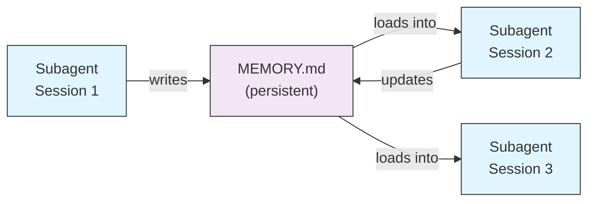
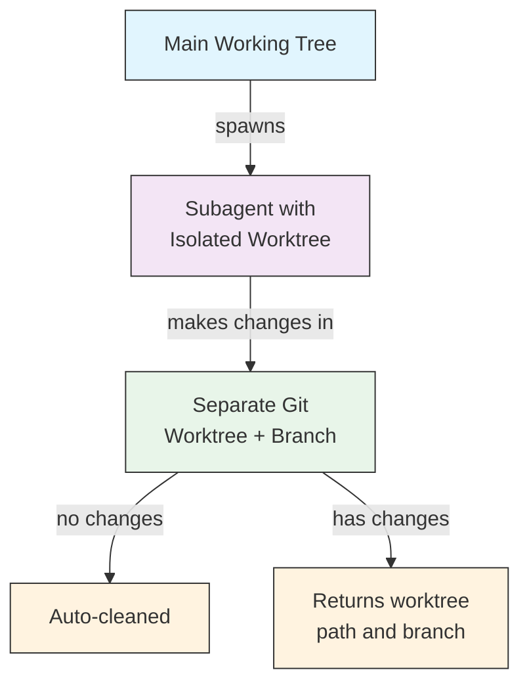
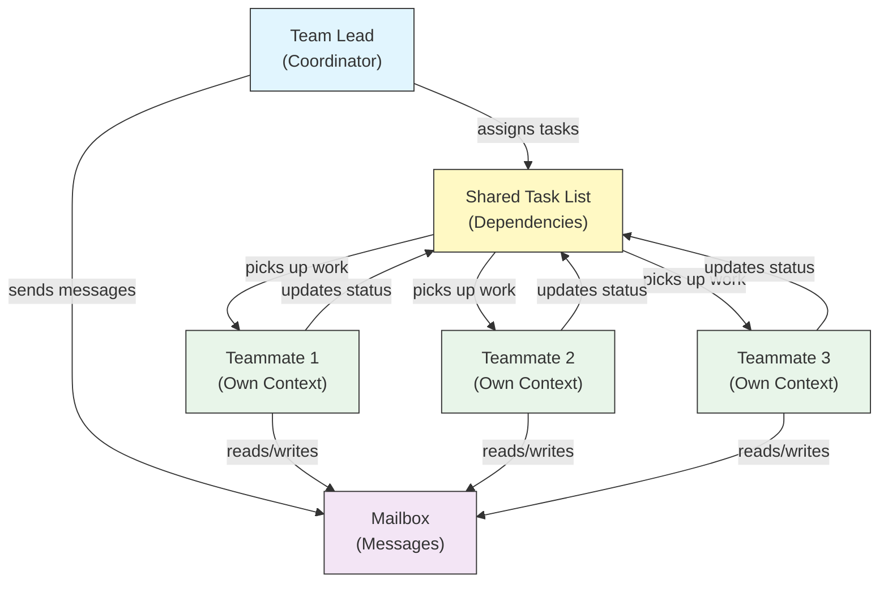
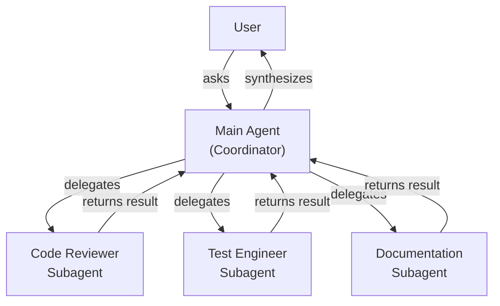
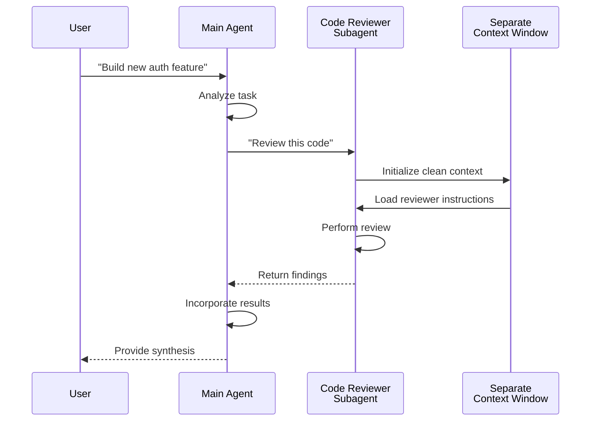
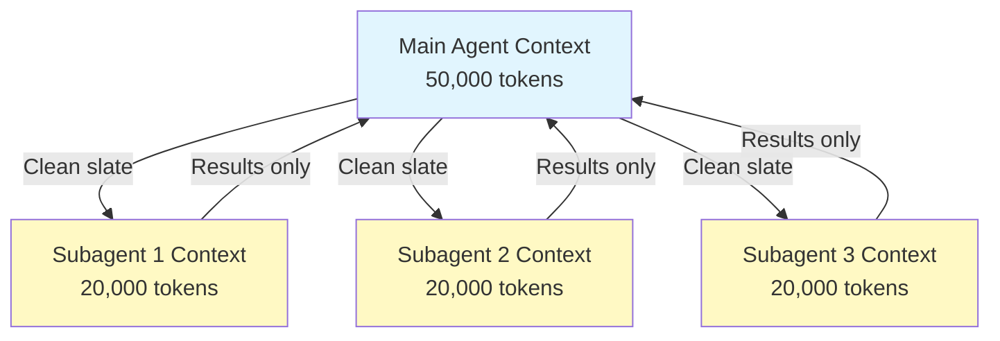
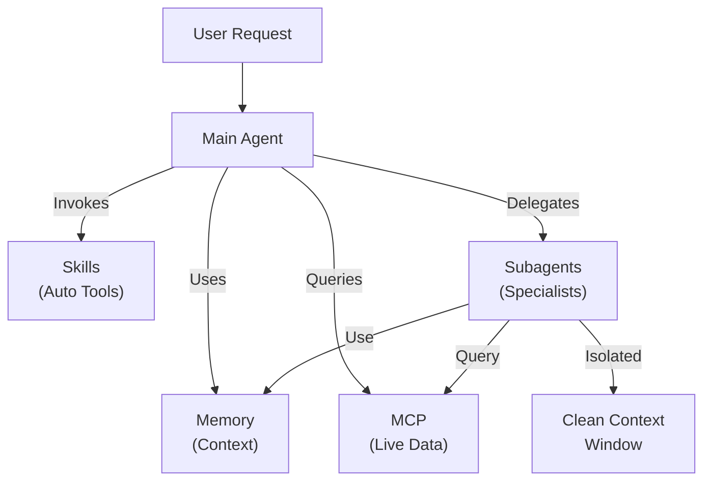

<!-- i18n-source: 04-subagents/README.md -->
<!-- i18n-source-sha: ba721a3 -->
<!-- i18n-date: 2026-10-29 -->

<picture>
  <source media="(prefers-color-scheme: dark)" srcset="../../resources/logos/claude-howto-logo-dark.svg">
  
</picture>

# 서브에이전트 - 전체 레퍼런스 가이드

서브에이전트는 Claude Code가 작업을 맡길 수 있는 전문 AI 어시스턴트입니다. 서브에이전트마다 정해진 목적이 있고, 메인 대화와 분리된 자체 컨텍스트 윈도를 쓰며, 특정 도구와 맞춤 시스템 프롬프트로 설정할 수 있습니다.

## 목차

1. [개요](#개요)
2. [주요 이점](#주요-이점)
3. [파일 위치](#파일-위치)
4. [설정](#설정)
5. [내장 서브에이전트](#내장-서브에이전트)
6. [서브에이전트 관리하기](#서브에이전트-관리하기)
7. [서브에이전트 사용하기](#서브에이전트-사용하기)
8. [재개할 수 있는 에이전트](#재개할-수-있는-에이전트)
9. [서브에이전트 연결하기](#서브에이전트-연결하기)
10. [서브에이전트의 지속 메모리](#서브에이전트의-지속-메모리)
11. [백그라운드 서브에이전트](#백그라운드-서브에이전트)
12. [워크트리 격리](#워크트리-격리)
13. [포크된 서브에이전트](#포크된-서브에이전트)
14. [띄울 수 있는 서브에이전트 제한하기](#띄울-수-있는-서브에이전트-제한하기)
15. [`claude agents` CLI 명령](#claude-agents-cli-명령)
16. [에이전트 팀 (실험적)](#에이전트-팀-실험적)
17. [플러그인 서브에이전트 보안](#플러그인-서브에이전트-보안)
18. [아키텍처](#아키텍처)
19. [컨텍스트 관리](#컨텍스트-관리)
20. [서브에이전트를 쓸 때](#서브에이전트를-쓸-때)
21. [모범 사례](#모범-사례)
22. [이 폴더의 예제 서브에이전트](#이-폴더의-예제-서브에이전트)
23. [설치 방법](#설치-방법)
24. [파일 구조](#파일-구조)
25. [관련 개념](#관련-개념)
26. [관측성](#관측성)
27. [추가 자료](#추가-자료)

---

## 개요

서브에이전트는 다음과 같은 방식으로 Claude Code에서 작업을 위임해 실행할 수 있게 합니다.

- 별도 컨텍스트 윈도를 가진 **격리된 AI 어시스턴트**를 만듭니다
- 전문성을 위한 **맞춤 시스템 프롬프트**를 제공합니다
- **도구 접근 제어**로 할 수 있는 일을 제한합니다
- 복잡한 작업 때문에 생기는 **컨텍스트 오염**을 막습니다
- 여러 전문 작업을 **병렬로 실행**할 수 있게 합니다

각 서브에이전트는 깨끗한 상태에서 독립적으로 작동합니다. 작업에 꼭 필요한 컨텍스트만 받아 일한 뒤, 결과를 메인 에이전트에게 돌려주어 종합하게 합니다.

**빠른 시작**: Claude에게 서브에이전트를 만들어 달라고 하거나 ("보안을 리뷰하는 서브에이전트를 만들어 줘"), `.claude/agents/<name>.md` 파일을 직접 추가하세요. 아래 [서브에이전트 관리하기](#서브에이전트-관리하기)를 참고하세요.

> **참고**: v2.1.198부터 `/agents` 명령은 더 이상 대화형 생성 마법사를 열지 않습니다. 서브에이전트는 Claude에게 요청하거나 `.claude/agents/` 파일을 직접 편집해 만들고 관리하세요.

---

## 주요 이점

| 이점 | 설명 |
|------|------|
| **컨텍스트 보존** | 별도 컨텍스트에서 작동해 메인 대화가 오염되지 않습니다 |
| **전문성** | 특정 분야에 맞춰져 성공률이 높습니다 |
| **재사용성** | 여러 프로젝트에서 쓰고 팀과 공유할 수 있습니다 |
| **유연한 권한** | 서브에이전트 유형마다 도구 접근 수준을 다르게 줄 수 있습니다 |
| **확장성** | 여러 에이전트가 동시에 서로 다른 부분을 맡습니다 |

---

## 파일 위치

서브에이전트 파일은 범위가 다른 여러 위치에 둘 수 있습니다.

| 우선순위 | 유형 | 위치 | 범위 |
|----------|------|------|------|
| 1 (가장 높음) | **관리형** | 관리형 설정 | 조직 전체 |
| 2 | **CLI 정의** | `--agents` 플래그 (JSON) | 세션 동안만 |
| 3 | **프로젝트 서브에이전트** | `.claude/agents/` | 현재 프로젝트 |
| 4 | **사용자 서브에이전트** | `~/.claude/agents/` | 모든 프로젝트 |
| 5 (가장 낮음) | **플러그인 에이전트** | 플러그인의 `agents/` 디렉터리 | 플러그인을 통해 |

이름이 겹치면 우선순위가 높은 출처가 이깁니다.

> **중첩된 `.claude/`의 우선순위 (v2.1.178)**: 같은 에이전트 이름이 중첩된 여러 `.claude/agents/` 디렉터리에 정의되어 있으면 (예: 패키지마다 `.claude/` 폴더가 있는 모노레포), **현재 작업 디렉터리에 가장 가까운 정의가 이깁니다**. 중첩된 워크플로와 출력 스타일 정의에도 같은 "가장 가까운 쪽이 이기는" 규칙이 적용됩니다.

---

## 설정

### 파일 형식

서브에이전트는 YAML 프런트매터와 그 뒤에 오는 markdown 시스템 프롬프트로 정의합니다.

```yaml
---
name: your-sub-agent-name
description: 이 서브에이전트를 언제 호출해야 하는지에 대한 설명
tools: tool1, tool2, tool3  # 선택 - 생략하면 모든 도구를 상속
disallowedTools: tool4  # 선택 - 명시적으로 금지할 도구
model: sonnet  # 선택 - sonnet, opus, haiku, 또는 inherit
permissionMode: default  # 선택 - 권한 모드
maxTurns: 20  # 선택 - 에이전트 턴 수 제한
skills: skill1, skill2  # 선택 - 컨텍스트에 미리 불러올 스킬
mcpServers: server1  # 선택 - 쓸 수 있게 할 MCP 서버
memory: user  # 선택 - 지속 메모리 범위 (user, project, local)
background: false  # 선택 - 백그라운드 작업으로 실행
effort: high  # 선택 - 추론 노력 수준 (low, medium, high, xhigh, max)
isolation: worktree  # 선택 - git 워크트리 격리
initialPrompt: "Start by analyzing the codebase"  # 선택 - 자동으로 제출되는 첫 턴
experimental:  # 선택 - 실험적 설정 블록
  cacheTtl: "1h"  # 이 서브에이전트의 캐시 TTL: "5m" 또는 "1h" (v2.1.248+)
hooks:  # 선택 - 구성 요소 범위의 훅
  PreToolUse:
    - matcher: "Bash"
      hooks:
        - type: command
          command: "./scripts/security-check.sh"
---

서브에이전트의 시스템 프롬프트를 여기에 씁니다. 여러 문단으로 써도 되며,
서브에이전트의 역할, 능력, 문제 해결 방식을 명확하게 정의해야 합니다.
```

### 설정 필드

| 필드 | 필수 | 설명 |
|------|------|------|
| `name` | 예 | 고유 식별자 (소문자와 하이픈). 조회할 때는 정규화되지만 (대소문자와 구분자를 가리지 않음, 아래 참고), v2.1.218부터 `:`가 들어간 이름은 **거부됩니다**. `:`는 플러그인 네임스페이스용으로 예약되어 있습니다 |
| `description` | 예 | 목적을 설명하는 자연어 문장. 자동 호출을 유도하려면 "use PROACTIVELY"를 넣습니다 |
| `tools` | 아니요 | 특정 도구 목록 (쉼표로 구분). 생략하면 모든 도구를 상속합니다. 에이전트가 `claude --agent`로 메인 스레드에서 실행될 때는 `Agent(agent_name)` 문법으로 띄울 수 있는 서브에이전트를 제한할 수 있습니다. 서브에이전트 안에서는 이 유형 목록이 무시됩니다. MCP: `mcp__<server>__*`는 서버 전체를 허용합니다 (v2.1.299+: 정확히 그 이름의 서버에만 일치). |
| `disallowedTools` | 아니요 | 서브에이전트가 쓰면 안 되는 도구 목록 (쉼표로 구분). 이름에 `__`가 들어간 MCP 서버의 경우, 여기서 `mcp__reports__*`라고 쓰면 `reports__v2`의 모든 도구도 막히므로 `reports` 도구를 하나씩 나열하세요. `tools`에서 그런 서버를 허용할 때는 `mcp__reports__v2__*`로 씁니다 |
| `model` | 아니요 | 사용할 모델: `sonnet`, `opus`, `haiku`, 전체 모델 ID, 또는 `inherit`. 기본값은 설정된 서브에이전트 모델입니다 |
| `permissionMode` | 아니요 | `default` (수동 모드; v2.1.200부터 `manual`도 별칭으로 받음), `acceptEdits`, `dontAsk`, `bypassPermissions`, `plan`, `auto`. v2.1.212부터 Task 도구의 `mode` 호출 매개변수는 폐지되어 무시됩니다. 여기서 덮어쓰지 않으면 서브에이전트는 기본적으로 부모 세션의 권한 모드를 물려받습니다. 부모가 `bypassPermissions`, `acceptEdits`, `auto`로 실행 중이면 서브에이전트의 `permissionMode`는 무시됩니다. 부모가 `plan` 모드면 `permissionMode`가 무엇이든 서브에이전트도 계획 모드에 머뭅니다 (에이전트 팀의 팀원으로 실행되는 경우는 예외). 이때 `dontAsk`를 설정하면, 계획 모드가 확인을 물었을 동작은 대신 거부됩니다 |
| `maxTurns` | 아니요 | 서브에이전트가 쓸 수 있는 최대 에이전트 턴 수 |
| `skills` | 아니요 | 미리 불러올 스킬 목록 (쉼표로 구분). 시작할 때 스킬 내용 전체를 서브에이전트의 컨텍스트에 넣습니다. **v2.1.133+:** 서브에이전트도 Skill 도구로 프로젝트, 사용자, 플러그인 스킬을 찾습니다. 메인 세션과 같은 목록을 보며, 더 이상 자체 내장 스킬로 제한되지 않습니다. 미리 불러오는 스킬은 최대 32개이고 각각 한 번씩만 불러옵니다. Skill 도구가 있는 서브에이전트는 나머지 스킬도 호출할 수 있습니다 (v2.1.295). |
| `mcpServers` | 아니요 | 서브에이전트가 쓸 수 있게 할 MCP 서버 |
| `hooks` | 아니요 | 이 서브에이전트가 활성화된 동안에만 실행되는 훅. 모든 훅 이벤트를 지원하며, 가장 흔한 것은 `PreToolUse`, `PostToolUse`, `Stop`(`SubagentStop`으로 실행됨)입니다 |
| `memory` | 아니요 | 지속 메모리 디렉터리 범위: `user`, `project`, `local` |
| `background` | 아니요 | 서브에이전트는 이미 기본적으로 백그라운드에서 실행됩니다 (v2.1.198). v2.1.302부터는 데스크톱 앱과 VS Code에서도 메인 대화의 서브에이전트가 백그라운드에서 시작합니다. 포크 모드가 켜져 있는 동안(기본값)에는 Claude가 이들을 기다릴 수 없습니다. `claude -p`, Agent SDK, 데스크톱 앱, VS Code에서 서브에이전트가 직접 하는 Agent 호출은 기본적으로 포그라운드에서 실행됩니다. `true`로 설정하면 항상 백그라운드 실행을 *강제*하고 인라인 실행을 막습니다 |
| `effort` | 아니요 | 추론 노력 수준: `low`, `medium`, `high`, `xhigh`, `max`. 세션의 노력 수준을 덮어쓰며, 쓸 수 있는 수준은 모델에 따라 다릅니다. Claude가 Agent 도구를 호출할 때 `effort` 값을 넘길 수도 있습니다 (v2.1.292). |
| `isolation` | 아니요 | `worktree`로 설정하면 서브에이전트에게 자체 git 워크트리를 줍니다 |
| `initialPrompt` | 아니요 | 서브에이전트가 메인 에이전트로 실행될 때 자동으로 제출되는 첫 턴 |
| `color` | 아니요 | 작업 목록과 대화 기록에서 서브에이전트를 표시할 색. `red`, `blue`, `green`, `yellow`, `purple`, `orange`, `pink`, `cyan`을 받습니다 |
| `experimental` | 아니요 | 실험적 설정 블록 (v2.1.248+). `experimental.cacheTtl`은 이 서브에이전트의 캐시 TTL을 `"5m"` 또는 `"1h"`로 정합니다 |
| `omitClaudeMd` | 아니요 | `true`로 설정하면 사용자, 프로젝트, 로컬 CLAUDE.md 파일 없이 서브에이전트를 시작합니다 (v2.1.271+). 관리형 정책 파일은 여전히 불러옵니다 (관리형 서브에이전트는 예외). 에이전트가 `--agent`나 `agent` 설정으로 메인 세션 에이전트로 실행될 때는 무시됩니다. `--agents` JSON에서도 받습니다 |
| `autoCompactWindow` | 아니요 | 이 서브에이전트의 컨텍스트를 메인 대화의 윈도보다 일찍 자동 압축합니다 (v2.1.296+; `--agents` JSON에서도 받음) |

#### 서브에이전트 모델 환경 변수

서브에이전트가 어떤 모델로 실행될지에 영향을 주는 환경 변수는 두 가지입니다.

| 변수 | 버전 | 설명 |
|------|------|------|
| `CLAUDE_CODE_SUBAGENT_MODEL` | — | 서브에이전트에 쓸 모델을 정합니다 |
| `CLAUDE_CODE_SUBAGENT_MODEL_FORCE` | v2.1.257+ | `1`로 설정하면 서브에이전트 프런트매터의 `model:`보다 서브에이전트 모델 설정을 우선합니다 |

> **v2.1.251에서 우선순위가 바뀌었습니다**: 그 이전에는 `CLAUDE_CODE_SUBAGENT_MODEL`이 먼저였고, `model: inherit`를 포함한 에이전트 프런트매터를 덮어썼습니다. v2.1.251부터는 서브에이전트 자체의 `model:` 프런트매터가 이깁니다. 예를 들어 평가 실행 전체를 한 모델로 고정하려는 경우처럼, 환경 변수가 다시 프런트매터를 덮어쓰게 하려면 `CLAUDE_CODE_SUBAGENT_MODEL_FORCE=1`(v2.1.257+)을 설정하세요.

### 메인 스레드 에이전트에서 적용되는 프런트매터 (v2.1.117+/v2.1.119+)

에이전트를 메인 스레드 에이전트로 호출하면 (`claude --agent <name>`이나 `--print` 모드), 다음 프런트매터 필드가 적용됩니다.

| 필드 | 버전 | 참고 |
|------|------|------|
| `mcpServers` | v2.1.117+ | `claude --agent <name>`으로 메인 스레드 에이전트로 호출할 때 불러옵니다 |
| `permissionMode` | v2.1.119+ | `--agent <name>`으로 호출한 내장 에이전트에 적용됩니다 |
| `tools` / `disallowedTools` | v2.1.119+ | `--print` 모드 (비대화형/스크립트 사용)에서 적용됩니다 |

**예시: `mcpServers`와 `permissionMode`가 있는 에이전트**

```yaml
---
name: secure-researcher
description: MCP 접근 범위가 정해지고 권한이 제한된 조사 에이전트
permissionMode: acceptEdits
mcpServers:
  notion:
    type: http
    url: https://mcp.notion.com/mcp
  github:
    type: http
    url: https://api.githubcopilot.com/mcp/
    headers:
      Authorization: "Bearer ${GITHUB_PERSONAL_ACCESS_TOKEN}"
tools: Read, Grep, Glob
---

당신은 조사 에이전트입니다. 설정된 MCP 서버로 Notion과 GitHub를 조회하고
로컬 파일을 읽을 수 있지만, 허용된 편집 말고는 쓰거나 명령을 실행할 수 없습니다.
```

실행:

```bash
claude --agent secure-researcher
```

### 도구 설정 옵션

**옵션 1: 모든 도구 상속 (필드 생략)**
```yaml
---
name: full-access-agent
description: 사용할 수 있는 모든 도구를 가진 에이전트
---
```

**옵션 2: 도구를 하나씩 지정**
```yaml
---
name: limited-agent
description: 특정 도구만 가진 에이전트
tools: Read, Grep, Glob, Bash
---
```

> **Glob/Grep 참고 (v2.1.113+):** 네이티브 macOS/Linux 빌드에서는 Glob과 Grep이 별도 도구가 아니라 Bash 도구를 통한 `bfs`/`ugrep`으로 제공됩니다. Windows와 npm-JS 빌드에서는 여전히 독립 도구로 노출됩니다. `allowedTools`에서 Glob/Grep을 계속 써도 되며, 내부 대체는 알아서 처리됩니다.

**옵션 3: 조건부 도구 접근**
```yaml
---
name: conditional-agent
description: 걸러진 도구 접근 권한을 가진 에이전트
tools: Read, Bash(npm:*), Bash(test:*)
---
```

### CLI로 설정하기

`--agents` 플래그와 JSON 형식으로 한 세션에서만 쓸 서브에이전트를 정의합니다.

```bash
claude --agents '{
  "code-reviewer": {
    "description": "Expert code reviewer. Use proactively after code changes.",
    "prompt": "You are a senior code reviewer. Focus on code quality, security, and best practices.",
    "tools": ["Read", "Grep", "Glob", "Bash"],
    "model": "sonnet"
  }
}'
```

**`--agents` 플래그의 JSON 형식:**

```json
{
  "agent-name": {
    "description": "Required: when to invoke this agent",
    "prompt": "Required: system prompt for the agent",
    "tools": ["Optional", "array", "of", "tools"],
    "model": "optional: sonnet|opus|haiku"
  }
}
```

> **참고**: v2.1.243부터 `--agents`는 잘못된 JSON이나 잘못된 에이전트 정의를 더 이상 조용히 무시하지 않습니다. `--mcp-config`와 마찬가지로 Claude Code가 명확한 오류를 내고 종료합니다.

**에이전트 정의의 우선순위:**

에이전트 정의는 다음 우선순위로 불러옵니다 (먼저 일치하는 것이 이김).
1. **관리형** - 관리형 설정 (조직 전체)
2. **CLI 정의** - `--agents` 플래그 (세션 동안만, JSON)
3. **프로젝트 단위** - `.claude/agents/` (현재 프로젝트)
4. **사용자 단위** - `~/.claude/agents/` (모든 프로젝트)
5. **플러그인 단위** - 플러그인의 `agents/` 디렉터리

그래서 CLI 정의로 한 세션 동안 프로젝트, 사용자, 플러그인 정의를 덮어쓸 수 있습니다. 관리형 정의는 그래도 우선합니다.

---

## 내장 서브에이전트

Claude Code에는 항상 쓸 수 있는 내장 서브에이전트가 여러 개 들어 있습니다.

| 에이전트 | 모델 | 용도 |
|----------|------|------|
| **general-purpose** | 상속 | 복잡한 여러 단계 작업 |
| **Plan** | 상속 | 계획 모드를 위한 조사 |
| **Explore** | 상속 (최대 Opus) | 읽기 전용 코드베이스 탐색 (quick/medium/very thorough) |
| **claude** | 상속 | 더 전문적인 에이전트에 맞지 않는 작업을 모두 맡습니다. 서브에이전트가 쓸 수 있는 모든 도구를 가집니다. 보내진 백그라운드 세션의 기본 에이전트이기도 합니다 |
| **statusline-setup** | Sonnet | `/statusline`으로 상태 줄을 설정할 때 실행됩니다 |
| **claude-code-guide** | Haiku | Claude Code 기능에 대한 질문에 답합니다 |

### general-purpose 서브에이전트

| 속성 | 값 |
|------|-----|
| **모델** | 부모에게서 상속 |
| **도구** | 모든 도구 |
| **용도** | 복잡한 조사 작업, 여러 단계 작업, 코드 수정 |

**쓰이는 때**: 복잡한 추론과 함께 탐색과 수정이 모두 필요한 작업.

### Plan 서브에이전트

| 속성 | 값 |
|------|-----|
| **모델** | 부모에게서 상속 |
| **도구** | Read, Glob, Grep, Bash |
| **용도** | 계획 모드에서 코드베이스를 조사할 때 자동으로 쓰임 |

**쓰이는 때**: Claude가 계획을 보여 주기 전에 코드베이스를 이해해야 할 때.

### Explore 서브에이전트

| 속성 | 값 |
|------|-----|
| **모델** | 세션 모델을 상속하며 최대 Opus까지 (v2.1.198). 빠르고 저렴하게 쓰려면 `model: haiku`로 설정하세요 |
| **모드** | 엄격한 읽기 전용 |
| **도구** | Glob, Grep, Read, Bash (읽기 전용 명령만) |
| **용도** | 빠른 코드베이스 검색과 분석 |

**쓰이는 때**: 코드를 바꾸지 않고 검색하거나 이해할 때.

**탐색 깊이**: 얼마나 깊이 탐색할지 지정합니다.
- **"quick"** - 최소한의 탐색으로 빠르게 검색. 특정 패턴을 찾을 때 좋음
- **"medium"** - 적당한 탐색. 속도와 꼼꼼함의 균형을 맞춘 기본 방식
- **"very thorough"** - 여러 위치와 이름 규칙에 걸친 종합 분석. 시간이 더 걸릴 수 있음

### claude 서브에이전트

| 속성 | 값 |
|------|-----|
| **모델** | 부모에게서 상속 |
| **도구** | 서브에이전트가 쓸 수 있는 모든 도구 |
| **용도** | 더 전문적인 에이전트에 맞지 않는 작업을 모두 맡는 에이전트 |

**쓰이는 때**: 작업이 더 전문적인 내장 에이전트와 맞지 않을 때. 보내진 백그라운드 세션의 기본 에이전트이기도 하며, 어떤 권한 모드로 시작하는지는 그 세션을 어떻게 시작했는지에 따라 다릅니다.

### statusline-setup 서브에이전트

| 속성 | 값 |
|------|-----|
| **모델** | Sonnet |
| **도구** | Read, Write, Bash |
| **용도** | Claude Code 상태 줄 표시 설정 |

**쓰이는 때**: 상태 줄을 설정하거나 꾸밀 때.

### Claude Code 가이드 서브에이전트 (`claude-code-guide`)

| 속성 | 값 |
|------|-----|
| **모델** | Haiku (빠르고 지연 시간이 짧음) |
| **도구** | 읽기 전용 |
| **용도** | Claude Code 기능과 사용법에 대한 질문에 답함 |

**쓰이는 때**: 사용자가 Claude Code가 어떻게 작동하는지, 특정 기능을 어떻게 쓰는지 물을 때.

---

## 서브에이전트 관리하기

### Claude에게 요청하기 (권장)

서브에이전트를 만들거나 관리하는 가장 간단한 방법은 Claude에게 직접 요청하는 것입니다.

```text
Create a subagent that reviews code for security vulnerabilities.
```

Claude가 알맞은 프런트매터(도구, 모델, 설명)를 골라 `.claude/agents/<name>.md` 파일을 써 줍니다. 그런 다음 직접 파일을 다듬거나 Claude에게 고쳐 달라고 하면 됩니다.

> **참고**: `/agents` 명령은 더 이상 대화형 생성 마법사를 열지 않습니다 (v2.1.198에서 제거됨). 이제는 Claude에게 요청하거나 `.claude/agents/` 파일을 직접 편집하라고 안내합니다.

### 파일 직접 관리하기

```bash
# 프로젝트 서브에이전트 만들기
mkdir -p .claude/agents
cat > .claude/agents/test-runner.md << 'EOF'
---
name: test-runner
description: Use proactively to run tests and fix failures
---

You are a test automation expert. When you see code changes, proactively
run the appropriate tests. If tests fail, analyze the failures and fix
them while preserving the original test intent.
EOF

# 사용자 서브에이전트 만들기 (모든 프로젝트에서 사용 가능)
mkdir -p ~/.claude/agents
```

---

## 서브에이전트 사용하기

### 자동 위임

Claude는 다음을 바탕으로 작업을 적극적으로 맡깁니다.
- 요청에 담긴 작업 설명
- 서브에이전트 설정의 `description` 필드
- 현재 컨텍스트와 쓸 수 있는 도구

적극적으로 쓰이게 하려면 `description` 필드에 "use PROACTIVELY"나 "MUST BE USED"를 넣으세요.

```yaml
---
name: code-reviewer
description: Expert code review specialist. Use PROACTIVELY after writing or modifying code.
---
```

### 명시적으로 호출하기

특정 서브에이전트를 명시적으로 요청할 수 있습니다.

```text
> Use the test-runner subagent to fix failing tests
> Have the code-reviewer subagent look at my recent changes
> Ask the debugger subagent to investigate this error
```

> **대소문자와 구분자를 가리지 않는 `subagent_type` 일치 (v2.1.140)**: `subagent_type`(`Agent` 도구 호출이나 `--agent` 플래그)은 대소문자를 가리지 않고 구분자 형태도 무시하고 비교합니다. `code-reviewer`, `Code Reviewer`, `code_reviewer`는 모두 같은 에이전트로 풀이됩니다. 대소문자가 조금만 달라도 아무 알림 없이 기본 에이전트로 넘어가던 오래된 함정이 없어졌습니다.

### @ 멘션으로 호출하기

`@` 접두사를 쓰면 특정 서브에이전트가 반드시 호출됩니다 (자동 위임 판단을 건너뜀).

```text
> @"code-reviewer (agent)" review the auth module
```

### 세션 전체 에이전트

특정 에이전트를 메인 에이전트로 삼아 세션 전체를 실행합니다.

```bash
# CLI 플래그로
claude --agent code-reviewer

# settings.json으로
{
  "agent": "code-reviewer"
}
```

### 사용할 수 있는 에이전트 보기

어떤 서브에이전트가 설정되어 있는지 보려면 Claude에게 묻거나 `.claude/agents/`와 `~/.claude/agents/`를 살펴보세요. (`claude agents`는 이와 관계없는 명령으로, 백그라운드 세션용 에이전트 보기를 엽니다. [CLI](../../10-cli/README.md#agent-view-claude-agents-v21139)를 참고하세요.)

---

## 재개할 수 있는 에이전트

서브에이전트는 전체 컨텍스트를 유지한 채 이전 대화를 이어 갈 수 있습니다.

```bash
# 처음 호출
> Use the code-analyzer agent to start reviewing the authentication module
# agentId: "abc123"을 돌려줌

# 나중에 에이전트 재개
> Resume agent abc123 and now analyze the authorization logic as well
```

**사용 사례**:
- 여러 세션에 걸친 오랜 조사
- 컨텍스트를 잃지 않는 반복적인 개선
- 컨텍스트를 유지하는 여러 단계 워크플로

---

## 서브에이전트 연결하기

여러 서브에이전트를 차례로 실행합니다.

```bash
> First use the code-analyzer subagent to find performance issues,
  then use the optimizer subagent to fix them
```

한 서브에이전트의 출력이 다른 서브에이전트의 입력이 되는 복잡한 워크플로를 만들 수 있습니다.

---

## 서브에이전트의 지속 메모리

`memory` 필드는 대화가 바뀌어도 유지되는 디렉터리를 서브에이전트에게 줍니다. 그래서 서브에이전트가 세션 사이에 유지되는 메모, 발견 사항, 컨텍스트를 저장하며 시간이 지날수록 지식을 쌓을 수 있습니다.

### 메모리 범위

| 범위 | 디렉터리 | 사용 사례 |
|------|----------|-----------|
| `user` | `~/.claude/agent-memory/<name>/` | 모든 프로젝트에 걸친 개인 메모와 선호 설정 |
| `project` | `.claude/agent-memory/<name>/` | 팀과 공유하는 프로젝트별 지식 |
| `local` | `.claude/agent-memory-local/<name>/` | 버전 관리에 커밋하지 않는 로컬 프로젝트 지식 |

### 작동 방식

- 메모리 디렉터리에 있는 `MEMORY.md`의 처음 200줄이 서브에이전트의 시스템 프롬프트에 자동으로 들어갑니다
- 서브에이전트가 메모리 파일을 관리할 수 있도록 `Read`, `Write`, `Edit` 도구가 자동으로 켜집니다
- 서브에이전트는 필요하면 메모리 디렉터리에 파일을 더 만들 수 있습니다

### 설정 예시

```yaml
---
name: researcher
description: 세션이 바뀌어도 발견 사항을 지속 메모리에 보관하는 조사 어시스턴트
memory: user
---

당신은 조사 어시스턴트입니다. 메모리 디렉터리에 발견 사항을 저장하고,
세션에 걸쳐 진행 상황을 추적하고, 시간이 지날수록 지식을 쌓으세요.

세션을 시작할 때마다 MEMORY.md 파일을 확인해 이전 맥락을 떠올리세요.
```



---

## 백그라운드 서브에이전트

서브에이전트는 기본적으로 백그라운드에서 실행됩니다 (v2.1.198). v2.1.302부터는 데스크톱 앱과 VS Code에서도 메인 대화의 서브에이전트가 백그라운드에서 시작합니다. 포크 모드가 켜져 있는 동안(기본값)에는 Claude가 이들을 기다릴 수 없습니다. `claude -p`, Agent SDK, 데스크톱 앱, VS Code에서 서브에이전트가 직접 하는 Agent 호출은 기본적으로 포그라운드에서 실행됩니다. 서브에이전트가 실행되는 동안 Claude는 메인 대화에서 계속 작업하다가 서브에이전트가 끝나면 알림을 받습니다. 그래서 더 이상 서브에이전트가 돌아올 때까지 기다렸다가 다음으로 넘어갈 필요가 없습니다. VS Code(v2.1.304+)에서는 백그라운드 서브에이전트가 모든 단계를 채팅에 흘려보내지 않고 Agent 카드 아래에 상태 한 줄로 표시됩니다. `/tasks`를 열고 눌러 보면 도구 호출과 대화 기록을 볼 수 있습니다.

### 설정

백그라운드가 이미 기본값이므로, 프런트매터의 `background: true`는 서브에이전트가 항상 백그라운드에서 실행되도록 *강제*하고 인라인 실행을 막습니다.

```yaml
---
name: long-runner
background: true
description: 오래 걸리는 분석 작업을 백그라운드에서 수행합니다
---
```

### 키보드 단축키

| 단축키 | 동작 |
|--------|------|
| `Ctrl+B` | 지금 실행 중인 서브에이전트 작업을 백그라운드로 보내기 |
| `Ctrl+X` `Ctrl+K` | 실행 중인 백그라운드 서브에이전트 모두 멈추기 (확인하려면 3초 안에 두 번 누름; `Ctrl+F`를 대체) |

### 백그라운드 작업 끄기

백그라운드 작업 지원을 완전히 끄려면 환경 변수를 설정합니다.

```bash
export CLAUDE_CODE_DISABLE_BACKGROUND_TASKS=1
```

### Claude가 서브에이전트를 기다리게 하기

아무것도 설정하지 않으면, Claude가 메인 대화에서 띄우는 서브에이전트는 백그라운드에서 시작합니다. `claude -p`와 Agent SDK에서는 Claude가 스스로 판단하거나 요청을 받으면 서브에이전트를 기다릴 수 있습니다. 대화형 터미널, VS Code, 데스크톱 세션에서는 포크 모드를 꺼야만 Claude가 기다릴 수 있습니다 (v2.1.302+).

```json
{
  "env": {
    "CLAUDE_CODE_FORK_SUBAGENT": "0"
  }
}
```

`claude`를 다시 시작하고 (또는 VS Code에서 새 대화를 열고), 예를 들어 "리뷰어 서브에이전트를 실행하고 보고서가 올 때까지 기다려 줘"라고 요청하세요. 기다리는 중에도 `Ctrl+B`로 백그라운드로 보낼 수 있습니다. 대신 `CLAUDE_CODE_DISABLE_BACKGROUND_TASKS=1`을 설정하면 Claude가 모든 서브에이전트를 기다리며, 백그라운드 명령도 꺼집니다.

---

## 워크트리 격리

`isolation: worktree` 설정은 서브에이전트에게 자체 git 워크트리를 줍니다. 그래서 서브에이전트가 메인 작업 트리에 영향을 주지 않고 독립적으로 변경할 수 있습니다.

### 설정

```yaml
---
name: feature-builder
isolation: worktree
description: 격리된 git 워크트리에서 기능을 구현합니다
tools: Read, Write, Edit, Bash, Grep, Glob
---
```

### 작동 방식



- 서브에이전트는 별도 브랜치의 자체 git 워크트리에서 작업합니다
- 서브에이전트가 아무것도 바꾸지 않으면 워크트리는 자동으로 정리됩니다
- 변경이 있으면 워크트리 경로와 브랜치 이름을 메인 에이전트에게 돌려주어 검토하거나 병합하게 합니다

---

## 포크된 서브에이전트

포크된 서브에이전트는 깨끗한 상태에서 시작하지 않고, 포크하는 순간의 부모 대화 전체(시스템 프롬프트, 도구, 모델, 메시지 기록, 프롬프트 캐시)를 물려받습니다. 지금까지 한 작업을 잃지 않고 다른 길을 탐색할 때 유용합니다.

> **제공 범위**: v2.1.117에서 정식 출시되었습니다. **v2.1.232부터 대화형 세션에서는 포크 모드가 기본으로 켜져 있습니다.** 공식 빌드든 아니든 모든 빌드에 해당합니다. v2.1.302부터는 비대화형 모드(`claude -p`), Agent SDK, 데스크톱 앱, VS Code에서도 기본으로 켜져 있습니다. `claude mcp serve`는 포크 서브에이전트를 제공하지 않습니다. v2.1.232보다 오래된 Claude Code에서는 `CLAUDE_CODE_FORK_SUBAGENT=1`을 설정해 켭니다.

> **포크 모드의 서브에이전트는 백그라운드에서 실행됩니다.** v2.1.302부터 모든 곳에서 기본으로 그렇듯 포크 모드가 켜져 있으면, Claude Code는 포크된 서브에이전트든 아니든 서브에이전트를 백그라운드에서 실행합니다. 그러면 대화형 터미널, VS Code, 데스크톱 세션에서는 Claude가 서브에이전트를 기다릴 수 없습니다. 기다리게 하려면 포크 모드를 끄세요 ([Claude가 서브에이전트를 기다리게 하기](#claude가-서브에이전트를-기다리게-하기) 참고).

### 설정

포크는 에이전트 파일에서 정의하지 않습니다. Claude가 Agent 도구에서 `subagent_type: "fork"`로 시작하거나, 내가 `/subtask <task>`로 직접 시작합니다 (v2.1.212+).

```text
/subtask Explore an alternative implementation path and report the trade-offs
```

포크는 또 다른 포크를 띄울 수 없습니다. 포크를 막으려면 거부 규칙 `Agent(fork)`를 추가합니다.

```json
{
  "permissions": {
    "deny": ["Agent(fork)"]
  }
}
```

> **참고**: `context: fork`는 서브에이전트 필드가 아니라 **스킬** 프런트매터 필드입니다 ([스킬](../03-skills/README.md) 참고). Claude Code는 에이전트 정의에서 알아보지 못하는 필드를 아무 알림 없이 무시합니다.

### 포크 모드를 명시적으로 켜고 끄기

모든 곳에서 포크 모드를 끄려면 `CLAUDE_CODE_FORK_SUBAGENT=0`을 설정합니다. v2.1.302 이전 버전에서는 `1`로 설정해야 `claude -p`와 Agent SDK에서 포크가 켜집니다.

```bash
export CLAUDE_CODE_FORK_SUBAGENT=0
claude
```

### 포크와 깨끗한 컨텍스트, 언제 무엇을 쓸까

| 상황 | 포크 (`subagent_type: "fork"`) | 깨끗한 컨텍스트 (기본값) |
|------|-------------------------------|--------------------------|
| 다른 구현 방식 탐색 | 예 | 아니요 (컨텍스트를 잃음) |
| 기존 컨텍스트를 쓰는 긴 조사 | 예 | 아니요 |
| 독립적인 전문 작업 | 아니요 | 예 |
| 컨텍스트 오염 피하기 | 아니요 | 예 |

---

## 띄울 수 있는 서브에이전트 제한하기

`tools` 필드에 `Agent(agent_type)` 문법을 쓰면, `claude --agent`로 메인 스레드에서 실행되는 에이전트가 어떤 서브에이전트를 띄울 수 있는지 제어할 수 있습니다. 작업을 맡길 수 있는 서브에이전트를 허용 목록으로 정하는 방법입니다. 서브에이전트 정의 안에서는 괄호 안의 유형 목록이 무시됩니다.

> **참고**: v2.1.63에서 `Task` 도구의 이름이 `Agent`로 바뀌었습니다. 기존의 `Task(...)` 참조도 별칭으로 계속 작동합니다.

### 예시

```yaml
---
name: coordinator
description: 전문 에이전트들 사이의 작업을 조율합니다
tools: Agent(worker, researcher), Read, Bash
---

당신은 조율 에이전트입니다. "worker"와 "researcher" 서브에이전트에게만
작업을 맡길 수 있습니다. 직접 탐색할 때는 Read와 Bash를 쓰세요.
```

이 예시에서 `claude --agent coordinator`를 실행하면, 메인 스레드는 `worker`와 `researcher` 서브에이전트만 띄울 수 있습니다. 다른 곳에 정의되어 있더라도 다른 서브에이전트는 띄울 수 없습니다. 대신 `coordinator`가 서브에이전트로 실행되면 유형 목록은 무시됩니다.

---

## `claude agents` CLI 명령

`claude agents`는 **에이전트 보기**(v2.1.139+)를 엽니다. 백그라운드 세션을 상태별로 묶어 보여 주는 전체 화면 목록입니다. 설정된 서브에이전트 정의를 나열하지는 않습니다. 세션 상태를 스크립트로 다루려면 `claude agents --json`을 쓰세요.

```bash
claude agents
claude agents --json
```

설정된 서브에이전트는 `.claude/agents/`(프로젝트)와 `~/.claude/agents/`(사용자)에 있습니다.

---

## 에이전트 팀 (실험적)

에이전트 팀은 복잡한 작업을 함께 처리하는 여러 Claude Code 인스턴스를 조율합니다. 위임받은 하위 작업을 처리하고 결과를 돌려주는 서브에이전트와 달리, 팀원은 자체 컨텍스트 윈도를 가지고 독립적으로 일하며 공유 메일함 시스템으로 서로 직접 메시지를 주고받을 수 있습니다.

> **공식 문서**: [code.claude.com/docs/en/agent-teams](https://code.claude.com/docs/en/agent-teams)

> **참고**: 에이전트 팀은 실험적 기능이며 기본으로 꺼져 있습니다. Claude Code v2.1.32+가 필요합니다. 쓰기 전에 켜세요.

### 서브에이전트와 에이전트 팀 비교

| 측면 | 서브에이전트 | 에이전트 팀 |
|------|--------------|-------------|
| **위임 방식** | 부모가 하위 작업을 맡기고 결과를 기다림 | 팀 리더가 작업을 조율하고, 팀원이 독립적으로 실행 |
| **컨텍스트** | 하위 작업마다 새 컨텍스트, 결과는 요약되어 돌아옴 | 팀원마다 자체 지속 컨텍스트 윈도를 유지 |
| **조율** | 순차 또는 병렬, 부모가 관리 | 의존성을 자동으로 관리하는 공유 작업 목록 |
| **소통** | 결과를 부모에게만 돌려줌 (에이전트끼리 메시지 없음) | 팀원끼리 메일함으로 직접 메시지를 주고받음 |
| **세션 재개** | 지원 | 프로세스 내 팀원은 지원하지 않음 |
| **적합한 용도** | 범위가 분명한 집중된 하위 작업 | 에이전트 사이의 소통과 병렬 실행이 필요한 복잡한 작업 |

### 에이전트 팀 켜기

환경 변수를 설정하거나 `settings.json`에 추가합니다.

```bash
export CLAUDE_CODE_EXPERIMENTAL_AGENT_TEAMS=1
```

또는 `settings.json`에서:

```json
{
  "env": {
    "CLAUDE_CODE_EXPERIMENTAL_AGENT_TEAMS": "1"
  }
}
```

### 팀 시작하기

켠 뒤에는 프롬프트에서 Claude에게 팀원과 함께 일하라고 요청합니다.

```text
User: Build the authentication module. Use a team — one teammate for the API endpoints,
      one for the database schema, and one for the test suite.
```

Claude가 팀을 만들고, 작업을 배정하고, 작업을 자동으로 조율합니다.

### 표시 모드

팀원의 활동을 어떻게 표시할지 정합니다.

| 모드 | 플래그 | 설명 |
|------|--------|------|
| **자동** | `--teammate-mode auto` | 터미널에 가장 알맞은 표시 모드를 자동으로 고릅니다 |
| **프로세스 내** (기본값) | `--teammate-mode in-process` | 팀원의 출력을 현재 터미널 안에 함께 보여 줍니다 |
| **분할 창** | `--teammate-mode tmux` | 팀원마다 별도의 tmux나 iTerm2 창을 엽니다 |
| **iTerm2** | `--teammate-mode iterm2` | (v2.1.186+) 팀원을 전용 iTerm2 창에서 띄웁니다. `it2` CLI가 필요하며, 찾을 수 없으면 자동 모드가 경고합니다 |

```bash
claude --teammate-mode tmux
```

`settings.json`에서 표시 모드를 정할 수도 있습니다.

```json
{
  "teammateMode": "tmux"
}
```

> **참고**: 분할 창 모드에는 tmux나 iTerm2가 필요합니다. VS Code 터미널, Windows Terminal, Ghostty에서는 쓸 수 없습니다.

### 이동하기

팀원 사이를 오가려면 에이전트 패널에서 위아래 화살표 키로 고르고 Enter를 누르거나 (프로세스 내 모드), 팀원의 창을 누릅니다 (분할 창 모드).

### 팀 설정

팀 설정은 `~/.claude/teams/{team-name}/config.json`에 저장됩니다.

### 팀원 모델 선택

v2.1.234부터 `/config`의 "Default teammate model" 설정이 없어졌습니다. 이제 팀원은 띄우는 호출에서 다른 모델을 명시하지 않는 한, 기본적으로 팀 리더의 모델을 물려받습니다.

### 팀 구조



**핵심 구성 요소**:

- **팀 리더**: 팀을 만들고, 작업을 배정하고, 조율하는 메인 Claude Code 세션
- **공유 작업 목록**: 의존성을 자동으로 추적하는 동기화된 작업 목록
- **메일함**: 팀원이 상태를 알리고 조율하는 에이전트 간 메시지 시스템
- **팀원**: 각자 자체 컨텍스트 윈도를 가진 독립적인 Claude Code 인스턴스

### 작업 배정과 메시지

팀 리더는 일을 작업으로 나눠 팀원에게 배정합니다. 공유 작업 목록은 다음을 처리합니다.

- **의존성 자동 관리**: 작업은 의존하는 작업이 끝날 때까지 기다립니다
- **상태 추적**: 팀원이 일하면서 작업 상태를 업데이트합니다
- **에이전트 간 메시지**: 팀원이 조율을 위해 메일함으로 메시지를 보냅니다 (예: "데이터베이스 스키마가 준비됐으니 쿼리 작성을 시작해도 됩니다")

### 계획 승인 워크플로

복잡하거나 위험한 작업이라면 팀원을 요청하기 전에 리더를 계획 모드로 바꾸세요. 리더가 계획 모드일 때 띄운 팀원은 계획이 준비될 때까지 읽기 전용으로 일하다가, 리더에게 계획 승인 요청을 보냅니다. 띄운 뒤로 그 팀원의 권한 모드를 바꾸지 않았다면, 요청이 도착하자마자 Claude Code가 계획을 승인합니다 (사용자에게 묻지 않음). 팀원의 편집과 명령은 여전히 일반 권한 확인 창을 거칩니다. 실행 중인 프로세스 내 팀원을 `Shift+Tab`으로 계획 모드로 바꾸면, 대신 리더가 그 계획을 검토합니다.

### 팀용 훅 이벤트

에이전트 팀은 [훅 이벤트](../06-hooks/) 두 가지를 더합니다.

| 이벤트 | 발생하는 때 | 사용 사례 |
|--------|-------------|-----------|
| `TeammateIdle` | 팀원이 현재 작업을 마쳤고 남은 일이 없을 때 | 알림 보내기, 후속 작업 배정하기 |
| `TaskCompleted` | 공유 작업 목록의 작업이 완료로 표시될 때 | 검증 실행, 대시보드 업데이트, 의존 작업 연결 |

### 모범 사례

- **팀 규모**: 조율이 잘 되도록 팀원은 3~5명으로 유지합니다
- **작업 크기**: 작업 하나가 5~15분 걸리도록 나눕니다. 병렬로 나눌 만큼 작고, 의미가 있을 만큼 크게
- **파일 충돌 피하기**: 병합 충돌을 막으려면 팀원마다 다른 파일이나 디렉터리를 맡깁니다
- **간단하게 시작하기**: 첫 팀은 프로세스 내 모드로 쓰고, 익숙해지면 분할 창으로 바꿉니다
- **명확한 작업 설명**: 팀원이 독립적으로 일할 수 있도록 구체적이고 실행할 수 있는 작업 설명을 줍니다

### 제한 사항

- **실험적**: 앞으로의 릴리스에서 기능 동작이 바뀔 수 있습니다
- **세션 재개 불가**: 세션이 끝나면 프로세스 내 팀원은 재개할 수 없습니다
- **세션당 팀 하나**: 한 세션에서 중첩된 팀이나 여러 팀을 만들 수 없습니다
- **고정된 리더**: 팀 리더 역할을 팀원에게 넘길 수 없습니다
- **분할 창 제약**: tmux/iTerm2가 필요하며, VS Code 터미널, Windows Terminal, Ghostty에서는 쓸 수 없습니다
- **분할 창 권한**: 분할 창 팀원은 리더의 `--disallowedTools`와 `--tools`(v2.1.309+)를 물려받지만 `--allowedTools`는 물려받지 않습니다. 그곳에서 동작을 미리 승인하려면 `claude --settings '{"permissions":{"allow":["Bash(npm *)"]}}'`로 리더를 시작하세요. 프로세스 내 팀원은 리더의 현재 규칙을 그대로 씁니다
- **세션 간 팀 불가**: 팀원은 현재 세션 안에서만 존재합니다

> **주의**: 에이전트 팀은 실험적 기능입니다. 중요하지 않은 작업으로 먼저 테스트하고, 팀원의 조율에 예상치 못한 동작이 없는지 지켜보세요.

---

## 플러그인 서브에이전트 보안

플러그인이 제공하는 서브에이전트는 보안을 위해 쓸 수 있는 프런트매터가 제한됩니다. 다음 필드는 플러그인 서브에이전트 정의에서 **허용되지 않습니다**.

- `hooks` - 수명 주기 훅을 정의할 수 없음
- `mcpServers` - MCP 서버를 설정할 수 없음
- `permissionMode` - 권한 설정을 덮어쓸 수 없음

그래서 플러그인이 서브에이전트 훅으로 권한을 높이거나 임의의 명령을 실행하지 못합니다.

### 서브에이전트 출력 검사 (v2.1.210+)

v2.1.210부터 Claude Code는 각 서브에이전트의 최종 보고서에 실행 환경의 출력 형식을 흉내 낸 텍스트가 있는지 검사합니다. 가짜 `<system-reminder>` 형태의 태그, 꾸며 낸 `Human:`/`Assistant:` 턴, 권한 우회 플래그나 설정 파일 경로에 대한 언급 같은 것입니다. 예를 들어 서브에이전트가 부모 세션을 조작하려고 만든 가짜 제어 토큰이 든 악성 웹 페이지를 가져온 경우처럼, 서브에이전트 출력에 실려 오는 프롬프트 주입을 막기 위한 것입니다.

검사에 걸리면 Claude Code가 그 부분을 무력화합니다. 백슬래시를 넣거나, 무엇 때문에 걸렸는지 적은 `[harness: subagent output matched instruction-shaped pattern(s): ...]` 같은 인라인 표시를 넣습니다. 부모 세션은 걸린 텍스트를 따라야 할 지시가 아니라 전달할 발견 사항으로 다뤄야 합니다. 이 검사는 기본으로 켜져 있으며, 문서화된 끄는 방법은 없습니다. 검사는 되도록 많이 걸러 내는 쪽으로 동작합니다. 실제 플래그 이름(예: `--dangerously-skip-permissions`)을 그대로 인용한 정상적인 서브에이전트 보고서도, 악의적인 일이 전혀 없었는데 표시가 붙을 수 있습니다. 주입을 놓치는 것보다는 오탐이 낫기 때문입니다.

### 서브에이전트 동시 실행 수와 깊이 제한

> **세션당 띄우기 한도는 없어졌습니다.** Claude Code는 v2.1.212부터 세션당 서브에이전트를 200개까지만 띄울 수 있게 했지만, **v2.1.224에서 이 한도를 없앴습니다**. 오래 실행되는 세션도 더 이상 새 에이전트를 거부하지 않으며, 공식 서브에이전트 레퍼런스에도 한 세션에서 Claude가 띄울 수 있는 서브에이전트 총수에 제한이 없다고 명시되어 있습니다. 이 한도를 덮어쓰던 `CLAUDE_CODE_MAX_SUBAGENTS_PER_SESSION` 변수도 함께 없어졌습니다.

서브에이전트를 여러 갈래로 띄우는 데에는 여전히 두 가지 제한이 있으며, 둘 다 환경 변수로 정합니다.

- `CLAUDE_CODE_MAX_CONCURRENT_SUBAGENTS` (v2.1.217) - **동시에** 실행되는 서브에이전트의 최대 수. 기본값: 20.
- `CLAUDE_CODE_MAX_SUBAGENT_SPAWN_DEPTH` (v2.1.217) - 서브에이전트가 자기 서브에이전트를 띄울 때의 최대 **중첩 깊이**. **v2.1.219부터 기본값은 3**입니다 (v2.1.217~v2.1.218에서는 1). 중첩을 끄려면 `1`로 설정하세요 ([핵심 동작](#핵심-동작) 참고).

```bash
export CLAUDE_CODE_MAX_CONCURRENT_SUBAGENTS=20
export CLAUDE_CODE_MAX_SUBAGENT_SPAWN_DEPTH=5
```

---

## 아키텍처

### 전체 아키텍처



### 서브에이전트 수명 주기



---

## 컨텍스트 관리



### 핵심 내용

- 서브에이전트마다 메인 대화 기록이 없는 **새 컨텍스트 윈도**를 받습니다
- 서브에이전트에게는 그 작업에 **관련된 컨텍스트**만 넘어갑니다
- 결과는 **요약되어** 메인 에이전트에게 돌아갑니다
- 그래서 긴 프로젝트에서 **컨텍스트 토큰이 바닥나는 것**을 막습니다

### 성능 고려 사항

- **컨텍스트 효율** - 에이전트가 메인 컨텍스트를 아껴 주므로 세션을 더 오래 이어 갈 수 있습니다
- **지연 시간** - 서브에이전트는 깨끗한 상태에서 시작하므로, 처음 컨텍스트를 모으느라 시간이 더 걸릴 수 있습니다

### 핵심 동작

- **중첩 띄우기가 기본으로 켜져 있으며 깊이는 3 (v2.1.219)** - 서브에이전트는 메인 대화 아래 세 단계까지 자기 서브에이전트를 띄울 수 있습니다. 한도를 바꾸려면 `CLAUDE_CODE_MAX_SUBAGENT_SPAWN_DEPTH`를 설정하고, 중첩을 끄려면 `1`로 설정합니다. 깊이 한도에 이르면 Claude Code는 포크를 뺀 모든 서브에이전트에게서 `Agent` 도구를 거둡니다. (이력: v2.1.172~v2.1.216에서는 기본으로 최대 5단계까지 중첩되었고 바꿀 방법이 없었습니다. v2.1.217에서는 깊이 1로 직접 켜야 하는 방식이 되었고, v2.1.219에서 기본값이 3이 되었습니다.) 메인 스레드 에이전트(`claude --agent`)가 띄울 수 있는 서브에이전트를 제어하려면 `Agent(agent_type)` 제한 문법을 쓰세요 ([띄울 수 있는 서브에이전트 제한하기](#띄울-수-있는-서브에이전트-제한하기) 참고). 서브에이전트 안에서는 유형 목록이 무시됩니다
- **백그라운드 권한** - 백그라운드 서브에이전트에게 미리 승인되지 않은 권한이 필요하면, 메인 세션에 확인 창이 뜨고 어느 서브에이전트가 요청하는지 알려 줍니다
- **백그라운드로 보내기** - `Ctrl+B`를 누르면 지금 실행 중인 작업을 백그라운드로 보냅니다
- **대화 기록** - 서브에이전트 대화 기록은 `~/.claude/projects/{project}/{sessionId}/subagents/agent-{agentId}.jsonl`에 저장됩니다
- **자동 압축** - 서브에이전트 컨텍스트는 약 95%가 차면 자동으로 압축됩니다 (`CLAUDE_AUTOCOMPACT_PCT_OVERRIDE` 환경 변수로 바꿀 수 있음)
- **확장 사고 상속 (v2.1.198)** - 이제 서브에이전트와 컨텍스트 압축이 세션의 확장 사고 설정을 물려받습니다 (예전에는 항상 꺼져 있었음). 서브에이전트별 사고 필드는 없습니다

### 추가 제어

- **내장 Explore/Plan 에이전트 끄기** - `CLAUDE_CODE_DISABLE_EXPLORE_PLAN_AGENTS=1`을 설정하면 내장 Explore와 Plan 에이전트를 없앱니다 (v2.1.198)
- **모든 서브에이전트 프롬프트에 덧붙이기** - 비대화형 / `--print` 모드에서 `--append-subagent-system-prompt "<text>"`는 모든 서브에이전트의 시스템 프롬프트에 텍스트를 덧붙입니다 (v2.1.205)
- **파일에서 덧붙이기** - `--append-subagent-system-prompt-file ./subagent-rules.txt`는 명령줄로 넘기기에 너무 긴 프롬프트를 위해, 같은 덧붙일 텍스트를 파일에서 읽습니다. 역시 `-p` 전용이며, `--append-subagent-system-prompt`와 함께 쓸 수 없습니다 (v2.1.261)

---

## 서브에이전트를 쓸 때

| 상황 | 서브에이전트 사용 | 이유 |
|------|-------------------|------|
| 단계가 많은 복잡한 기능 | 예 | 관심사를 나누고 컨텍스트 오염을 막음 |
| 빠른 코드 리뷰 | 아니요 | 불필요한 부담 |
| 병렬 작업 실행 | 예 | 서브에이전트마다 자체 컨텍스트가 있음 |
| 전문 지식이 필요함 | 예 | 맞춤 시스템 프롬프트 |
| 오래 걸리는 분석 | 예 | 메인 컨텍스트가 바닥나는 것을 막음 |
| 단일 작업 | 아니요 | 쓸데없이 지연 시간이 늘어남 |

---

## 모범 사례

### 설계 원칙

**해야 할 것:**
- Claude가 만든 에이전트로 시작하기 - Claude로 첫 서브에이전트를 만든 뒤, 고쳐 가며 맞춤 설정합니다
- 집중된 서브에이전트 설계하기 - 하나가 모든 일을 하기보다 명확한 책임 하나만 맡깁니다
- 자세한 프롬프트 쓰기 - 구체적인 지침, 예시, 제약을 넣습니다
- 도구 접근 제한하기 - 서브에이전트의 목적에 필요한 도구만 줍니다
- 버전 관리하기 - 팀이 함께 쓸 수 있도록 프로젝트 서브에이전트를 버전 관리에 넣습니다

**하지 말아야 할 것:**
- 역할이 겹치는 서브에이전트 만들기
- 서브에이전트에게 불필요한 도구 접근 주기
- 간단한 단일 단계 작업에 서브에이전트 쓰기
- 서브에이전트 하나의 프롬프트에 여러 관심사 섞기
- 필요한 컨텍스트를 넘겨주는 것 잊기

### 시스템 프롬프트 모범 사례

1. **역할을 구체적으로 정하기**
   ```text
   You are an expert code reviewer specializing in [specific areas]
   ```

2. **우선순위를 명확히 정하기**
   ```text
   Review priorities (in order):
   1. Security Issues
   2. Performance Problems
   3. Code Quality
   ```

3. **출력 형식 지정하기**
   ```text
   For each issue provide: Severity, Category, Location, Description, Fix, Impact
   ```

4. **실행 단계 넣기**
   ```text
   When invoked:
   1. Run git diff to see recent changes
   2. Focus on modified files
   3. Begin review immediately
   ```

### 도구 접근 전략

1. **제한적으로 시작하기**: 꼭 필요한 도구만으로 시작합니다
2. **필요할 때만 늘리기**: 요구 사항이 생기면 도구를 추가합니다
3. **가능하면 읽기 전용으로**: 분석 에이전트에는 Read/Grep을 씁니다
4. **샌드박스 실행**: Bash 명령을 특정 패턴으로 제한합니다

---

## 이 폴더의 예제 서브에이전트

이 폴더에는 바로 쓸 수 있는 예제 서브에이전트가 들어 있습니다.

### 1. 코드 리뷰어 (`code-reviewer.md`)

**용도**: 코드 품질과 유지 보수성 종합 분석

**도구**: Read, Grep, Glob, Bash

**전문 분야**:
- 보안 취약점 찾기
- 성능 최적화 지점 찾기
- 코드 유지 보수성 평가
- 테스트 커버리지 분석

**쓰는 경우**: 품질과 보안에 초점을 둔 자동 코드 리뷰가 필요할 때

---

### 2. 테스트 엔지니어 (`test-engineer.md`)

**용도**: 테스트 전략, 커버리지 분석, 자동 테스트

**도구**: Read, Write, Bash, Grep

**전문 분야**:
- 단위 테스트 작성
- 통합 테스트 설계
- 경계 사례 찾기
- 커버리지 분석 (80% 초과 목표)

**쓰는 경우**: 종합적인 테스트 스위트를 만들거나 커버리지를 분석해야 할 때

---

### 3. 문서 작성자 (`documentation-writer.md`)

**용도**: 기술 문서, API 문서, 사용자 가이드

**도구**: Read, Write, Grep

**전문 분야**:
- API 엔드포인트 문서화
- 사용자 가이드 작성
- 아키텍처 문서화
- 코드 주석 개선

**쓰는 경우**: 프로젝트 문서를 만들거나 업데이트해야 할 때

---

### 4. 보안 리뷰어 (`secure-reviewer.md`)

**용도**: 최소 권한으로 하는 보안 중심 코드 리뷰

**도구**: Read, Grep

**전문 분야**:
- 보안 취약점 찾기
- 인증/인가 문제
- 데이터 노출 위험
- 인젝션 공격 찾기

**쓰는 경우**: 수정 권한 없이 보안 감사가 필요할 때

---

### 5. 구현 에이전트 (`implementation-agent.md`)

**용도**: 기능 개발을 위한 전체 구현 능력

**도구**: Read, Write, Edit, Bash, Grep, Glob

**전문 분야**:
- 기능 구현
- 코드 생성
- 빌드와 테스트 실행
- 코드베이스 수정

**쓰는 경우**: 서브에이전트가 기능을 처음부터 끝까지 구현해야 할 때

---

### 6. 디버거 (`debugger.md`)

**용도**: 오류, 테스트 실패, 예상치 못한 동작을 다루는 디버깅 전문가

**도구**: Read, Edit, Bash, Grep, Glob

**전문 분야**:
- 근본 원인 분석
- 오류 조사
- 테스트 실패 해결
- 최소한의 수정 구현

**쓰는 경우**: 버그, 오류, 예상치 못한 동작을 만났을 때

---

### 7. 데이터 과학자 (`data-scientist.md`)

**용도**: SQL 쿼리와 데이터 인사이트를 다루는 데이터 분석 전문가

**도구**: Bash, Read, Write

**전문 분야**:
- SQL 쿼리 최적화
- BigQuery 작업
- 데이터 분석과 시각화
- 통계 인사이트

**쓰는 경우**: 데이터 분석, SQL 쿼리, BigQuery 작업이 필요할 때

---

### 8. 클린 코드 리뷰어 (`clean-code-reviewer.md`)

**용도**: 클린 코드 원칙에 따른 가독성과 유지 보수성 리뷰

**도구**: Read, Grep, Glob, Bash

**전문 분야**:
- 이름 짓기, 함수 길이, 인수 개수
- 중복과 죽은 코드
- 주석의 품질과 의도
- 영리함보다 구조적 명확성

**쓰는 경우**: 정확성 리뷰와는 별도로 스타일과 유지 보수성을 점검하고 싶을 때

---

### 9. 성능 최적화 담당 (`performance-optimizer.md`)

**용도**: 성능 병목을 찾아 해결하기

**도구**: Read, Edit, Bash, Grep, Glob

**전문 분야**:
- 알고리즘 복잡도와 자주 실행되는 경로
- 메모리 할당과 누수
- 캐싱과 쿼리 최적화
- 동시성과 I/O 병목

**쓰는 경우**: 코드가 측정할 수 있을 만큼 느리고, 목표를 정한 최적화가 필요할 때

---

## 설치 방법

### 방법 1: Claude에게 요청하기 (권장)

원하는 서브에이전트를 설명하고 Claude가 파일을 만들게 합니다.

```text
Create a project-level subagent that runs tests and fixes failures.
Give it access to Bash, Read, Edit, and Grep.
```

Claude가 알맞은 프런트매터로 `.claude/agents/<name>.md`를 씁니다. 만들어진 파일을 검토한 뒤 사용하세요. (`/agents` 대화형 생성 마법사는 v2.1.198에서 제거되었으니, 대신 Claude에게 요청하거나 파일을 직접 편집하세요.)

### 방법 2: 프로젝트로 복사하기

에이전트 파일을 프로젝트의 `.claude/agents/` 디렉터리로 복사합니다.

> **한국어판 에이전트:** 아래 명령은 원문(영어) 파일을 복사합니다. 한국어로 번역된 에이전트를 쓰려면 경로의 `04-subagents/`를 `ko/04-subagents/`로 바꾸세요.

```bash
# 프로젝트로 이동
cd /path/to/your/project

# agents 디렉터리가 없으면 만들기
mkdir -p .claude/agents

# 이 폴더의 에이전트 파일 모두 복사
cp /path/to/04-subagents/*.md .claude/agents/

# README 지우기 (.claude/agents에는 필요 없음)
rm .claude/agents/README.md
```

### 방법 3: 사용자 디렉터리로 복사하기

모든 프로젝트에서 쓸 에이전트라면:

```bash
# 사용자 agents 디렉터리 만들기
mkdir -p ~/.claude/agents

# 에이전트 복사
cp /path/to/04-subagents/code-reviewer.md ~/.claude/agents/
cp /path/to/04-subagents/debugger.md ~/.claude/agents/
# ... 필요한 다른 에이전트도 복사
```

### 확인

설치한 뒤 디렉터리를 나열해 에이전트가 인식되는지 확인합니다.

```bash
ls .claude/agents/
```

현재 세션에서 쓸 수 있는 서브에이전트를 Claude에게 물어볼 수도 있습니다. Claude가 작업을 맡길 수 있는 내장 에이전트와 맞춤 에이전트를 알려 줍니다.

---

## 파일 구조

```text
project/
├── .claude/
│   └── agents/
│       ├── code-reviewer.md
│       ├── test-engineer.md
│       ├── documentation-writer.md
│       ├── secure-reviewer.md
│       ├── implementation-agent.md
│       ├── debugger.md
│       ├── data-scientist.md
│       ├── clean-code-reviewer.md
│       └── performance-optimizer.md
└── ...
```

---

## 관련 개념

### 관련 기능

- **[슬래시 명령](../01-slash-commands/)** - 사용자가 직접 호출하는 빠른 단축 명령
- **[메모리](../02-memory/)** - 세션 간에 유지되는 컨텍스트
- **[스킬](../03-skills/)** - 재사용할 수 있는 자율 기능
- **[MCP 프로토콜](../05-mcp/)** - 실시간 외부 데이터 접근
- **[훅](../06-hooks/)** - 이벤트 기반 셸 명령 자동화
- **[플러그인](../07-plugins/)** - 기능을 묶은 확장 패키지

### 다른 기능과 비교

| 기능 | 사용자 호출 | 자동 호출 | 유지됨 | 외부 접근 | 격리된 컨텍스트 |
|------|-------------|-----------|--------|-----------|-----------------|
| **슬래시 명령** | 예 | 아니요 | 아니요 | 아니요 | 아니요 |
| **서브에이전트** | 예 | 예 | 아니요 | 아니요 | 예 |
| **메모리** | 자동 | 자동 | 예 | 아니요 | 아니요 |
| **MCP** | 자동 | 예 | 아니요 | 예 | 아니요 |
| **스킬** | 예 | 예 | 아니요 | 아니요 | 아니요 |

### 연동 패턴



---

## 관측성

> **v2.1.139에서 추가.**

서브에이전트에서 나간 API 요청에는 HTTP 헤더 두 개가 더 붙어, 추적 기록과 로그를 작업을 보낸 세션과 연결할 수 있습니다.

| 헤더 | 설명 |
|------|------|
| `x-claude-code-agent-id` | 요청을 보낸 서브에이전트의 UUID. |
| `x-claude-code-parent-agent-id` | 이 서브에이전트를 보낸 에이전트의 UUID (메인 에이전트, 또는 사슬에서 한 단계 위의 서브에이전트). |

같은 식별자가 `claude_code.llm_request` OpenTelemetry 스팬에 `claude.code.agent.id`와 `claude.code.agent.parent_id` 속성으로도 노출됩니다. 다음 용도로 씁니다.

- API 비용을 부모 세션이 아니라 특정 서브에이전트 유형에 귀속하기
- 나중에 에이전트 호출 사슬을 재구성하기 (parent_id가 트리를 이룸)
- 폭주하는 서브에이전트 경고하기 (예: `agent.id` 하나가 세션 비용의 50% 넘게 차지할 때)

내보내기 설정을 처음부터 끝까지 하려면 [고급 기능 → 텔레메트리](../09-advanced-features/README.md)의 OpenTelemetry 단락을 참고하세요.

## 추가 자료

- [공식 서브에이전트 문서](https://code.claude.com/docs/en/sub-agents)
- [CLI 레퍼런스](https://code.claude.com/docs/en/cli-reference) - `--agents` 플래그와 기타 CLI 옵션
- [플러그인 가이드](../07-plugins/) - 에이전트를 다른 기능과 함께 묶기
- [스킬 가이드](../03-skills/) - 자동 호출되는 기능
- [메모리 가이드](../02-memory/) - 지속적인 컨텍스트
- [훅 가이드](../06-hooks/) - 이벤트 기반 자동화

---

**마지막 업데이트**: 2026년 10월 26일
**Claude Code 버전**: 2.1.310
**출처**:
- https://code.claude.com/docs/en/sub-agents
- https://github.com/anthropics/claude-code/blob/main/CHANGELOG.md
- https://code.claude.com/docs/en/cli-reference
- https://code.claude.com/docs/en/agent-teams
- https://code.claude.com/docs/en/changelog#2-1-172
- https://code.claude.com/docs/en/changelog
- https://github.com/anthropics/claude-code/releases/tag/v2.1.117
- https://github.com/anthropics/claude-code/releases/tag/v2.1.131
- https://github.com/anthropics/claude-code/releases/tag/v2.1.138
- https://github.com/anthropics/claude-code/releases/tag/v2.1.139
- https://github.com/anthropics/claude-code/releases/tag/v2.1.140
- https://code.claude.com/docs/en/model-config
- https://code.claude.com/docs/en/interactive-mode
- https://github.com/anthropics/claude-code/releases/tag/v2.1.296
- https://code.claude.com/docs/en/hooks
- https://code.claude.com/docs/en/agent-view
- https://code.claude.com/docs/en/sub-agents#permission-modes
- https://code.claude.com/docs/en/sub-agents#available-tools
- https://code.claude.com/docs/en/mcp
- https://code.claude.com/docs/en/changelog#2-1-302
- https://code.claude.com/docs/en/sub-agents#turn-fork-mode-on-or-off
- https://code.claude.com/docs/en/sub-agents#which-subagents-run-in-the-background
- https://code.claude.com/docs/en/agent-teams#have-teammates-plan-before-implementing
- https://code.claude.com/docs/en/sub-agents#let-claude-wait-for-a-subagent
- https://code.claude.com/docs/en/sub-agents#mcp-server-names-that-contain-a-double-underscore
- https://code.claude.com/docs/en/agent-teams#permissions
- https://code.claude.com/docs/en/changelog#2-1-309
- https://code.claude.com/docs/en/changelog#2-1-304
- https://code.claude.com/docs/en/vs-code#see-a-background-subagents-tool-calls
**호환 모델**: Claude Fable 5, Claude Opus 5, Claude Sonnet 5, Claude Sonnet 4.6, Claude Opus 4.8, Claude Haiku 4.5
