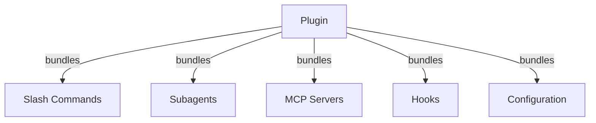
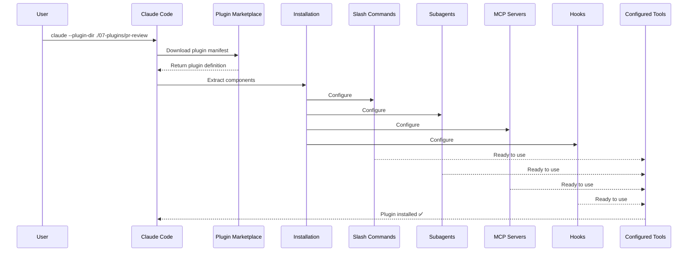
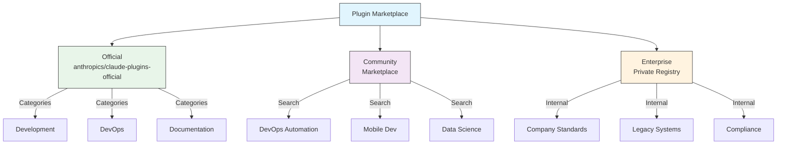
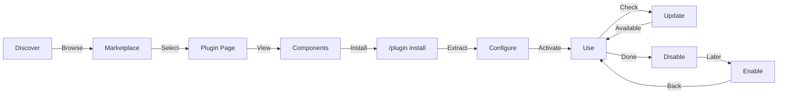
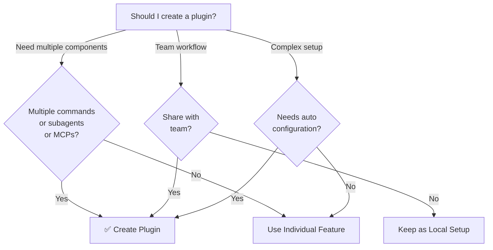

<!-- i18n-source: 07-plugins/README.md -->
<!-- i18n-source-sha: ba721a3 -->
<!-- i18n-date: 2026-10-29 -->

<picture>
  <source media="(prefers-color-scheme: dark)" srcset="../../resources/logos/claude-howto-logo-dark.svg">
  
</picture>

# Claude Code 플러그인

이 폴더에는 여러 Claude Code 기능을 하나로 묶어 설치할 수 있게 만든 완전한 플러그인 예제가 들어 있습니다.

## 개요

Claude Code 플러그인은 사용자 정의 요소(슬래시 명령, 서브에이전트, MCP 서버, 훅)를 묶은 모음으로, 명령 하나로 설치합니다. 여러 기능을 하나의 공유 가능한 패키지로 합친, 가장 높은 수준의 확장 방식입니다.

## 플러그인 구조



## 플러그인 로딩 과정



> **마켓플레이스 없이 사용(v2.1.157+)**: `.claude/skills` 디렉터리에 둔 플러그인은 이제 마켓플레이스 없이 자동으로 불러옵니다. `claude plugin init <name>`으로 새 플러그인 뼈대를 만들면 `~/.claude/skills/<name>/`(사용자 전역)에 생성되고, 다음 세션에서 `<name>@skills-dir`로 자동 로드됩니다. 관리형 설정으로 스킬 디렉터리 플러그인을 막을 수 있습니다. `strictPluginOnlyCustomization`은 허용 목록에 `{ "source": "skills-dir" }` 항목이 있어도 막고, 그 항목이 없는 마켓플레이스 허용 목록도 막습니다. 막힌 폴더는 `/plugin`이나 `claude plugin list`에 플러그인도 오류도 보이지 않습니다.

## 플러그인 종류와 배포

| 종류 | 범위 | 공유 대상 | 관리 주체 | 예시 |
|------|------|-----------|-----------|------|
| 공식 | 전역 | 모든 사용자 | Anthropic | PR Review, Security Guidance |
| 커뮤니티 | 공개 | 모든 사용자 | 커뮤니티 | DevOps, Data Science |
| 조직 | 내부 | 팀원 | 회사 | 사내 표준, 도구 |
| 개인 | 개인 | 한 사용자 | 개발자 | 사용자 정의 워크플로 |

## 플러그인 정의 구조

플러그인 매니페스트는 `.claude-plugin/plugin.json`에 JSON 형식으로 씁니다.

```json
{
  "name": "my-first-plugin",
  "description": "A greeting plugin",
  "version": "1.0.0",
  "author": {
    "name": "Your Name"
  },
  "homepage": "https://example.com",
  "repository": "https://github.com/user/repo",
  "license": "MIT"
}
```

이런 식별 필드 말고도, 매니페스트로 기본 폴더가 아닌 곳에 있는 컴포넌트를 Claude Code에 알려 주고 검색·의존성 메타데이터를 담을 수 있습니다.

| 필드 | 타입 | 설명 |
|------|------|------|
| `workflows` | string \| array | 사용자 정의 [워크플로](https://code.claude.com/docs/en/workflows) 스크립트 파일이나 디렉터리(기본 `workflows/`를 대체) |
| `outputStyles` | string \| array | 사용자 정의 출력 스타일 파일이나 디렉터리(기본 `output-styles/`를 대체) |
| `lspServers` | string \| array \| object | 코드 인텔리전스(정의로 이동, 참조 찾기, 진단)를 위한 LSP 서버. 보통 `"./.lsp.json"`. [LSP 서버 설정](#lsp-서버-설정) 참고 |
| `channels` | array | 메시지 주입을 위한 채널 선언(Telegram, Slack, Discord 방식) |
| `dependencies` | array | 이 플러그인이 필요로 하는 다른 플러그인. semver 버전 제약을 붙일 수 있음 |
| `keywords` | array | 마켓플레이스를 둘러보고 검색할 때 쓰는 검색 태그 |
| `metadata` | object | 이용 권한이나 카탈로그 필드처럼 자유롭게 쓰는 사용자 데이터 객체 |
| `experimental.themes` | string \| array | 색 테마 파일이나 디렉터리(기본 `themes/`를 대체) |
| `experimental.monitors` | string \| array | 플러그인이 활성화되면 자동으로 시작하는 [백그라운드 모니터](#백그라운드-모니터-v21105) 설정 |

## 플러그인 구조 예시

```text
my-plugin/
├── .claude-plugin/
│   └── plugin.json       # 매니페스트 (name, description, version, author)
├── commands/             # 마크다운 파일로 된 스킬
│   ├── task-1.md
│   ├── task-2.md
│   └── workflows/
├── agents/               # 사용자 정의 에이전트 정의
│   ├── specialist-1.md
│   ├── specialist-2.md
│   └── configs/
├── skills/               # SKILL.md 파일이 있는 에이전트 스킬
│   ├── skill-1/
│   │   └── SKILL.md
│   └── skill-2/
│       └── SKILL.md
├── hooks/                # hooks.json의 이벤트 핸들러
│   └── hooks.json
├── .mcp.json             # MCP 서버 설정
├── .lsp.json             # 코드 인텔리전스용 LSP 서버 설정
├── bin/                  # 플러그인이 켜져 있는 동안 Bash 도구의 PATH에 추가되는 실행 파일 (샌드박스 밖 PowerShell 명령도 찾음, v2.1.302)
├── settings.json         # 플러그인이 켜질 때 적용되는 기본 설정 (`agent`와 `subagentStatusLine` 키만 효과 있음)
├── themes/               # 선택: 사용자 정의 Claude Code 테마 제공 (v2.1.118+)
├── templates/
│   └── issue-template.md
├── scripts/
│   ├── helper-1.sh
│   └── helper-2.py
├── docs/
│   ├── README.md
│   └── USAGE.md
└── tests/
    └── plugin.test.js
```

> **참고**: `commands/`는 **레거시**입니다. 공식 안내는 *"새 플러그인에는 `skills/`를 쓰세요"*입니다. 기존 `commands/` 디렉터리는 계속 동작하며 이 모듈의 예제 플러그인 세 개도 이를 씁니다. 하지만 새 플러그인은 평면 마크다운 명령 파일 대신 `skills/`에 `SKILL.md` 디렉터리로 기능을 넣어야 합니다.

### LSP 서버 설정

플러그인에 실시간 코드 인텔리전스를 위한 LSP(Language Server Protocol) 지원을 넣을 수 있습니다. LSP 서버는 작업하는 동안 진단, 코드 탐색, 심볼 정보를 제공합니다.

**설정 위치**:
- 플러그인 루트 디렉터리의 `.lsp.json` 파일
- `plugin.json`의 `lspServers` 키(공식 매니페스트 필드 이름). 문자열, 배열, 객체를 받습니다. 문자열이나 배열은 LSP 설정 파일이나 디렉터리(예: `"./.lsp.json"`)를 가리키고, 객체는 서버를 인라인으로 선언합니다.

#### 필드 레퍼런스

| 필드 | 필수 | 설명 |
|------|------|------|
| `command` | 예 | LSP 서버 바이너리(PATH에 있어야 함) |
| `extensionToLanguage` | 예 | 파일 확장자를 언어 ID에 매핑 |
| `args` | 아니요 | 서버의 명령줄 인수 |
| `transport` | 아니요 | 통신 방식: `stdio`(기본값) 또는 `socket` |
| `env` | 아니요 | 서버 프로세스의 환경 변수 |
| `initializationOptions` | 아니요 | LSP 초기화 때 보내는 옵션 |
| `settings` | 아니요 | 서버에 넘기는 작업 공간 설정 |
| `workspaceFolder` | 아니요 | 작업 공간 폴더 경로 재정의 |
| `startupTimeout` | 아니요 | 서버 시작을 기다리는 최대 시간(ms) |
| `shutdownTimeout` | 아니요 | 정상 종료에 허용하는 최대 시간(ms) |
| `restartOnCrash` | 아니요 | 서버가 비정상 종료되면 자동 재시작 |
| `maxRestarts` | 아니요 | 포기하기 전 최대 재시작 횟수 |

#### 설정 예시

**Go (gopls)**:

```json
{
  "go": {
    "command": "gopls",
    "args": ["serve"],
    "extensionToLanguage": {
      ".go": "go"
    }
  }
}
```

**Python (pyright)**:

```json
{
  "python": {
    "command": "pyright-langserver",
    "args": ["--stdio"],
    "extensionToLanguage": {
      ".py": "python",
      ".pyi": "python"
    }
  }
}
```

**TypeScript**:

```json
{
  "typescript": {
    "command": "typescript-language-server",
    "args": ["--stdio"],
    "extensionToLanguage": {
      ".ts": "typescript",
      ".tsx": "typescriptreact",
      ".js": "javascript",
      ".jsx": "javascriptreact"
    }
  }
}
```

#### 사용할 수 있는 LSP 플러그인

공식 마켓플레이스에는 미리 설정된 LSP 플러그인이 있습니다.

| 플러그인 | 언어 | 서버 바이너리 | 설치 명령 |
|----------|------|---------------|-----------|
| `pyright-lsp` | Python | `pyright-langserver` | `pip install pyright` |
| `typescript-lsp` | TypeScript/JavaScript | `typescript-language-server` | `npm install -g typescript-language-server typescript` |
| `rust-analyzer-lsp` | Rust | `rust-analyzer` | `rustup component add rust-analyzer`로 설치 |

#### LSP 기능

설정을 마치면 LSP 서버가 다음을 제공합니다.

- **즉시 진단** — 편집하자마자 오류와 경고가 나타남
- **코드 탐색** — 정의로 이동, 참조와 구현 찾기
- **호버 정보** — 마우스를 올리면 타입 시그니처와 문서 표시
- **심볼 목록** — 현재 파일이나 작업 공간의 심볼 둘러보기

### `PATH`에 추가되는 `bin/` 디렉터리

플러그인이 켜지면 그 `bin/` 디렉터리가 세션의 `PATH`에, 사용자 자신의 `PATH` 항목 뒤에 추가됩니다. 그래서 플러그인이 `git`, `ls` 같은 시스템 명령을 가릴 수 없습니다. 여기 둔 실행 파일은 전체 경로 없이 이름만으로 Bash 도구에서 바로 호출할 수 있습니다(샌드박스 밖의 PowerShell 도구 명령도 찾을 수 있으며(v2.1.302), 샌드박스 안의 명령은 찾지 못합니다).

```bash
# 플러그인 구성:
my-plugin/
├── .claude-plugin/
│   └── plugin.json
└── bin/
    └── my-tool          # 실행 파일 (chmod +x)

# 플러그인을 켠 Claude Code 세션 안에서:
$ my-tool --help
```

같은 플러그인의 훅, 스킬, 명령이 호출할 CLI 도우미에 씁니다. 플러그인 저장소에서 파일에 실행 권한(`chmod +x`)을 주세요. git이 이 비트를 유지합니다.

## 플러그인 옵션 (v2.1.83+)

플러그인은 매니페스트의 `userConfig`로 사용자가 설정할 수 있는 옵션을 선언할 수 있습니다. `sensitive: true`로 표시한 값은 평문 설정 파일이 아니라 시스템 키체인에 저장됩니다.

```json
{
  "name": "my-plugin",
  "version": "1.0.0",
  "userConfig": {
    "apiKey": {
      "type": "string",
      "title": "API key",
      "description": "API key for the service",
      "sensitive": true
    },
    "region": {
      "type": "string",
      "title": "Region",
      "description": "Deployment region",
      "default": "us-east-1"
    }
  }
}
```

## 영구 플러그인 데이터 (`${CLAUDE_PLUGIN_DATA}`) (v2.1.78+)

플러그인은 `${CLAUDE_PLUGIN_DATA}` 환경 변수로 영구 상태 디렉터리에 접근할 수 있습니다. 이 디렉터리는 플러그인마다 따로 있고 세션이 바뀌어도 남아 있어, 캐시, 데이터베이스 같은 영구 상태에 알맞습니다.

```json
{
  "hooks": {
    "PostToolUse": [
      {
        "matcher": "*",
        "hooks": [
          {
            "type": "command",
            "command": "node \"${CLAUDE_PLUGIN_ROOT}\"/scripts/track-usage.js \"${CLAUDE_PLUGIN_DATA}\"/usage.json"
          }
        ]
      }
    ]
  }
}
```

이 디렉터리(`~/.claude/plugins/data/<id>/`)는 처음 참조할 때 만들어지고 플러그인을 업데이트해도 유지됩니다. 플러그인이 설치된 마지막 위치에서 제거하면 삭제됩니다(`--keep-data`를 넘기면 유지).

### 백그라운드 모니터 (v2.1.105)

플러그인은 세션이 시작될 때나 플러그인의 스킬이 처음 실행될 때 시작하는 백그라운드 모니터를 등록할 수 있습니다. `plugin.json`의 `experimental.monitors`(또는 `monitors/monitors.json`)에 선언합니다.

```json
{
  "name": "my-plugin",
  "version": "1.0.0",
  "experimental": {
    "monitors": [
      {
        "name": "app-log",
        "command": "tail -f /var/log/app.log",
        "description": "Application log errors",
        "when": "always"
      }
    ]
  }
}
```

`name`, `command`, `description`은 필수입니다. `when`은 다음 값을 받습니다.
- `"always"`(기본값) — 세션 시작 시와 플러그인을 다시 불러올 때 시작
- `"on-skill-invoke:<skill>"` — 그 스킬이 처음 실행될 때 시작

모르는 키가 있으면 거부되어 플러그인이 로드되지 않습니다. 최상위 `monitors` 키는 아직 로드되지만 `claude plugin validate`가 경고합니다.

모니터는 내부적으로 Monitor 도구를 써서, stdout 줄을 Claude가 반응할 수 있는 이벤트로 흘려보냅니다.

플러그인 모니터는 비대화형 `-p` 실행에서는 시작하지 않습니다. Amazon Bedrock, Claude Platform on AWS, Google Cloud Agent Platform, Microsoft Foundry에서, 또는 `DISABLE_TELEMETRY`나 `CLAUDE_CODE_DISABLE_NONESSENTIAL_TRAFFIC`를 설정했을 때는 v2.1.310+가 필요합니다(이전 버전은 이런 환경에서 시작하지 않았습니다). 관리형 설정에 `allowManagedHooksOnly`가 있으면 관리형 설정이 강제로 켠 플러그인의 모니터만 시작합니다(v2.1.310+).

## 설정 파일 안의 인라인 플러그인 (`source: 'settings'`) (v2.1.80+)

`source: 'settings'` 필드를 써서 설정 파일 안에 마켓플레이스 항목으로 플러그인을 인라인 정의할 수 있습니다. 별도 저장소나 마켓플레이스 없이 플러그인 정의를 바로 넣을 수 있습니다. `extraKnownMarketplaces.<name>.source` 아래에 선언하며, `name`은 마켓플레이스 키와 같아야 하고, 그 플러그인들은 GitHub이나 npm 같은 외부 출처를 가리켜야 합니다(상대 경로는 거부).

```json
{
  "extraKnownMarketplaces": {
    "inline-tools": {
      "source": {
        "source": "settings",
        "name": "inline-tools",
        "plugins": [
          {
            "name": "quick-lint",
            "source": {
              "source": "github",
              "repo": "my-org/quick-lint"
            }
          }
        ]
      }
    }
  }
}
```

## 모드 (Mods, v2.1.287+)

모드(mod)는 Claude Code의 모양과 동작을 바꾸는 플러그인입니다. 코드는 JavaScript나 TypeScript로 된 훅 모듈로, 도구 호출, 프롬프트 제출, 인터페이스 일부를 그리는 것 같은 일이 일어날 때 Claude Code가 호출하는 이벤트 핸들러입니다. 각 핸들러는 이벤트를 관찰하거나, 다시 쓰거나, 직접 응답할 수 있습니다. 모드는 다른 플러그인처럼 설치하며(`/plugin install <plugin>@<marketplace>`), 스킬, MCP 서버와 같은 플러그인에 담을 수 있고, 사용자 권한으로 실행됩니다. 그러니 믿을 수 있는 작성자와 마켓플레이스의 모드만 설치하세요. 모드는 Claude Code CLI(v2.1.287+), Claude Desktop 앱의 Code 탭, VS Code 확장에서 동작합니다.

| 모드로 할 수 있는 일 | 예시 |
|----------------------|------|
| 창(pane)과 프롬프트 위 띠(band) 그리기 | 대화 기록 옆의 창이나 프롬프트 위의 띠. 탭, 버튼, 텍스트 필드 포함 |
| 명령 추가 | Claude가 작업 중이어도 Claude 턴 없이 함수를 바로 실행하는 `/command` |
| 도구 호출 보호·변경 | 사용자에게 질문하는 동안 도구 호출을 보류하거나, 거부하거나, 도구를 실행하지 않고 직접 응답 |
| 이벤트에 반응 | 도구 호출, 프롬프트, 턴을 추적. 한 모드의 훅들은 변수를 공유하므로 하나는 도구 호출을 세고 다른 하나는 스피너 옆에 개수를 보여 줄 수 있음 |
| 모드 API 호출 | 모델 호출, 파일 읽기·쓰기, 프로세스 시작, 네트워크 요청(훅은 모드 API로만 이런 일을 할 수 있음) |

모드를 만들려면 Claude Code 세션에서 원하는 것을 설명합니다. Claude가 내장 `plugin-authoring` 스킬로 작업하며(직접 `/plugin-authoring`을 실행해도 됨) 모드를 작성하고, 세션에서 핫 리로드를 켜면 모드를 바꾼 턴이 끝날 때마다 다시 불러옵니다. `claude plugin validate`는 모드를 실행하지 않고 검사합니다. 모드를 실행할지, 어떤 모드를 실행할지는 관리자가 관리형 설정으로 정합니다. 예를 들어 `allowManagedModsOnly`를 쓰면 조직의 모드와 Claude Code에 내장된 모드만 훅을 실행합니다. 관리형 설정이 있거나 세션 자격 증명이 Team 또는 Enterprise `/login`이면, 내장 보호 장치가 `deny`·`ask` 규칙이나 `PreToolUse` 훅이 막을 호출을 사용자 모드가 승인하지 못하게 합니다. 둘 다 없으면 모드가 그런 호출을 승인할 수 있습니다.

> **참고**: v2.1.299–2.1.300에서 `Text` 속성 `size`, `weight`, `mono`, `tabular`, `dir`(RTL)이 추가되었고(`bold`는 `weight`로 대체되어 지원 중단), `Box` 간격 단계 `xs`–`xl`, 프롬프트 `virtualText`, `$.ui.view({ agentId })`, `prompt.change` 훅이 추가되었습니다. v2.1.301에서는 여러 줄 입력을 위한 `Input` `rows`가 추가되었습니다(Enter로 제출, Shift+Enter로 줄 추가). v2.1.304에서는 `tool.check`의 `e.isReadOnly`(와 `isReadOnly: true` 매처), Claude Code가 설정을 읽을 때 설정 계층마다(`e.layers`) 보는 `settings.read` 훅(그래서 관리형 모드가 조직의 설정에 상한을 둘 수 있음), `$.settings.read()`의 `key` 인수가 추가되었습니다. v2.1.305는 고정된 창을 터미널 너비의 45% 안에 두고 iTerm2 3.5+에서 `Image`를 그립니다(전체 화면 렌더링). v2.1.310은 `allow-passthrough`와 `focus-events`를 켠 tmux 3.3+ 안에서 `Image`를 그립니다.

> **참고**: 공식 [Mods overview](https://code.claude.com/docs/en/plugins/mods/overview), [Create a mod](https://code.claude.com/docs/en/plugins/mods/create), [Mods reference](https://code.claude.com/docs/en/plugins/mods/reference)를 참고하세요.

## 플러그인 설정

플러그인은 기본 설정을 제공하는 `settings.json` 파일을 담을 수 있습니다. 효과가 있는 키는 `agent`와 `subagentStatusLine` 두 개뿐이고, 다른 키는 모두 버려집니다. `agent`는 플러그인 에이전트 중 하나의 이름을 받아 그 에이전트를 메인 스레드로 실행합니다.

```json
{
  "agent": "specialist-1"
}
```

플러그인에 `settings.json`이 있으면 설치할 때 기본값이 적용됩니다. 사용자는 자신의 프로젝트 설정이나 사용자 설정에서 이를 재정의할 수 있습니다.

## 단독 방식과 플러그인 방식

| 방식 | 명령 이름 | 설정 | 알맞은 경우 |
|------|-----------|------|-------------|
| **단독** | `/hello` | CLAUDE.md에서 수동 설정 | 개인용, 프로젝트 전용 |
| **플러그인** | `/plugin-name:hello` | plugin.json으로 자동 | 공유, 배포, 팀 사용 |

간단한 개인 워크플로에는 **단독 슬래시 명령**을 씁니다. 여러 기능을 묶거나, 팀과 공유하거나, 배포하려면 **플러그인**을 씁니다.

> **공백으로 호출(v2.1.136+)**: 플러그인 슬래시 명령은 공백으로도 동작합니다. `/myplugin review`는 정식 형태인 `/myplugin:review`로 해석됩니다. 어느 쪽이든 괜찮지만, 콜론 형태가 정식이며 스크립트에서는 이쪽을 권장합니다.

> **`skills/` 검색(v2.1.136+)**: `plugin.json`의 `skills` 항목이 더 이상 플러그인의 기본 `skills/` 디렉터리를 가리지 않습니다. 두 곳에 선언한 스킬이 합쳐지므로, `plugin.json`에 주요 스킬 몇 개만 나열해도 나머지를 잃지 않습니다.

> **루트에 `SKILL.md`가 있는 플러그인(v2.1.142+)**: 최상위에 `SKILL.md`가 있고 **`skills/` 하위 디렉터리가 없는** 플러그인은 그 자체가 스킬 하나로 나타납니다. 플러그인이 곧 스킬입니다. `skills/` 디렉터리나 `plugin.json`의 `skills` 항목을 대신하는 것이 아니라 추가된 패턴이며, 디렉터리 구성이 쓸모없는 작은 단일 스킬 플러그인에 씁니다.

## 실전 예제

### 예제 1: PR 리뷰 플러그인

**파일:** `.claude-plugin/plugin.json`

```json
{
  "name": "pr-review",
  "version": "1.0.0",
  "description": "Complete PR review workflow with security, testing, and docs",
  "author": {
    "name": "Anthropic"
  },
  "repository": "https://github.com/your-org/pr-review",
  "license": "MIT"
}
```

**파일:** `commands/review-pr.md`

```markdown
---
name: Review PR
description: 보안·테스트 검사를 포함한 종합 PR 리뷰를 시작합니다
---

# PR 리뷰

이 명령은 다음을 포함한 풀 리퀘스트 전체 리뷰를 시작합니다.

1. 보안 분석
2. 테스트 커버리지 확인
3. 문서 업데이트
4. 코드 품질 검사
5. 성능 영향 평가
```

**파일:** `agents/security-reviewer.md`

```yaml
---
name: security-reviewer
description: 보안 중심 코드 리뷰
tools: Read, Grep, Bash
---

# 보안 리뷰어

보안 취약점 찾기에 특화되어 있습니다.
- 인증/인가 문제
- 데이터 노출
- 인젝션 공격
- 안전한 설정
```

**설치:**

```bash
claude --plugin-dir ./07-plugins/pr-review

# 결과:
# ✅ 슬래시 명령 3개 설치
# ✅ 서브에이전트 3개 설정
# ✅ MCP 서버 2개 연결
# ✅ 훅 4개 등록
# ✅ 사용 준비 완료!
```

### 예제 2: DevOps 플러그인

**구성 요소:**

```text
devops-automation/
├── commands/
│   ├── deploy.md
│   ├── rollback.md
│   ├── status.md
│   └── incident.md
├── agents/
│   ├── deployment-specialist.md
│   ├── incident-commander.md
│   └── alert-analyzer.md
├── mcp/
│   └── kubernetes-config.json
├── hooks/
│   ├── pre-deploy.js
│   └── post-deploy.js
└── scripts/
    ├── deploy.sh
    ├── rollback.sh
    └── health-check.sh
```

### 예제 3: 문서화 플러그인

**묶인 구성 요소:**

```text
documentation/
├── commands/
│   ├── generate-api-docs.md
│   ├── generate-readme.md
│   ├── sync-docs.md
│   └── validate-docs.md
├── agents/
│   ├── api-documenter.md
│   ├── code-commentator.md
│   └── example-generator.md
├── mcp/
│   └── github-docs-config.json
└── templates/
    ├── api-endpoint.md
    ├── function-docs.md
    └── adr-template.md
```

> **참고:** 세 예제 플러그인의 한국어판(`ko/07-plugins/<plugin>/`)에는 설명 문서, 명령, 에이전트, 템플릿만 번역되어 있습니다. 설치할 때는 `plugin.json`, 훅, 스크립트, MCP 설정이 있는 원문 폴더를 씁니다.

## 플러그인 마켓플레이스

Anthropic이 관리하는 공식 플러그인 디렉터리는 `anthropics/claude-plugins-official`이며, 처음 대화형으로 실행할 때 자동 등록됩니다. 엔터프라이즈 관리자는 내부 배포용 비공개 플러그인 마켓플레이스를 만들 수도 있습니다.

**커뮤니티 마켓플레이스**인 `anthropics/claude-plugins-community`도 있습니다. Anthropic의 자동 검증과 안전 심사를 통과한 서드파티 플러그인을 담고 있으며, 각 플러그인은 카탈로그에서 특정 커밋 SHA에 고정됩니다. 공식 마켓플레이스와 달리 직접 추가해야 합니다.

```bash
/plugin marketplace add anthropics/claude-plugins-community

# 그런 다음 claude-community 마켓플레이스 이름으로 설치
/plugin install <plugin-name>@claude-community
```



### 마켓플레이스 설정

엔터프라이즈 사용자와 고급 사용자는 설정으로 마켓플레이스 동작을 제어할 수 있습니다.

| 설정 | 설명 |
|------|------|
| `extraKnownMarketplaces` | 기본값 외에 마켓플레이스 출처 추가 |
| `strictKnownMarketplaces` | 사용자가 추가할 수 있는 마켓플레이스 제한(관리형 전용) |
| `blockedMarketplaces` | 관리자가 관리하는 마켓플레이스 차단 목록(v2.1.119부터 `hostPattern` / `pathPattern` 정규식 필드 지원) |
| `enabledPlugins` (`false`로 설정) | 특정 플러그인 차단: 관리형 설정에 `"enabledPlugins": { "<plugin>@<marketplace>": false }`를 넣으면 모든 범위에서 설치를 막고 마켓플레이스에서 숨김 |

> **더 쉬운 별칭(v2.1.232)**: `additionalMarketplaces`는 `extraKnownMarketplaces`의,
> `allowedMarketplaces`는 `strictKnownMarketplaces`의 별칭으로 받아들여집니다.
> 공식 설정 레퍼런스의
> [Marketplace key aliases](https://code.claude.com/docs/en/settings-reference#marketplace-key-aliases)에 둘 다 나와 있습니다.
> 이전 버전은 별칭을 무시하므로, 정식 키를 계속 써도 안전합니다.

> **소유자 와일드카드(v2.1.223+)**: `"owner/*"` 항목은 한 GitHub 소유자 아래의 모든 마켓플레이스
> 저장소를 허용하거나 차단합니다. **`strictKnownMarketplaces`와
> `blockedMarketplaces`에서만 받아들여집니다.** `extraKnownMarketplaces`나 `/plugin marketplace add`를
> 포함해 `github` 출처가 나오는 다른 모든 곳에서는 `repo` 값이 저장소 하나를
> 가리켜야 합니다.

> **강제 적용**(v2.1.117+): `blockedMarketplaces`와 `strictKnownMarketplaces`는 처음 추가할 때뿐 아니라 설치, 업데이트, 새로 고침, 자동 업데이트 등 모든 플러그인 수명 주기 이벤트에서 적용됩니다. `strictKnownMarketplaces`는 관리형 전용입니다.

호스트/경로 정규식을 쓴 `blockedMarketplaces` 예시(v2.1.119):

```json
{
  "blockedMarketplaces": [
    { "source": "hostPattern", "hostPattern": "^evil\\.example\\.com$" },
    { "source": "pathPattern", "pathPattern": "^/opt/approved/" }
  ]
}
```

#### 마켓플레이스 `headersHelper` (v2.1.238)

`url` 마켓플레이스나 개별 카탈로그 항목에 `headersHelper` 명령을 지정할 수 있습니다. 이 명령은 카탈로그와 같은 출처(same-origin)의 아카이브를 가져올 때 쓸 HTTP 헤더를 만듭니다. 토큰 발급 서비스 뒤에 있는 비공개 마켓플레이스가 설정에 고정 비밀 값을 두지 않고 인증하는 방법입니다.

**카탈로그 항목의** 헬퍼는 설치나 업데이트 때만, 그리고 그 명령을 사용자에게 보여 준 뒤에만 실행됩니다. `claude plugin install`과 `claude plugin update`는 실행 전에 `[y/N]`로 묻습니다. 자동화에서는 `-y`를 넘겨 묻지 않고 수락합니다.

### 마켓플레이스 추가 기능

- **마켓플레이스 검색창(v2.1.172)**: `/plugin`에서 마켓플레이스의 플러그인을 둘러볼 때 검색창으로 이름이나 키워드로 거를 수 있습니다. 전체 목록을 스크롤하기 느린 큰 마켓플레이스에서 편리합니다.
- **기본 git 타임아웃**: 큰 플러그인 저장소를 위해 30초에서 120초로 늘었습니다
- **사용자 지정 npm 레지스트리**: 플러그인이 의존성 해석에 쓸 npm 레지스트리 URL을 지정할 수 있습니다
- **버전 고정**: 재현 가능한 환경을 위해 플러그인을 특정 버전에 고정합니다
- **둘러보기 창의 예상 컨텍스트 비용(v2.1.143)**: `/plugin` 마켓플레이스 브라우저는 플러그인마다 턴당 예상 컨텍스트 토큰 비용(항상 불러오는 스킬, 훅, MCP 서버 설명의 합)을 보여 줍니다. 설치 전에 도입 규모를 가늠할 때 씁니다. 설치 뒤에는 [`claude plugin details <name>`](#claude-plugin-details-name-v21139)으로 같은 예상치를 볼 수 있습니다.
- **플러그인 서브모듈만 클론(v2.1.295)**: Claude Code가 마켓플레이스 저장소를 클론할 때 플러그인 파일이 있는 git 서브모듈만 가져옵니다(`"source": "./"`인 루트 플러그인은 전부 또는 전혀 가져오지 않고, `--sparse`/`sparsePaths`는 하나도 가져오지 않음). 이전 버전은 모든 서브모듈을 가져와 클론 타임아웃을 넘길 수 있었습니다.

비용 열이 있는 둘러보기 행 예시:

```text
NAME              VERSION   AUTHOR     CTX/TURN   DESCRIPTION
code-reviewer     1.2.0     anthropic  +1,420     Multi-agent PR review
devops-toolkit    0.4.1     acme       +3,180     SRE playbooks, on-call helpers
docs-helper       0.9.0     community  +610       Doc-style guide enforcement
```

### 마켓플레이스 정의 스키마

플러그인 마켓플레이스는 `.claude-plugin/marketplace.json`에 정의합니다.

```json
{
  "name": "my-team-plugins",
  "owner": { "name": "my-org" },
  "plugins": [
    {
      "name": "code-standards",
      "source": "./plugins/code-standards",
      "description": "Enforce team coding standards",
      "version": "1.2.0",
      "author": { "name": "platform-team" }
    },
    {
      "name": "deploy-helper",
      "source": {
        "source": "github",
        "repo": "my-org/deploy-helper",
        "ref": "v2.0.0"
      },
      "description": "Deployment automation workflows"
    }
  ]
}
```

| 필드 | 필수 | 설명 |
|------|------|------|
| `name` | 예 | kebab-case 마켓플레이스 이름 |
| `owner` | 예 | 마켓플레이스를 관리하는 조직이나 사용자. `name`이 필수인 객체(`email`, `url`은 선택) |
| `plugins` | 예 | 플러그인 항목 배열 |
| `plugins[].name` | 예 | 플러그인 이름(kebab-case) |
| `plugins[].source` | 예 | 플러그인 출처(경로 문자열 또는 source 객체) |
| `plugins[].description` | 아니요 | 짧은 플러그인 설명 |
| `plugins[].version` | 아니요 | 시맨틱 버전 문자열 |
| `plugins[].author` | 아니요 | 플러그인 작성자. `name`이 필수인 객체(`email`, `url`은 선택) |
| `renames` | 아니요 | 마켓플레이스 최상위 필드(항목별이 아님). 예전 플러그인 `name`을 현재 이름(제거되었으면 `null`)에 매핑해 사용자가 자동으로 옮겨 가게 함(v2.1.193) |
| `plugins[].displayName` | 아니요 | UI에 표시하는 사람이 읽기 좋은 이름. 조회에는 쓰지 않음(v2.1.143) |
| `plugins[].defaultEnabled` | 아니요 | `false`면 사용자가 켤 때까지 비활성 상태로 설치(v2.1.154) |

### 플러그인 출처 유형

플러그인은 여러 위치에서 가져올 수 있습니다.

| 출처 | 문법 | 예시 |
|------|------|------|
| **상대 경로** | 경로 문자열 | `"./plugins/my-plugin"` |
| **GitHub** | `{ "source": "github", "repo": "owner/repo" }` | `{ "source": "github", "repo": "acme/lint-plugin", "ref": "v1.0" }` |
| **Git URL** | `{ "source": "url", "url": "..." }` | `{ "source": "url", "url": "https://git.internal/plugin.git" }` |
| **Git 하위 디렉터리** | `{ "source": "git-subdir", "url": "...", "path": "..." }` | `{ "source": "git-subdir", "url": "https://github.com/org/monorepo.git", "path": "packages/plugin" }` |
| **npm** | `{ "source": "npm", "package": "..." }` | `{ "source": "npm", "package": "@acme/claude-plugin", "version": "^2.0" }` |
| **아카이브** (v2.1.224+) | `{ "source": "archive", "url": "..." }` | `{ "source": "archive", "url": "https://cdn.example.com/lint-plugin-1.2.0.zip", "sha256": "…" }` |
| **명령** (v2.1.229+) | `{ "source": "command", "command": "..." }` | `{ "source": "command", "command": "acme-plugin-resolver --print-dir" }` |

GitHub와 git 출처는 버전 고정을 위해 선택 필드 `ref`(브랜치/태그)와 `sha`(커밋 해시)를 지원합니다.

**출처 이름만 쓰기와 `metadata.pluginRoot`(v2.1.239)**: 이제 마켓플레이스의 `metadata.pluginRoot`가 적용됩니다. 카탈로그에 플러그인 출처 이름만 쓰면 그 루트 아래 디렉터리로 해석되므로, 항목마다 전체 상대 경로를 쓸 필요가 없습니다.

**claude.ai에서 동기화한 스킬(v2.1.239)**: claude.ai에서 내려받아 동기화한 플러그인은 `name@synced`로 나타납니다. `claude plugin enable <name>@synced`, `claude plugin disable <name>@synced`처럼 그 이름으로 지정합니다. 동기화한 플러그인은 같은 이름의 설치된 플러그인을 덮어쓰지 않으며, 둘은 `@synced` 접미사로 구분되어 함께 존재합니다.

#### `archive` 출처 (v2.1.224+)

git 클론이나 npm 설치 없이 HTTPS로 zip 파일에서 플러그인을 설치합니다.

```json
{
  "source": "archive",
  "url": "https://cdn.example.com/lint-plugin-1.2.0.zip",
  "sha256": "3b1f0c2e9a7d4f5b8c6e1a2d3f4b5c6d7e8f9a0b1c2d3e4f5a6b7c8d9e0f1a2b"
}
```

| 필드 | 필수 | 참고 |
|------|------|------|
| `url` | 예 | **HTTPS만 가능.** `http://`, 루프백, 링크 로컬, 클라우드 메타데이터 호스트는 거부되며, **리디렉션할 때마다** 다시 검사하므로 리디렉션으로 차단된 호스트에 몰래 접속할 수 없음 |
| `sha256` | 아니요 | 16진수 64자. 일치하지 않으면 `Plugin archive integrity check failed`로 설치 실패 |

아카이브 크기는 **256 MiB**까지입니다. 직접 빌드하지 않은 아카이브에는 `sha256`을 고정하세요. 그러지 않으면 URL을 제어하는 사람이 세션에서 실행되는 코드를 제어하게 됩니다.

#### `command` 출처 (v2.1.229+)

로컬에 설치한 도구가 플러그인 위치를 정하게 합니다. 사내 패키지 관리자가 이미
플러그인을 가져와 배치하는 방법을 알고 있을 때 유용합니다.

```json
{
  "source": "command",
  "command": "acme-plugin-resolver --print-dir",
  "timeout": 60,
  "mode": "copy"
}
```

규칙은 엄격합니다. **명령은 stdout에 정확히 한 줄을 출력하고 종료 코드 0으로 끝나야
합니다.** 그 줄은 완전한 플러그인이 들어 있는 디렉터리의 절대 경로입니다.

| 필드 | 필수 | 기본값 | 참고 |
|------|------|--------|------|
| `command` | 예 | — | 실행할 명령 |
| `timeout` | 아니요 | `60`(초) | 최대 600 |
| `mode` | 아니요 | `"copy"` | `"copy"`는 디렉터리 스냅샷을 만들고, `"link"`는 심볼릭 링크를 걸어 편집이 바로 반영됨 |

명령은 세션마다 다시 해석되며, 결과는 재시작 없이 적용됩니다.
조직은 `disableCommandPluginSources`로 이 출처 유형을 아예 막을 수 있습니다.

예약된 마켓플레이스 이름에 이제 `first-party-plugins`와 `healthcare`가 포함됩니다(v2.1.205). 공식 용도로 확보된 이름이라 사용자 지정 마켓플레이스가 쓸 수 없습니다.

### 배포 방법

**GitHub (권장)**:
```bash
# 사용자가 마켓플레이스를 추가
/plugin marketplace add owner/repo-name
```

**다른 git 서비스** (전체 URL 필요):
```bash
/plugin marketplace add https://gitlab.com/org/marketplace-repo.git
```

중첩 하위 그룹을 포함한 `gitlab.com` 저장소 URL도 `github.com` URL과 똑같이 클론됩니다
(v2.1.232). **스킴은 꼭 써야 합니다**: v2.1.196부터 `gitlab.example.com/team/plugins`처럼
스킴 없이 쓰면 잘못된 `owner/repo` 축약형으로 거부되므로, `https://gitlab.com/company/plugins.git`처럼
전체 형식을 씁니다. v2.1.232에서는 GitLab 토큰 계열 비밀 값 가리기도 추가되었고,
`glab` CLI에도 `gh`에 이미 있던 샌드박스와 자격 증명 경로 보호가 적용되었습니다.

**비공개 저장소**: git 자격 증명 헬퍼나 환경 토큰으로 지원합니다. 사용자는 저장소 읽기 권한이 있어야 합니다. HTTPS에서는 Claude Code가 git의 프롬프트와 askpass 프로그램(`GIT_ASKPASS` 포함)을 끄므로, `gh auth login`과 `gh auth setup-git` 등으로 자격 증명을 미리 저장해 두어야 합니다.

**디렉터리 제출**: 더 널리 배포하려면 개발자 포털 [claude.ai/directory/manage](https://claude.ai/directory/manage)에서 Anthropic 디렉터리에 플러그인을 제출합니다. Anthropic 공식 마켓플레이스인 `claude-plugins-official`은 디렉터리 포털로 제출을 받지 않습니다.

### 마켓플레이스 관리

```bash
# 마켓플레이스 CLI 명령
claude plugin marketplace add <source>       # 마켓플레이스 추가 (GitHub, URL, 로컬)
claude plugin marketplace update [name]      # 카탈로그 색인 새로 고침
claude plugin marketplace remove <name>      # 마켓플레이스 제거
claude plugin marketplace list               # 설정된 마켓플레이스 나열
```

> **중요**: `marketplace update`는 플러그인 카탈로그(설치할 수 있는 목록)만 새로 고칩니다. 설치된 플러그인은 업데이트하지 **않습니다**. 설치된 특정 플러그인을 업데이트하려면 `plugin update <name>`을 씁니다.

### 엄격 모드

마켓플레이스 정의가 로컬 `plugin.json` 파일과 어떻게 상호 작용할지 정합니다.

| 설정 | 동작 |
|------|------|
| `strict: true` (기본값) | 로컬 `plugin.json`이 기준이고, 마켓플레이스 항목이 이를 보완 |
| `strict: false` | 마켓플레이스 항목이 플러그인 정의 전체 |

`strictKnownMarketplaces`로 거는 **조직 제한**:

| 값 | 효과 |
|----|------|
| 설정 안 함 | 제한 없음 — 사용자가 어떤 마켓플레이스든 추가 가능 |
| 빈 배열 `[]` | 전면 차단 — 어떤 마켓플레이스도 허용 안 함 |
| source 객체 배열 | 허용 목록 — 일치하는 마켓플레이스만 추가 가능 |

```json
{
  "strictKnownMarketplaces": [
    { "source": "github", "repo": "my-org/*" },
    { "source": "github", "repo": "trusted-vendor/*" }
  ]
}
```

> **주의**: `strictKnownMarketplaces`를 쓴 엄격 모드에서는 허용 목록에 있는 마켓플레이스의 플러그인만 설치할 수 있습니다. 플러그인 배포를 통제해야 하는 엔터프라이즈 환경에 유용합니다.

## 플러그인 설치와 수명 주기



## 플러그인 기능 비교

| 기능 | 슬래시 명령 | 스킬 | 서브에이전트 | 플러그인 |
|------|-------------|------|--------------|----------|
| **설치** | 수동 복사 | 수동 복사 | 수동 설정 | 명령 하나 |
| **설정 시간** | 5분 | 10분 | 15분 | 2분 |
| **묶음** | 파일 하나 | 파일 하나 | 파일 하나 | 여러 개 |
| **버전 관리** | 수동 | 수동 | 수동 | 자동 |
| **팀 공유** | 파일 복사 | 파일 복사 | 파일 복사 | 설치 ID |
| **업데이트** | 수동 | 수동 | 수동 | 자동 제공 |
| **의존성** | 없음 | 없음 | 없음 | 포함 가능 |
| **마켓플레이스** | 아니요 | 아니요 | 아니요 | 예 |
| **배포** | 저장소 | 저장소 | 저장소 | 마켓플레이스 |

## 플러그인 CLI 명령

모든 플러그인 작업은 CLI 명령으로 할 수 있습니다.

```bash
claude plugin install <name>@<marketplace>   # 마켓플레이스에서 설치
claude plugin uninstall <name>               # 플러그인 제거
claude plugin update <name>                  # 설치된 플러그인을 최신 버전으로 업데이트
claude plugin list                           # 설치된 플러그인 나열
claude plugin enable <name>                  # 비활성 플러그인 켜기
claude plugin disable <name>                 # 플러그인 끄기
claude plugin validate <path>                # <path>의 플러그인 구조 검증
claude plugin tag [path]                     # {name}--v{version} 릴리스 git 태그 만들기 (v2.1.118+)
claude plugin prune                          # 고아가 된 자동 설치 플러그인 의존성 제거 (v2.1.121+)
claude plugin uninstall <name> --prune       # 제거하면서 고아 의존성도 연쇄 정리 (v2.1.121+)
claude plugin details <name>                 # 구성 목록과 턴당 예상 토큰 비용 표시 (v2.1.139+)
claude plugin configure <name>@<marketplace> # 플러그인 옵션과 미설정 항목 표시. --values-stdin으로 stdin의 값 저장 (v2.1.285+)
claude plugin init <name>                    # 새 플러그인 뼈대 만들기 (별칭: claude plugin new)
```

**별칭**: `init`은 `claude plugin new`, `uninstall`은 `remove` / `rm`, `list`는 `ls`, `prune`은 `autoremove`.

**알아 둘 만한 플래그:**

| 명령 | 플래그 | 용도 |
|------|--------|------|
| `plugin init` | `--with <components...>` | 특정 컴포넌트 폴더 뼈대 만들기: `skills`, `agents`, `hooks`, `mcp`, `lsp`, `output-style`, `channel` |
| `plugin init` | `-f`, `--force` | 기존 `.claude-plugin/` 디렉터리 덮어쓰기 |
| `plugin install` | `--config <key=value>` | 설치할 때 `userConfig` 옵션 설정. v2.1.285부터 `<server>.<key>=<value>`로 번들된 `.mcpb` MCP 서버 자체 설정을 지정해, `/plugin` → Configure를 거치지 않고 시작하게 함 |
| `plugin install` | `-y`, `--yes` | 확인 프롬프트 없이 명령 수락 |
| `plugin list` | `--available` | 마켓플레이스에서 설치할 수 있는 플러그인도 나열(`--json` 필요) |
| `plugin tag` | `--push` | 태그를 만든 뒤 원격에 푸시 |
| `plugin tag` | `--dry-run` | 태그를 만들지 않고 무엇이 태그될지 출력 |
| `plugin validate` | `--strict` | 경고를 오류로 취급 |
| `plugin validate` | `--json` | 기계가 읽을 수 있는 검증 보고서 출력(v2.1.259+) |

`claude plugin validate`는 `.mcp.json` 항목도 검사하며(v2.1.281+), `outputStyles`, `themes`, `monitors`, `lspServers` 경로가 없거나 플러그인 디렉터리 밖을 가리키면 실패합니다(v2.1.283+).

예: `claude plugin tag ./my-plugin`은 버전 문자열이 아니라 플러그인 **경로**를 받습니다. `plugin.json`에서 얻은 `{name}--v{version}` git 태그를 만들면서 `plugin.json`과 그것을 담은 마켓플레이스 항목이 일치하는지 검증하며, 배포용 플러그인 릴리스를 만드는 권장 방법입니다.

`claude plugin prune`은 자체 의존성을 끌어온 마켓플레이스 플러그인을 설치하거나 제거한 뒤에 유용합니다. 부모 플러그인이 제거된 자동 설치 플러그인을 지웁니다. `plugin uninstall --prune`은 같은 연쇄 정리를 한 번에 합니다.

> **의존성 강제(v2.1.143)**: 켜져 있는 다른 플러그인이 대상에 아직 의존하면 `claude plugin disable <name>`은 **거부**합니다(의존성 그래프가 깨지기 때문). `claude plugin enable <name>`은 하나씩 따로 켜게 하지 않고, 확인 프롬프트 한 번 뒤에 **전이 의존성을 강제로 켭니다**. 의존하던 플러그인이 나중에 제거된 의존성은 `claude plugin prune`으로 정리합니다.

### `claude plugin details <name>` (v2.1.139+)

`claude plugin details <name>`은 플러그인의 전체 구성 목록(스킬, 훅, MCP 서버, LSP 서버, 백그라운드 모니터, 슬래시 명령)과 **턴당(그리고 호출당) 예상 토큰 비용**을 보여 줍니다. 특히 컨텍스트가 제한된 모델에서, 도입하기 전에 플러그인 규모를 가늠할 때 씁니다.

출력 예시(일부 생략):

```text
plugin: code-reviewer (1.2.0)
skills:        3      hooks: 2      mcp: 1      lsp: 0      monitors: 0
commands:      /review, /security-review
projected ctx: +1,420 tokens per turn  ·  +9,800 tokens per /review invocation
```

LSP 서버는 v2.1.142에서 details 창에 추가되었습니다. [플러그인 마켓플레이스](#플러그인-마켓플레이스)에서 다룬 마켓플레이스 둘러보기 창의 예상 컨텍스트 비용(v2.1.143)도 참고하세요.

### `claude plugin eval` (v2.1.269+)

`claude plugin eval`은 플러그인의 평가(eval) 모음을 실행해 점수가 매겨진 재현 가능한 결과를 보고합니다. 그래서 스킬이나 에이전트를 바꾼 것이 실제로 나아졌는지 알 수 있습니다. 결과는 JSON과 HTML 보고서로 나옵니다. v2.1.283부터는 git이 설치되어 있으면 git 2.31 이상이 필요합니다.

```bash
claude plugin eval            # 플러그인의 평가 모음 실행
claude plugin eval --help     # 전체 옵션 목록
```

`--disallow-tools <tools…>`와 케이스별 `disallowed_tools` 필드로 Agent 같은 내장 도구를 평가 실행에서 뺄 수 있습니다(v2.1.299).

### `--json`으로 기계가 읽는 출력 (v2.1.268+)

`install`, `uninstall`, `update`, `enable`, `disable`에서 `--json`을 받으므로 CI에서 플러그인 관리를 스크립트로 처리할 수 있습니다. `claude plugin list --json`의 각 행에는 `errorDetails`와 `noteDetails`도 들어 있어, 실패한 플러그인이 다른 명령 없이 이유를 알려 줍니다.

```bash
claude plugin install my-plugin@my-marketplace --json
claude plugin list --json
```

### `--accept-command`로 정확한 명령 수락하기 (v2.1.271+)

`install`과 `update`의 `--accept-command <sha256>`은 일괄 수락하는 `-y` 대신, 이전 `--json` 실행이 보여 준 바로 그 명령만 수락합니다.

```bash
claude plugin install my-plugin@my-marketplace --accept-command <sha256>
```

### 추가하지 않은 마켓플레이스에서 설치하기 (v2.1.275+)

세션에서 `/plugin install <plugin> --marketplace <source>`로 마켓플레이스를 바로 지정하면, 설치하기 전에 추가할지 물어봅니다. 그래서 마켓플레이스를 찾아 추가하는 일이 더 이상 별도 단계가 아닙니다. 셸에서 `claude plugin install <plugin> --marketplace <source>`도 같은 일을 합니다(v2.1.292+). 필요하면 `claude plugin marketplace add`와 같은 정책 검사를 거쳐 마켓플레이스를 추가한 뒤 플러그인을 설치합니다.

```bash
/plugin install code-review --marketplace anthropics/claude-code
claude plugin install code-review --marketplace anthropics/claude-code   # 같은 동작, 셸에서 (v2.1.292+)
```

## 설치 방법

### 마켓플레이스에서
```bash
/plugin install plugin-name
# 또는 CLI에서:
claude plugin install plugin-name@marketplace-name
```

**바로 적용되나요?** **v2.1.221**부터는 대개 그렇습니다. 설치 요약의 마지막 줄을
확인하세요.

| 설치 요약 문구 | 뜻 |
|---|---|
| `Plugin is now active.` | Claude Code가 설치하면서 플러그인을 활성화함. 더 할 일 없음 |
| `Run /reload-plugins to activate.` | 플러그인은 설치되었지만 아직 활성화되지 않음. 활성화하면 프롬프트 캐시가 무효화되거나, 활성화 시도가 실패한 경우 |

v2.1.221 전에는 `/reload-plugins`를 실행하거나 재시작하기 전까지 어떤 설치도 현재 세션에
적용되지 않았으므로, 예전 가이드에서는 이 단계를 무조건 거쳐야 한다고 설명합니다.

### 켜기 / 끄기 (범위 자동 감지)
```bash
/plugin enable plugin-name
/plugin disable plugin-name
```

`/plugin` 화면은 쓰지 않는 플러그인을 보여 주어 정리할 수 있게 합니다(v2.1.187+). 플러그인 `plugin.json`의 `name`이 마켓플레이스 항목 이름과 달라도 켜기/끄기가 동작합니다(v2.1.195+).

### 설치된 플러그인 나열 (v2.1.163)
현재 세션에서 어떤 플러그인이 활성 상태인지 확인합니다.
```bash
/plugin list             # 설치된 모든 플러그인
/plugin list --enabled   # 켜진 플러그인만
/plugin list --disabled  # 꺼진 플러그인만
```

### 로컬 플러그인 (개발용)
```bash
# 로컬 테스트용 CLI 플래그 (여러 플러그인에 반복 사용 가능)
claude --plugin-dir ./path/to/plugin
claude --plugin-dir ./plugin-a --plugin-dir ./plugin-b

# --plugin-dir은 .zip 아카이브 경로도 받음 (v2.1.128+)
claude --plugin-dir ./my-plugin.zip

# 현재 세션용으로 URL에서 플러그인 .zip 아카이브 가져오기 (v2.1.129+, 반복 사용 가능)
claude --plugin-url https://example.com/releases/my-plugin-0.3.0.zip
```

### Git 저장소에서
```bash
/plugin marketplace add username/repo                    # GitHub 저장소를 마켓플레이스로 추가
/plugin install plugin-name@marketplace-name             # 그런 다음 플러그인 설치
/plugin install plugin-name --marketplace username/repo  # 또는 한 번에 (v2.1.275+)
```

## 자동 업데이트

Claude Code는 시작할 때 마켓플레이스와 설치된 플러그인을 자동으로 업데이트할 수 있습니다.

| 마켓플레이스 종류 | 자동 업데이트 기본값 | 전환 방법 |
|-------------------|----------------------|-----------|
| 공식 (`claude-plugins-official`) | ✅ 켜짐 | `/plugin` → Marketplaces → 선택 |
| 서드파티 / 로컬 | ❌ 꺼짐 | 같은 UI 경로 |

자동 업데이트가 실행되면 Claude Code는 다음을 합니다.
1. 마켓플레이스 카탈로그 새로 고침
2. 설치된 플러그인을 최신 버전으로 업데이트
3. 플러그인마다 결과 보고: 업데이트하면서 활성화했으면 `Plugin is now active.`, 그렇지 않으면 `Run /reload-plugins to activate.`

### 환경 변수

| 변수 | 효과 |
|------|------|
| `DISABLE_AUTOUPDATER=1` | 모든 자동 업데이트 끄기(Claude Code + 플러그인) |
| `DISABLE_AUTOUPDATER=1` + `FORCE_AUTOUPDATE_PLUGINS=1` | 플러그인 업데이트는 유지하고 Claude Code 업데이트만 끄기 |
| `CLAUDE_CODE_PLUGIN_PREFER_HTTPS=1` | (v2.1.141+) SSH 원격이 있어도 `claude plugin install`이 GitHub 플러그인 출처를 SSH 대신 HTTPS로 클론하게 강제. SSH 키가 없는 CI 러너나 컨테이너에서 사용 |

```bash
# 모든 자동 업데이트 끄기
export DISABLE_AUTOUPDATER=1

# 플러그인 자동 업데이트만 유지
export DISABLE_AUTOUPDATER=1
export FORCE_AUTOUPDATE_PLUGINS=1

# SSH 키 없는 CI 러너 — 플러그인 설치에 HTTPS 강제
export CLAUDE_CODE_PLUGIN_PREFER_HTTPS=1
claude plugin install code-review@claude-code-plugins
```

> **원격 세션 플러그인 로딩(v2.1.179)**: v2.1.179에서 원격 세션의 플러그인 로딩 성능이 개선되어, 원격 세션에 연결하면 플러그인을 더 빨리 쓸 수 있습니다.

## 언제 플러그인을 만들까



### 플러그인 사용 사례

| 사용 사례 | 권장 | 이유 |
|-----------|------|------|
| **팀 온보딩** | ✅ 플러그인 사용 | 모든 설정을 즉시 준비 |
| **프레임워크 설정** | ✅ 플러그인 사용 | 프레임워크 전용 명령을 묶음 |
| **엔터프라이즈 표준** | ✅ 플러그인 사용 | 중앙 배포, 버전 관리 |
| **간단한 작업 자동화** | ❌ 명령 사용 | 지나치게 복잡함 |
| **단일 분야 전문성** | ❌ 스킬 사용 | 너무 무거움. 스킬을 대신 사용 |
| **특화된 분석** | ❌ 서브에이전트 사용 | 직접 만들거나 스킬 사용 |
| **실시간 데이터 접근** | ❌ MCP 사용 | 단독으로 쓰고 묶지 않음 |

## 플러그인 테스트

배포하기 전에 `--plugin-dir` CLI 플래그(여러 플러그인에 반복 사용 가능)로 플러그인을 로컬에서 테스트합니다.

```bash
claude --plugin-dir ./my-plugin
claude --plugin-dir ./my-plugin --plugin-dir ./another-plugin

# --plugin-dir은 디렉터리뿐 아니라 .zip 아카이브도 받음 (v2.1.128+)
claude --plugin-dir ./my-plugin.zip

# --plugin-url은 이 세션용으로 URL에서 플러그인 .zip을 가져옴 (v2.1.129+, 반복 사용 가능)
claude --plugin-url https://example.com/releases/my-plugin-0.3.0.zip
```

플러그인을 불러온 채로 Claude Code가 실행되므로 다음을 할 수 있습니다.
- 모든 슬래시 명령을 쓸 수 있는지 확인
- 서브에이전트와 에이전트가 제대로 동작하는지 테스트
- MCP 서버가 제대로 연결되는지 확인
- 훅 실행 검증
- LSP 서버 설정 확인
- 설정 오류가 없는지 확인

## 핫 리로드

플러그인은 개발 중 핫 리로드를 지원합니다. 플러그인 파일을 고치면 Claude Code가 변경을 자동으로 감지할 수 있습니다. 다음 명령으로 강제로 다시 불러올 수도 있습니다.

```bash
/reload-plugins
```

세션을 재시작하지 않고 모든 플러그인 매니페스트, 명령, 에이전트, 스킬, 훅, MCP/LSP 설정을 다시 읽습니다.

## 플러그인 관리형 설정

관리자는 관리형 설정으로 조직 전체의 플러그인 동작을 제어할 수 있습니다.

| 설정 | 설명 |
|------|------|
| `enabledPlugins` | 기본으로 켜는 플러그인 허용 목록 |
| `enabledPlugins` (`false`로 설정) | 플러그인 차단: 관리형 설정에 `"enabledPlugins": { "<plugin>@<marketplace>": false }`를 넣으면 모든 범위에서 설치를 막고 마켓플레이스에서 숨김 |
| `extraKnownMarketplaces` | 기본값 외에 마켓플레이스 출처 추가 |
| `strictKnownMarketplaces` | 사용자가 추가할 수 있는 마켓플레이스 제한(관리형 전용. v2.1.117부터 모든 플러그인 수명 주기 이벤트에서 적용) |
| `blockedMarketplaces` | 마켓플레이스 차단 목록. v2.1.117부터 모든 플러그인 수명 주기 이벤트에서 적용. v2.1.119부터 `hostPattern` / `pathPattern` 정규식 필드 지원 |
| `allowedChannelPlugins` | 세션에 메시지를 보낼 수 있는 [채널](https://code.claude.com/docs/en/channels) 플러그인 허용 목록(항목에 `marketplace`와 `plugin`을 지정) |
| `disableCommandPluginSources` | 조직 전체에서 `command` 플러그인 출처 유형 차단(v2.1.229+) |

> **더 쉬운 별칭(v2.1.232)**: `additionalMarketplaces`는 `extraKnownMarketplaces`의,
> `allowedMarketplaces`는 `strictKnownMarketplaces`의 별칭으로 받아들여집니다.
> 공식 설정 레퍼런스의
> [Marketplace key aliases](https://code.claude.com/docs/en/settings-reference#marketplace-key-aliases)에 둘 다 나와 있습니다.
> 이전 버전은 별칭을 무시하므로, 정식 키를 계속 써도 안전합니다.

> **소유자 와일드카드(v2.1.223+)**: `"owner/*"` 항목은 한 GitHub 소유자 아래의 모든 마켓플레이스
> 저장소를 허용하거나 차단합니다. **`strictKnownMarketplaces`와
> `blockedMarketplaces`에서만 받아들여집니다.** `extraKnownMarketplaces`나 `/plugin marketplace add`를
> 포함해 `github` 출처가 나오는 다른 모든 곳에서는 `repo` 값이 저장소 하나를
> 가리켜야 합니다.

이 설정은 관리형 설정 파일로 조직 수준에서 적용할 수 있으며, 사용자 수준 설정보다 우선합니다.

## 플러그인 보안

플러그인 서브에이전트는 다음 프런트매터 키를 **무시**합니다(에이전트는 로드되지만 이 키들은 효과가 없음).

- `hooks` -- 서브에이전트는 이벤트 핸들러를 등록할 수 없음
- `mcpServers` -- 서브에이전트는 MCP 서버를 설정할 수 없음
- `permissionMode` -- 서브에이전트는 권한 모델을 재정의할 수 없음
- `initialPrompt` -- 플러그인 에이전트는 첫 프롬프트를 자동 제출할 수 없음

에이전트 파일만으로는 훅이나 MCP 서버를 추가할 수 없습니다. 대신 플러그인 수준의 훅과 MCP 서버로 제공하세요. 256자를 넘는 프런트매터 `name`도 무시되며, 이때 에이전트 이름은 파일 이름을 따릅니다.

## 플러그인 배포하기

**배포 단계:**

1. 모든 컴포넌트로 플러그인 구조 만들기
2. `.claude-plugin/plugin.json` 매니페스트 작성
3. 문서가 담긴 `README.md` 작성
4. `claude --plugin-dir ./my-plugin`으로 로컬 테스트
5. `claude plugin tag ./my-plugin`으로 릴리스 태그 달기(v2.1.118+). 플러그인 **경로**를 받아 `plugin.json`에서 얻은 `{name}--v{version}` git 태그를 만듦
6. 플러그인 마켓플레이스에 제출
7. 검토와 승인 받기
8. 마켓플레이스에 게시
9. 사용자가 명령 하나로 설치 가능

**제출 예시:**

````markdown
# PR 리뷰 플러그인

## 설명
보안, 테스트, 문서 검사를 갖춘 완전한 PR 리뷰 워크플로입니다.

## 포함된 것
- 리뷰 유형별 슬래시 명령 3개
- 전문 서브에이전트 3개
- GitHub와 CodeQL MCP 연동
- 자동 보안 스캔 훅

## 설치
```bash
claude --plugin-dir ./07-plugins/pr-review
```

## 기능
✅ 보안 분석
✅ 테스트 커버리지 확인
✅ 문서 확인
✅ 코드 품질 평가
✅ 성능 영향 분석

## 사용법
```bash
/review-pr
/check-security
/check-tests
```

## 요구 사항
- Claude Code 2.1+
- GitHub 접근 권한
- CodeQL(선택)
````

## 플러그인과 수동 설정 비교

**수동 설정(2시간 이상):**
- 슬래시 명령을 하나씩 설치
- 서브에이전트를 하나씩 만들기
- MCP를 따로 설정
- 훅을 수동으로 설정
- 모든 것을 문서화
- 팀과 공유(제대로 설정하길 바라며)

**플러그인 사용(2분):**
```bash
claude --plugin-dir ./07-plugins/pr-review
# ✅ 모든 것이 설치되고 설정됨
# ✅ 바로 사용 가능
# ✅ 팀이 똑같은 설정을 재현 가능
```

## 모범 사례

### 해야 할 일 ✅
- 명확하고 설명적인 플러그인 이름 사용
- 충실한 README 포함
- 플러그인 버전을 제대로 관리(semver)
- 모든 컴포넌트를 함께 테스트
- 요구 사항을 명확히 문서화
- 사용 예시 제공
- 오류 처리 포함
- 검색되도록 알맞은 태그 달기
- 하위 호환성 유지
- 플러그인을 한 가지 목적에 집중시키기
- 충실한 테스트 포함
- 모든 의존성 문서화

### 하지 말아야 할 일 ❌
- 관련 없는 기능을 묶지 않기
- 자격 증명을 하드코딩하지 않기
- 테스트를 건너뛰지 않기
- 문서를 빠뜨리지 않기
- 중복된 플러그인을 만들지 않기
- 버전 관리를 무시하지 않기
- 컴포넌트 의존성을 지나치게 복잡하게 만들지 않기
- 오류를 매끄럽게 처리하는 것을 잊지 않기

## 설치 안내

### 마켓플레이스에서 설치

1. **사용할 수 있는 플러그인 둘러보기** (**Discover** 탭에 마켓플레이스의 플러그인이 나열됩니다. `/plugin list`는 설치된 플러그인만 보여 줍니다):
   ```bash
   /plugin
   ```

2. **플러그인 상세 정보 보기:** **Discover** 탭에서 플러그인을 선택하면 상세 정보가 열립니다. (`claude plugin details plugin-name`은 플러그인이 로드된 뒤에만, 즉 설치했거나 `--plugin-dir`로 넘겼을 때만 동작합니다.)

3. **플러그인 설치:**
   ```bash
   /plugin install plugin-name
   ```

### 로컬 경로에서 설치

```bash
# /plugin install에는 name@marketplace가 필요하며, 경로를 주면 "marketplace not found"가 나옴
claude --plugin-dir ./path/to/plugin-directory
```

### GitHub에서 설치

```bash
/plugin marketplace add username/repo                    # GitHub 저장소를 마켓플레이스로 추가
/plugin install plugin-name@marketplace-name             # 그런 다음 플러그인 설치
/plugin install plugin-name --marketplace username/repo  # 또는 한 번에 (v2.1.275+)
```

### 설치된 플러그인 나열

```bash
/plugin list             # 설치된 모든 플러그인
/plugin list --enabled   # 켜진 플러그인만
/plugin list --disabled  # 꺼진 플러그인만
```

### 플러그인 업데이트

CLI 형식을 씁니다. [`plugin update`](https://code.claude.com/docs/en/plugins-reference)에 문서화된 형식이며, 업데이트가 있을 때 Claude Code가 직접 안내하는 형식이기도 합니다.

```bash
claude plugin update plugin-name
```

### 플러그인 끄기/켜기

```bash
# 잠시 끄기
/plugin disable plugin-name

# 다시 켜기
/plugin enable plugin-name
```

### 플러그인 제거

```bash
/plugin uninstall plugin-name
```

## 관련 개념

다음 Claude Code 기능은 플러그인과 함께 동작합니다.

- **[슬래시 명령](../01-slash-commands/)** - 플러그인에 묶이는 개별 명령
- **[메모리](../02-memory/)** - 플러그인을 위한 영구 컨텍스트
- **[스킬](../03-skills/)** - 플러그인으로 감쌀 수 있는 분야 전문성
- **[서브에이전트](../04-subagents/)** - 플러그인 컴포넌트로 포함되는 전문 에이전트
- **[MCP 서버](../05-mcp/)** - 플러그인에 묶이는 Model Context Protocol 연동
- **[훅](../06-hooks/)** - 플러그인 워크플로를 실행시키는 이벤트 핸들러

## 전체 워크플로 예시

### PR 리뷰 플러그인 전체 워크플로

```text
1. User: /review-pr

2. 플러그인 실행:
   ├── pre-review.js 훅이 git 저장소 확인
   ├── GitHub MCP가 PR 데이터 가져오기
   ├── security-reviewer 서브에이전트가 보안 분석
   ├── test-checker 서브에이전트가 커버리지 확인
   └── performance-analyzer 서브에이전트가 성능 확인

3. 결과를 종합해 제시:
   ✅ 보안: 심각한 문제 없음
   ⚠️  테스트: 커버리지 65% (80% 이상 권장)
   ✅ 성능: 큰 영향 없음
   📝 권장 사항 12개 제공
```

## 문제 해결

### 플러그인이 설치되지 않을 때
- Claude Code 버전 호환성 확인: `claude --version`
- JSON 검증기로 `plugin.json` 문법 확인
- 인터넷 연결 확인(원격 플러그인의 경우)
- 권한 확인: `ls -la plugin/`

### 컴포넌트가 로드되지 않을 때
- `plugin.json`의 경로가 실제 디렉터리 구조와 맞는지 확인
- 파일 권한 확인: `chmod +x scripts/`
- 컴포넌트 파일 문법 확인
- 컴포넌트 구성 목록 확인: `claude plugin details plugin-name`

### MCP 연결 실패
- 환경 변수가 제대로 설정되었는지 확인
- MCP 서버 설치와 상태 확인
- `/mcp`로 MCP 서버 상태 확인
- `mcp/` 디렉터리의 MCP 설정 확인

### 설치 후 명령을 쓸 수 없을 때
- 플러그인이 제대로 설치되었는지 확인: `/plugin list`
- 플러그인이 켜져 있는지 확인: `/plugin list --enabled`
- 아직 활성화되지 않았는지 확인 — [설치 방법](#설치-방법)의 설치 요약 안내 참고: `Plugin is now active.`면 할 일 없음, `Run /reload-plugins to activate.`면 그 명령 실행(재시작은 필요 없음)
- 기존 명령과 이름이 충돌하는지 확인

### 플러그인 버전이 `unknown`으로 표시될 때

git 출처 플러그인의 `claude plugin list`가 `Version: unknown`을 보여 주면, Claude Code를 v2.1.302+로 업데이트한(`claude update`) 뒤 `claude plugin marketplace update <marketplace>`와 `claude plugin update <plugin>@<marketplace>`를 실행합니다. `plugin update`는 한 번에 범위 하나만 고치므로, 아직 `unknown`으로 남은 블록이 있으면 `--scope project`(또는 그 블록의 다른 `Scope:` 값)로 다시 실행합니다.

### 훅 실행 문제
- 훅 파일의 권한이 올바른지 확인
- 훅 문법과 이벤트 이름 확인
- 훅 로그에서 오류 세부 내용 확인
- 가능하면 훅을 직접 테스트

## 추가 자료

- [Official Plugins Documentation](https://code.claude.com/docs/en/plugins)
- [Discover Plugins](https://code.claude.com/docs/en/discover-plugins)
- [Plugin Marketplaces](https://code.claude.com/docs/en/plugin-marketplaces)
- [Plugins Reference](https://code.claude.com/docs/en/plugins-reference)
- [MCP Server Reference](https://modelcontextprotocol.io/)
- [서브에이전트 설정 가이드](../04-subagents/README.md)
- [훅 시스템 레퍼런스](../06-hooks/README.md)

---

**최종 업데이트**: 2026년 10월 26일
**Claude Code 버전**: 2.1.310
**출처**:
- https://code.claude.com/docs/en/plugins
- https://code.claude.com/docs/en/plugins-reference
- https://code.claude.com/docs/en/changelog#2-1-172
- https://code.claude.com/docs/en/changelog
- https://code.claude.com/docs/en/commands
- https://code.claude.com/docs/en/plugin-marketplaces
- https://code.claude.com/docs/en/discover-plugins.md
- https://github.com/anthropics/claude-code/releases/tag/v2.1.117
- https://github.com/anthropics/claude-code/releases/tag/v2.1.118
- https://github.com/anthropics/claude-code/releases/tag/v2.1.131
- https://github.com/anthropics/claude-code/releases/tag/v2.1.138
- https://github.com/anthropics/claude-code/releases/tag/v2.1.139
- https://github.com/anthropics/claude-code/releases/tag/v2.1.141
- https://github.com/anthropics/claude-code/releases/tag/v2.1.142
- https://github.com/anthropics/claude-code/releases/tag/v2.1.143
- https://code.claude.com/docs/en/cli-reference
- https://code.claude.com/docs/en/model-config
- https://github.com/anthropics/claude-code/blob/main/CHANGELOG.md
- https://code.claude.com/docs/en/plugins/cli-reference
- https://code.claude.com/docs/en/plugin-evals
- https://github.com/anthropics/claude-code/releases/tag/v2.1.281
- https://github.com/anthropics/claude-code/releases/tag/v2.1.283
- https://code.claude.com/docs/en/plugins/install
- https://github.com/anthropics/claude-code/releases/tag/v2.1.285
- https://code.claude.com/docs/en/plugins/mods/overview
- https://code.claude.com/docs/en/plugins/mods/create
- https://code.claude.com/docs/en/plugins/mods/reference
- https://github.com/anthropics/claude-code/releases/tag/v2.1.287
- https://github.com/anthropics/claude-code/releases/tag/v2.1.292
- https://code.claude.com/docs/en/plugins-reference#monitors
- https://code.claude.com/docs/en/changelog#2-1-299
- https://code.claude.com/docs/en/changelog#2-1-300
- https://code.claude.com/docs/en/plugins/manifest-reference
- https://code.claude.com/docs/en/plugins/marketplace-reference
- https://code.claude.com/docs/en/settings-reference
- https://code.claude.com/docs/en/plugins/components
- https://code.claude.com/docs/en/plugins/publish
- https://code.claude.com/docs/en/plugins/overview
- https://code.claude.com/docs/en/changelog#2-1-301
- https://code.claude.com/docs/en/changelog#2-1-302
- https://code.claude.com/docs/en/plugins/components#executables
- https://code.claude.com/docs/en/plugins/security
- https://code.claude.com/docs/en/changelog#2-1-310
- https://code.claude.com/docs/en/plugins/components#monitors
- https://code.claude.com/docs/en/plugins/manifest-reference#monitors
- https://code.claude.com/docs/en/settings-reference#what-runs-under-allowmanagedhooksonly
- https://code.claude.com/docs/en/plugins/loading#skills-directory-plugins-blocked-by-managed-settings
- https://code.claude.com/docs/en/plugins/org#keep-skills-directory-plugins-loading
- https://code.claude.com/docs/en/changelog#2-1-304
- https://code.claude.com/docs/en/plugins/mods/events#change-or-refuse-a-settings-read
- https://code.claude.com/docs/en/plugins/mods/events#check-whether-a-tool-call-is-read-only
- https://code.claude.com/docs/en/plugins/mods/gallery#draw-an-image-inside-tmux
- https://code.claude.com/docs/en/plugins/mods/admin#know-what-happens-by-default
- https://code.claude.com/docs/en/plugins/create-marketplace#keep-unused-submodules-out-of-the-clone
- https://code.claude.com/docs/en/plugins/marketplace-reference#git-submodules-in-the-marketplace-repository
- https://code.claude.com/docs/en/plugins/troubleshooting#a-plugin-installed-from-a-git-repository-shows-version-unknown
- https://code.claude.com/docs/en/plugins/host-marketplace
- https://code.claude.com/docs/en/plugins/components#frontmatter-fields-in-plugin-agents
**호환 모델**: Claude Fable 5, Claude Opus 5, Claude Sonnet 5, Claude Sonnet 4.6, Claude Opus 4.8, Claude Haiku 4.5
