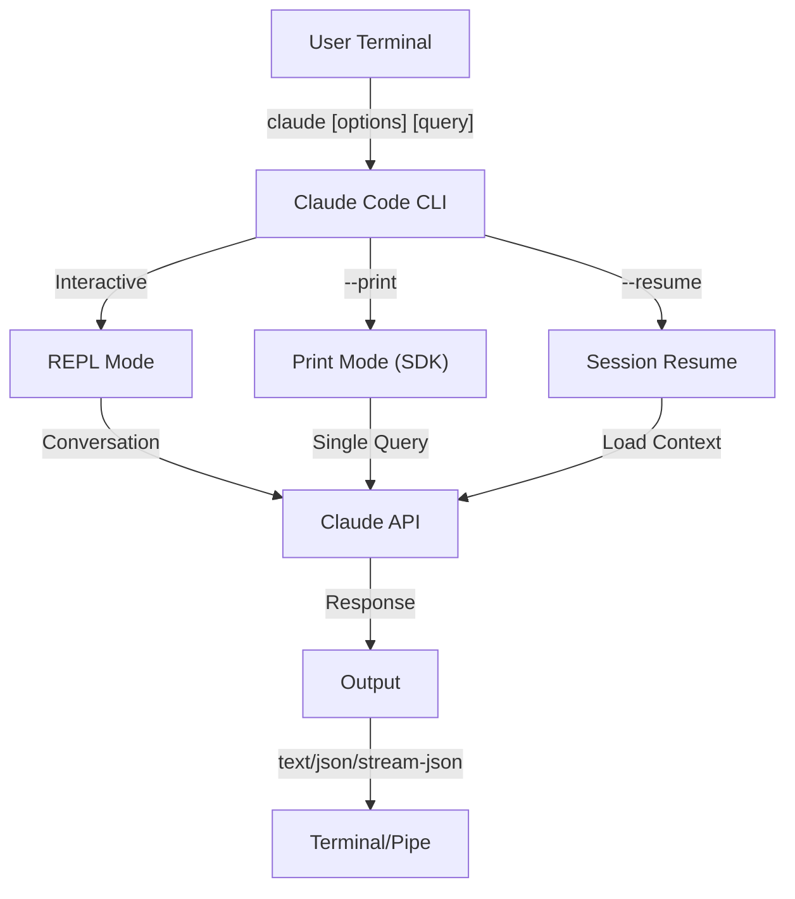
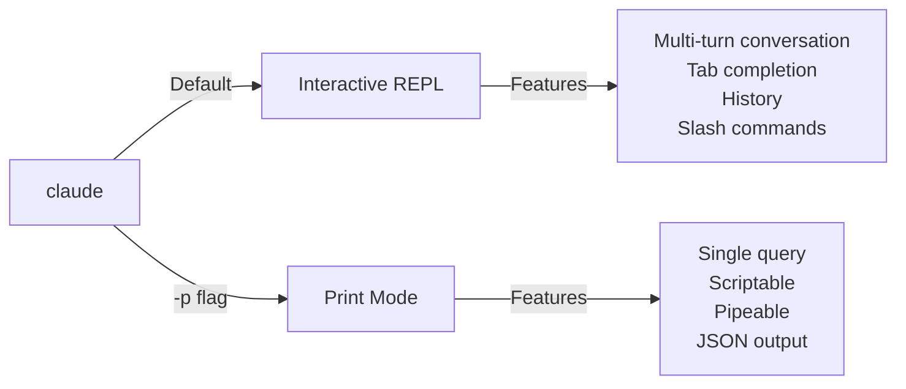

<!-- i18n-source: 10-cli/README.md -->
<!-- i18n-source-sha: ba721a3 -->
<!-- i18n-date: 2026-10-29 -->

<picture>
  <source media="(prefers-color-scheme: dark)" srcset="../../resources/logos/claude-howto-logo-dark.svg">
  
</picture>

# CLI 레퍼런스

## 개요

Claude Code CLI(Command Line Interface)는 Claude Code를 쓰는 기본 방법입니다. 질문 실행, 세션 관리, 모델 설정, 개발 워크플로에 Claude를 통합하는 강력한 옵션을 제공합니다.

## 구조



## 런타임과 패키징

**v2.1.113**부터 Claude Code CLI는 선택적 npm 의존성으로 **플랫폼별 네이티브 바이너리**(macOS, Linux, Windows)를 실행합니다. 설치할 때 OS와 아키텍처에 맞는 바이너리를 고르며, 예전의 번들 JavaScript 런타임은 macOS와 Linux에서 더 이상 기본값이 아닙니다.

**권장 설치**는 네이티브 설치 프로그램입니다(`curl -fsSL https://claude.ai/install.sh | bash`, Windows에서는 `irm https://claude.ai/install.ps1 | iex`). 공식 README에서 npm 설치는 지원 중단되었으므로 네이티브 설치 프로그램, Homebrew(`brew install --cask claude-code`), WinGet(`winget install Anthropic.ClaudeCode`)을 우선 씁니다. 참고로 `npm install -g @anthropic-ai/claude-code`(Node.js 22+)도 플랫폼별 선택적 의존성으로 같은 네이티브 바이너리를 설치합니다.

**다운로드 호스트**(v2.1.116+): 네이티브 바이너리 파일은 `https://downloads.claude.ai/claude-code-releases`에서 제공됩니다.

> **회사 / 프록시 사용자**: 네트워크에 명시적 허용 목록이 필요하다면 프록시 송신 규칙에 `downloads.claude.ai`(와 `https://downloads.claude.ai/claude-code-releases`)를 추가하세요. 예전에 `storage.googleapis.com`이나 npm 레지스트리만 허용했던 환경은 업데이트하지 않으면 `claude update`와 첫 설치가 실패합니다.

예전 JavaScript 번들은 Windows와 그것에 고정한 환경을 위해 아직 만들어지며, 이런 설치에는 Glob과 Grep이 계속 독립 도구로 들어 있습니다([도구](#도구와-권한-관리) 아래 Glob/Grep 각주 참고).

## CLI 명령

| 명령 | 설명 | 예시 |
|------|------|------|
| `claude` | 대화형 REPL 시작 | `claude` |
| `claude "query"` | 첫 프롬프트와 함께 REPL 시작 | `claude "explain this project"` |
| `claude -p "query"` | 출력 모드 - 질문하고 종료 | `claude -p "explain this function"` |
| `cat file \| claude -p "query"` | 파이프로 받은 내용 처리 | `cat logs.txt \| claude -p "explain"` |
| `claude -c` | 가장 최근 대화 이어서 하기 | `claude -c` |
| `claude -c -p "query"` | 출력 모드로 이어서 하기 | `claude -c -p "check for type errors"` |
| `claude -r "<session>" "query"` | ID나 이름으로 세션 재개 | `claude -r "auth-refactor" "finish this PR"` |
| `claude update` | 최신 버전으로 업데이트 | `claude update` |
| `/doctor`(슬래시 명령) | 설치, 설정, 플러그인 상태 진단. v2.1.116부터 **Claude가 응답하는 중에도** 열 수 있고, 상태 아이콘을 바로 보여 주며, `f` 키로 발견된 문제를 자동 수정. v2.1.178에서 상태 아이콘이 더 분명한 평면 트리와 강조된 명령으로 레이아웃이 바뀜 | REPL 안에서 `/doctor` 실행 |
| `claude mcp` | MCP 서버 설정(인증용 `login`/`logout` 포함, v2.1.186+) | [MCP 문서](../05-mcp/) 참고 |
| `claude mcp serve` | Claude Code를 MCP 서버로 실행 | `claude mcp serve` |
| `claude agents` | **에이전트 뷰** 열기(리서치 프리뷰, v2.1.139+) — 모든 Claude Code 세션을 상태와 함께 나열하는 다중 세션 관리자. 아래 [에이전트 뷰](#에이전트-뷰-claude-agents-v21139) 참고 | `claude agents` |
| `claude auto-mode defaults` | 자동 모드 기본 규칙을 JSON으로 출력 | `claude auto-mode defaults` |
| `claude auto-mode reset` | 자동 모드 기본 설정 복원. 확인 프롬프트가 나오며 `--yes`로 건너뜀(v2.1.212) | `claude auto-mode reset --yes` |
| `claude remote-control` | 원격 제어 서버 시작(서버 모드, 로컬 대화형 세션 없음. 여러 세션 처리, `--capacity` 기본값 32) | `claude remote-control --name "My Project"` |
| `claude --remote-control [name]` | 원격 제어를 켠 대화형 세션 시작(별칭 `--rc`) | `claude --rc` |
| `claude plugin` | 플러그인 관리(설치, 켜기, 끄기) | `claude plugin install my-plugin` |
| `claude plugin init <name>` | `~/.claude/skills/<name>/`(사용자 전역)에 새 플러그인 뼈대 생성. 마켓플레이스 없이 다음 세션에서 `<name>@skills-dir`로 자동 로드(v2.1.157+) | `claude plugin init my-plugin` |
| `claude plugin tag [path]` | `[path]`의 플러그인에 `{name}--v{version}` 릴리스 git 태그 생성. `plugin.json`과 그것을 담은 마켓플레이스 항목이 일치하는지 검증(v2.1.118+) | `claude plugin tag ./my-plugin` |
| `claude install [version]` | 특정 네이티브 바이너리 버전 설치. `stable`, `latest`, 명시적 버전 문자열을 받음 | `claude install 2.1.131` |
| `claude purge [path]` | 프로젝트의 로컬 Claude Code 상태(대화 기록, 태스크, 디버그 로그, 파일 편집 기록, 프롬프트 기록, `~/.claude.json` 항목)를 모두 삭제. `[path]`를 빼면 대화형 선택기. 플래그: 미리 보기 `--dry-run`, 확인 생략 `-y/--yes`, 항목별 확인 `-i/--interactive`, 모든 프로젝트 `--all`(v2.1.126+). v2.1.288에서 `claude project purge`에서 이름이 바뀌었으며, 예전 이름도 동작하고 안내를 출력 | `claude purge ~/work/repo --dry-run` |
| `claude plugin prune` | 고아가 된(부모 플러그인이 없어진) 자동 설치 플러그인 의존성 제거. `plugin uninstall --prune`은 대상을 제거한 뒤 같은 연쇄 정리를 함(v2.1.121+) | `claude plugin prune` |
| `claude ultrareview [target]` | `/ultrareview`를 비대화형으로 실행. 결과를 stdout에 출력하고 성공 시 0, 실패 시 1, Ctrl-C로 중단 시 130으로 종료. 원시 데이터는 `--json`, 기본 45분을 바꾸려면 `--timeout <minutes>`(v2.1.260부터), PR에 결과를 올릴지는 `--post` / `--no-post`로 정함. 신뢰하지 않은 폴더에서는 터미널이면 묻고 아니면 1로 종료. 스크립트와 CI에서는 대상 뒤에 `--trust-workspace`를 붙임(v2.1.309+). **Claude Code v2.1.227 이상 필요** | `claude ultrareview 1234 --json --no-post` |
| `claude self-hosted-runner [setup\|doctor\|orchestrator]` | 자신의 컴퓨터나 컨테이너에서 Claude Code 클라우드 세션을 호스팅하는 러너 시작. `setup`은 운영자용 안내 절차, `doctor`는 배포된 러너 진단, `orchestrator`는 필요할 때 러너를 띄움(`--shutdown-drain-sec`, v2.1.299는 SIGTERM 때 진행 중인 폴링과 생성 훅이 끝나게 함). **Team과 Enterprise 요금제, Claude Code v2.1.224 이상 필요.** Windows에서는 시작할 때 `--base-dir`을 명시해야 함(v2.1.229). v2.1.307부터 체크아웃 훅은 기본 30분 뒤 중지되어 세션 준비가 실패하므로, `--checkout-hook-timeout-min`을 늘리거나 `0`으로 설정 | `claude self-hosted-runner setup` |
| `claude auth login` | 로그인(`--email`, `--sso` 지원). v2.1.126부터 브라우저 콜백이 localhost에 닿지 못할 때(WSL2, SSH, 컨테이너) 터미널에 붙여 넣은 OAuth 코드를 대신 받음 | `claude auth login --email user@example.com` |
| `claude auth logout` | 현재 계정에서 로그아웃 | `claude auth logout` |
| `claude auth status` | 인증 상태 확인(로그인했으면 0, 아니면 1로 종료) | `claude auth status` |

## 핵심 플래그

| 플래그 | 설명 | 예시 |
|--------|------|------|
| `-p, --print` | 대화형 모드 없이 응답 출력 | `claude -p "query"` |
| `-c, --continue` | 가장 최근 대화 불러오기 | `claude --continue` |
| `-r, --resume` | ID나 이름으로 특정 세션 재개 | `claude --resume auth-refactor` |
| `-v, --version` | 버전 번호 출력 | `claude -v` |
| `--system-prompt-snapshot off` | 대화에 기록된 프롬프트를 재사용하지 않고 요청마다 시스템 프롬프트를 새로 렌더링. 프롬프트 문구를 다듬을 때 유용(v2.1.257+) | `claude --system-prompt-snapshot off` |
| `-w, --worktree` | 격리된 git 워크트리에서 시작. v2.1.233부터 GitHub PR URL뿐 아니라 GitLab 머지 리퀘스트 URL도 받음 | `claude -w` |
| `-n, --name` | 세션 표시 이름 | `claude -n "auth-refactor"` |
| `--from-pr <url-or-number>` | 풀/머지 리퀘스트에 연결된 세션 재개. v2.1.119부터 GitHub(클라우드 + Enterprise), GitLab MR, Bitbucket PR URL을 받음. 그 전에는 GitHub.com만 | `claude --from-pr 42` 또는 `claude --from-pr https://gitlab.example.com/org/repo/-/merge_requests/17` |
| `--cloud [description\|session_id\|url]` | 주어진 설명으로 claude.ai에 클라우드 세션을 만들거나, 세션 ID나 claude.ai/code URL로 기존 세션에 연결 | `claude --cloud "implement API"` |
| `--remote "task"` | 기존 세션 형태를 포함한 **`--cloud`의 지원 중단된 별칭**. 대신 `--cloud`를 사용 | `claude --remote "implement API"` |
| `--remote-control, --rc` | 원격 제어를 켠 대화형 세션 | `claude --rc` |
| `--teleport [session]` | 웹 세션을 로컬에서 재개. 인수 없이 쓰면 웹 세션 선택기가 열리고, 세션 ID를 넘기면 그 세션을 바로 재개. claude.ai 구독 필요 | `claude --teleport` |
| `--teammate-mode` | 에이전트 팀 표시 모드 | `claude --teammate-mode tmux` |
| `--bare` | 최소 모드(훅, 스킬, 플러그인, MCP, 자동 메모리, CLAUDE.md 건너뜀) | `claude --bare` |
| `--safe-mode` | 설정 문제를 가려내기 위해 모든 사용자 지정 요소(CLAUDE.md, 플러그인, 스킬, 훅, MCP)를 끄고 시작. `CLAUDE_CODE_SAFE_MODE=1`도 가능(v2.1.169) | `claude --safe-mode` |
| `--restricted` | 신뢰할 수 없거나 공유하는 용도로 세션을 잠금: 명령·코드를 실행하는 내장 도구와 WebFetch를 없애고, 사용자/프로젝트/로컬 설정을 무시하며, 파일 도구를 작업 디렉터리로 제한하고, `bypassPermissions`와 클라우드 세션을 거부. `CLAUDE_CODE_RESTRICTED=1`도 가능(v2.1.248+) | `claude --restricted -p "summarize this repo"` |
| `--permission-mode auto` | 자동 권한 모드로 시작(v2.1.111에서 없어진 `--enable-auto-mode` 플래그를 대신함) | `claude --permission-mode auto` |
| `--channels` | MCP 채널 플러그인 구독. 항목은 `plugin:<name>@<marketplace>`로 표시해야 하며 이름만 쓰면 거부 | `claude --channels plugin:discord@my-marketplace` |
| `--chrome` / `--no-chrome` | Chrome 브라우저 연동 켜기/끄기 | `claude --chrome` |
| `--effort` | 사고 노력 수준 설정 | `claude --effort high` |
| `--desktop` | 현재 디렉터리로 Claude 데스크톱 앱에서 세션 열기. 세션을 고르려면 `--continue`나 `--resume <id>` 추가(v2.1.285) | `claude --desktop --continue` |
| `--init` / `--init-only` | `--init`은 세션 전에 초기화(Setup) 훅을 실행(출력 모드 전용). `--init-only`는 Setup과 `SessionStart` 훅을 실행하고 종료 | `claude -p --init "query"` |
| `--maintenance` | 세션 전에 유지 보수(Setup) 훅 실행(출력 모드 전용) | `claude -p --maintenance "query"` |
| `--disable-slash-commands` | 모든 스킬과 슬래시 명령 끄기 | `claude --disable-slash-commands` |
| `--no-session-persistence` | 세션 저장 끄기(출력 모드) | `claude -p --no-session-persistence "query"` |
| `--exclude-dynamic-system-prompt-sections` | 프롬프트 캐시 적중률을 높이려고 시스템 프롬프트에서 동적 부분을 뺌 | `claude -p --exclude-dynamic-system-prompt-sections "query"` |

### 제한 모드 (`--restricted`, v2.1.248+)

`--restricted`(또는 `CLAUDE_CODE_RESTRICTED=1`)는 입력을 통제할 수 없는 누군가를 대신해 `claude`를 실행할 때 씁니다. 공유 컴퓨터의 평가 하네스, 외부 기여자가 실행시킨 CI 작업, 데모 장비 같은 경우입니다. 다음을 모두 적용합니다.

- **명령이나 코드를 실행하는 도구를 없앱니다** — Bash, PowerShell, REPL, 그리고 WebFetch. 단, `--tools`가 명시적으로 지정하면 예외입니다.
- **사용자, 프로젝트, 로컬 설정 파일을 무시합니다.** 관리형 설정과 명시적 `--settings` 파일은 계속 적용되므로, 관리자는 통제권을 유지하고 커밋된 `.claude/settings.json`은 샌드박스를 넓힐 수 없습니다.
- **파일 도구를 작업 디렉터리 안으로 제한**하므로, 읽기와 쓰기가 시작한 경로를 벗어날 수 없습니다.
- 어떤 방식으로 요청하든 **`bypassPermissions`를 거부합니다**.
- **클라우드 세션 생성을 거부**하므로, 제한 모드 실행은 작업을 컴퓨터 밖으로 보낼 수 없습니다.

```bash
# 평가 하네스: 셸 없음, 네트워크 가져오기 없음, 설정 상속 없음
claude --restricted -p "summarize the architecture of this repo"

# 같은 잠금이지만 도구 하나를 일부러 다시 켬
claude --restricted --tools WebFetch -p "check the linked RFC"
```

> **참고**: `--restricted`는 `--permission-mode`보다 거친 잠금입니다. 도구를 묻는 대신 아예 없애므로, 제한 모드 세션은 세션 안에서 넓힐 수 없습니다.

### 대화형 모드와 출력 모드



**대화형 모드**(기본값):
```bash
# 대화형 세션 시작
claude

# 첫 프롬프트와 함께 시작
claude "explain the authentication flow"
```

**출력 모드**(비대화형):
```bash
# 질문 하나 하고 종료
claude -p "what does this function do?"

# 파일 내용 처리
cat error.log | claude -p "explain this error"

# 다른 도구와 연결
claude -p "list todos" | grep "URGENT"
```

## 모델과 설정

| 플래그 | 설명 | 예시 |
|--------|------|------|
| `--model` | 모델 지정(sonnet, opus, haiku, 또는 전체 이름) | `claude --model opus` |
| `--fallback-model` | 주 모델이 과부하/사용 불가일 때 자동 대체. `fallbackModel` 설정으로 최대 세 개까지 지정. v2.1.166부터 대화형 세션에도 적용(그 전에는 출력 모드 전용) | `claude -p --fallback-model sonnet "query"` |
| `--agent` | 세션에 쓸 에이전트 지정 | `claude --agent my-custom-agent` |
| `--agents` | JSON으로 사용자 지정 서브에이전트 정의 | [에이전트 설정](#에이전트-설정) 참고 |
| `--effort` | 노력 수준 설정(low, medium, high, xhigh, max) | `claude --effort xhigh` |

### 모델 선택 예시

```bash
# 복잡한 작업에는 Opus 5.5
claude --model opus "design a caching strategy"

# 빠른 작업에는 Haiku (v2.1.293부터 Anthropic API에서는 Haiku 5.5, Bedrock, Vertex, Foundry에서는 Haiku 4.5)
claude --model haiku -p "format this JSON"

# 전체 모델 이름
claude --model claude-sonnet-4-6 "review this code"

# 안정성을 위한 대체 모델
claude -p --model opus --fallback-model sonnet "analyze architecture"

# opusplan 사용 (Opus가 계획, Sonnet이 실행)
claude --model opusplan "design and implement the caching layer"
```

> **게이트웨이 모델 탐색(v2.1.129+, 선택 사항)**: `ANTHROPIC_BASE_URL`이 Anthropic 호환 게이트웨이를 가리킬 때 `CLAUDE_CODE_ENABLE_GATEWAY_MODEL_DISCOVERY=1`을 설정하면 게이트웨이의 `/v1/models` 엔드포인트로 `/model`을 채웁니다. 이 환경 변수가 없으면 `/model`은 내장된 고정 목록을 씁니다. 탐색 호출이 사용자가 쓸 권한이 없는 모델까지 보여 줄 수 있어 선택 사항입니다(v2.1.129에서 변경). v2.1.126에서 자동으로 바뀌었다가 되돌려졌습니다.

> **사용자 지정 기본 URL 뒤의 1M 컨텍스트(v2.1.285)**: `ANTHROPIC_BASE_URL`이 사용자 지정 엔드포인트를 가리키는 세션은 이제 1M 컨텍스트 윈도가 있는 모델(Opus 4.7+, Sonnet 5+, Fable)에서 그 윈도를 씁니다. 게이트웨이가 200K까지만 지원하면 `/autocompact 200k`를 실행하세요.

> **서드파티 제공자의 기본 1M 컨텍스트(v2.1.287)**: Opus 4.7+와 Fable은 이제 Amazon Bedrock, Google Vertex AI, Microsoft Foundry, Claude 앱 게이트웨이에서 `[1m]` 접미사 없이 기본으로 1M 컨텍스트 윈도를 씁니다. 200K로 유지하려면 `CLAUDE_CODE_DISABLE_1M_CONTEXT=1`을 설정합니다.

> **조직 기본 모델(v2.1.196)**: 조직 관리자가 기본 모델을 정하면 `/model`에 "Org default"(또는 "Role default")로 표시됩니다.

## 시스템 프롬프트 사용자 지정

| 플래그 | 설명 | 예시 |
|--------|------|------|
| `--system-prompt` | 기본 프롬프트 전체를 대체 | `claude --system-prompt "You are a Python expert"` |
| `--system-prompt-file` | 파일에서 프롬프트를 불러와 기본 프롬프트를 대체 | `claude -p --system-prompt-file ./prompt.txt "query"` |
| `--append-system-prompt` | 기본 프롬프트 뒤에 덧붙임 | `claude --append-system-prompt "Always use TypeScript"` |
| `--append-subagent-system-prompt` | 모든 서브에이전트의 시스템 프롬프트 뒤에 텍스트를 덧붙임(비대화형) | `claude -p --append-subagent-system-prompt "Cite sources" "query"` |
| `--append-subagent-system-prompt-file` | (v2.1.261) 명령줄로 넘기기엔 너무 긴 프롬프트를 위해 덧붙일 텍스트를 파일에서 불러옴. 비대화형 전용이며 `--append-subagent-system-prompt`와 **함께 쓸 수 없음** | `claude -p --append-subagent-system-prompt-file ./subagent-rules.txt "query"` |

### 시스템 프롬프트 예시

```bash
# 완전한 사용자 지정 역할
claude --system-prompt "You are a senior security engineer. Focus on vulnerabilities."

# 특정 지침 덧붙이기
claude --append-system-prompt "Always include unit tests with code examples"

# 파일에서 복잡한 프롬프트 불러오기
claude -p --system-prompt-file ./prompts/code-reviewer.txt "review main.py"
```

### 시스템 프롬프트 플래그 비교

| 플래그 | 동작 | 대화형 | 출력 |
|--------|------|--------|------|
| `--system-prompt` | 기본 시스템 프롬프트 전체를 대체 | ✅ | ✅ |
| `--system-prompt-file` | 파일의 프롬프트로 대체 | ✅ | ✅ |
| `--append-system-prompt` | 기본 시스템 프롬프트 뒤에 덧붙임 | ✅ | ✅ |

**모든 시스템 프롬프트 플래그는 대화형과 출력 모드 모두에서 동작합니다(파일 형태는 v2.1.69부터). `--system-prompt`와 `--system-prompt-file`은 기본 프롬프트를 대체하고, append 플래그는 덧붙입니다.**

## 도구와 권한 관리

| 플래그 | 설명 | 예시 |
|--------|------|------|
| `--tools` | 쓸 수 있는 내장 도구 제한 | `claude -p --tools "Bash,Edit,Read" "query"` |
| `--allowedTools` | 묻지 않고 실행할 도구 | `"Bash(git log:*)" "Read"` |
| `--disallowedTools` | 컨텍스트에서 뺄 도구 | `"Bash(rm:*)" "Edit"` |
| `--dangerously-skip-permissions` | 모든 권한 프롬프트 건너뛰기 | `claude --dangerously-skip-permissions` |
| `--permission-mode` | 지정한 권한 모드로 시작 | `claude --permission-mode auto` |
| `--permission-prompt-tool` | 출력 모드에서 권한 프롬프트에 답하는 MCP 도구. 실행에서 불러오는 서버의 전체 `mcp__<server>__<tool>` 이름을 넘김 | `claude -p --mcp-config ./mcp.json --permission-prompt-tool mcp__permissions__approve "query"` |
| `--permission-prompts` | (v2.1.259) 출력 모드에서 권한 프롬프트에 누가 답할지. 기본값 `host`는 Agent SDK 호스트나 `--permission-prompt-tool` 도구로 보냄. 답할 사람이 없으면 `none`을 넘겨 Claude Code가 대신 거부 | `claude -p --permission-prompts none "query"` |

> **v2.1.111 변경 사항**: `--enable-auto-mode`가 제거되었습니다. 이제 자동 모드는 기본으로 `Shift+Tab` 순환에 들어 있으며, 바로 자동 모드로 시작하려면 `--permission-mode auto`를 씁니다.

> **Glob / Grep 각주(v2.1.113+)**: 네이티브 macOS/Linux 빌드에서 `Glob`과 `Grep`은 별도 독립 도구가 아니라 Bash 도구로 호출하는 내장 `bfs`와 `ugrep` 바이너리로 제공됩니다. Windows와 npm 번들(JS) 설치는 여전히 독립 도구로 제공합니다. 서브에이전트 `allowedTools` / `disallowedTools` 목록에서는 이 대체가 드러나지 않으므로, 모든 플랫폼에서 설정에 `Glob` / `Grep`을 계속 써도 됩니다.

> **PowerShell 자동 승인(v2.1.119)**: PowerShell 도구 명령도 Bash 명령과 똑같이 권한 모드에서 자동 승인될 수 있습니다. 이미 쓰는 `Bash(...)` 규칙과 같은 매처 문법으로 PowerShell 권한 범위를 정합니다. 예: `PowerShell(Get-ChildItem:*)`.

> **재개할 때도 `--permission-mode` 적용(v2.1.132+)**: 이제 `claude -p --continue --permission-mode plan`(과 `--resume`)이 플래그를 따릅니다. 이전 버전은 세션을 재개할 때 `--permission-mode`를 아무 말 없이 버려서, 플래그를 다시 넘기지 않고 재개한 계획 모드 세션이 조용히 낮은 모드로 바뀌었는데 이것이 고쳐졌습니다.

> **권한 강화(v2.1.214)**: 데몬 전환 플래그(예: `--url`, `--connection`, `--identity`)를 쓰는 Docker/Podman 명령은 이제 자동 실행되지 않고 권한 프롬프트가 필요합니다. `-m`/`--magic-file`이나 `-f`/`--files-from`을 쓰는 `file` 명령도 권한이 필요합니다. 10,000자를 넘는 Bash 명령은 허용 규칙과 상관없이 항상 권한을 묻습니다.

### 권한 예시

```bash
# 코드 리뷰를 위한 읽기 전용 모드
claude --permission-mode plan "review this codebase"

# 안전한 도구만 허용
claude --tools "Read,Grep,Glob" -p "find all TODO comments"

# 특정 git 명령은 묻지 않고 허용
claude --allowedTools "Bash(git status:*)" "Bash(git log:*)"

# 위험한 작업 차단
claude --disallowedTools "Bash(rm -rf:*)" "Bash(git push --force:*)"
```

> **매개변수 매칭 `Tool(param:value)`(v2.1.178)**: 권한 규칙은 `Tool`(모든 사용) 또는 `Tool(specifier)` 형식을 따릅니다. v2.1.178부터 지정자는 명령이나 경로 패턴뿐 아니라 도구 입력 **매개변수**에도 일치할 수 있으며, 와일드카드를 지원하는 `Tool(param:value)` 형식을 씁니다. `Bash(...)` 명령 접두사(예: `Bash(npm run test *)`)와 `Read(...)` 경로 glob(예: `Read(./.env.*)`)에 쓰던 매칭을 일반화해, 다른 도구도 인수로 범위를 정할 수 있게 합니다. 정확한 매개변수 이름은 도구마다 다르므로, 규칙을 쓰기 전에 [권한 레퍼런스](https://code.claude.com/docs/en/settings)의 최신 도구별 예시를 확인하세요.

## 출력과 형식

| 플래그 | 설명 | 옵션 | 예시 |
|--------|------|------|------|
| `--output-format` | 출력 형식 지정(출력 모드) | `text`, `json`, `stream-json` | `claude -p --output-format json "query"` |
| `--input-format` | 입력 형식 지정(출력 모드) | `text`, `stream-json` | `claude -p --input-format stream-json` |
| `--verbose` | 상세 로그 켜기 | | `claude --verbose` |
| `--include-partial-messages` | 스트리밍 이벤트 포함 | `stream-json` 필요 | `claude -p --output-format stream-json --include-partial-messages "query"` |
| `--forward-subagent-text` | 서브에이전트 텍스트 출력을 스트림으로 전달. v2.1.219부터 깊이 2 이상에서 생성된 서브에이전트도 생성한 `Agent`의 `tool_use` id를 키로 전달됨(`CLAUDE_CODE_MAX_SUBAGENT_SPAWN_DEPTH`로 기본으로 켜진 중첩을 이렇게 관찰) | `stream-json` 필요 | `claude -p --output-format stream-json --forward-subagent-text "query"` |
| `--json-schema` | 스키마에 맞게 검증된 JSON 받기 | | `claude -p --json-schema '{"type":"object"}' "query"` |
| `--max-budget-usd` | 출력 모드의 최대 지출. v2.1.217부터 한도에 이르면 실행 중인 백그라운드 서브에이전트도 멈추고 새 생성을 거부(그 전에는 한도를 넘겨도 백그라운드 에이전트가 계속 실행) | | `claude -p --max-budget-usd 5.00 "query"` |

### 출력 형식 예시

```bash
# 일반 텍스트 (기본값)
claude -p "explain this code"

# 프로그램에서 쓰기 위한 JSON
claude -p --output-format json "list all functions in main.py"

# 실시간 처리를 위한 스트리밍 JSON
claude -p --output-format stream-json "generate a long report"

# 스키마 검증을 거친 구조화된 출력
claude -p --json-schema '{"type":"object","properties":{"bugs":{"type":"array"}}}' \
  "find bugs in this code and return as JSON"
```

## 작업 공간과 디렉터리

| 플래그 | 설명 | 예시 |
|--------|------|------|
| `--add-dir` | 작업 디렉터리 추가 | `claude --add-dir ../apps ../lib` |
| `--setting-sources` | 쉼표로 구분한 설정 출처 | `claude --setting-sources user,project` |

> **`/config` 유지(v2.1.119)**: `/config` 명령으로 대화형으로 바꾼 설정은 이제 `~/.claude/settings.json`에 기록되고 일반 우선순위 체계(policy → local → project → user)를 따릅니다. v2.1.119 전에는 일부 `/config` 변경이 세션 동안만 유지되었습니다. 전체 우선순위는 [메모리와 설정](../02-memory/README.md)을 참고하세요.
| `--settings` | 파일이나 JSON에서 설정 불러오기. 파일은 2 MiB 이하여야 함(v2.1.214) | `claude --settings ./settings.json` |
| `--plugin-dir` | 디렉터리에서 플러그인 불러오기(반복 사용 가능). v2.1.265부터 **플러그인 폴더**도 받아, 매니페스트가 있는 모든 하위 폴더를 불러오고 세션 중 추가·제거된 하위 폴더도 반영 | `claude --plugin-dir ./my-plugin` |

### 여러 디렉터리 예시

```bash
# 여러 프로젝트 디렉터리에 걸쳐 작업
claude --add-dir ../frontend ../backend ../shared "find all API endpoints"

# 사용자 지정 설정 불러오기
claude --settings '{"model":"opus","verbose":true}' "complex task"
```

## MCP 설정

| 플래그 | 설명 | 예시 |
|--------|------|------|
| `--mcp-config` | JSON에서 MCP 서버 불러오기 | `claude --mcp-config ./mcp.json` |
| `--strict-mcp-config` | 지정한 MCP 설정만 사용 | `claude --strict-mcp-config --mcp-config ./mcp.json` |
| `--channels` | MCP 채널 플러그인 구독. 항목은 `plugin:<name>@<marketplace>`로 표시해야 하며 이름만 쓰면 거부 | `claude --channels plugin:discord@my-marketplace` |

### MCP 예시

```bash
# GitHub MCP 서버 불러오기
claude --mcp-config ./github-mcp.json "list open PRs"

# 엄격 모드 - 지정한 서버만
claude --strict-mcp-config --mcp-config ./production-mcp.json "deploy to staging"
```

## 세션 관리

| 플래그 | 설명 | 예시 |
|--------|------|------|
| `--session-id` | 특정 세션 ID(UUID) 사용 | `claude --session-id "550e8400-..."` |
| `--fork-session` | 재개할 때 새 세션 만들기 | `claude --resume abc123 --fork-session` |

### 세션 예시

```bash
# 마지막 대화 이어서 하기
claude -c

# 이름 붙인 세션 재개
claude -r "feature-auth" "continue implementing login"

# 실험용으로 세션 포크
claude --resume feature-auth --fork-session "try alternative approach"

# 특정 세션 ID 사용
claude --session-id "550e8400-e29b-41d4-a716-446655440000" "continue"
```

> **v2.1.299**: 종료할 때 출력하는 재개 명령이 세션을 ID로 가리킵니다.

### 세션 포크

실험을 위해 기존 세션에서 갈래를 만듭니다.

```bash
# 다른 접근 방식을 시도하려고 세션 포크
claude --resume abc123 --fork-session "try alternative implementation"

# 사용자 지정 메시지로 포크
claude -r "feature-auth" --fork-session "test with different architecture"
```

**사용 사례:**
- 원래 세션을 잃지 않고 다른 구현 시도
- 여러 접근 방식을 병렬로 실험
- 성공한 작업에서 갈래를 만들어 변형
- 메인 세션에 영향 없이 호환성을 깨는 변경 테스트

원래 세션은 그대로 남고, 포크는 새 독립 세션이 됩니다.

### 프로젝트 상태 정리 (v2.1.126+)

`claude purge`는 프로젝트의 로컬 Claude Code 상태(대화 기록, 태스크 목록, 디버그 로그, 파일 편집 기록, 프롬프트 기록 줄, 프로젝트의 `~/.claude.json` 항목)를 모두 삭제합니다. v2.1.288 전에는 `claude project purge`라고 불렀으며, 그 이름도 동작하고 안내를 출력합니다. 먼저 `--dry-run`으로 무엇이 삭제될지 미리 보세요. `--all`은 컴퓨터의 모든 프로젝트를 차례로 처리합니다.

```bash
# 무엇이 삭제될지 미리 보기 (안전)
claude purge ~/work/repo --dry-run

# 특정 프로젝트의 상태를 묻지 않고 삭제
claude purge ~/work/repo --yes

# 모든 프로젝트를 대화형으로 처리
claude purge --all --interactive
```

## 고급 기능

| 플래그 | 설명 | 예시 |
|--------|------|------|
| `--chrome` | Chrome 브라우저 연동 켜기 | `claude --chrome` |
| `--no-chrome` | Chrome 브라우저 연동 끄기 | `claude --no-chrome` |
| `--ide` | 가능하면 IDE에 자동 연결 | `claude --ide` |
| `--max-turns` | 에이전트 턴 수 제한(비대화형) | `claude -p --max-turns 3 "query"` |
| `--debug` | 필터링을 지원하는 디버그 모드 켜기(필터는 `=` 형식에서만 적용) | `claude --debug=api,mcp` |
| `--enable-lsp-logging` | 상세 LSP 로그 켜기 | `claude --enable-lsp-logging` |
| `--betas` | API 요청용 베타 헤더 | `claude --betas interleaved-thinking` |
| `--plugin-dir` | 디렉터리에서 플러그인 불러오기(반복 사용 가능). v2.1.265부터 **플러그인 폴더**도 받아, 매니페스트가 있는 모든 하위 폴더를 불러오고 세션 중 추가·제거된 하위 폴더도 반영 | `claude --plugin-dir ./my-plugin` |
| `--effort` | 사고 노력 수준 설정 | `claude --effort high` |
| `--bare` | 최소 모드(훅, 스킬, 플러그인, MCP, 자동 메모리, CLAUDE.md 건너뜀) | `claude --bare` |
| `--channels` | MCP 채널 플러그인 구독(`plugin:<name>@<marketplace>`로 표시) | `claude --channels plugin:discord@my-marketplace` |
| `--tmux` | 워크트리용 tmux 세션 만들기(`--worktree` 필요) | `claude --worktree feature-x --tmux` |
| `--fork-session` | 재개할 때 새 세션 ID 만들기 | `claude --resume abc --fork-session` |
| `--max-budget-usd` | 최대 지출(출력 모드). 한도에 이르면 백그라운드 서브에이전트도 멈춤(v2.1.217) | `claude -p --max-budget-usd 5.00 "query"` |
| `--json-schema` | 검증된 JSON 출력 | `claude -p --json-schema '{"type":"object"}' "q"` |
| `--ax-screen-reader` | 화면 낭독기용 일반 텍스트 렌더링 모드(v2.1.208) | `claude --ax-screen-reader` |

### 플랫폼과 테마 참고 사항 (v2.1.112)

- **Windows의 PowerShell 도구**: Windows에 전용 PowerShell 도구가 배포되고 있으며 환경 변수로 제어할 수 있습니다.
- **Auto (match terminal) 테마**: 새 "Auto (match terminal)" 테마는 Claude Code의 밝은/어두운 모양을 터미널에 맞춥니다.
- **더 조용한 권한 프롬프트**: 읽기 전용 `Bash` 호출과 `Glob` 패턴은 더 이상 권한 프롬프트를 띄우지 않습니다.

### 고급 예시

```bash
# 자율 동작 제한
claude -p --max-turns 5 "refactor this module"

# API 호출 디버깅
claude --debug=api "test query"

# IDE 연동 켜기
claude --ide "help me with this file"
```

## 에이전트 설정

`--agents` 플래그는 세션용 사용자 지정 서브에이전트를 정의하는 JSON 객체를 받습니다.

**v2.1.243**부터 `--agents`는 잘못된 JSON이나 잘못된 에이전트 정의를 더 이상 조용히 무시하지 않고, `--mcp-config`가 원래 하던 것처럼 분명한 오류와 함께 종료합니다.

### 에이전트 JSON 형식

```json
{
  "agent-name": {
    "description": "필수: 이 에이전트를 언제 호출할지",
    "prompt": "필수: 에이전트의 시스템 프롬프트",
    "tools": ["선택", "도구", "배열"],
    "model": "선택: sonnet|opus|haiku"
  }
}
```

**필수 필드:**
- `description` - 이 에이전트를 언제 쓸지 자연어로 쓴 설명
- `prompt` - 에이전트의 역할과 동작을 정하는 시스템 프롬프트

**선택 필드:**
- `tools` - 쓸 수 있는 도구 배열(빼면 모두 이어받음)
  - 형식: `["Read", "Grep", "Glob", "Bash"]`
- `model` - 쓸 모델: `sonnet`, `opus`, `haiku`

### 전체 에이전트 예시

```json
{
  "code-reviewer": {
    "description": "Expert code reviewer. Use proactively after code changes.",
    "prompt": "You are a senior code reviewer. Focus on code quality, security, and best practices.",
    "tools": ["Read", "Grep", "Glob", "Bash"],
    "model": "sonnet"
  },
  "debugger": {
    "description": "Debugging specialist for errors and test failures.",
    "prompt": "You are an expert debugger. Analyze errors, identify root causes, and provide fixes.",
    "tools": ["Read", "Edit", "Bash", "Grep"],
    "model": "opus"
  },
  "documenter": {
    "description": "Documentation specialist for generating guides.",
    "prompt": "You are a technical writer. Create clear, comprehensive documentation.",
    "tools": ["Read", "Write"],
    "model": "haiku"
  }
}
```

### 에이전트 명령 예시

```bash
# 사용자 지정 에이전트를 인라인으로 정의
claude --agents '{
  "security-auditor": {
    "description": "Security specialist for vulnerability analysis",
    "prompt": "You are a security expert. Find vulnerabilities and suggest fixes.",
    "tools": ["Read", "Grep", "Glob"],
    "model": "opus"
  }
}' "audit this codebase for security issues"

# 파일에서 에이전트 불러오기
claude --agents "$(cat ~/.claude/agents.json)" "review the auth module"

# 다른 플래그와 함께 사용
claude -p --agents "$(cat agents.json)" --model sonnet "analyze performance"
```

### 에이전트 우선순위

에이전트 정의가 여러 개 있으면 다음 우선순위로 불러옵니다.
1. **CLI 정의**(`--agents` 플래그) - 세션 전용
2. **프로젝트 수준**(`.claude/agents/`) - 현재 프로젝트
3. **사용자 수준**(`~/.claude/agents/`) - 모든 프로젝트

CLI로 정의한 에이전트는 그 세션에서 프로젝트와 사용자 에이전트를 모두 재정의합니다. 이름이 겹치면 프로젝트 수준 에이전트가 사용자 수준 에이전트를 재정의합니다. 플러그인 수준 에이전트를 포함한 전체 우선순위 표는 [04장 — 서브에이전트](../04-subagents/README.md#파일-위치)를 참고하세요.

### 에이전트 뷰 (`claude agents`, v2.1.139+)

> **리서치 프리뷰** — 매일 쓸 만큼 안정적이지만 바뀔 수 있습니다.

`claude agents`는 **에이전트 뷰**를 엽니다. 컴퓨터의 모든 Claude Code 세션을 현재 상태(`running`, `blocked on you`, `done`)와 함께 보여 주는 하나의 목록입니다. 백그라운드 에이전트, 예약 태스크, `--bg`로 띄운 세션을 돌릴 때 여러 터미널 탭을 오가는 대신 씁니다.

```bash
# 에이전트 뷰 열기
claude agents
```

뷰에서(또는 `claude --bg <prompt>`로) 세션을 보낼 때는 `claude` 자체에 넘기는 것과 같은 설정 플래그를 넘길 수 있습니다. 에이전트 뷰 실행 경로에 추가된 플래그:

| 플래그 | 도입 | 설명 |
|--------|------|------|
| `--cwd <path>` | v2.1.141 | 세션 목록(또는 새 세션)을 특정 작업 디렉터리로 한정 |
| `--add-dir <path>` | v2.1.142 | 보낸 세션의 작업 공간에 디렉터리 추가 |
| `--settings <path>` | v2.1.142 | 보낸 세션에 특정 `settings.json` 사용 |
| `--mcp-config <path>` | v2.1.142 | 보낸 세션에 특정 MCP 설정 사용 |
| `--plugin-dir <path>` | v2.1.142 | 보낸 세션에 특정 플러그인 디렉터리 사용 |
| `--permission-mode <mode>` | v2.1.142 | 보낸 세션의 권한 모드(`plan`, `acceptEdits`, `auto` 등) 설정 |
| `--model <model>` | v2.1.142 | 보낸 세션의 모델 고정 |
| `--effort <level>` | v2.1.142 | 노력 수준 고정(`low`/`medium`/`high`/`xhigh`/`max`) |
| `--dangerously-skip-permissions` | v2.1.142 | 보낸 세션을 권한 프롬프트 없이 실행(샌드박스에서만 사용) |
| `--json` | v2.1.145 | 스크립트용(상태 표시줄, 세션 선택기, tmux-resurrect 연동)으로 에이전트 목록을 기계가 읽는 JSON으로 출력 |

작업을 끝냈지만 백그라운드 셸을 열어 둔 세션은 "Working"에서 "Completed"로 옮겨 갑니다(v2.1.141 수정). 연결한 에이전트 세션 안에서 `Shift+Tab`은 자동 모드를 포함한 권한 모드를 순환합니다(v2.1.143).

**GitLab 머지 리퀘스트(v2.1.233)** — 에이전트 뷰는 GitHub PR URL과 함께 GitLab MR URL도 알아보며, 머지 리퀘스트는 `!N`으로 표시합니다(GitHub 풀 리퀘스트는 그대로 `#N`). 같은 릴리스에서 `--worktree`도 GitLab MR URL을 받게 되었습니다.

**세션 고정** — `claude agents`에서 세션에 `Ctrl+T`를 누르면 고정됩니다(v2.1.147). 고정한 백그라운드 세션은 유휴 상태에서도 살아 있고, Claude Code 업데이트를 적용할 때 그 자리에서 재시작되며, 메모리가 부족하면 고정하지 않은 세션보다 나중에 정리됩니다. (이 `Ctrl+T`는 에이전트 뷰 전용이며, 메인 세션에서는 태스크 목록 보기를 전환합니다.)

**새 세션 기본값(v2.1.299)** — 에이전트 뷰에서 `/effort`와 `/fast`는 새 세션이 시작할 값을 정합니다. 인수 없는 `/model`, `/effort`, `/fast`는 선택기를 엽니다.

---

## 가치가 큰 사용 사례

### 1. CI/CD 연동

CI/CD 파이프라인에서 Claude Code로 코드 리뷰, 테스트, 문서화를 자동화합니다.

**GitHub Actions 예시:**

```yaml
name: AI Code Review

on: [pull_request]

jobs:
  review:
    runs-on: ubuntu-latest
    steps:
      - uses: actions/checkout@v4

      - name: Install Claude Code
        run: npm install -g @anthropic-ai/claude-code

      - name: Run Code Review
        env:
          ANTHROPIC_API_KEY: ${{ secrets.ANTHROPIC_API_KEY }}
        run: |
          claude -p --output-format json \
            --max-turns 1 \
            "Review the changes in this PR for:
            - Security vulnerabilities
            - Performance issues
            - Code quality
            Output as JSON with 'issues' array" > review.json

      - name: Post Review Comment
        uses: actions/github-script@v7
        with:
          script: |
            const fs = require('fs');
            const review = JSON.parse(fs.readFileSync('review.json', 'utf8'));
            // 리뷰 댓글을 처리해 게시
```

**Jenkins 파이프라인:**

```groovy
pipeline {
    agent any
    stages {
        stage('AI Review') {
            steps {
                sh '''
                    claude -p --output-format json \
                      --max-turns 3 \
                      "Analyze test coverage and suggest missing tests" \
                      > coverage-analysis.json
                '''
            }
        }
    }
}
```

**헤드리스 `ultrareview`(v2.1.227+ 필요, `--trust-workspace`는 v2.1.309+ 필요):**

```yaml
# .github/workflows/ultrareview.yml
# 신뢰하는 브랜치를 체크아웃 (예: actions/checkout에 `ref: ${{ github.base_ref }}`).
# ultrareview는 클라우드에서 풀 리퀘스트를 직접 클론함.
- name: Claude ultrareview
  run: claude ultrareview ${{ github.event.pull_request.number }} --trust-workspace --json --no-post > review.json
```

`claude ultrareview`는 리뷰가 끝나면 결과가 있든 없든 0으로, 실행에 실패하거나 오류가 나거나 시간이 초과되거나 폴더를 신뢰하지 않으면 1로, 리뷰를 시작하거나 결과를 기다리거나 `--post` 댓글을 올리는 중에 Ctrl-C를 누르면 130으로 종료합니다. 그러니 PR 통과 여부는 종료 코드가 아니라 `review.json`의 결과로 판단하세요. CI에서는 체크아웃을 신뢰하는지 물을 수 없으므로, v2.1.309부터 PR 번호나 베이스 브랜치 뒤에 `--trust-workspace`(값 없음)를 넘기거나 작업 환경에 `CLAUDE_CODE_DISABLE_ULTRAREVIEW_TRUST_CHECK=1`을 설정하지 않으면 `Error: Workspace not trusted`와 함께 1로 종료합니다. 둘 다 신뢰하는 체크아웃에서만 쓰세요. 기본 45분을 바꾸려면 `--timeout <minutes>`를 씁니다(v2.1.260부터). `--post`는 완성된 결과를 풀 리퀘스트에 올리고, `--no-post`는 stdout에만 남깁니다. 이후 CI 단계에서 보고서를 직접 정리할 때 알맞습니다.

### 2. 스크립트 파이프

파일, 로그, 데이터를 Claude에 흘려보내 분석합니다.

**로그 분석:**

```bash
# 오류 로그 분석
tail -1000 /var/log/app/error.log | claude -p "summarize these errors and suggest fixes"

# 접근 로그에서 패턴 찾기
cat access.log | claude -p "identify suspicious access patterns"

# git 기록 분석
git log --oneline -50 | claude -p "summarize recent development activity"
```

**코드 처리:**

```bash
# 특정 파일 리뷰
cat src/auth.ts | claude -p "review this authentication code for security issues"

# 문서 생성
cat src/api/*.ts | claude -p "generate API documentation in markdown"

# TODO를 찾아 우선순위 매기기
grep -r "TODO" src/ | claude -p "prioritize these TODOs by importance"
```

### 3. 여러 세션 워크플로

여러 대화 갈래로 복잡한 프로젝트를 관리합니다.

```bash
# 기능 브랜치 세션 시작
claude -r "feature-auth" "let's implement user authentication"

# 나중에 세션 이어서 하기
claude -r "feature-auth" "add password reset functionality"

# 다른 접근 방식을 시도하려고 포크
claude --resume feature-auth --fork-session "try OAuth instead"

# 다른 기능 세션으로 전환
claude -r "feature-payments" "continue with Stripe integration"
```

### 4. 사용자 지정 에이전트 설정

팀 워크플로에 맞춘 전문 에이전트를 정의합니다.

```bash
# 에이전트 설정을 파일로 저장
cat > ~/.claude/agents.json << 'EOF'
{
  "reviewer": {
    "description": "Code reviewer for PR reviews",
    "prompt": "Review code for quality, security, and maintainability.",
    "model": "opus"
  },
  "documenter": {
    "description": "Documentation specialist",
    "prompt": "Generate clear, comprehensive documentation.",
    "model": "sonnet"
  },
  "refactorer": {
    "description": "Code refactoring expert",
    "prompt": "Suggest and implement clean code refactoring.",
    "tools": ["Read", "Edit", "Glob"]
  }
}
EOF

# 세션에서 에이전트 사용
claude --agents "$(cat ~/.claude/agents.json)" "review the auth module"
```

### 5. 일괄 처리

같은 설정으로 여러 질문을 처리합니다.

```bash
# 여러 파일 처리
for file in src/*.ts; do
  echo "Processing $file..."
  claude -p --model haiku "summarize this file: $(cat $file)" >> summaries.md
done

# 일괄 코드 리뷰
find src -name "*.py" -exec sh -c '
  echo "## $1" >> review.md
  cat "$1" | claude -p "brief code review" >> review.md
' _ {} \;

# 모든 모듈의 테스트 생성
for module in $(ls src/modules/); do
  claude -p "generate unit tests for src/modules/$module" > "tests/$module.test.ts"
done
```

### 6. 보안을 의식한 개발

권한 제어로 안전하게 작업합니다.

```bash
# 읽기 전용 보안 감사
claude --permission-mode plan \
  --tools "Read,Grep,Glob" \
  "audit this codebase for security vulnerabilities"

# 위험한 명령 차단
claude --disallowedTools "Bash(rm:*)" "Bash(curl:*)" "Bash(wget:*)" \
  "help me clean up this project"

# 제한된 자동화
claude -p --max-turns 2 \
  --allowedTools "Read" "Glob" \
  "find all hardcoded credentials"
```

### 7. JSON API 연동

`jq` 파싱과 함께 Claude를 도구의 프로그래밍 가능한 API처럼 씁니다.

```bash
# 구조화된 분석 받기
claude -p --output-format json \
  --json-schema '{"type":"object","properties":{"functions":{"type":"array"},"complexity":{"type":"string"}}}' \
  "analyze main.py and return function list with complexity rating"

# jq와 연동해 처리 (스키마 출력은 .structured_output에 들어감)
claude -p --output-format json \
  --json-schema '{"type":"object","properties":{"endpoints":{"type":"array"}}}' \
  "list all API endpoints" | jq '.structured_output.endpoints[]'

# 스크립트에서 사용
RESULT=$(claude -p --output-format json \
  --json-schema '{"type":"object","properties":{"secure":{"type":"boolean"},"issues":{"type":"array"}},"required":["secure","issues"]}' \
  "is this code secure?" < code.py)
if echo "$RESULT" | jq -e '.structured_output.secure == false' > /dev/null; then
  echo "Security issues found!"
  echo "$RESULT" | jq '.structured_output.issues[]'
fi
```

### jq 파싱 예시

`jq`로 Claude의 JSON 출력을 파싱하고 처리합니다. 응답 텍스트는 `.result`에 있고, `--json-schema`를 쓰면 검증된 객체는 `.structured_output`에 있습니다(아래 `$SCHEMA`는 각 필터가 읽는 필드를 정의한 스키마를 뜻합니다).

```bash
# 응답 텍스트 추출
claude -p --output-format json "analyze this code" | jq -r '.result'

# 배열 요소 거르기
claude -p --output-format json --json-schema "$SCHEMA" "list issues" | jq -r '.structured_output.issues[] | select(.severity=="high")'

# 여러 필드 추출
claude -p --output-format json --json-schema "$SCHEMA" "describe the project" | jq -r '.structured_output | {name, version, description}'

# CSV로 변환
claude -p --output-format json --json-schema "$SCHEMA" "list functions" | jq -r '.structured_output.functions[] | [.name, .lineCount] | @csv'

# 조건부 처리
claude -p --output-format json --json-schema "$SCHEMA" "check security" | jq 'if (.structured_output.vulnerabilities | length) > 0 then "UNSAFE" else "SAFE" end'

# 중첩 값 추출
claude -p --output-format json --json-schema "$SCHEMA" "analyze performance" | jq '.structured_output.metrics.cpu.usage'

# 배열 전체 처리
claude -p --output-format json --json-schema "$SCHEMA" "find todos" | jq '.structured_output.todos | length'

# 출력 변환
claude -p --output-format json --json-schema "$SCHEMA" "list improvements" | jq '.structured_output.improvements | map({title: .title, priority: .priority})'
```

---

## 모델

Claude Code는 기능이 다른 여러 모델을 지원합니다.

| 모델 | ID | 컨텍스트 윈도 | 참고 |
|------|-----|---------------|------|
| Opus 5.5 | `claude-opus-5-5` | 1M 토큰 | v2.1.280부터 Pro, Max, Team, Enterprise, Anthropic API, Claude Platform on AWS, Amazon Bedrock, Google Cloud Agent Platform의 기본 모델이자 기본 Opus 모델(Pro와 Team Standard는 그 전에 Sonnet 5가 기본). Microsoft Foundry는 여전히 `opus`를 Opus 4.6으로, `default`를 Sonnet 4.5로 해석. 적응형 노력 수준 `low → max`, 기본 노력 수준 `medium`. 사고를 끌 수 없음. v2.1.280+ 필요 |
| Sonnet 5.5 | `claude-sonnet-5-5` | 1M 토큰 | v2.1.284부터 Anthropic API의 기본 Sonnet 모델(거기서는 `sonnet` 별칭이 이 모델을 가리킴). 적응형 노력 수준 `low → max`, 기본 노력 수준 `medium`. 사고를 끌 수 없음. 빠른 모드에서는 사용 불가. v2.1.284+ 필요 |
| Haiku 5.5 | `claude-haiku-5-5` | 1M 토큰 | v2.1.293부터 Anthropic API의 기본 Haiku 모델(거기서는 `haiku` 별칭이 이 모델을 가리키며, Bedrock, Vertex, Foundry, Claude Platform on AWS는 여전히 `haiku`를 Haiku 4.5로 해석). 적응형 노력 수준 `low → max`, 기본 노력 수준 `medium`. 사고를 끌 수 없음. v2.1.293+ 필요 |
| Sonnet 5 | `claude-sonnet-5` | 1M 토큰 | v2.1.197부터 v2.1.280까지 Pro / Team Standard 좌석의 기본값(이후 Opus 5.5로 바뀜). 기본 1M 토큰 컨텍스트 윈도 |
| Opus 5 | `claude-opus-5` | 1M 토큰 | v2.1.219부터 v2.1.280까지 기본 Opus 모델(지금은 Opus 5.5). 여전히 선택 가능. 적응형 노력 수준 `low → max`, 기본 노력 수준 `high` |
| Opus 4.8 | `claude-opus-4-8` | 1M 토큰 | 이전 주력 Opus, 여전히 선택 가능. 적응형 노력 수준 `low → max`. 기본 노력 수준 `high`(v2.1.154) |
| Sonnet 4.6 | `claude-sonnet-4-6` | 1M 토큰 | 속도와 능력의 균형. Pro/Max 구독자의 기본 노력 수준이 v2.1.117에서 `medium`에서 `high`로 올라감 |
| Haiku 4.5 | `claude-haiku-4-5` | 200K 토큰 | 이전 Haiku. Bedrock, Vertex, Foundry, Claude Platform on AWS에서는 여전히 `haiku` 별칭. 노력 수준 없음 |
| Fable 5.1 | `claude-fable-5-1` | — | 현재 Fable 모델. `fable` 별칭이 이 모델을 가리킴(v2.1.257) |
| Fable 5 | `claude-fable-5` | — | 일반 용도로 안전하게 만든 Mythos급 모델(v2.1.170) |

> **참고**: Sonnet 4.5는 Claude API, Claude Platform on AWS, Claude Models on Google Cloud(Anthropic 관리), Microsoft Foundry에서 2026년 11월 30일에 종료됩니다. Amazon Bedrock과 Google Cloud Agent Platform은 각자 날짜를 정합니다. `default`와 `sonnet`이 아직 Sonnet 4.5를 가리키는 Foundry에서는 더 새 모델을 명시적으로 지정하세요.

### 모델 선택

```bash
# 짧은 이름 사용
claude --model opus "complex architectural review"
claude --model sonnet "implement this feature"
claude --model haiku -p "format this JSON"

# opusplan 별칭 사용 (Opus가 계획, Sonnet이 실행)
claude --model opusplan "design and implement the API"

# 세션 중 빠른 모드 전환
/fast
```

> **Fable 5.1과 `fable` 별칭(v2.1.257)**: Fable 5.1(`claude-fable-5-1`)은 **v2.1.257**에 들어 있으며, 이제 `fable` 별칭이 Fable 5가 아니라 이 모델을 가리킵니다. 공식 모델 설정 페이지에는 Fable 5.1에 "Claude Code v2.1.255 이상이 필요하다"고 나와 있지만, 2.1.255는 배포된 적이 없어 실제로 설치할 수 있는 첫 릴리스는 v2.1.257입니다. Claude 앱 게이트웨이에서는 `fable`과 `best`가 여전히 **Fable 5**를 가리키므로, 거기서는 `/model`에서 5.1을 직접 고르세요. 조직에서 최신 Fable 모델을 쓸 수 없으면 `fable`과 `best`는 이전 Fable 모델로 한 번 다시 시도합니다(v2.1.301).

> **빠른 모드는 Opus 5.5, Opus 5, Opus 4.8에서 실행(v2.1.280)**: v2.1.219부터 `/fast`는 **Opus 5와 Opus 4.8**에 적용되며, Opus 4.7은 빠른 모드에서 빠졌습니다. Opus 5의 빠른 모드 요금은 Mtok당 $10/$50입니다. 빠른 모드는 v2.1.154에서 처음 Opus 4.8로 옮겨 갔으며(표준 요금의 약 2배로 약 2.5배의 출력 속도), 그 전 v2.1.142에서 Opus 4.6에서 Opus 4.7로 바뀌었습니다. `CLAUDE_CODE_OPUS_4_6_FAST_MODE_OVERRIDE` 환경 변수는 **v2.1.154에서 지원 중단되고 2026-06-01에 제거**되었습니다. Opus 4.6에서는 더 이상 빠른 모드를 쓸 수 없으니 Opus 5나 Opus 4.8을 고르세요. **v2.1.280부터 빠른 모드의 기본값은 Opus 5.5**(Mtok당 $8/$40)이며, Opus 5와 Opus 4.8도 $10/$50로 계속 지원합니다. 빠른 모드와 표준 속도는 프롬프트 캐시를 따로 씁니다. 처음 빠른 모드로 바꾸면 대화를 캐시 없이 빠른 모드 요금으로 다시 읽고, 이후 전환할 때마다(속도 제한 뒤 자동 대체 포함) 그 속도에 캐시되지 않은 부분을 다시 읽으므로, 세션을 시작할 때 켜 두세요.

### 노력 수준 (Opus 5 / Sonnet 5 / Opus 4.8 / Opus 4.7)

Opus 5, Sonnet 5, Opus 4.8, Opus 4.7은 노력 수준을 쓰는 적응형 추론을 지원하며, 가벼운 것부터 무거운 순서로 `low`(○), `medium`(◐), `high`(●), `xhigh`, `max`입니다. Opus 5.5, Sonnet 5.5, Haiku 5.5도 다섯 수준을 모두 지원합니다. **기본값**은 Opus 5.5(v2.1.280부터 기본 모델), Sonnet 5.5, Haiku 5.5에서 `medium`, Opus 5, Sonnet 5, Opus 4.8(v2.1.154부터), Opus 4.6, Sonnet 4.6에서 `high`, Opus 4.7에서 `xhigh`입니다. `xhigh`는 Opus 5.5, Sonnet 5.5, Haiku 5.5, Opus 5, Sonnet 5, Opus 4.8, Opus 4.7에서 쓸 수 있고, `max`는 Opus 5.5, Sonnet 5.5, Haiku 5.5, Opus 5, Sonnet 5, Opus 4.8/4.7/4.6, Sonnet 4.6에서 동작합니다(세션 한정). Haiku 4.5에는 노력 수준이 없습니다. Opus 4.6 / Sonnet 4.6에서는 Pro/Max 구독자의 기본 노력 수준이 v2.1.117에서 `medium`에서 `high`로 올라갔습니다.

```bash
# CLI 플래그로 노력 수준 설정
claude --effort high "complex review"

# 슬래시 명령으로 노력 수준 설정
/effort high

# 환경 변수로 노력 수준 설정
export CLAUDE_CODE_EFFORT_LEVEL=high   # low, medium, high, xhigh (Opus 5.5, Sonnet 5.5, Haiku 5.5, Opus 5, Sonnet 5, Opus 4.8/4.7), max 중 선택 — Opus 5의 기본값은 high
```

프롬프트에 "ultrathink" 키워드를 넣으면 깊은 추론이 켜집니다. `/effort` 슬라이더에는 **Ultracode** 전환(Tab 또는 `/effort ultracode [on|off]`)도 있는데, 이는 모델 노력 수준이 **아닙니다**. 세션의 노력 수준과 상관없이 Claude가 동적 워크플로를 조율하게 합니다. v2.1.284부터는 더 이상 `xhigh`를 강제하지 않고 수준을 바꿔도 켜진 채로 남습니다. `--effort ultracode`와 Agent SDK의 `effortLevel: "ultracode"`는 여전히 `xhigh`를 설정합니다.

---

## 주요 환경 변수

| 변수 | 설명 |
|------|------|
| `ANTHROPIC_API_KEY` | 인증용 API 키 |
| `ANTHROPIC_MODEL` | 기본 모델 재정의 |
| `ANTHROPIC_DEFAULT_MODEL` | (v2.1.236) 새 세션이 시작할 모델 설정. 모델을 고정하는 `ANTHROPIC_MODEL`과 달리 `/model` 선택이 이 값을 재정의하며 **재시작 뒤에도 유지**됨. 이 차이가 이 변수의 핵심 |
| `ANTHROPIC_CUSTOM_MODEL_OPTION` | API용 사용자 지정 모델 옵션 |
| `ANTHROPIC_DEFAULT_OPUS_MODEL` | 기본 Opus 모델 ID 재정의 |
| `ANTHROPIC_DEFAULT_SONNET_MODEL` | 기본 Sonnet 모델 ID 재정의 |
| `ANTHROPIC_DEFAULT_HAIKU_MODEL` | 기본 Haiku 모델 ID 재정의 |
| `MAX_THINKING_TOKENS` | 확장 사고 토큰 예산 설정 |
| `CLAUDE_CODE_EFFORT_LEVEL` | 노력 수준 설정(`low`/`medium`/`high`/`xhigh`/`max`). 기본값은 Opus 5.5, Sonnet 5.5, Haiku 5.5에서 `medium`, Opus 5, Sonnet 5, Opus 4.8에서 `high`(Opus 4.7은 `xhigh`). `xhigh`는 Opus 5.5, Sonnet 5.5, Haiku 5.5, Opus 5, Sonnet 5, Opus 4.8/4.7 필요. `max`는 Opus 5.5, Sonnet 5.5, Haiku 5.5, Opus 5, Sonnet 5, Opus 4.8/4.7/4.6, Sonnet 4.6에서 동작 |
| `CLAUDE_CODE_SIMPLE` | 최소 모드. `--bare` 플래그가 설정 |
| `CLAUDE_CODE_SAFE_MODE` | `1`이면 모든 사용자 지정 요소(CLAUDE.md, 플러그인, 스킬, 훅, MCP)를 끄고 시작. 설정 문제를 가려내기 위한 `--safe-mode`의 환경 변수 형태(v2.1.169) |
| `CLAUDE_CODE_DISABLE_BUNDLED_SKILLS` | `1`이면 번들된 스킬, 워크플로, 명령을 모델에게서 숨김(v2.1.169) |
| `CLAUDE_CODE_DISABLE_AUTO_MEMORY` | `1`이면 자동 메모리를 끔(자동 메모리 파일을 만들거나 불러오지 않음) |
| `CLAUDE_CODE_DISABLE_BACKGROUND_TASKS` | 백그라운드 태스크 실행 끄기 |
| `CLAUDE_CODE_DISABLE_CRON` | 세션 범위 예약 태스크(`/loop`, cron 도구) 끄기. 클라우드 예약 태스크는 영향 없음 |
| `CLAUDE_CODE_DISABLE_GIT_INSTRUCTIONS` | git 관련 지침 끄기 |
| `CLAUDE_CODE_DISABLE_TERMINAL_TITLE` | 터미널 제목 업데이트 끄기 |
| `CLAUDE_CODE_DISABLE_1M_CONTEXT` | 1M 토큰 컨텍스트 윈도 끄기 |
| `CLAUDE_CODE_DISABLE_MOUSE_CLICKS` | 전체 화면 모드에서 마우스 클릭/드래그/호버 끄기. 휠 스크롤은 계속 동작(v2.1.195+) |
| `CLAUDE_CODE_DISABLE_NONSTREAMING_FALLBACK` | 비스트리밍 대체 끄기 |
| `CLAUDE_CODE_ENABLE_TASKS` | 태스크 도구가 기본값. `0`이면 예전 `TodoWrite` 도구로 돌아감 |
| `CLAUDE_CODE_TASK_LIST_ID` | 세션끼리 공유하는 이름 붙인 태스크 디렉터리 |
| `CLAUDE_CODE_ENABLE_PROMPT_SUGGESTION` | 프롬프트 제안 켜기/끄기(`true`/`false`) |
| `CLAUDE_CODE_EXPERIMENTAL_AGENT_TEAMS` | 실험 기능인 에이전트 팀 켜기 |
| `CLAUDE_CODE_NEW_INIT` | 새 초기화 흐름 사용 |
| `CLAUDE_CODE_SUBAGENT_MODEL` | 서브에이전트 실행에 쓸 모델 |
| `CLAUDE_CODE_PLUGIN_SEED_DIR` | 플러그인 시드 파일 디렉터리 |
| `CLAUDE_CODE_SUBPROCESS_ENV_SCRUB` | 하위 프로세스에서 지울 환경 변수 |
| `CLAUDE_AUTOCOMPACT_PCT_OVERRIDE` | 자동 압축 비율 재정의 |
| `CLAUDE_CODE_AUTO_COMPACT_WINDOW` | 자동 압축 윈도, `100000`부터 `1000000` 토큰. v2.1.304부터 `200k` 같은 `k`/`M` 접미사를 받음(이전 버전은 `200k`를 200으로 읽어 100K로 맞춤). 범위를 벗어나면 경고 |
| `CLAUDE_STREAM_IDLE_TIMEOUT_MS` | 스트림 유휴 타임아웃(밀리초) |
| `API_TIMEOUT_MS` | API 요청 시도마다 응답 헤더를 받기까지 허용하는 시간(기본값 600000). v2.1.305부터 `0`이면 제한 없음. 비스트리밍 시도는 로컬에서 300초 뒤 멈춤 |
| `CLAUDE_CODE_WARN_DISK_FREE_GIB` / `CLAUDE_CODE_WARN_MEMORY_FREE_GIB` | 작업 디렉터리 파일 시스템의 남은 디스크 공간 / 사용 가능한 메모리(메모리: Linux와 WSL)가 이 GiB 값 아래로 떨어지면 Claude에게 경고. 실행 환경에서만 설정(v2.1.304) |
| `SLASH_COMMAND_TOOL_CHAR_BUDGET` | 슬래시 명령 도구의 글자 수 예산 |
| `ENABLE_TOOL_SEARCH` | 도구 검색 기능 켜기 |
| `MAX_MCP_OUTPUT_TOKENS` | MCP 도구 출력의 최대 토큰 수 |
| `CLAUDE_CODE_PERFORCE_MODE` | `1`이면 Perforce 모드 켜기 — 파일을 기본으로 읽기 전용으로 취급(Perforce/P4 버전 관리 워크플로용)(v2.1.98에서 추가) |
| `DISABLE_UPDATES` | 수동 `claude update`를 포함한 모든 업데이트 경로 차단. 백그라운드 자동 업데이트만 막는 `DISABLE_AUTOUPDATER`보다 엄격(v2.1.118+) |
| `CLAUDE_CODE_HIDE_CWD` | `1`이면 시작 로고에서 현재 작업 디렉터리를 숨김(개인 정보 보호 / 화면 공유용)(v2.1.119+) |
| `CLAUDE_CODE_FORK_SUBAGENT` | `0`이면 포크 서브에이전트를 끔. v2.1.302부터 터미널, `claude -p`, Agent SDK, 데스크톱 앱, VS Code에서 기본으로 켜짐. v2.1.302 전에는 `claude -p`와 Agent SDK에서 켜려면 `1`로 설정 |
| `CLAUDE_CODE_DISABLE_ALTERNATE_SCREEN` | `1`이면 전체 화면 대체 화면 렌더러를 쓰지 않고 일반 터미널 스크롤백에 머묾. 대화 기록을 로그로 보내거나 `script(1)`과 함께 쓸 때 유용(v2.1.132+) |
| `CLAUDE_CODE_SESSION_ID` | Claude Code가 띄우는 모든 Bash 도구 하위 프로세스에 설정되며, 훅 입력 JSON의 `session_id`와 같음. bash 로그를 훅 텔레메트리와 연결할 때 사용(v2.1.132+) |
| `CLAUDE_CODE_ENABLE_FEEDBACK_SURVEY_FOR_OTEL` | `1`이면 OpenTelemetry 데이터를 수집하는 조직에서 Anthropic의 세션 품질 설문을 다시 켬. OTEL 배포에서는 기본으로 꺼짐(v2.1.136+) |
| `OTEL_LOG_TOOL_DETAILS` | `1`이면 OpenTelemetry 이벤트에서 사용자 지정·MCP 명령 이름을 가리지 않음(v2.1.117+). 가리기가 기본값. `tool_decision` 이벤트에 `classifier_category`도 추가(v2.1.301) |
| `CLAUDE_CODE_OTEL_CONTENT_MAX_LENGTH` | OpenTelemetry 내용 속성에 적용하는 잘라내기 한도(기본 60 KB) 설정(v2.1.214) |
| `FORCE_HYPERLINK` | `0`이면 하단의 클릭 가능한 PR 배지 하이퍼링크를 쓰지 않음. 이제 터미널 지원을 자동 감지하지 못해도 렌더링됨(v2.1.217) |
| `ANTHROPIC_BEDROCK_SERVICE_TIER` | Bedrock 서비스 계층 선택: `default`, `flex`, `priority`(v2.1.122+) |
| `AI_AGENT` | 외부 CLI(예: `gh`)가 트래픽을 Claude Code로 귀속할 수 있도록 하위 프로세스에 자동 설정(v2.1.120+) |
| `CLAUDE_CODE_FORCE_SYNC_OUTPUT` | `1`이면 자동 감지가 놓치는 터미널(예: Emacs `eat`)에 동기 출력 강제(v2.1.129+) |
| `CLAUDE_CODE_PACKAGE_MANAGER_AUTO_UPDATE` | `1`이면 Homebrew/WinGet 설치(원래 자동 업데이트되지 않음)의 백그라운드 업그레이드를 켬(v2.1.129+) |
| `CLAUDE_CODE_ENABLE_GATEWAY_MODEL_DISCOVERY` | `1`이면 `ANTHROPIC_BASE_URL`을 설정했을 때 게이트웨이 `/v1/models` 탐색 사용. 없으면 `/model`이 내장 고정 목록을 보여 줌(v2.1.129+) |
| `CLAUDE_CODE_DISABLE_STRUCTURED_OUTPUTS` | `1`이면 상위 서비스가 거부하는 LLM 게이트웨이를 위해 구조화 출력 `output_config.format` 필드와 짝이 되는 `anthropic-beta` 값을 보내지 않음. `CLAUDE_CODE_DISABLE_EXPERIMENTAL_BETAS`가 끄는 다른 사전 출시 기능은 그대로 둠(v2.1.288) |
| `CLAUDE_CODE_ENABLE_AUTO_MODE` | Bedrock, Vertex, Foundry에서 자동 모드를 켜던 예전 옵션(v2.1.158–v2.1.206). v2.1.207부터 이 제공자들에서 Sonnet 5, Opus 4.7/4.8, Fable 5(v2.1.219에서 Opus 5 추가)로 자동 모드를 기본으로 쓸 수 있으며, 이 변수는 호환성을 위해 받지만 효과 없음 |
| `CLAUDE_CODE_MAX_WEB_SEARCHES_PER_SESSION` | 검색이 폭주하지 않도록 세션당 WebSearch 도구 호출 수 제한. 기본값 200(v2.1.212). v2.1.290부터 대화형 세션에서는 예산이 시간에 따라 다시 채워짐 — `CLAUDE_CODE_WEB_SEARCH_REFILLS_PER_HOUR` 참고 |
| `CLAUDE_CODE_WEB_SEARCH_REFILLS_PER_HOUR` | 세션의 WebSearch 예산이 다시 채워지는 속도(시간당 호출 수). 대화형 세션 기본값 `100`, 비대화형(`-p`) 세션 `0`(충전 없음). 숫자만(v2.1.290) |
| `CLAUDE_CODE_MAX_CONCURRENT_SUBAGENTS` | 동시에 실행하는 서브에이전트 수 제한. 기본값 20(v2.1.217) |
| `CLAUDE_CODE_MAX_SUBAGENT_SPAWN_DEPTH` | 서브에이전트를 얼마나 깊이 중첩해 띄울 수 있는지 정함. v2.1.219부터 기본값 **3단계**(전에는 1). `1`이면 중첩을 완전히 끔 |
| `CLAUDE_CODE_MCP_AUTO_BACKGROUND_MS` | 오래 걸리는 MCP 도구 호출이 자동으로 백그라운드로 넘어가기까지의 기준(밀리초). 기본값 120000(2분)(v2.1.212) |
| `CLAUDE_CODE_DISABLE_MCP_TASK_BACKGROUND` | `1`이면 대화형 세션에서 Claude가 MCP 태스크 결과를 기다림. 2분 뒤 자동 백그라운드 전환은 그대로 적용(v2.1.304) |
| `CLAUDE_AX_SCREEN_READER` | `1`이면 일반 텍스트 화면 낭독기 렌더링 모드를 켜고, `0`이면 강제로 끔. `--ax-screen-reader`나 사용자/관리형 설정의 `"axScreenReader": true`와 같은 효과(v2.1.208). v2.1.305부터 프로젝트와 로컬 설정의 이 키와 설정 `env` 블록의 이 변수는 무시 |
| `CLAUDE_CLIENT_PRESENCE_FILE` | 컴퓨터 앞에 있는 동안 모바일 푸시 알림을 막을 표시 파일을 지정(v2.1.181+). 참고: 이름은 `CLAUDE_CODE_CLIENT_PRESENCE_FILE`이 아니라 `CLAUDE_CLIENT_PRESENCE_FILE` |
| `CLAUDE_CODE_MAX_RETRIES` | API 재시도 최대 횟수. v2.1.186부터 최대 15 |
| `CLAUDE_CODE_RETRY_WATCHDOG` | `CLAUDE_CODE_MAX_RETRIES`를 늘리는 대신 무인 세션에 권장하는 재시도 제어(v2.1.186+) |
| `CLAUDE_CODE_RETRY_WATCHDOG_MAX_WAIT_MS` | `CLAUDE_CODE_RETRY_WATCHDOG`가 설정되었을 때 API 요청마다 `429`와 `529` 오류를 기다리며 쓰는 최대 시간(밀리초). 다 쓰면 다음 오류에서 요청이 끝남. 숫자만 쓰는 양의 정수(예: 30분은 `1800000`). 설정하지 않으면 제한 없음(v2.1.295) |
| `CLAUDE_CODE_RETRY_WATCHDOG_MAX_USAGE_LIMIT_WAIT_MS` | 무인 재시도 모드(`CLAUDE_CODE_RETRY_WATCHDOG`)가 기다리는 사용량 한도 초기화의 최대 시간. 더 늦게 초기화되는 한도에 걸린 요청은 기다리지 않고 끝남(v2.1.301) |
| `CLAUDE_CODE_RETRY_WATCHDOG_USAGE_LIMIT_RECHECK_MS` | `CLAUDE_CODE_RETRY_WATCHDOG`가 초기화를 기다리는 동안 claude.ai 사용량 한도가 일찍 풀렸는지 확인하는 최소 간격. `60000`부터 `10800000`까지 숫자만. 설정하지 않으면 확인 안 함(v2.1.305) |
| `CLAUDE_CODE_OVERLOADED_RETRY_BASE_DELAY_MS` | `529` 과부하 오류로 거부된 요청을 자동으로 다시 보낼 때 지수 백오프의 시작 지연(밀리초, 기본 500 대신). 500부터 32000까지 숫자만. `CLAUDE_CODE_RETRY_WATCHDOG=1`이거나 빠른 모드에서는 효과 없음(v2.1.292) |
| `CLAUDE_ENABLE_STREAM_WATCHDOG` | 스트리밍 유휴 감시(스트림 이벤트가 5분 없으면 중단/재시도)는 모든 제공자에서 기본으로 켜짐. `0`이면 끔(v2.1.196) |
| `CLAUDE_CODE_MCP_TOOL_IDLE_TIMEOUT` | 응답 없이 멈춘 원격 MCP 도구 호출의 5분 유휴 중단을 재정의(v2.1.187+) |
| `CLAUDE_CODE_OPUS_4_6_FAST_MODE_OVERRIDE` | **제거됨(v2.1.160부터 아무 효과 없음).** 예전에는 빠른 모드(`/fast`)를 Opus 4.6에 고정했음. `/fast`는 **Opus 5.5(v2.1.280부터 기본값), Opus 5, Opus 4.8**에만 적용되며 Opus 4.6과 Opus 4.7은 더 이상 빠른 모드 대상이 아님 |
| `CLAUDE_CODE_MCP_STARTUP_WAIT_MS` | 첫 비대화형 턴이 아직 연결 중인 MCP 서버를 기다리는 시간의 한도. `0`이면 기다리지 않음(v2.1.274). 단, v2.1.284부터 첫 턴은 `--allowedTools`나 `mcp_tool` 훅이 지정한 서버를 여전히 최대 2초 기다림 |
| `MCP_PROTOCOL_NEGOTIATION` | v2 MCP 클라이언트 런타임에서만, Claude Code가 서버에 MCP 프로토콜 리비전 2026-07-28을 확인할지 정함: `auto`는 HTTP, claude.ai 커넥터, stdio 서버를 확인하고, `legacy`는 아무것도 확인하지 않음. 다른 값은 디버그 로그에 경고를 남기고 무시(v2.1.221) |
| `CLAUDE_CODE_DISABLE_WEB_FETCH` | WebFetch 도구를 끔(v2.1.285) |
| `CLAUDE_CODE_NONSTREAMING_TIMEOUT_RETRIES` | 시간이 초과된 비스트리밍 대체 요청을 다시 보내는 횟수 제한(v2.1.285) |
| `CLAUDE_CODE_WEBFETCH_DEADLINE_MS` | v2.1.268에서 생긴 WebFetch의 300초 기한을 재정의. `0`이면 기한 없음(v2.1.268) |
| `CLAUDE_CODE_WORKFLOW_MAX_CONCURRENT_AGENTS` | Workflow 도구의 실행당 동시 에이전트 한도를 높임. 1–256(v2.1.269) |
| `CLAUDE_CODE_AUTO_MODE_SERVER` | `0`이면 서버 쪽 검토 대신 Claude Code 자체의 자동 모드 분류기 요청을 씀. Bedrock, Vertex, Foundry, 게이트웨이에서는 v2.1.278부터, Anthropic API 직접 연결에서는 v2.1.281부터(이때 로컬 분류기는 사용량에 포함되며, `1`이면 켬) |
| `CLAUDE_CODE_AUTO_MODE_MODEL` | 클라이언트 쪽 자동 모드 분류기에 쓸 전체 모델 ID(예: `claude-sonnet-4-6`). 설정하지 않으면 Sonnet 5 사용. 서버 쪽 자동 모드의 모델은 바꾸지 않음. Opus 5, Sonnet 5.5, Opus 5.5나 조직 정책이 제외한 모델이면 무시(v2.1.302) |
| `CLAUDE_CODE_DISABLE_DANGEROUS_RM_TIMEOUT` | `1`이면 `--dangerously-skip-permissions`와 자동 모드에서 위험한 `rm` 프롬프트의 2분 타임아웃을 끔. 이 타임아웃은 원래 무인 세션이 계속 진행되도록 다시 쓰라는 힌트와 함께 명령을 거부함(v2.1.281) |
| `CLAUDE_CODE_DISABLE_MOUNTED_DRIVE_RM_PROMPT` | 실행 환경에서 `1`로 설정하면(설정 `env` 블록에서는 무시) `/Volumes/USB`나 WSL의 `/mnt/c` 같은 마운트 드라이브 경로를 재귀 `rm`할 때의 프롬프트를 끔(v2.1.304) |
| `CLAUDE_CODE_DISABLE_ULTRAREVIEW_TRUST_CHECK` | 실행 환경에서 `1`로 설정하면 CI처럼 물어볼 수 없는 폴더에서 `claude ultrareview`가 `Error: Workspace not trusted`로 종료하지 않음. 모든 실행이 신뢰하는 폴더에서 시작할 때만 사용(v2.1.309) |
| `CLAUDE_CODE_DISABLE_FILE_MENTIONS` | `1`이면 파일과 디렉터리의 `@` 멘션을 펼치지 않음. Claude는 멘션된 경로와 함께 파일 도구로 읽으라는 메모를 받음. 프로젝트와 로컬 설정에서는 무시(v2.1.299) |
| `CLAUDE_CODE_IDLE_COMPACT_MIN_TOKENS` | 유휴 압축이 적용되는 컨텍스트 크기(토큰, 기본값 `200000`. `100000` 미만이면 `100000`으로 올림). `"idleCompaction": false`나 `/config`의 `Idle compaction` 행에서 끔(v2.1.302). v2.1.299에서 추가, v2.1.290+ 필요 |
| `CLAUDE_CODE_GZIP_REQUEST_BODIES` | `0`이면 `api.anthropic.com`으로 보내는 큰 API, 텔레메트리, 아티팩트 게시 요청 본문의 gzip 압축을 끔. 프록시 뒤, 클라이언트 인증서 사용 시, `NODE_EXTRA_CA_CERTS` 사용 시에는 압축을 자동으로 건너뜀. Claude Code가 감지하지 못하는 TLS 검사 프록시가 압축 요청을 잘못 처리하면 `0` 사용. v2.1.300부터 텔레메트리를 꺼도 압축 적용(v2.1.300) |
| `CLAUDE_CODE_ARTIFACT_PUBLISH_EDITS` | `0`이면 Claude가 게시하면서 아티팩트 파일에 작은 변경을 적용하지 않음. 대신 파일 도구로 편집하고 별도 단계로 게시(v2.1.300) |
| `CLAUDE_CODE_ENABLE_TODO_TOOLS` | `1`이면 할 일/태스크 추적 도구(`TaskCreate`/`Get`/`Update`/`List`, `TodoWrite`)를 되살림. 이 도구는 Claude 3.x 모델, Opus 4부터 4.7, Sonnet 4부터 4.6, Haiku 4.5에서만 기본 제공(v2.1.268) |
| `CLAUDE_CODE_WEBFETCH_CACHE_TTL_MS` | WebFetch가 가져온 URL을 캐시하는 시간. 기본값 15분(v2.1.233) |
| `CLAUDE_CODE_TOOL_MEMORY_LIMIT` | Linux 전용: Bash 명령에 적용할 메모리 cgroup 사용(v2.1.233) |
| `ANTHROPIC_BEDROCK_REGION_PREFIX` | 특정 Bedrock 교차 리전 추론 프로필을 우선(v2.1.224) |
| `CLAUDE_CODE_DISABLE_UNKNOWN_MODEL_WINDOW_ENFORCEMENT` | `1`이면 알 수 없는 모델 ID에서 v2.1.223 이전의 자동 압축 동작으로 복원(v2.1.223) |
| `CLAUDE_CODE_WORKFLOW_PREFIX_STAGGER_MS` | `0`이면 동적 워크플로 팬아웃에서 접두 시차 두기를 끔(v2.1.229) |
| `CLAUDE_CODE_USER_DIALOG_TIMEOUT_MS` | `dialogExpiry` 설정을 재정의(v2.1.224) |
| `CLAUDE_CODE_PROJECT_DIR_NAME` | Claude Code가 프로젝트 경로에서 만드는 프로젝트별 대화 기록 디렉터리 이름을 재정의(v2.1.234) |

> **이 여덟 행은 변경 기록 기준입니다.** CLI 레퍼런스 페이지에는 환경 변수 전용 단락이 없으므로,
> 레퍼런스 페이지가 아니라 v2.1.221–v2.1.234 변경 기록 항목을 바탕으로 정리했습니다.

> **v2.1.223에서 `CLAUDE_CODE_DISABLE_1M_CONTEXT` 적용 범위 확대**: 이제 정해진 모델 ID 목록만이 아니라, 기본 1M 토큰 윈도를 가진 **모든** Claude 모델을 자동 압축으로 200K로 묶어 둡니다.

> **Agent Platform(Vertex AI)과 게이트웨이의 `ENABLE_TOOL_SEARCH`**: v2.1.221 전에는 `ENABLE_TOOL_SEARCH=true`를 설정하지 않으면 Google Cloud Agent Platform에서 도구 검색이 꺼져 있었습니다. 이제 거기서도 Claude Opus 4.5, Sonnet 4.5, Haiku 4.5와 그 이후 모델에서 켜져 있습니다(이전 모델은 모든 MCP 도구를 처음부터 불러오며, `true`로도 바뀌지 않음). 도구 검색은 기본으로 켜져 있으며, v2.1.304부터 사용자 지정 `ANTHROPIC_BASE_URL` 게이트웨이 뒤에서도 마찬가지입니다(v2.1.305부터 게이트웨이가 400이나 422로 거부하면 도구 검색 없이 다시 시도). 모든 도구를 처음부터 불러오려면 `ENABLE_TOOL_SEARCH=false`를 설정합니다.

> **프로젝트 설정의 OpenTelemetry 변수(v2.1.282)**: 프로젝트와 로컬 설정은 내보내기를 켜거나, 엔드포인트를 정하거나, 내용을 수집하는 OpenTelemetry 변수(`CLAUDE_CODE_ENABLE_TELEMETRY`, `OTEL_LOG_*` 등)를 무시합니다.

---

## Settings.json 키

다음 키는 플래그나 환경 변수로 넘기지 않고 `settings.json` 파일(사용자 범위는 `~/.claude/settings.json`, 프로젝트 범위는 `.claude/settings.json`)에 둡니다. 아래 표는 최근 추가된 UI/UX 키 몇 가지를 다룹니다. 관리형 `enforceAvailableModels` 키는 [고급 기능 → 관리형 설정](../09-advanced-features/README.md#사용할-수-있는-관리형-설정)을 참고하세요.

| 키 | 설명 |
|----|------|
| `respondToBashCommands` | (v2.1.186) `!` bash 명령의 출력에 자동으로 응답. 기본값 `true`. 컨텍스트에만 넣는(v2.1.186 이전) 동작을 원하면 `false`. [고급 기능 → Bash 모드](../09-advanced-features/README.md#bash-모드) 참고 |
| `wheelScrollAccelerationEnabled` | (v2.1.174) `false`면 전체 화면 렌더러의 마우스 휠 스크롤 가속을 끔. 휠을 빠르게 굴리면 지나칠 때 유용 |
| `footerLinksRegexes` | (v2.1.176) 일치하는 링크를 하단 행에 배지로 표시하는 정규식 배열. 사용자 또는 관리형 설정에서 지정 |
| `language` | Claude의 선호 응답 언어와 음성 받아쓰기 언어 설정(예: `"french"`, `"japanese"`). **v2.1.176**부터 자동 생성되는 세션 제목의 언어도 고정 |
| `sandbox.filesystem.disabled` | (v2.1.216) 네트워크 송신 제어는 유지한 채 파일 시스템 샌드박싱을 건너뜀. 파일 샌드박싱이 도구를 깨뜨리지만 네트워크 정책은 유지해야 하는 워크플로용 |
| `emojiCompletionEnabled` | (v2.1.217) 프롬프트 입력에서 이모지 단축 코드 자동 완성 켜기(예: `:heart:`를 입력하면 ❤️ 삽입). `false`면 끔 |
| `workflowSizeGuideline` | (v2.1.219) 어느 설정 파일에서든 권고용 동적 워크플로 크기 지침을 정함. 지침은 엄격한 상한이 아니라 Claude가 목표로 하는 기준이며, 기본값은 중간(에이전트 10개 미만 목표), Pro 요금제로 로그인했다면 작음(v2.1.271+). 다른 크기나 제한 없음을 고를 수 있음. 이 키가 있으면 `/config`의 "Dynamic workflow size" 행이 숨겨짐. 강제되는 동시 실행 한도인 `CLAUDE_CODE_MAX_CONCURRENT_SUBAGENTS`와는 다름 |
| `spellcheck` | (v2.1.235) `PATH`에 있는 `aspell`, `hunspell`, `ispell` 중 하나를 그 순서로 찾아 프롬프트 입력의 틀린 단어에 밑줄 표시. 객체 값(`{"enabled": true, "language": "en_GB"}`)이며 기본으로 꺼짐. **사용자 설정, `--settings` 플래그, 관리형 설정에서만 읽음**: 프로젝트 `.claude/settings.json`이나 `.claude/settings.local.json`의 `spellcheck` 블록은 무시. [고급 기능 → 사용자별 추가 설정](../09-advanced-features/README.md#사용자별-추가-설정)도 참고 |
| `modelPicker` | (v2.1.243) `/model` 선택기에 나열할 모델을 원하는 순서와 이름으로 정함. 설정 계층 사이에서 **병합하지 않고 대체하는** 몇 안 되는 설정 |
| `promptCacheTtl` | (v2.1.243) 메인 대화의 프롬프트 캐시 수명 선택 |
| `subagentPromptCacheTtl` | (v2.1.243) 서브에이전트와 메인 대화 밖 요청에 대한 같은 선택 |
| `modelPricing` | (v2.1.243) **관리형 설정.** 조직의 계약 단가를 넣어 `/cost`, 상태 줄, 텔레메트리가 정가 대신 그 단가로 보고하게 함 |
| `availableModelsMatch` | (v2.1.283) **관리형 설정.** `"exact"`면 `availableModels` 항목이 지정한 모델 버전만 허용하므로, 새 릴리스는 목록에 넣을 때까지 막힘 |
| `deniedModels` | (v2.1.283) **관리형 설정.** `availableModels`가 허용하더라도 특정 모델을 막음 |
| `keybindingFlavor` | **v2.1.261부터 지원 중단되었고 효과 없음.** 프롬프트의 단어 편집 키는 Bash처럼 항상 readline 규칙을 따름: `Ctrl+W`는 공백까지 지우고, `Alt+F`와 `Alt+D`는 단어 끝에서 멈추며, 문장 부호가 단어를 나눔. 키는 아직 받으므로 이를 설정한 설정 파일도 유효함(v2.1.238–v2.1.260에서는 `"classic"`과 `"readline"` 중 선택) |
| `bashOutputMaxChars` | (v2.1.261) **성공한** Bash나 PowerShell 명령 출력 중 Claude가 바로 받을 글자 수, 최대 128K. 넘으면 Claude Code가 출력을 파일로 저장하고 Claude는 짧은 미리 보기와 경로를 받음. 설정하면 `BASH_MAX_OUTPUT_LENGTH`를 무시 |
| `taskOutputMaxChars` | (v2.1.261) **v2.1.278에서 대체되어 효과 없음.** 예전에는 `TaskOutput` 도구로 **백그라운드 태스크** 출력을 읽을 때 Claude가 바로 받는 글자 수를 제한했음. v2.1.278에서 `TaskOutput` 도구가 제거되어 이제 Claude는 `Read`로 백그라운드 태스크 출력 파일을 읽으므로, 이 키와 `TASK_MAX_OUTPUT_LENGTH` 모두 효과가 없음. 키는 아직 받으므로 이를 설정한 설정 파일도 유효함 |
| `maxEffortLevel` | (v2.1.267) Bedrock, Vertex, Foundry를 포함한 모든 제공자에서 Claude Code가 쓸 수 있는 노력 수준의 상한. 최상위나 `modelSettings` 아래 모델별로 설정. 사용자는 여전히 더 낮은 수준을 고를 수 있음 |
| `bashEditDiffEnabled` | (v2.1.269) Bash 도구 결과에 명령이 바꾼 파일의 diff를 포함 |
| `syncClaudeAiSkills` / `syncClaudeAiPlugins` | (v2.1.275) `false`로 설정하면 claude.ai 계정에서 켠 스킬이나 플러그인을 터미널 세션으로 동기화하지 않음 |
| `attribution` | (v2.1.281) `"attribution": false`면 커밋과 PR의 출처 표시를 모두 숨김. 이전 CLI 버전은 이 값이 든 설정 파일을 건너뛰므로, 여러 버전이 함께 쓰는 파일에서는 객체 형태를 유지 |
| `maxProseWidth` | (v2.1.282) 넓은 터미널에서 Claude의 본문 텍스트 너비를 제한. 표와 코드 블록은 전체 너비 유지 |
| `idleCompaction` | (v2.1.290) 자리를 비운 긴 대화를 프롬프트 캐시가 만료되기 직전에 압축해, 다음 메시지가 대화 전체 대신 요약을 보내게 함. 1시간 캐시 TTL을 쓰는 대화형 세션에서 컨텍스트가 200K 토큰(`CLAUDE_CODE_IDLE_COMPACT_MIN_TOKENS`)에 이르고 약 54분이 지나면 기본으로 동작. `false`나 `/config`의 `Idle compaction` 행에서 끔(v2.1.302). `DISABLE_AUTO_COMPACT`도 끔 |

```json
{
  "wheelScrollAccelerationEnabled": false,
  "language": "french",
  "footerLinksRegexes": ["https://jira\\.example\\.com/.*"]
}
```

---

## 빠른 참고

### 가장 많이 쓰는 명령

```bash
# 대화형 세션
claude

# 간단한 질문
claude -p "how do I..."

# 대화 이어서 하기
claude -c

# 파일 처리
cat file.py | claude -p "review this"

# 스크립트용 JSON 출력
claude -p --output-format json "query"
```

### 플래그 조합

| 사용 사례 | 명령 |
|-----------|------|
| 빠른 코드 리뷰 | `cat file \| claude -p "review"` |
| 구조화된 출력 | `claude -p --output-format json "query"` |
| 안전한 탐색 | `claude --permission-mode plan` |
| 안전장치가 있는 자율 실행 | `claude --permission-mode auto` |
| CI/CD 연동 | `claude -p --max-turns 3 --output-format json` |
| 작업 재개 | `claude -r "session-name"` |
| 사용자 지정 모델 | `claude --model opus "complex task"` |
| 최소 모드 | `claude --bare "quick query"` |
| 예산 제한 실행 | `claude -p --max-budget-usd 2.00 "analyze code"` |

---

## 문제 해결

### 명령을 찾을 수 없음

**문제:** `claude: command not found`

**해결:**
- Claude Code 설치: `curl -fsSL https://claude.ai/install.sh | bash`(네이티브, 권장) 또는 `npm install -g @anthropic-ai/claude-code`
- PATH에 `~/.local/bin`(네이티브 설치)이나 npm 전역 bin 디렉터리가 있는지 확인
- `claude doctor` 실행

### API 키 문제

**문제:** 인증 실패

**해결:**
- API 키 설정: `export ANTHROPIC_API_KEY=your-key`
- 키가 유효하고 크레딧이 충분한지 확인
- 요청한 모델에 대한 키 권한 확인

### 세션을 찾을 수 없음

**문제:** 세션을 재개할 수 없음

**해결:**
- 쓸 수 있는 세션을 나열해 올바른 이름/ID 찾기
- 오래 쓰지 않으면 세션이 만료될 수 있음
- `-c`로 가장 최근 세션 이어서 하기

### 출력 형식 문제

**문제:** JSON 출력 형식이 깨짐

**해결:**
- `--json-schema`로 구조 강제
- 프롬프트에 JSON 지시를 명시
- 프롬프트로 JSON을 요청하는 데 그치지 말고 `--output-format json` 사용

### 권한 거부

**문제:** 도구 실행이 막힘

**해결:**
- `--permission-mode` 설정 확인
- v2.1.302부터 권한 모드를 정하지 않은 `claude -p`나 Agent SDK 실행은 Manual 모드(설정값 `default`)로 시작하고 승인이 필요한 도구 호출을 거부합니다. `--permission-mode`(예: `auto`, `acceptEdits`)나 `--allowedTools`를 넘기세요.
- `--allowedTools`와 `--disallowedTools` 플래그 확인
- 자동화에는 `--dangerously-skip-permissions` 사용(주의해서)

---

## 추가 자료

- **[Official CLI Reference](https://code.claude.com/docs/en/cli-reference)** - 전체 명령 레퍼런스
- **[Headless Mode Documentation](https://code.claude.com/docs/en/headless)** - 자동 실행
- **[슬래시 명령](../01-slash-commands/)** - Claude 안의 사용자 지정 단축 명령
- **[메모리 가이드](../02-memory/)** - CLAUDE.md를 통한 영구 컨텍스트
- **[MCP 프로토콜](../05-mcp/)** - 외부 도구 연동
- **[고급 기능](../09-advanced-features/)** - 계획 모드, 확장 사고
- **[서브에이전트 가이드](../04-subagents/)** - 작업 위임 실행

---

*[Claude How To](../) 가이드 시리즈의 일부*

---

**최종 업데이트**: 2026년 10월 26일
**Claude Code 버전**: 2.1.310
**출처**:
- https://raw.githubusercontent.com/anthropics/claude-code/main/CHANGELOG.md
- https://code.claude.com/docs/en/workflows#set-a-size-guideline
- https://code.claude.com/docs/en/tools-reference#task-tool-availability
- https://code.claude.com/docs/en/cli-reference
- https://code.claude.com/docs/en/env-vars
- https://code.claude.com/docs/en/changelog#2-1-174
- https://code.claude.com/docs/en/changelog#2-1-176
- https://code.claude.com/docs/en/changelog
- https://code.claude.com/docs/en/settings
- https://github.com/anthropics/claude-code/blob/main/CHANGELOG.md
- https://code.claude.com/docs/en/troubleshooting
- https://code.claude.com/docs/en/commands
- https://code.claude.com/docs/en/model-config
- https://platform.claude.com/docs/en/about-claude/models/overview
- https://www.anthropic.com/news/claude-opus-4-8
- https://github.com/anthropics/claude-code/releases/tag/v2.1.117
- https://github.com/anthropics/claude-code/releases/tag/v2.1.139
- https://github.com/anthropics/claude-code/releases/tag/v2.1.142
- https://github.com/anthropics/claude-code/releases/tag/v2.1.154
- https://code.claude.com/docs/en/plugins
- https://code.claude.com/docs/en/overview
- https://code.claude.com/docs/en/sub-agents
- https://code.claude.com/docs/en/headless
- https://code.claude.com/docs/en/cli-reference.md
- https://code.claude.com/docs/en/settings.md
- https://code.claude.com/docs/en/settings-reference
- https://code.claude.com/docs/en/fast-mode
- https://github.com/anthropics/claude-code/releases/tag/v2.1.281
- https://github.com/anthropics/claude-code/releases/tag/v2.1.282
- https://github.com/anthropics/claude-code/releases/tag/v2.1.283
- https://code.claude.com/docs/en/settings-reference#ultracode
- https://github.com/anthropics/claude-code/releases/tag/v2.1.284
- https://github.com/anthropics/claude-code/releases/tag/v2.1.285
- https://code.claude.com/docs/en/permission-modes
- https://github.com/anthropics/claude-code/releases/tag/v2.1.287
- https://github.com/anthropics/claude-code/releases/tag/v2.1.288
- https://github.com/anthropics/claude-code/releases/tag/v2.1.290
- https://github.com/anthropics/claude-code/releases/tag/v2.1.293
- https://code.claude.com/docs/en/cli-reference#cli-commands
- https://code.claude.com/docs/en/remote-control
- https://code.claude.com/docs/en/setup
- https://code.claude.com/docs/en/troubleshoot-install#command-not-found-claude-after-installation
- https://code.claude.com/docs/en/self-hosted-environments-reference
- https://code.claude.com/docs/en/settings-reference#idlecompaction
- https://code.claude.com/docs/en/prompt-caching#compacting-the-conversation
- https://code.claude.com/docs/en/agent-view
- https://code.claude.com/docs/en/changelog#2-1-299
- https://code.claude.com/docs/en/changelog#2-1-300
- https://code.claude.com/docs/en/changelog#2-1-301
- https://code.claude.com/docs/en/changelog#2-1-302
- https://github.com/anthropics/claude-code
- https://platform.claude.com/docs/en/about-claude/model-deprecations
- https://code.claude.com/docs/en/changelog#2-1-309
- https://code.claude.com/docs/en/errors#workspace-not-trusted-when-running-claude-ultrareview
- https://code.claude.com/docs/en/ultrareview#trust-the-folder-before-the-review-runs
- https://code.claude.com/docs/en/env-vars#variables
- https://code.claude.com/docs/en/ultrareview#run-ultrareview-non-interactively
- https://code.claude.com/docs/en/settings-reference#axscreenreader
- https://code.claude.com/docs/en/cli-reference#cli-flags
- https://code.claude.com/docs/en/changelog#2-1-304
- https://code.claude.com/docs/en/mcp#configure-tool-search
- https://code.claude.com/docs/en/mcp#tool-search-through-a-gateway
- https://code.claude.com/docs/en/permission-modes#default-classifier-model
- https://code.claude.com/docs/en/permission-modes#which-mode-a-non-interactive-run-starts-in
- https://code.claude.com/docs/en/prompt-caching#turning-on-fast-mode
- https://code.claude.com/docs/en/changelog#2-1-307
- https://code.claude.com/docs/en/scheduled-tasks
**호환 모델**: Claude Fable 5, Claude Opus 5, Claude Sonnet 5, Claude Sonnet 4.6, Claude Opus 4.8, Claude Haiku 4.5
