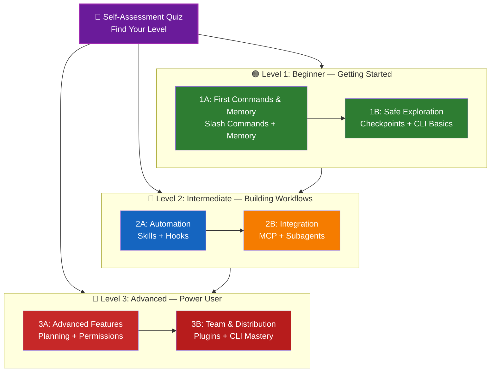

<!-- i18n-source: LEARNING-ROADMAP.md -->
<!-- i18n-source-sha: ba721a3 -->
<!-- i18n-date: 2026-10-29 -->

<picture>
  <source media="(prefers-color-scheme: dark)" srcset="../resources/logos/claude-howto-logo-dark.svg">
  
</picture>

# 📚 Claude Code 학습 로드맵

**Claude Code가 처음인가요?** 이 가이드는 각자의 속도에 맞춰 Claude Code 기능을 익히도록 돕습니다. 완전히 처음이든 경험 많은 개발자든, 아래 자가 진단 퀴즈로 나에게 맞는 경로를 먼저 찾아보세요.

---

## 🧭 내 수준 찾기

모두가 같은 곳에서 출발하지는 않습니다. 간단한 자가 진단으로 알맞은 시작점을 찾아보세요.

**다음 질문에 솔직하게 답해 보세요.**

- [ ] Claude Code를 실행하고 대화할 수 있다 (`claude`)
- [ ] CLAUDE.md 파일을 만들거나 고쳐 본 적이 있다
- [ ] 내장 슬래시 명령을 3개 이상 써 봤다 (예: /help, /compact, /model)
- [ ] 사용자 정의 슬래시 명령이나 스킬(SKILL.md)을 만들어 봤다
- [ ] MCP 서버를 설정해 봤다 (예: GitHub, 데이터베이스)
- [ ] ~/.claude/settings.json에 훅을 설정해 봤다
- [ ] 사용자 정의 서브에이전트(.claude/agents/)를 만들거나 써 봤다
- [ ] 스크립트나 CI/CD에서 출력 모드(`claude -p`)를 써 봤다

**내 수준:**

| 체크 수 | 수준 | 시작 지점 | 소요 시간 |
|--------|-------|----------|------------------|
| 0-2 | **레벨 1: 입문** — 시작하기 | [마일스톤 1A](#마일스톤-1a-첫-명령과-메모리) | 약 3시간 |
| 3-5 | **레벨 2: 중급** — 워크플로 만들기 | [마일스톤 2A](#마일스톤-2a-자동화-스킬--훅) | 약 5시간 |
| 6-8 | **레벨 3: 고급** — 파워 유저와 팀 리드 | [마일스톤 3A](#마일스톤-3a-고급-기능) | 약 5시간 |

> **팁**: 잘 모르겠다면 한 단계 낮은 수준에서 시작하세요. 기초 개념을 놓치는 것보다 아는 내용을 빠르게 복습하는 편이 낫습니다.

> **대화형 버전**: Claude Code에서 `/self-assessment`를 실행하면 대화형 퀴즈가 10개 기능 영역 전체의 숙련도를 채점하고 맞춤 학습 경로를 만들어 줍니다.

---

## 🎯 학습 철학

이 저장소의 폴더는 세 가지 원칙에 따라 **권장 학습 순서**대로 번호가 붙어 있습니다.

1. **의존성** - 기초 개념이 먼저 나옵니다
2. **복잡도** - 쉬운 기능이 고급 기능보다 먼저 나옵니다
3. **사용 빈도** - 가장 자주 쓰는 기능을 일찍 배웁니다

이렇게 하면 탄탄한 기초를 쌓으면서도 바로 생산성을 높일 수 있습니다.

---

## 🗺️ 나의 학습 경로



**색상 안내:**
- 💜 보라: 자가 진단 퀴즈
- 🟢 초록: 레벨 1 — 입문 경로
- 🔵 파랑 / 🟡 주황: 레벨 2 — 중급 경로
- 🔴 빨강: 레벨 3 — 고급 경로

---

## 📊 전체 로드맵 표

| 단계 | 기능 | 복잡도 | 시간 | 수준 | 선행 지식 | 배우는 이유 | 주요 이점 |
|------|---------|-----------|------|-------|--------------|----------------|--------------|
| **1** | [슬래시 명령](01-slash-commands/) | ⭐ 입문 | 30분 | 레벨 1 | 없음 | 빠르게 생산성 높이기 (60개 이상의 내장 명령 + 번들 스킬) | 즉시 자동화, 팀 표준 |
| **2** | [메모리](02-memory/) | ⭐⭐ 입문+ | 45분 | 레벨 1 | 없음 | 모든 기능의 바탕 | 지속되는 컨텍스트, 선호 설정 |
| **3** | [체크포인트](08-checkpoints/) | ⭐⭐ 중급 | 45분 | 레벨 1 | 세션 관리 | 안전한 탐색 | 실험, 복구 |
| **4** | [CLI 기초](10-cli/) | ⭐⭐ 입문+ | 30분 | 레벨 1 | 없음 | 핵심 CLI 사용법 | 대화형 모드와 출력 모드 |
| **5** | [스킬](03-skills/) | ⭐⭐ 중급 | 1시간 | 레벨 2 | 슬래시 명령 | 자동으로 쓰이는 전문 지식 | 재사용할 수 있는 기능, 일관성 |
| **6** | [훅](06-hooks/) | ⭐⭐ 중급 | 1시간 | 레벨 2 | 도구, 명령 | 워크플로 자동화 (이벤트 33개, 유형 5개) | 검증, 품질 게이트 |
| **7** | [MCP](05-mcp/) | ⭐⭐⭐ 중급+ | 1시간 | 레벨 2 | 설정 | 실시간 데이터 접근 | 실시간 연동, API |
| **8** | [서브에이전트](04-subagents/) | ⭐⭐⭐ 중급+ | 1.5시간 | 레벨 2 | 메모리, 명령 | 복잡한 작업 처리 (Explore, Plan을 포함한 내장 6개) | 위임, 전문화된 지식 |
| **9** | [고급 기능](09-advanced-features/) | ⭐⭐⭐⭐⭐ 고급 | 2-3시간 | 레벨 3 | 앞의 모든 단계 | 파워 유저 도구 | 계획, Auto Mode, Channels, Voice Dictation, 권한 |
| **10** | [플러그인](07-plugins/) | ⭐⭐⭐⭐ 고급 | 2시간 | 레벨 3 | 앞의 모든 단계 | 완성된 솔루션 | 팀 온보딩, 배포 |
| **11** | [CLI 숙달](10-cli/) | ⭐⭐⭐ 고급 | 1시간 | 레벨 3 | 권장: 모든 단계 | 명령줄 사용법 숙달 | 스크립트, CI/CD, 자동화 |

**전체 학습 시간**: 약 11-13시간 (내 수준으로 바로 건너뛰면 시간을 아낄 수 있음)

---

## 🟢 레벨 1: 입문 — 시작하기

**대상**: 퀴즈 체크 0-2개
**시간**: 약 3시간
**초점**: 즉시 생산성, 기초 이해
**결과**: 매일 편하게 쓰는 사용자, 레벨 2 준비 완료

### 마일스톤 1A: 첫 명령과 메모리

**주제**: 슬래시 명령 + 메모리
**시간**: 1-2시간
**복잡도**: ⭐ 입문
**목표**: 사용자 정의 명령과 지속되는 컨텍스트로 바로 생산성 높이기

#### 달성할 것
✅ 반복 작업용 사용자 정의 슬래시 명령 만들기
✅ 팀 표준을 담은 프로젝트 메모리 설정하기
✅ 개인 선호 설정하기
✅ Claude가 컨텍스트를 자동으로 불러오는 방식 이해하기

#### 실습

```bash
# 실습 1: 첫 슬래시 명령 설치
mkdir -p .claude/commands
cp 01-slash-commands/optimize.md .claude/commands/

# 실습 2: 프로젝트 메모리 만들기
cp 02-memory/project-CLAUDE.md ./CLAUDE.md

# 실습 3: 사용해 보기
# Claude Code에서 입력: /optimize
```

한국어판 템플릿을 쓰려면 경로 앞에 `ko/`를 붙입니다 (예: `ko/01-slash-commands/optimize.md`).

#### 성공 기준
- [ ] `/optimize` 명령을 호출했다
- [ ] Claude가 CLAUDE.md의 프로젝트 표준을 기억한다
- [ ] 슬래시 명령과 메모리를 언제 쓰는지 안다

#### 다음 단계
익숙해지면 다음을 읽습니다.
- [01-slash-commands/README.md](01-slash-commands/README.md)
- [02-memory/README.md](02-memory/README.md)

> **이해도 확인**: Claude Code에서 `/lesson-quiz slash-commands`나 `/lesson-quiz memory`를 실행해 배운 내용을 확인합니다.

---

### 마일스톤 1B: 안전하게 탐색하기

**주제**: 체크포인트 + CLI 기초
**시간**: 1시간
**복잡도**: ⭐⭐ 입문+
**목표**: 안전하게 실험하는 법과 핵심 CLI 명령 익히기

#### 달성할 것
✅ 안전한 실험을 위해 체크포인트 만들고 복원하기
✅ 대화형 모드와 출력 모드의 차이 이해하기
✅ 기본 CLI 플래그와 옵션 쓰기
✅ 파이프로 파일 처리하기

#### 실습

```bash
# 실습 1: 체크포인트 워크플로 해 보기
# Claude Code에서:
# 실험적인 변경을 한 다음, Esc+Esc를 누르거나 /rewind를 씁니다
# 실험하기 전의 체크포인트를 고릅니다
# "Restore code and conversation"을 골라 되돌아갑니다

# 실습 2: 대화형 모드와 출력 모드
claude "explain this project"           # 대화형 모드
claude -p "explain this function"       # 출력 모드 (비대화형)

# 실습 3: 파이프로 파일 내용 처리
cat error.log | claude -p "explain this error"
```

#### 성공 기준
- [ ] 체크포인트를 만들고 되돌려 봤다
- [ ] 대화형 모드와 출력 모드를 모두 써 봤다
- [ ] 파일을 파이프로 Claude에 넘겨 분석해 봤다
- [ ] 안전한 실험에 체크포인트를 언제 쓰는지 안다

#### 다음 단계
- 읽기: [08-checkpoints/README.md](08-checkpoints/README.md)
- 읽기: [10-cli/README.md](10-cli/README.md)
- **레벨 2 준비 완료!** [마일스톤 2A](#마일스톤-2a-자동화-스킬--훅)로 넘어갑니다

> **이해도 확인**: `/lesson-quiz checkpoints`나 `/lesson-quiz cli`를 실행해 레벨 2로 넘어갈 준비가 되었는지 확인합니다.

---

## 🔵 레벨 2: 중급 — 워크플로 만들기

**대상**: 퀴즈 체크 3-5개
**시간**: 약 5시간
**초점**: 자동화, 연동, 작업 위임
**결과**: 자동화된 워크플로, 외부 연동, 레벨 3 준비 완료

### 선행 지식 확인

레벨 2를 시작하기 전에 레벨 1의 다음 개념이 익숙한지 확인합니다.

- [ ] 슬래시 명령을 만들고 쓸 수 있다 ([01-slash-commands/](01-slash-commands/))
- [ ] CLAUDE.md로 프로젝트 메모리를 설정해 봤다 ([02-memory/](02-memory/))
- [ ] 체크포인트를 만들고 복원할 줄 안다 ([08-checkpoints/](08-checkpoints/))
- [ ] 명령줄에서 `claude`와 `claude -p`를 쓸 수 있다 ([10-cli/](10-cli/))

> **부족한 부분이 있나요?** 계속하기 전에 위에 링크한 튜토리얼을 복습합니다.

---

### 마일스톤 2A: 자동화 (스킬 + 훅)

**주제**: 스킬 + 훅
**시간**: 2-3시간
**복잡도**: ⭐⭐ 중급
**목표**: 자주 하는 워크플로와 품질 검사 자동화하기

#### 달성할 것
✅ YAML 프런트매터(`effort`, `shell` 필드 포함)로 전문 기능을 자동 호출하기
✅ 훅 이벤트 33개에 걸친 이벤트 기반 자동화 설정하기
✅ 훅 유형 5개(command, http, mcp_tool, prompt, agent) 모두 써 보기
✅ 코드 품질 기준 강제하기
✅ 내 워크플로에 맞는 사용자 정의 훅 만들기

#### 실습

```bash
# 실습 1: 스킬 설치
cp -r 03-skills/code-review-specialist ~/.claude/skills/

# 실습 2: 훅 설정
mkdir -p ~/.claude/hooks
cp 06-hooks/pre-tool-check.sh ~/.claude/hooks/
chmod +x ~/.claude/hooks/pre-tool-check.sh

# 실습 3: settings에 훅 구성
# ~/.claude/settings.json에 추가:
{
  "hooks": {
    "PreToolUse": [
      {
        "matcher": "Bash",
        "hooks": [
          {
            "type": "command",
            "command": "~/.claude/hooks/pre-tool-check.sh"
          }
        ]
      }
    ]
  }
}
```

훅 스크립트(`.sh`)는 `ko/`에 없으므로 원문 폴더에서 복사합니다.

#### 성공 기준
- [ ] 관련 있을 때 코드 리뷰 스킬이 자동으로 호출된다
- [ ] 도구 실행 전에 PreToolUse 훅이 실행된다
- [ ] 스킬 자동 호출과 훅 이벤트 트리거의 차이를 안다

#### 다음 단계
- 나만의 사용자 정의 스킬 만들기
- 워크플로에 맞는 훅 더 설정하기
- 읽기: [03-skills/README.md](03-skills/README.md)
- 읽기: [06-hooks/README.md](06-hooks/README.md)

> **이해도 확인**: 다음으로 넘어가기 전에 `/lesson-quiz skills`나 `/lesson-quiz hooks`로 지식을 확인합니다.

---

### 마일스톤 2B: 연동 (MCP + 서브에이전트)

**주제**: MCP + 서브에이전트
**시간**: 2-3시간
**복잡도**: ⭐⭐⭐ 중급+
**목표**: 외부 서비스를 연동하고 복잡한 작업 위임하기

#### 달성할 것
✅ GitHub, 데이터베이스 등의 실시간 데이터에 접근하기
✅ 전문 AI 에이전트에게 작업 위임하기
✅ MCP와 서브에이전트를 언제 쓰는지 이해하기
✅ 연동된 워크플로 만들기

#### 실습

```bash
# 실습 1: GitHub MCP 설정
claude mcp add --transport http github https://api.githubcopilot.com/mcp/ --header "Authorization: Bearer YOUR_GITHUB_PAT"

# 실습 2: MCP 연동 테스트
# Claude Code에서: /mcp__github__list_prs

# 실습 3: 서브에이전트 설치
mkdir -p .claude/agents
cp 04-subagents/*.md .claude/agents/
```

#### 연동 실습
다음 전체 워크플로를 해 봅니다.
1. MCP로 GitHub PR을 가져옵니다
2. Claude가 code-reviewer 서브에이전트에게 리뷰를 위임하게 합니다
3. 훅으로 테스트를 자동 실행합니다

#### 성공 기준
- [ ] MCP로 GitHub 데이터를 조회했다
- [ ] Claude가 복잡한 작업을 서브에이전트에게 위임한다
- [ ] MCP와 서브에이전트의 차이를 안다
- [ ] 한 워크플로에서 MCP + 서브에이전트 + 훅을 함께 썼다

#### 다음 단계
- MCP 서버 더 설정하기 (데이터베이스, Slack 등)
- 내 분야에 맞는 사용자 정의 서브에이전트 만들기
- 읽기: [05-mcp/README.md](05-mcp/README.md)
- 읽기: [04-subagents/README.md](04-subagents/README.md)
- **레벨 3 준비 완료!** [마일스톤 3A](#마일스톤-3a-고급-기능)로 넘어갑니다

> **이해도 확인**: `/lesson-quiz mcp`나 `/lesson-quiz subagents`를 실행해 레벨 3으로 넘어갈 준비가 되었는지 확인합니다.

---

## 🔴 레벨 3: 고급 — 파워 유저와 팀 리드

**대상**: 퀴즈 체크 6-8개
**시간**: 약 5시간
**초점**: 팀 도구, CI/CD, 엔터프라이즈 기능, 플러그인 개발
**결과**: 팀 워크플로와 CI/CD를 설정할 수 있는 파워 유저

### 선행 지식 확인

레벨 3을 시작하기 전에 레벨 2의 다음 개념이 익숙한지 확인합니다.

- [ ] 자동 호출되는 스킬을 만들고 쓸 수 있다 ([03-skills/](03-skills/))
- [ ] 이벤트 기반 자동화용 훅을 설정해 봤다 ([06-hooks/](06-hooks/))
- [ ] 외부 데이터용 MCP 서버를 설정할 수 있다 ([05-mcp/](05-mcp/))
- [ ] 서브에이전트로 작업을 위임할 줄 안다 ([04-subagents/](04-subagents/))

> **부족한 부분이 있나요?** 계속하기 전에 위에 링크한 튜토리얼을 복습합니다.

---

### 마일스톤 3A: 고급 기능

**주제**: 고급 기능 (계획, 권한, 확장 사고, Auto Mode, Channels, Voice Dictation, Remote/Desktop/Web)
**시간**: 2-3시간
**복잡도**: ⭐⭐⭐⭐⭐ 고급
**목표**: 고급 워크플로와 파워 유저 도구 숙달하기

#### 달성할 것
✅ 복잡한 기능을 위한 계획 모드
✅ 6가지 모드(manual — 예전 default, acceptEdits, plan, auto, dontAsk, bypassPermissions)로 세밀한 권한 제어
✅ Alt+T / Option+T 토글로 확장 사고(extended thinking)
✅ 백그라운드 작업 관리
✅ 학습한 선호를 기억하는 Auto Memory
✅ 백그라운드 안전 분류기가 있는 Auto Mode
✅ 실행 중인 세션에 이벤트(CI 결과, 채팅 메시지, 웹훅)를 밀어 넣는 Channels
✅ 손을 쓰지 않고 대화하는 Voice Dictation
✅ Remote Control (정식 출시 — 내 컴퓨터가 Claude 앱에 기기 카드로 표시됨), 데스크톱 앱, 웹 세션
✅ 여러 에이전트가 협업하는 Agent Teams

#### 실습

```bash
# 실습 1: 계획 모드 쓰기
/plan Implement user authentication system

# 실습 2: 권한 모드 써 보기 (6가지: manual [예전 default], acceptEdits, plan, auto, dontAsk, bypassPermissions)
claude --permission-mode plan "analyze this codebase"
claude --permission-mode acceptEdits "refactor the auth module"
claude --permission-mode auto "implement the feature"

# 실습 3: 확장 사고 켜기
# 세션 중에 Alt+T (macOS는 Option+T)를 눌러 토글합니다

# 실습 4: 고급 체크포인트 워크플로
# 1. "Clean state" 체크포인트 만들기
# 2. 계획 모드로 기능 설계하기
# 3. 서브에이전트에게 위임해 구현하기
# 4. 백그라운드에서 테스트 실행하기
# 5. 테스트가 실패하면 체크포인트로 되감기
# 6. 다른 방법 시도하기

# 실습 5: auto 모드 써 보기 (백그라운드 안전 분류기)
claude --permission-mode auto "implement user settings page"

# 실습 6: 에이전트 팀 켜기
export CLAUDE_CODE_EXPERIMENTAL_AGENT_TEAMS=1
# Claude에게 요청: "Implement feature X using a team approach"

# 실습 7: 예약 작업
/loop 5m /check-status
# 작업은 세션 범위입니다. 지속적인 예약에는 클라우드 예약 작업(예전 routines, /schedule로 설정)이나 Desktop 예약 작업을 씁니다

# 실습 8: Channels (리서치 프리뷰)
# 채널은 실행 중인 세션에 이벤트를 밀어 넣는 MCP 서버입니다

# 실습 9: Voice Dictation
# 음성 입력으로 손을 쓰지 않고 Claude Code와 대화합니다
```

#### 성공 기준
- [ ] 복잡한 기능에 계획 모드를 써 봤다
- [ ] 권한 모드(plan, acceptEdits, auto, dontAsk)를 설정해 봤다
- [ ] Alt+T / Option+T로 확장 사고를 토글해 봤다
- [ ] 백그라운드 안전 분류기가 있는 auto 모드를 써 봤다
- [ ] 오래 걸리는 작업에 백그라운드 작업을 써 봤다
- [ ] 외부 이벤트를 세션에 밀어 넣는 Channels를 살펴봤다
- [ ] Voice Dictation으로 손을 쓰지 않고 입력해 봤다
- [ ] Remote Control, 데스크톱 앱, 웹 세션을 이해한다
- [ ] 세션 간 `SendMessage`에 `notify_when_idle`을 써서 다른 세션이 유휴 상태가 되면 알림을 받아 봤다
- [ ] Agent Teams를 켜서 협업 작업에 써 봤다
- [ ] 반복 작업이나 예약 모니터링에 `/loop`를 써 봤다

#### 다음 단계
- 읽기: [09-advanced-features/README.md](09-advanced-features/README.md)

> **이해도 확인**: `/lesson-quiz advanced`를 실행해 파워 유저 기능을 얼마나 익혔는지 확인합니다.

---

### 마일스톤 3B: 팀과 배포 (플러그인 + CLI 숙달)

**주제**: 플러그인 + CLI 숙달 + CI/CD
**시간**: 2-3시간
**복잡도**: ⭐⭐⭐⭐ 고급
**목표**: 팀 도구 만들기, 플러그인 만들기, CI/CD 연동 숙달하기

#### 달성할 것
✅ 완성된 번들 플러그인 설치하고 만들기
✅ 스크립트와 자동화를 위한 CLI 숙달
✅ `claude -p`로 CI/CD 연동 설정하기
✅ 자동화 파이프라인용 JSON 출력
✅ 세션 관리와 일괄 처리

#### 실습

```bash
# 실습 1: 완성된 플러그인 설치
claude --plugin-dir ./07-plugins/pr-review  # 저장소 루트에서

# 실습 2: CI/CD용 출력 모드
claude -p "Run all tests and generate report" --permission-mode auto

# 실습 3: 스크립트용 JSON 출력
claude -p --output-format json "list all functions"

# 실습 4: 세션 관리와 재개
claude -r "feature-auth" "continue implementation"

# 실습 5: 제약을 건 CI/CD 연동
claude -p --max-turns 3 --output-format json "review code"

# 실습 6: 일괄 처리
for file in *.md; do
  claude -p --output-format json "summarize this: $(cat $file)" > ${file%.md}.summary.json
done
```

플러그인의 `plugin.json`과 스크립트는 `ko/`에 없으므로 플러그인은 원문 폴더(`./07-plugins/`)를 지정합니다.

#### CI/CD 연동 실습
간단한 CI/CD 스크립트를 만들어 봅니다.
1. `claude -p`로 변경된 파일을 리뷰합니다
2. 결과를 JSON으로 출력합니다
3. `jq`로 특정 문제를 골라냅니다
4. GitHub Actions 워크플로에 연동합니다

#### 성공 기준
- [ ] 플러그인을 설치하고 써 봤다
- [ ] 팀을 위한 플러그인을 만들거나 고쳐 봤다
- [ ] CI/CD에서 출력 모드(`claude -p`)를 써 봤다
- [ ] 스크립트용 JSON 출력을 만들어 봤다
- [ ] 이전 세션을 재개해 봤다
- [ ] 일괄 처리 스크립트를 만들어 봤다
- [ ] Claude를 CI/CD 워크플로에 연동해 봤다

#### CLI 실무 사용 사례
- **코드 리뷰 자동화**: CI/CD 파이프라인에서 코드 리뷰 실행
- **로그 분석**: 오류 로그와 시스템 출력 분석
- **문서 생성**: 문서를 일괄 생성
- **테스트 분석**: 테스트 실패 분석
- **성능 분석**: 성능 지표 검토
- **데이터 처리**: 데이터 파일 변환과 분석

#### 다음 단계
- 읽기: [07-plugins/README.md](07-plugins/README.md)
- 읽기: [10-cli/README.md](10-cli/README.md)
- 팀 공용 CLI 단축 명령과 플러그인 만들기
- 일괄 처리 스크립트 설정하기

> **이해도 확인**: `/lesson-quiz plugins`나 `/lesson-quiz cli`를 실행해 숙달 정도를 확인합니다.

---

## 🧪 지식 점검

이 저장소에는 Claude Code에서 언제든 이해도를 평가할 수 있는 대화형 스킬 두 개가 있습니다.

| 스킬 | 명령 | 목적 |
|-------|---------|---------|
| **자가 진단** | `/self-assessment` | 10개 기능 전체의 숙련도를 평가합니다. Quick(2분)이나 Deep(5분) 모드를 골라 맞춤 숙련도 프로필과 학습 경로를 받습니다. |
| **레슨 퀴즈** | `/lesson-quiz [lesson]` | 10문제로 특정 레슨의 이해도를 확인합니다. 레슨 전(사전 테스트), 도중(진도 확인), 후(숙달 확인)에 씁니다. |

**예시:**
```text
/self-assessment                  # 전체 수준 찾기
/lesson-quiz hooks                # 06 레슨: 훅 퀴즈
/lesson-quiz 03                   # 03 레슨: 스킬 퀴즈
/lesson-quiz advanced-features    # 09 레슨 퀴즈
```

---

## ⚡ 빠른 시작 경로

### 15분만 있다면
**목표**: 첫 성공 경험하기

1. 슬래시 명령 하나 복사: `cp 01-slash-commands/optimize.md .claude/commands/`
2. Claude Code에서 써 보기: `/optimize`
3. 읽기: [01-slash-commands/README.md](01-slash-commands/README.md)

**결과**: 동작하는 슬래시 명령이 생기고 기본을 이해합니다

---

### 1시간이 있다면
**목표**: 필수 생산성 도구 설정하기

1. **슬래시 명령** (15분): `/optimize`와 `/pr`을 복사해서 테스트합니다
2. **프로젝트 메모리** (15분): 프로젝트 표준을 담은 CLAUDE.md를 만듭니다
3. **스킬 설치** (15분): code-review-specialist 스킬을 설정합니다
4. **함께 써 보기** (15분): 셋이 어떻게 맞물려 동작하는지 봅니다

**결과**: 명령, 메모리, 자동 스킬로 기본 생산성이 올라갑니다

---

### 주말이 있다면
**목표**: 대부분의 기능에 능숙해지기

**토요일 오전** (3시간):
- 마일스톤 1A 완료: 슬래시 명령 + 메모리
- 마일스톤 1B 완료: 체크포인트 + CLI 기초

**토요일 오후** (3시간):
- 마일스톤 2A 완료: 스킬 + 훅
- 마일스톤 2B 완료: MCP + 서브에이전트

**일요일** (4시간):
- 마일스톤 3A 완료: 고급 기능
- 마일스톤 3B 완료: 플러그인 + CLI 숙달 + CI/CD
- 팀을 위한 사용자 정의 플러그인 만들기

**결과**: 다른 사람을 가르치고 복잡한 워크플로를 자동화할 수 있는 Claude Code 파워 유저가 됩니다

---

## 💡 학습 팁

### ✅ 권장

- **퀴즈부터 풀어** 시작점을 찾습니다
- 마일스톤마다 **실습을 끝까지** 합니다
- **단순하게 시작해** 조금씩 복잡도를 더합니다
- 다음으로 넘어가기 전에 **기능마다 테스트**합니다
- 내 워크플로에서 잘 되는 것을 **기록**합니다
- 고급 주제를 배울 때 앞의 개념을 **다시 찾아봅니다**
- 체크포인트로 **안전하게 실험**합니다
- 팀과 **지식을 나눕니다**

### ❌ 피할 것

- 높은 수준으로 건너뛸 때 **선행 지식 확인 생략하기**
- **모든 것을 한 번에 배우려 하기** - 감당하기 어렵습니다
- **이해하지 않고 설정을 복사하기** - 디버깅할 수 없게 됩니다
- **테스트 잊기** - 기능이 동작하는지 늘 확인합니다
- **마일스톤을 서둘러 넘기기** - 이해할 시간을 가집니다
- **문서 무시하기** - README마다 중요한 내용이 있습니다
- **혼자서만 하기** - 팀원과 이야기합니다

---

## 🎓 학습 스타일

### 시각형 학습자
- 각 README의 mermaid 다이어그램을 살펴봅니다
- 명령 실행 흐름을 지켜봅니다
- 나만의 워크플로 다이어그램을 그려 봅니다
- 위의 시각적 학습 경로를 활용합니다

### 실습형 학습자
- 모든 실습을 끝까지 합니다
- 변형해서 실험해 봅니다
- 일부러 망가뜨리고 고쳐 봅니다 (체크포인트를 쓰세요!)
- 나만의 예제를 만듭니다

### 읽기형 학습자
- 각 README를 꼼꼼히 읽습니다
- 코드 예제를 살펴봅니다
- 비교표를 검토합니다
- 자료 목록에 링크된 블로그 글을 읽습니다

### 소통형 학습자
- 페어 프로그래밍 시간을 만듭니다
- 팀원에게 개념을 가르칩니다
- Claude Code 커뮤니티 토론에 참여합니다
- 나만의 설정을 공유합니다

---

## 📈 진도 관리

다음 체크리스트로 수준별 진도를 관리합니다. 언제든 `/self-assessment`를 실행해 최신 숙련도 프로필을 받거나, 튜토리얼을 마칠 때마다 `/lesson-quiz [lesson]`로 이해도를 확인합니다.

### 🟢 레벨 1: 입문
- [ ] [01-slash-commands](01-slash-commands/) 완료
- [ ] [02-memory](02-memory/) 완료
- [ ] 첫 사용자 정의 슬래시 명령 만들기
- [ ] 프로젝트 메모리 설정
- [ ] **마일스톤 1A 달성**
- [ ] [08-checkpoints](08-checkpoints/) 완료
- [ ] [10-cli](10-cli/) 기초 완료
- [ ] 체크포인트를 만들고 되돌려 보기
- [ ] 대화형 모드와 출력 모드 써 보기
- [ ] **마일스톤 1B 달성**

### 🔵 레벨 2: 중급
- [ ] [03-skills](03-skills/) 완료
- [ ] [06-hooks](06-hooks/) 완료
- [ ] 첫 스킬 설치
- [ ] PreToolUse 훅 설정
- [ ] **마일스톤 2A 달성**
- [ ] [05-mcp](05-mcp/) 완료
- [ ] [04-subagents](04-subagents/) 완료
- [ ] GitHub MCP 연결
- [ ] 사용자 정의 서브에이전트 만들기
- [ ] 한 워크플로에서 여러 연동 조합하기
- [ ] **마일스톤 2B 달성**

### 🔴 레벨 3: 고급
- [ ] [09-advanced-features](09-advanced-features/) 완료
- [ ] 계획 모드 써 보기
- [ ] 권한 모드 설정 (auto를 포함한 6가지)
- [ ] 안전 분류기가 있는 auto 모드 써 보기
- [ ] 확장 사고 토글 써 보기
- [ ] Channels와 Voice Dictation 살펴보기
- [ ] **마일스톤 3A 달성**
- [ ] [07-plugins](07-plugins/) 완료
- [ ] [10-cli](10-cli/) 고급 사용법 완료
- [ ] CI/CD에 출력 모드(`claude -p`) 설정
- [ ] 자동화용 JSON 출력 만들기
- [ ] Claude를 CI/CD 파이프라인에 연동
- [ ] 팀 플러그인 만들기
- [ ] **마일스톤 3B 달성**

---

## 🆘 자주 겪는 학습 어려움

### 어려움 1: "한 번에 개념이 너무 많아요"
**해결**: 한 번에 마일스톤 하나에만 집중합니다. 실습을 모두 마친 뒤 다음으로 넘어갑니다.

### 어려움 2: "어떤 기능을 언제 써야 할지 모르겠어요"
**해결**: 메인 README의 [Use Case Matrix](README.md#use-case-matrix)를 참고합니다.

### 어려움 3: "설정이 동작하지 않아요"
**해결**: [Troubleshooting](README.md#troubleshooting) 단락을 확인하고 파일 위치를 점검합니다.

### 어려움 4: "개념이 서로 겹치는 것 같아요"
**해결**: [Feature Comparison](README.md#feature-comparison) 표에서 차이를 확인합니다.

### 어려움 5: "다 기억하기 어려워요"
**해결**: 나만의 요약표를 만듭니다. 체크포인트로 안전하게 실험합니다.

### 어려움 6: "경험은 있는데 어디서 시작할지 모르겠어요"
**해결**: 위의 [자가 진단 퀴즈](#-내-수준-찾기)를 풉니다. 내 수준으로 건너뛰고, 선행 지식 확인으로 부족한 부분을 찾습니다.

---

## 🎯 다 마친 다음에는?

모든 마일스톤을 마쳤다면:

1. **팀 문서 만들기** - 팀의 Claude Code 설정을 문서로 남깁니다
2. **사용자 정의 플러그인 만들기** - 새 매니페스트 필드(`workflows`, `channels`, `dependencies`)를 포함해 팀의 워크플로를 패키지로 묶습니다
3. **`/design` 써 보기** - HTML을 직접 쓰는 대신 디자인 캔버스에 UI 목업, 화면 흐름, 랜딩 페이지를 스케치합니다 (v2.1.265+)
4. **Remote Control 살펴보기** - 로컬 Claude Code 세션을 휴대폰, 브라우저, Claude 앱에서 이어 가거나, Claude 앱의 기기 카드로 휴대폰에서 세션을 시작합니다
5. **웹 세션 써 보기** - 브라우저 기반 인터페이스로 Claude Code를 써서 원격 개발을 합니다
6. **데스크톱 앱 쓰기** - 네이티브 데스크톱 앱에서 Claude Code 기능을 씁니다
7. **Auto Mode 쓰기** - 백그라운드 안전 분류기와 함께 Claude가 스스로 작업하게 합니다
8. **Auto Memory 활용하기** - Claude가 시간이 지나며 내 선호를 자동으로 학습하게 합니다
9. **Agent Teams 설정하기** - 여러 측면이 있는 복잡한 작업에 여러 에이전트를 조율합니다
10. **Channels 쓰기** - 실행 중인 세션에 이벤트(CI 결과, 채팅 메시지, 웹훅)를 밀어 넣는 MCP 서버를 연결합니다
11. **Voice Dictation 써 보기** - 손을 쓰지 않는 음성 입력으로 Claude Code와 대화합니다
12. **예약 작업 쓰기** - `/loop`와 cron 도구(세션 범위)로, 또는 `/schedule`로 클라우드 예약 작업을 만들어 반복 확인을 자동화합니다
13. **예제 기여하기** - 커뮤니티와 공유합니다
14. **다른 사람 이끌어 주기** - 팀원의 학습을 돕습니다
15. **워크플로 최적화하기** - 사용 경험을 바탕으로 계속 개선합니다
16. **최신 정보 따라가기** - Claude Code 릴리스와 새 기능을 챙겨 봅니다

---

## 📚 추가 자료

### 공식 문서
- [Claude Code Documentation](https://code.claude.com/docs/en/overview)
- [Anthropic Documentation](https://docs.anthropic.com)
- [MCP Protocol Specification](https://modelcontextprotocol.io)

### 블로그 글
- [Discovering Claude Code Slash Commands](https://medium.com/@luongnv89/discovering-claude-code-slash-commands-cdc17f0dfb29)

### 커뮤니티
- [Anthropic Cookbook](https://github.com/anthropics/anthropic-cookbook)
- [MCP Servers Repository](https://github.com/modelcontextprotocol/servers)

---

## 💬 의견과 지원

- **문제를 발견했나요?** 저장소에 이슈를 만듭니다
- **제안이 있나요?** 풀 리퀘스트를 보냅니다
- **도움이 필요한가요?** 문서를 확인하거나 커뮤니티에 물어봅니다

---

**최종 수정일**: 2026년 10월 26일
**Claude Code 버전**: 2.1.310
**출처**:
- https://code.claude.com/docs/en/overview
- https://code.claude.com/docs/en/hooks
- https://code.claude.com/docs/en/permission-modes
- https://github.com/anthropics/claude-code/releases/tag/v2.1.144
- https://github.com/anthropics/claude-code/releases/tag/v2.1.145
- https://code.claude.com/docs/en/model-config
- https://code.claude.com/docs/en/agent-teams
- https://code.claude.com/docs/en/mcp
- https://code.claude.com/docs/en/plugins/install
- https://code.claude.com/docs/en/channels
- https://code.claude.com/docs/en/remote-control
- https://code.claude.com/docs/en/scheduled-tasks
- https://code.claude.com/docs/en/commands
- https://code.claude.com/docs/en/sub-agents
- https://code.claude.com/docs/en/routines#where-the-name-routines-still-appears
- https://code.claude.com/docs/en/headless#auto-approve-tools
- https://code.claude.com/docs/en/permission-modes#which-mode-a-non-interactive-run-starts-in
**호환 모델**: Claude Fable 5.1, Claude Fable 5, Claude Opus 5, Claude Sonnet 5, Claude Sonnet 4.6, Claude Opus 4.8, Claude Haiku 4.5
**관리**: Claude How-To Contributors
**라이선스**: 교육 목적, 자유롭게 사용하고 고쳐 쓸 수 있음

---

[← 메인 README로 돌아가기](README.md)
