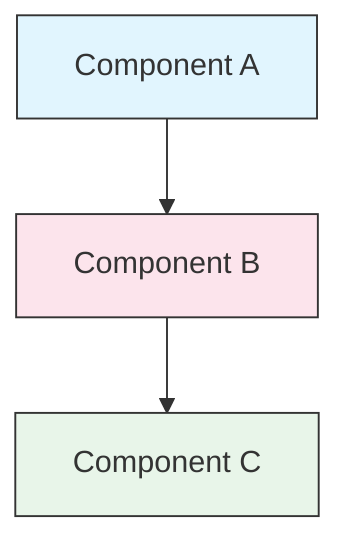

<!-- i18n-source: STYLE_GUIDE.md -->
<!-- i18n-source-sha: 0e01159 -->
<!-- i18n-date: 2026-10-29 -->

<picture>
  <source media="(prefers-color-scheme: dark)" srcset="../resources/logos/claude-howto-logo-dark.svg">
  
</picture>

# 스타일 가이드

> Claude How To에 기여할 때 지킬 관례와 서식 규칙입니다. 이 가이드를 따르면 콘텐츠를 일관되고 전문적이며 관리하기 쉽게 유지할 수 있습니다.
>
> 한국어 번역 문체와 용어는 [TRANSLATION_NOTES.md](TRANSLATION_NOTES.md)를 따릅니다.

---

## 목차

- [파일과 폴더 이름](#파일과-폴더-이름)
- [문서 구조](#문서-구조)
- [제목](#제목)
- [텍스트 서식](#텍스트-서식)
- [목록](#목록)
- [표](#표)
- [코드 블록](#코드-블록)
- [링크와 상호 참조](#링크와-상호-참조)
- [다이어그램](#다이어그램)
- [이모지 사용](#이모지-사용)
- [YAML 프런트매터](#yaml-프런트매터)
- [이미지와 미디어](#이미지와-미디어)
- [어조와 문체](#어조와-문체)
- [커밋 메시지](#커밋-메시지)
- [작성자 체크리스트](#작성자-체크리스트)

---

## 파일과 폴더 이름

### 레슨 폴더

레슨 폴더는 **두 자리 숫자 접두사** 뒤에 **kebab-case** 설명어를 붙입니다.

```text
01-slash-commands/
02-memory/
03-skills/
04-subagents/
05-mcp/
```

숫자는 입문부터 고급까지의 학습 순서를 나타냅니다.

### 파일 이름

| 종류 | 규칙 | 예시 |
|------|-----------|----------|
| **레슨 README** | `README.md` | `01-slash-commands/README.md` |
| **기능 파일** | kebab-case `.md` | `code-reviewer.md`, `generate-api-docs.md` |
| **셸 스크립트** | kebab-case `.sh` | `format-code.sh`, `validate-input.sh` |
| **설정 파일** | 표준 이름 | `.mcp.json`, `settings.json` |
| **메모리 파일** | 범위 접두사 | `project-CLAUDE.md`, `personal-CLAUDE.md` |
| **최상위 문서** | UPPER_CASE `.md` | `CATALOG.md`, `QUICK_REFERENCE.md`, `CONTRIBUTING.md` |
| **이미지 파일** | kebab-case | `pr-slash-command.png`, `claude-howto-logo.svg` |

### 규칙

- 모든 파일과 폴더 이름은 **소문자**로 씁니다 (`README.md`, `CATALOG.md` 같은 최상위 문서는 예외)
- 단어 구분에는 **하이픈**(`-`)을 쓰고, 밑줄이나 공백은 쓰지 않습니다
- 이름은 내용을 알 수 있되 간결하게 짓습니다

---

## 문서 구조

### 루트 README

루트 `README.md`는 다음 순서를 따릅니다.

1. 로고 (다크/라이트 버전이 있는 `<picture>` 요소)
2. H1 제목
3. 소개 인용문 (한 줄 가치 제안)
4. 비교표가 있는 "Why This Guide?" 단락
5. 가로줄 (`---`)
6. 목차
7. 기능 카탈로그
8. 빠른 탐색
9. 학습 경로
10. 기능별 단락
11. 시작하기
12. 모범 사례 / 문제 해결
13. 기여 / 라이선스

### 레슨 README

각 레슨의 `README.md`는 다음 순서를 따릅니다.

1. H1 제목 (예: `# Slash Commands`)
2. 짧은 개요 문단
3. 빠른 참조표 (선택)
4. 구조 다이어그램 (Mermaid)
5. 상세 단락 (H2)
6. 실습 예제 (번호를 붙여 4–6개)
7. 모범 사례 (Do's and Don'ts 표)
8. 문제 해결
9. 관련 가이드 / 공식 문서
10. 문서 메타데이터 꼬리말

### 기능·예제 파일

개별 기능 파일(예: `optimize.md`, `pr.md`)은 다음 순서를 따릅니다.

1. YAML 프런트매터 (해당하면)
2. H1 제목
3. 목적 / 설명
4. 사용 방법
5. 코드 예제
6. 사용자 맞춤 팁

### 단락 구분선

문서의 큰 영역은 가로줄(`---`)로 나눕니다.

```markdown
---

## New Major Section
```

소개 인용문 뒤와 논리적으로 구분되는 부분 사이에 넣습니다.

---

## 제목

### 계층

| 수준 | 용도 | 예시 |
|-------|-----|---------|
| `#` H1 | 페이지 제목 (문서당 하나) | `# Slash Commands` |
| `##` H2 | 주요 단락 | `## Best Practices` |
| `###` H3 | 하위 단락 | `### Adding a Skill` |
| `####` H4 | 그 아래 단락 (드물게) | `#### Configuration Options` |

### 규칙

- **H1은 문서당 하나**만 씁니다. 페이지 제목에만 씁니다
- **수준을 건너뛰지 않습니다**. H2에서 H4로 바로 넘어가지 않습니다
- **제목은 간결하게** 씁니다. 2–5단어를 목표로 합니다
- **문장형 대소문자(sentence case)**를 씁니다. 첫 단어와 고유 명사만 대문자로 씁니다 (기능 이름은 예외로 그대로 둡니다)
- **이모지 접두사는 루트 README**의 단락 제목에만 붙입니다 ([이모지 사용](#이모지-사용) 참고)

---

## 텍스트 서식

### 강조

| 스타일 | 쓰는 곳 | 예시 |
|-------|------------|---------|
| **굵게** (`**text**`) | 핵심 용어, 표의 레이블, 중요한 개념 | `**Installation**:` |
| *기울임* (`*text*`) | 기술 용어가 처음 나올 때, 책·문서 제목 | `*frontmatter*` |
| `코드` (`` `text` ``) | 파일 이름, 명령, 설정 값, 코드 참조 | `` `CLAUDE.md` `` |

### 강조 상자용 인용문

중요한 참고 사항은 굵은 접두사를 붙인 인용문으로 씁니다.

```markdown
> **Note**: Custom slash commands have been merged into skills since v2.0.

> **Important**: Never commit API keys or credentials.

> **Tip**: Combine memory with skills for maximum effectiveness.
```

지원하는 종류: **Note**, **Important**, **Tip**, **Warning**. 한국어판에서는 [TRANSLATION_NOTES.md](TRANSLATION_NOTES.md#문체-예시)에 따라 "참고", "팁", "주의" 등으로 씁니다.

### 문단

- 문단은 짧게 씁니다 (2–4문장)
- 문단 사이에 빈 줄을 넣습니다
- 핵심을 먼저 말하고 맥락을 덧붙입니다
- "무엇"뿐 아니라 "왜"를 설명합니다

---

## 목록

### 순서 없는 목록

대시(`-`)를 쓰고, 중첩할 때는 2칸 들여씁니다.

```markdown
- First item
- Second item
  - Nested item
  - Another nested item
    - Deep nested (avoid going deeper than 3 levels)
- Third item
```

### 순서 있는 목록

차례대로 하는 단계, 지시, 순위가 있는 항목에는 번호 목록을 씁니다.

```markdown
1. First step
2. Second step
   - Sub-point detail
   - Another sub-point
3. Third step
```

### 설명형 목록

키-값 형태의 목록에는 굵은 레이블을 씁니다.

```markdown
- **Performance bottlenecks** - identify O(n^2) operations, inefficient loops
- **Memory leaks** - find unreleased resources, circular references
- **Algorithm improvements** - suggest better algorithms or data structures
```

### 규칙

- 들여쓰기를 일관되게 유지합니다 (수준마다 2칸)
- 목록 앞뒤에 빈 줄을 넣습니다
- 항목의 구조를 나란히 맞춥니다 (모두 동사로 시작하거나, 모두 명사로 쓰는 식)
- 3단계보다 깊이 중첩하지 않습니다

---

## 표

### 기본 형식

```markdown
| Column 1 | Column 2 | Column 3 |
|----------|----------|----------|
| Data     | Data     | Data     |
```

### 자주 쓰는 표 패턴

**기능 비교 (3–4열):**

```markdown
| Feature | Invocation | Persistence | Best For |
|---------|-----------|------------|----------|
| **Slash Commands** | Manual (`/cmd`) | Session only | Quick shortcuts |
| **Memory** | Auto-loaded | Cross-session | Long-term learning |
```

**Do's and Don'ts:**

```markdown
| Do | Don't |
|----|-------|
| Use descriptive names | Use vague names |
| Keep files focused | Overload a single file |
```

**빠른 참조:**

```markdown
| Aspect | Details |
|--------|---------|
| **Purpose** | Generate API documentation |
| **Scope** | Project-level |
| **Complexity** | Intermediate |
```

### 규칙

- 첫 열이 행 레이블이면 **굵게** 씁니다
- 원본에서 읽기 쉽게 파이프를 맞춥니다 (선택이지만 권장)
- 셀 내용은 간결하게 쓰고, 자세한 내용은 링크로 연결합니다
- 셀 안의 명령과 파일 경로에는 `코드 서식`을 씁니다

---

## 코드 블록

### 언어 표시

구문 강조를 위해 언어를 항상 표시합니다.

| 언어 | 표시 | 쓰는 곳 |
|----------|-----|---------|
| 셸 | `bash` | CLI 명령, 스크립트 |
| Python | `python` | Python 코드 |
| JavaScript | `javascript` | JS 코드 |
| TypeScript | `typescript` | TS 코드 |
| JSON | `json` | 설정 파일 |
| YAML | `yaml` | 프런트매터, 설정 |
| Markdown | `markdown` | Markdown 예시 |
| SQL | `sql` | 데이터베이스 쿼리 |
| 일반 텍스트 | (표시 없음) | 예상 출력, 디렉터리 트리 |

참고: 저장소의 `cross-references` 검사는 언어 표시가 없는 코드 블록을 실패로 처리합니다. 일반 텍스트에는 `text`를 붙입니다.

### 관례

```bash
# 명령이 하는 일을 설명하는 주석
claude mcp add notion --transport http https://mcp.notion.com/mcp
```

- 알기 어려운 명령 앞에는 **주석 줄**을 넣습니다
- 모든 예제를 **복사해서 바로 쓸 수 있게** 만듭니다
- 필요하면 **간단한 버전과 고급 버전**을 모두 보여 줍니다
- 이해에 도움이 되면 **예상 출력**을 넣습니다

### 설치 블록

설치 안내에는 다음 패턴을 씁니다.

```bash
# 파일을 프로젝트로 복사
cp 01-slash-commands/*.md .claude/commands/
```

### 여러 단계 워크플로

```bash
# 1단계: 디렉터리 만들기
mkdir -p .claude/commands

# 2단계: 템플릿 복사
cp 01-slash-commands/*.md .claude/commands/

# 3단계: 설치 확인
ls .claude/commands/
```

---

## 링크와 상호 참조

### 내부 링크 (상대 경로)

모든 내부 링크에는 상대 경로를 씁니다.

```markdown
[Slash Commands](01-slash-commands/)
[Skills Guide](03-skills/)
[Memory Architecture](02-memory/#memory-architecture)
```

레슨 폴더에서 루트나 옆 폴더로 갈 때:

```markdown
[Back to main guide](../README.md)
[Related: Skills](../03-skills/)
```

### 외부 링크 (절대 경로)

전체 URL과 내용을 알 수 있는 링크 텍스트를 씁니다.

```markdown
[Anthropic's official documentation](https://code.claude.com/docs/en/overview)
```

- "여기를 클릭"이나 "이 링크" 같은 링크 텍스트는 쓰지 않습니다
- 앞뒤 문맥 없이도 뜻이 통하는 텍스트를 씁니다

### 단락 앵커

같은 문서 안의 단락에는 GitHub 방식 앵커로 링크합니다.

```markdown
[Feature Catalog](#-feature-catalog)
[Best Practices](#best-practices)
```

### 관련 가이드 패턴

레슨 끝에는 관련 가이드 단락을 둡니다.

```markdown
## Related Guides

- [Slash Commands](../01-slash-commands/) - Quick shortcuts
- [Memory](../02-memory/) - Persistent context
- [Skills](../03-skills/) - Reusable capabilities
```

---

## 다이어그램

### Mermaid

모든 다이어그램은 Mermaid로 그립니다. 지원하는 종류:

- `graph TB` / `graph LR` — 구조, 계층, 흐름
- `sequenceDiagram` — 상호작용 흐름
- `timeline` — 시간 순서

GitHub는 Mermaid를 기본으로 렌더링합니다. 웹사이트와 EPUB은 같은 원본을 [Pele](https://github.com/obsidianmd/pele)로 렌더링합니다. Pele 버전은 `scripts/vendor_assets.py`에 고정되어 있고, `mermaid-syntax` pre-commit 훅이 같은 번들로 모든 블록을 검증합니다. 그래서 훅을 통과한 블록은 어디서나 렌더링됩니다.

### 스타일 관례

style 블록으로 색을 일관되게 지정합니다.



**색상 팔레트:**

| 색 | 16진수 | 쓰는 곳 |
|-------|-----|---------|
| 연한 파랑 | `#e1f5fe` | 주요 구성 요소, 입력 |
| 연한 분홍 | `#fce4ec` | 처리, 미들웨어 |
| 연한 초록 | `#e8f5e9` | 출력, 결과 |
| 연한 노랑 | `#fff9c4` | 설정, 선택 사항 |
| 연한 보라 | `#f3e5f5` | 사용자 대면, UI |

### 규칙

- 노드 레이블에는 `["Label text"]`를 씁니다 (특수 문자를 쓸 수 있음)
- 레이블 안의 줄바꿈에는 `<br/>`를 씁니다
- 레이블은 일반 텍스트로 쓰고, 번호 레이블은 그대로 씁니다 (`["1. Load file"]`, 마침표 앞에 백슬래시를 넣지 않음)
- `%%{init}%%` 지시문이나 Mermaid 테마에 기대지 않습니다. 웹사이트가 자체 라이트·다크 팔레트를 적용합니다
- 다이어그램은 단순하게 유지합니다 (노드 최대 10–12개)
- 접근성을 위해 다이어그램 아래에 짧은 설명을 붙입니다
- 계층에는 위에서 아래(`TB`), 워크플로에는 왼쪽에서 오른쪽(`LR`)을 씁니다

---

## 이모지 사용

### 이모지를 쓰는 곳

이모지는 **아껴서, 목적이 있을 때만** 씁니다. 다음 경우에만 씁니다.

| 쓰는 곳 | 이모지 | 예시 |
|---------|--------|---------|
| 루트 README 단락 제목 | 분류 아이콘 | `## 📚 Learning Path` |
| 숙련도 표시 | 색 원 | 🟢 Beginner, 🔵 Intermediate, 🔴 Advanced |
| Do's and Don'ts | 체크·엑스 표시 | ✅ Do this, ❌ Don't do this |
| 난이도 | 별 | ⭐⭐⭐ |

### 표준 이모지

| 이모지 | 뜻 |
|-------|---------|
| 📚 | 학습, 가이드, 문서 |
| ⚡ | 시작하기, 빠른 참조 |
| 🎯 | 기능, 빠른 참조 |
| 🎓 | 학습 경로 |
| 📊 | 통계, 비교 |
| 🚀 | 설치, 빠른 명령 |
| 🟢 | 입문 |
| 🔵 | 중급 |
| 🔴 | 고급 |
| ✅ | 권장 방식 |
| ❌ | 피할 것 / 안티패턴 |
| ⭐ | 난이도 단위 |

### 규칙

- **본문이나 문단에는 이모지를 쓰지 않습니다**
- **이모지는 루트 README의 제목에만** 씁니다 (레슨 README에는 쓰지 않음)
- **장식용 이모지를 넣지 않습니다**. 모든 이모지는 뜻을 전해야 합니다
- 위 표와 같은 방식으로 일관되게 씁니다

---

## YAML 프런트매터

### 기능 파일 (스킬, 명령, 에이전트)

```yaml
---
name: unique-identifier
description: What this feature does and when to use it
allowed-tools: Bash, Read, Grep
---
```

### 선택 필드

```yaml
---
name: my-feature
description: Brief description
argument-hint: "[file-path] [options]"
allowed-tools: Bash, Read, Grep, Write, Edit
model: opus                        # opus, sonnet, haiku 중 하나
disable-model-invocation: true     # 사용자만 호출할 수 있음
user-invocable: false              # 사용자 메뉴에서 숨김
context: fork                      # 격리된 서브에이전트에서 실행
agent: Explore                     # context: fork에 쓸 에이전트 유형
---
```

### 규칙

- 프런트매터는 파일 맨 위에 둡니다
- `name` 필드는 **kebab-case**로 씁니다
- `description`은 한 문장으로 씁니다
- 필요한 필드만 넣습니다

한국어판 템플릿에서는 `i18n-source` 주석을 프런트매터 바로 아래에 둡니다 ([TRANSLATION_WORKFLOW.md](TRANSLATION_WORKFLOW.md#파일-다루기) 참고).

---

## 이미지와 미디어

### 로고 패턴

로고로 시작하는 모든 문서는 다크·라이트 모드를 지원하도록 `<picture>` 요소를 씁니다.

```html
<picture>
  <source media="(prefers-color-scheme: dark)" srcset="resources/logos/claude-howto-logo-dark.svg">
  
</picture>
```

### 스크린샷

- 관련 레슨 폴더에 둡니다 (예: `01-slash-commands/pr-slash-command.png`)
- 파일 이름은 kebab-case로 짓습니다
- 내용을 알 수 있는 대체 텍스트를 넣습니다
- 다이어그램은 SVG, 스크린샷은 PNG를 우선합니다

### 규칙

- 이미지에는 항상 대체 텍스트를 넣습니다
- 이미지 파일 크기를 적당히 유지합니다 (PNG는 500KB 미만)
- 이미지 참조에는 상대 경로를 씁니다
- 이미지는 그 이미지를 쓰는 문서와 같은 디렉터리에 두고, 함께 쓰는 이미지는 `assets/`에 둡니다

---

## 어조와 문체

### 글쓰기 스타일

- **전문적이지만 친근하게** — 기술적으로 정확하되 전문 용어를 남발하지 않습니다
- **능동태** — "파일이 만들어져야 합니다"가 아니라 "파일을 만듭니다"
- **직접적인 지시** — "이 명령을 실행해 보는 것도 좋습니다"가 아니라 "이 명령을 실행합니다"
- **입문자 친화적** — 독자가 프로그래밍은 알지만 Claude Code는 처음이라고 가정합니다

### 콘텐츠 원칙

| 원칙 | 예시 |
|-----------|---------|
| **말하지 말고 보여 주기** | 추상적인 설명 대신 동작하는 예제를 제공합니다 |
| **점진적인 난이도** | 단순하게 시작해서 뒤로 갈수록 깊이를 더합니다 |
| **"왜"를 설명** | "메모리를 ...에 씁니다"가 아니라 "...하기 때문에 메모리를 ...에 씁니다" |
| **복사해서 바로 쓰기** | 모든 코드 블록은 그대로 붙여 넣어도 동작해야 합니다 |
| **실제 맥락** | 억지로 만든 예가 아니라 실무 시나리오를 씁니다 |

### 어휘

- "Claude Code"라고 씁니다 ("Claude CLI"나 "이 도구"가 아님)
- "스킬"이라고 씁니다 ("사용자 정의 명령"은 예전 용어)
- 번호가 붙은 단락은 "레슨" 또는 "가이드"라고 부릅니다
- 개별 기능 파일은 "예제"라고 부릅니다

---

## 커밋 메시지

[Conventional Commits](https://www.conventionalcommits.org/)를 따릅니다.

```text
type(scope): description
```

### 유형

| 유형 | 쓰는 곳 |
|------|---------|
| `feat` | 새 기능, 예제, 가이드 |
| `fix` | 버그 수정, 정정, 깨진 링크 |
| `docs` | 문서 개선 |
| `refactor` | 동작을 바꾸지 않는 구조 변경 |
| `style` | 서식만 변경 |
| `test` | 테스트 추가나 변경 |
| `chore` | 빌드, 의존성, CI |

### 범위

레슨 이름이나 파일 영역을 scope로 씁니다.

```text
feat(slash-commands): Add API documentation generator
docs(memory): Improve personal preferences example
fix(README): Correct table of contents link
docs(skills): Add comprehensive code review skill
```

---

## 문서 메타데이터 꼬리말

레슨 README는 메타데이터 블록으로 끝납니다.

```markdown
---
**Last Updated**: August 25, 2026
**Claude Code Version**: 2.1.245
**Compatible Models**: Claude Fable 5, Claude Opus 5, Claude Sonnet 5, Claude Sonnet 4.6, Claude Opus 4.8, Claude Haiku 4.5
```

- 여기 적힌 값이 아니라 현재 동기화 실행에서 확인한 버전을 씁니다
- 날짜는 월 + 일 + 연도 형식으로 씁니다 (예: "May 20, 2026"). 한국어판에서는 "2026년 5월 20일"로 씁니다
- 기능이 바뀌면 버전을 갱신합니다
- 호환 모델을 모두 적습니다

---

## 작성자 체크리스트

콘텐츠를 제출하기 전에 확인합니다.

- [ ] 파일·폴더 이름이 kebab-case다
- [ ] 문서가 H1 제목으로 시작한다 (파일당 하나)
- [ ] 제목 계층이 올바르다 (건너뛴 수준이 없음)
- [ ] 모든 코드 블록에 언어 표시가 있다
- [ ] 코드 예제를 복사해서 바로 쓸 수 있다
- [ ] 내부 링크가 상대 경로다
- [ ] 외부 링크의 텍스트가 내용을 알려 준다
- [ ] 표 서식이 올바르다
- [ ] 이모지가 표준 목록을 따른다 (쓴다면)
- [ ] Mermaid 다이어그램이 표준 색상 팔레트를 쓴다
- [ ] 민감한 정보(API 키, 자격 증명)가 없다
- [ ] YAML 프런트매터가 유효하다 (해당하면)
- [ ] 이미지에 대체 텍스트가 있다
- [ ] 문단이 짧고 한 가지에 집중한다
- [ ] 관련 가이드 단락이 관련 레슨으로 링크한다
- [ ] 커밋 메시지가 Conventional Commits 형식을 따른다

---

**최종 수정일**: 2026년 8월 25일
**Claude Code 버전**: 2.1.245
**출처**:
- https://code.claude.com/docs/en/overview
- https://code.claude.com/docs/en/changelog
- https://code.claude.com/docs/en/model-config
- https://github.com/anthropics/claude-code/releases/tag/v2.1.154
**호환 모델**: Claude Fable 5, Claude Opus 5, Claude Sonnet 5, Claude Sonnet 4.6, Claude Opus 4.8, Claude Haiku 4.5
