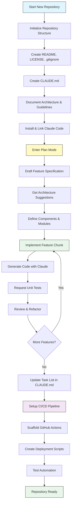
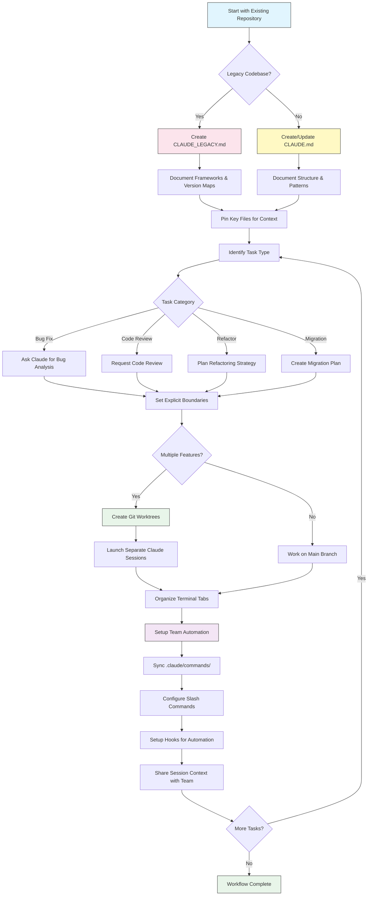

<!-- i18n-source: resources.md -->
<!-- i18n-source-sha: ba721a3 -->
<!-- i18n-date: 2026-10-30 -->

<picture>
  <source media="(prefers-color-scheme: dark)" srcset="../resources/logos/claude-howto-logo-dark.svg">
  
</picture>

# 좋은 자료 모음

## 공식 문서

| 자료 | 설명 | 링크 |
|------|------|------|
| Claude Code Docs | Claude Code 공식 문서 | [code.claude.com/docs/en/overview](https://code.claude.com/docs/en/overview) |
| Anthropic Docs | Anthropic 전체 문서 | [docs.anthropic.com](https://docs.anthropic.com) |
| MCP Protocol | Model Context Protocol 명세 | [modelcontextprotocol.io](https://modelcontextprotocol.io) |
| MCP Servers | 공식 MCP 서버 구현 | [github.com/modelcontextprotocol/servers](https://github.com/modelcontextprotocol/servers) |
| Anthropic Cookbook | 코드 예제와 튜토리얼 | [github.com/anthropics/anthropic-cookbook](https://github.com/anthropics/anthropic-cookbook) |
| Claude Code Skills | 커뮤니티 스킬 저장소 | [github.com/anthropics/skills](https://github.com/anthropics/skills) |
| Agent Teams | 여러 에이전트의 조율과 협업 | [code.claude.com/docs/en/agent-teams](https://code.claude.com/docs/en/agent-teams) |
| Scheduled Tasks | /loop와 cron을 쓰는 세션 범위 반복 작업 | [code.claude.com/docs/en/scheduled-tasks](https://code.claude.com/docs/en/scheduled-tasks) |
| Chrome Integration | 브라우저 자동화 | [code.claude.com/docs/en/chrome](https://code.claude.com/docs/en/chrome) |
| Keybindings | 키보드 단축키 사용자 지정 | [code.claude.com/docs/en/keybindings](https://code.claude.com/docs/en/keybindings) |
| Desktop App | 네이티브 데스크톱 앱 | [code.claude.com/docs/en/desktop](https://code.claude.com/docs/en/desktop) |
| Remote Control | 원격 세션 제어 | [code.claude.com/docs/en/remote-control](https://code.claude.com/docs/en/remote-control) |
| Auto Mode | 자동 권한 관리 | [code.claude.com/docs/en/permissions](https://code.claude.com/docs/en/permissions) |
| Channels | 다중 채널 커뮤니케이션 | [code.claude.com/docs/en/channels](https://code.claude.com/docs/en/channels) |
| Voice Dictation | Claude Code 음성 입력 | [code.claude.com/docs/en/voice-dictation](https://code.claude.com/docs/en/voice-dictation) |
| Code Review | Claude GitHub App으로 관리되는 풀 리퀘스트 리뷰 (Team, Enterprise) | [code.claude.com/docs/en/code-review](https://code.claude.com/docs/en/code-review) |

## Anthropic 엔지니어링 블로그

| 글 | 설명 | 링크 |
|----|------|------|
| Code Execution with MCP | 코드 실행으로 MCP 컨텍스트 비대 문제를 푸는 방법 — 토큰 98.7% 절감 | [anthropic.com/engineering/code-execution-with-mcp](https://www.anthropic.com/engineering/code-execution-with-mcp) |

---

## 30분 만에 Claude Code 익히기

_동영상_: https://www.youtube.com/watch?v=6eBSHbLKuN0

_**전체 팁**_
- **고급 기능과 단축키 살펴보기**
  - 릴리스 노트에서 Claude의 새 코드 편집 기능과 컨텍스트 기능을 정기적으로 확인합니다.
  - 채팅, 파일, 편집기 화면을 빠르게 오가는 키보드 단축키를 익힙니다.

- **효율적인 설정**
  - 나중에 쉽게 찾을 수 있도록 이름과 설명이 분명한 프로젝트별 세션을 만듭니다.
  - 가장 많이 쓰는 파일이나 폴더를 고정해 Claude가 언제든 볼 수 있게 합니다.
  - Claude 연동(GitHub, 주요 IDE 등)을 설정해 코딩 과정을 간소화합니다.

- **효과적인 코드베이스 질의응답**
  - 아키텍처, 디자인 패턴, 특정 모듈에 대해 Claude에게 자세히 묻습니다.
  - 질문에 파일과 줄 위치를 넣습니다(예: "What does the logic in `app/models/user.py` accomplish?").
  - 큰 코드베이스에서는 요약이나 매니페스트를 주어 Claude가 집중하도록 돕습니다.
  - **예시 프롬프트**: _"Can you explain the authentication flow implemented in src/auth/AuthService.ts:45-120? How does it integrate with the middleware in src/middleware/auth.ts?"_

- **코드 편집과 리팩터링**
  - 코드 블록 안에 인라인 주석이나 요청을 넣어 범위가 좁은 편집을 받습니다("Refactor this function for clarity").
  - 변경 전후를 나란히 비교해 달라고 요청합니다.
  - 큰 편집 뒤에는 품질 보증을 위해 Claude가 테스트나 문서를 만들게 합니다.
  - **예시 프롬프트**: _"Refactor the getUserData function in api/users.js to use async/await instead of promises. Show me a before/after comparison and generate unit tests for the refactored version."_

- **컨텍스트 관리**
  - 붙여 넣는 코드와 컨텍스트는 지금 작업에 필요한 것만으로 제한합니다.
  - 가장 좋은 결과를 얻으려면 구조화된 프롬프트("Here's file A, here's function B, my question is X")를 씁니다.
  - 컨텍스트 한도를 넘지 않도록 프롬프트 창에서 큰 파일은 빼거나 접습니다.
  - **예시 프롬프트**: _"Here's the User model from models/User.js and the validateUser function from utils/validation.js. My question is: how can I add email validation while maintaining backward compatibility?"_

- **팀 도구 연동**
  - Claude 세션을 팀의 저장소와 문서에 연결합니다.
  - 반복되는 엔지니어링 작업에는 내장 템플릿을 쓰거나 맞춤 템플릿을 만듭니다.
  - 세션 기록과 프롬프트를 팀원과 공유해 협업합니다.

- **성능 높이기**
  - Claude에게 목표가 분명한 지시를 줍니다(예: "Summarize this class in five bullet points").
  - 컨텍스트 윈도에서 불필요한 주석과 보일러플레이트를 줄입니다.
  - Claude의 출력이 빗나가면 컨텍스트를 초기화하거나 질문을 바꿔 다시 묻습니다.
  - **예시 프롬프트**: _"Summarize the DatabaseManager class in src/db/Manager.ts in five bullet points, focusing on its main responsibilities and key methods."_

- **실전 사용 예시**
  - 디버깅: 오류와 스택 트레이스를 붙여 넣고 가능한 원인과 해결책을 묻습니다.
  - 테스트 생성: 복잡한 로직에 대해 속성 기반, 단위, 통합 테스트를 요청합니다.
  - 코드 리뷰: 위험한 변경, 경계 사례, 코드 스멜을 찾아 달라고 Claude에게 요청합니다.
  - **예시 프롬프트**:
    - _"I'm getting this error: 'TypeError: Cannot read property 'map' of undefined at line 42 in components/UserList.jsx'. Here's the stack trace and the relevant code. What's causing this and how can I fix it?"_
    - _"Generate comprehensive unit tests for the PaymentProcessor class, including edge cases for failed transactions, timeouts, and invalid inputs."_
    - _"Review this pull request diff and identify potential security issues, performance bottlenecks, and code smells."_

- **워크플로 자동화**
  - 반복 작업(포맷, 정리, 반복적인 이름 바꾸기 등)을 Claude 프롬프트로 스크립트화합니다.
  - 코드 diff를 바탕으로 PR 설명, 릴리스 노트, 문서 초안을 Claude에게 맡깁니다.
  - **예시 프롬프트**: _"Based on the git diff, create a detailed PR description with a summary of changes, list of modified files, testing steps, and potential impacts. Also generate release notes for version 2.3.0."_

**팁**: 가장 좋은 결과를 얻으려면 이 방법들을 함께 씁니다. 먼저 핵심 파일을 고정하고 목표를 요약한 다음, 범위가 좁은 프롬프트와 Claude의 리팩터링 도구로 코드베이스와 자동화를 조금씩 개선합니다.

**Claude Code 권장 워크플로**

### Claude Code 권장 워크플로

#### 새 저장소에서

1. **저장소와 Claude 연동 초기화**
   - 새 저장소에 README, LICENSE, .gitignore, 루트 설정 파일 같은 기본 구조를 갖춥니다.
   - 아키텍처, 상위 목표, 코딩 지침을 설명하는 `CLAUDE.md` 파일을 만듭니다.
   - Claude Code를 설치하고 저장소에 연결해 코드 제안, 테스트 뼈대 생성, 워크플로 자동화에 씁니다.

2. **계획 모드와 명세 활용**
   - 기능을 구현하기 전에 계획 모드(`shift-tab` 또는 `/plan`)로 자세한 명세 초안을 씁니다.
   - Claude에게 아키텍처 제안과 초기 프로젝트 구조를 묻습니다.
   - 목표가 분명한 프롬프트 순서를 유지합니다. 컴포넌트 개요, 주요 모듈, 각 책임을 차례로 요청합니다.

3. **반복 개발과 리뷰**
   - 핵심 기능을 작은 단위로 구현하며 Claude에게 코드 생성, 리팩터링, 문서화를 요청합니다.
   - 단계마다 단위 테스트와 예제를 요청합니다.
   - CLAUDE.md에 진행 중인 작업 목록을 유지합니다.

4. **CI/CD와 배포 자동화**
   - Claude로 GitHub Actions, npm/yarn 스크립트, 배포 워크플로의 뼈대를 만듭니다.
   - CLAUDE.md를 고치고 그에 맞는 명령이나 스크립트를 요청해 파이프라인을 쉽게 바꿉니다.

#### 기존 저장소에서

1. **저장소와 컨텍스트 설정**
   - `CLAUDE.md`를 추가하거나 갱신해 저장소 구조, 코딩 패턴, 핵심 파일을 기록합니다. 레거시 저장소에는 프레임워크, 버전 대응표, 지침, 버그, 업그레이드 메모를 담은 `CLAUDE_LEGACY.md`를 씁니다.
   - Claude가 컨텍스트로 써야 할 주요 파일을 고정하거나 강조합니다.

2. **컨텍스트 기반 코드 질의응답**
   - 특정 파일이나 함수를 지목해 코드 리뷰, 버그 설명, 리팩터링, 마이그레이션 계획을 Claude에게 요청합니다.
   - Claude에게 경계를 분명히 줍니다(예: "modify only these files", "no new dependencies").

3. **브랜치, 워크트리, 여러 세션 관리**
   - 기능이나 버그 수정마다 git 워크트리를 따로 쓰고, 워크트리마다 Claude 세션을 따로 띄웁니다.
   - 병렬 워크플로를 위해 터미널 탭이나 창을 브랜치나 기능별로 정리합니다.

4. **팀 도구와 자동화**
   - 팀 전체가 일관되도록 `.claude/commands/`로 맞춤 명령을 동기화합니다.
   - 반복 작업, PR 생성, 코드 포맷을 Claude의 슬래시 명령이나 훅으로 자동화합니다.
   - 함께 문제를 해결하고 리뷰할 수 있도록 세션과 컨텍스트를 팀원과 공유합니다.

**팁**:
- 새 기능이나 수정은 매번 명세와 계획 모드 프롬프트로 시작합니다.
- 레거시 저장소나 복잡한 저장소에는 CLAUDE.md/CLAUDE_LEGACY.md에 자세한 지침을 둡니다.
- 지시는 분명하고 범위를 좁게 주고, 복잡한 작업은 여러 단계 계획으로 나눕니다.
- 어수선해지지 않도록 세션을 정기적으로 정리하고, 컨텍스트를 줄이고, 끝난 워크트리를 지웁니다.

이 단계들이 새 코드베이스와 기존 코드베이스 모두에서 Claude Code로 원활하게 작업하기 위한 핵심 권장 사항입니다.

---

## 새 기능과 역량

### 주요 기능 자료

| 기능 | 설명 | 더 알아보기 |
|------|------|-------------|
| **자동 메모리** | Claude가 세션을 넘어 사용자의 선호를 자동으로 배우고 기억합니다 | [메모리 안내](02-memory/) |
| **원격 제어** | 로컬 Claude Code 세션을 휴대폰, 브라우저, Claude 앱에서 이어 갑니다 | [고급 기능](09-advanced-features/) |
| **웹 세션** | 원격 개발을 위해 브라우저 기반 인터페이스로 Claude Code를 씁니다 | [CLI 레퍼런스](10-cli/) |
| **데스크톱 앱** | UI가 강화된 Claude Code 네이티브 데스크톱 앱 | [Claude Code Docs](https://code.claude.com/docs/en/desktop) |
| **확장 사고** | `Alt+T`/`Option+T`로 켜는 깊은 추론. Opus 4.7 이상, Sonnet 5 이상, Haiku 5.5, Fable은 항상 적응형 추론을 쓰므로 고정 `MAX_THINKING_TOKENS` 예산이 적용되지 않습니다(깊이는 `/effort`로 조절) | [고급 기능](09-advanced-features/) |
| **권한 모드** | 세밀한 제어: manual(설정 값 `default`), acceptEdits, plan, auto, dontAsk, bypassPermissions | [고급 기능](09-advanced-features/) |
| **7단계 메모리** | Managed Policy, Project, Project Rules, User, User Rules, Local, Auto Memory | [메모리 안내](02-memory/) |
| **훅 이벤트** | 33개 이벤트: PreToolUse, PostToolUse, PostToolUseFailure, Stop, StopFailure, SubagentStart, SubagentStop, Notification, Elicitation 등 | [훅 안내](06-hooks/) |
| **에이전트 팀** | 여러 에이전트가 복잡한 작업을 함께 하도록 조율합니다 | [서브에이전트 안내](04-subagents/) |
| **예약 작업** | `/loop`와 cron 도구로 세션 범위 반복 작업을 설정합니다 | [고급 기능](09-advanced-features/) |
| **Chrome 연동** | Claude in Chrome 확장 프로그램으로 내 Chrome에서 브라우저 자동화 | [고급 기능](09-advanced-features/) |
| **키보드 사용자 지정** | 코드(chord) 시퀀스를 포함한 키 바인딩 사용자 지정 | [고급 기능](09-advanced-features/) |
| **Monitor 도구** | 폴링 대신 백그라운드 명령의 stdout 스트림을 지켜보다가 이벤트에 반응합니다 (v2.1.98+) | [고급 기능](09-advanced-features/) |
| **/goal 모드** | 세션 수준의 완료 조건을 등록하면 Claude가 조건을 만족할 때까지 계속 작업합니다 (v2.1.139+) | [슬래시 명령](01-slash-commands/) |
| **claude agents (Agent View)** | 터미널에서 백그라운드 에이전트를 나열·확인·재개합니다. `--json`으로 기계가 읽을 수 있는 출력 (v2.1.139+, `--json`은 v2.1.145에 추가) | [code.claude.com/docs/en/agent-view](https://code.claude.com/docs/en/agent-view) |
| **/run, /verify, /run-skill-generator** | 프로젝트 실행, 수정 확인, 프로젝트별 run/verify 스킬 생성을 하는 번들 스킬 (v2.1.145+) | [스킬 안내](03-skills/) |

---
**마지막 업데이트**: 2026년 10월 26일
**Claude Code 버전**: 2.1.310
**출처**:
- https://code.claude.com/docs/en/overview
- https://code.claude.com/docs/en/changelog
- https://code.claude.com/docs/en/agent-view
- https://code.claude.com/docs/en/permission-modes
- https://github.com/anthropics/claude-code/releases/tag/v2.1.144
- https://github.com/anthropics/claude-code/releases/tag/v2.1.145
- https://code.claude.com/docs/en/model-config
- https://code.claude.com/docs/en/chrome
- https://code.claude.com/docs/en/remote-control
- https://code.claude.com/docs/en/code-review
- https://code.claude.com/docs/en/scheduled-tasks
- https://code.claude.com/docs/en/permission-modes#available-modes
**호환 모델**: Claude Fable 5, Claude Opus 5, Claude Sonnet 5, Claude Sonnet 4.6, Claude Opus 4.8, Claude Haiku 4.5
